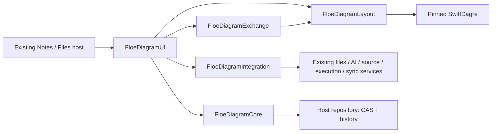

# FloeDiagramKit

Native Swift components for Floe’s multi-page mind maps, mixed diagrams and project plans. This is independent predevelopment: the production Notes/Files entrypoints, database, sync transport, AI providers and execution services have not been replaced or integrated.

[中文](README.zh-CN.md) · [Integration handoff](../../../docs/FLOE_DIAGRAM_KIT_PREDEVELOPMENT_HANDOFF.zh-CN.md) · [Native qualification host](../../Qualification/DiagramKit/README.md)

## Products

| Product | Responsibility |
| --- | --- |
| `FloeDiagramCore` | Stable document/page/element/connection/task/resource identities; validation; trusted edit scopes and locks; atomic revision batches; repository/session protocols; working-day planning; ink geometry recognition |
| `FloeDiagramLayout` | Iterative tree layouts, native Dagre flow layout, container/folding geometry, spatial queries, routing and hit regions |
| `FloeDiagramUI` | iOS/iPadOS 26+ SwiftUI shell, UIKit viewport, native text/rich content editors, PencilKit, outline/board/Gantt, contextual inspectors, file/print UI |
| `FloeDiagramExchange` | Native archive, foreign supported subsets, shared CoreGraphics/CoreText/SwiftMath output, SVG and plan projection |
| `FloeDiagramIntegration` | Host callbacks, asset interfaces/store, legacy Notes bridge, field patches, three-way merge/recovery, identity-safe copies and cross-page moves |

Core/layout/exchange also build on macOS 15+. The editor UI is currently iOS-only. macOS PencilKit rendering requires an application bundle identifier; a headless process receives a recoverable `unsupported` error. Native archives can preserve editable ink bytes without rendering them.



## Minimal runnable caller

The qualification app is a complete persistent caller. A new standalone file can also be created as follows:

```swift
import Foundation
import FloeDiagramCore
import FloeDiagramIntegration
import FloeDiagramUI

@MainActor
func makeDiagram(at root: URL) async throws -> DiagramEditorModel {
    let repository = try FileDiagramRepository(
        directory: root.appendingPathComponent("Documents"))
    let assets = try FileDiagramAssets(
        directory: root.appendingPathComponent("Assets"))
    let document = DiagramDocument(
        title: "Plan",
        pages: [.init(title: "Overview", elements: [.init(title: "Central topic")])],
        metadata: ["calendarTimeZone": TimeZone.current.identifier])
    try await repository.create(document)
    return DiagramEditorModel(document: document, repository: repository,
                              assets: assets, callbacks: .init())
}
// Embed DiagramEditorView(model: model) in the feature's existing navigation.
```

For reopen, call `repository.load(documentID)` using the same stable ID. Retain the model while the file is open; call `await model.close()` when its owner actually closes or changes files. Do not close it for transient view reconstruction. The model flushes pending ink and finishes its owned save queue before fencing late results.

`FileDiagramRepository` and `FileDiagramAssets` are real, bounded standalone stores for the host and examples. Production integration should implement the repository/resource protocols over the existing Floe services. Keep one persistence/undo authority; do not write to both stores.

## Editing and interaction

- The feature owns a native `NavigationSplitView`, system toolbar, `searchable` outline and Floe-style SwiftUI inspector column with system forms. Host it in the focused editor surface while preserving Floe's outer navigation. Avoid adding a second document toolbar around it. Floating controls use iOS 26 Liquid Glass; diagram cards keep their document styles. Compact navigation and inspection use the same coordinated sheet route; compact/accessibility undo and redo are in File actions.
- The canvas leads: navigation starts closed, its regular-width column opens on demand, and the overview map is available from File actions. Pages use a bounded floating dock rather than reserving a full-width bottom strip. When titles or page count no longer fit, the dock switches to the current-page menu; compact/accessibility layouts also use a zoom menu. Buttons retain 44-point targets and the Notes tab/pressed-state style.
- Chrome follows Floe's existing Notes rhythm: inherited accent and semantic surfaces, 44-point actions, quiet pressed feedback and small rounded selection fills. The page strip uses Notes-style tabs on wide layouts and a system page picker on compact/accessibility layouts. Glass is reserved for floating chrome; adding a topic is a regular-sized action.
- Tree branches auto-layout; drag carries the subtree and dropping onto a topic reparents it. Free topics and flow shapes retain manual frames. Arrange/align/distribute operate on the selection and preserve locked carriers.
- Parents and containers are independent relations. Ownership and task dependencies are acyclic; ordinary flow/association edges may cycle. Cross-page moves keep element IDs and replace relationships that cross the boundary with page links.
- Curves, rounded orthogonal routes and straight lines share geometry across UI/output. Tree branches follow the layout axis, stay within the connecting gap and include pinned shapes in obstacle checks. Connect using two topics or ports; edit endpoints, waypoints and label distance. The router is bounded and may report `routingFailed`; it does not promise intersection-free diagrams.
- Double-tap edits titles with a native text view. Tab/Return add child/sibling, Command-C/X/V copy/cut/paste, Command-Z/Shift-Command-Z undo/redo. Long-press empty canvas then drag selects a rectangle. Outline provides accessible alternatives and explicit connection rows.
- Card forms use **Apply changes**. Native in-place title editing commits on blur. Field patches retain unrelated concurrent changes and reject simultaneous edits to the same field.
- Board and Gantt are projections of the same tasks, not a second project document. Board dragging changes status; Gantt dragging/resizing changes calendar-day dates. Task dependencies and scheduling never start execution.
- PencilKit stores editable world-coordinate ink. Shape/arrow promotion can retain or replace matching strokes. Text fields support system Scribble; Vision OCR can append recognized text while retaining ink. Synthetic stroke tests are not physical Pencil accuracy/latency acceptance.

## Host service contracts

`DiagramHostCallbacks` accepts existing source navigation, assistant editing, source refresh and explicit execution start/stop handlers. Unavailable handlers have no fake UI action. A configured production provider should be connected through the existing services without requiring a developer subscription or account smoke test.

Assistant requests contain selected elements/connections/tasks/dependencies and derived locked IDs. Returned batches must match document/revision and are committed with the **host's** scope, never authority supplied by model output. Page-wide requests cap the materialized assistant context at 2,000 elements; choose a branch for larger files. A task-only scope uses `elementIDs: []` and explicit `taskIDs`. `allowsNewTasks` permits independent task roots; selected task children and references from permitted new topics stay within their selection. Locked task owners also protect dependencies and child insertion. The editor's new-page alternative remaps the current selection and keeps original pages unchanged.

Source refresh takes a last common base and incoming snapshot, proposes a field-wise three-way merge, and waits for the user's choice. Conflicting fields keep the current value and retain an incoming recovery file before the merge commits. The host owns reverse-link registration and sync transport. Imported content and `floeTaskID` values do not authorize execution; the host must resolve trusted task bindings and ownership.

## Formats and limits

| Format | Editable subset / conversion boundary |
| --- | --- |
| `.floemap` | Exact current document plus resource bytes/digests, pages, content, tasks, ink and retained source payload. Local undo/history remain with the repository; this is not a database backup. |
| XMind | Modern ZIP/JSON and legacy XML input; modern editable multi-sheet tree/topics, floating topics, notes, basic styles, images and relationships output. Every exported sheet requires a root topic; a flow-only sheet needs conversion or another format. Unsupported decorations/structures need review; original input is retained for recovery. No claim of complete XMind format parity. |
| FreeMind | Tree, notes, basic colors/fonts, links and associations. Multiple roots get an explicit synthetic root and notice. |
| OPML / Markdown | Editable outline/text/task subsets. Rich media, geometry and complete project metadata are not lossless. |
| draw.io | Plain/compressed native XML, basic shapes/containers, ports, loops, labels, waypoints and editable edges. Custom stencils/rich HTML/images are limited; input is not executed or remotely fetched. |
| Mermaid | Native mindmap/flowchart/subgraph and basic Gantt parser/writer. No JavaScript renderer or full grammar; unsupported directives are reported. `after` dependencies may recalculate manually chosen dates. |
| PDF / PNG | Shared native painter. PDF has one page per diagram page. PNG is bounded to 8,192 pixels per side and 24 megapixels. Image painting streams per placement so cache eviction cannot drop earlier images. |
| SVG | Editable vector shapes/paths/text with embedded raster media. Formulas and ink use native-rendered images; platform symbol icons are omitted with a notice. Text layout can vary with the reader's fonts. |
| Existing `.floenote` | Bounded root-mind-map conversion using the existing archive manifest/resource schema. Linked documents are not recursively converted. Legacy JSON export is limited to the original imported identities and representable fields; new features are explicitly refused. |

Archive limits: 128 MiB packed input/output, 64 MiB per entry, 512 MiB expanded, 20,000 entries. XML has additional depth/node/text limits. The standalone record limit is 256 MiB including retained history. Images are static thumbnails bounded to 1,024 decoded pixels per side; original image bytes remain in the native file. Other SVG raster formats are converted to PNG thumbnails. Project dates use `metadata["calendarTimeZone"]` (UTC default) and calendar-day arithmetic, including daylight saving transitions.

Loss notices are part of import/export results. Keep the native original for foreign exchange. Cross-application opening/round-trip and physical device acceptance remain integration checks.

## Verification and examples

```sh
DEVELOPER_DIR=/Applications/Xcode-27.1.app/Contents/Developer \
swift test --package-path FloeAgent/Modules/FloeDiagramKit \
  --scratch-path /absolute/internal/cache/package --jobs 6 -Xswiftc -j6

DEVELOPER_DIR=/Applications/Xcode-27.1.app/Contents/Developer \
swift run -c release --package-path FloeAgent/Modules/FloeDiagramKit \
  --scratch-path /absolute/internal/cache/examples --jobs 6 -Xswiftc -j6 \
  floe-diagram-examples /absolute/repository/Local/Artifacts/diagram-examples
```

The example runner writes ten actual format artifacts, board/Gantt output and a benchmark report, and reimports all seven editable formats. XMind demonstrates the two topic sheets; native/draw.io/PDF also include the flow-only sheet. The report measures host validation/layout/codec work and cumulative process peak RSS, not device frame rate. The 500-card fixture shares a synthetic image/formula; the image-cache regression separately checks twenty distinct decoded images. Use the repository canonical iPad lock for the native host. See the handoff for current commands, results, source hashes and remaining integration gates.

## Provenance

New component code follows the repository MPL-2.0 license. Pristine vendored source and individual SHA-256 records are in [Vendor/PROVENANCE.json](Vendor/PROVENANCE.json):

- [SwiftDagre](https://github.com/lukilabs/dagre-swift), MIT, revision `92efb78b73a8b665ee74bacfb0f1f5b17bbe1b38`.
- [SwiftMath](https://github.com/mgriebling/SwiftMath), MIT code, revision `0b0222e102ba415b352cd29f334075622bd4e6aa`. Font bundles retain their separate GUST/OFL notices.
- [ZIPFoundation](https://github.com/weichsel/ZIPFoundation), MIT, exact `0.9.20`.

The implementation has no embedded Web graph editor, production account configuration or release workflow.
