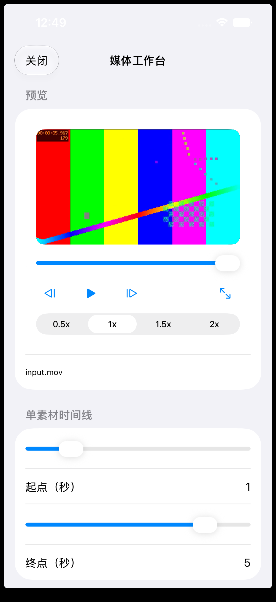

# Product Overview

## Product scope

Floe Agent is an open-source AI workspace for iOS/iPadOS and a separate Android alpha, with iPad-first native editing. Tasks, Notes, Office files, creative work, development and connections share configured models and public services while retaining their own document/session ownership.

Model-authored code runs in the resolved Linux environment through existing shell, job and service entry points. The iOS runtime uses shared ARM64 Linux with project-owned files and software layers; the App does not bundle native Python/Node interpreters. Environment layers organize dependencies, data and lifecycle rather than providing a native-code security sandbox.

Available workflows depend on platform and release. See the [user manual](docs/USER_GUIDE.md), [workspace tutorials](docs/WORKSPACES_GUIDE.md) and [dated channel snapshots](docs/CURRENT_STATUS.md). Source, component qualification, App behavior and delivery are separate states; active requirements are indexed in the [documentation hub](docs/README.md).

### Media workflow preview

This historical iOS Simulator capture uses synthetic media and illustrates the earlier preview/trim surface. It is not a current-interface or physical-device acceptance claim. See the [user guide](docs/USER_GUIDE.md) for current workflows.

## Purpose

Floe Agent is a bring-your-own-key AI agent workspace for iOS/iPadOS and Android. It brings model conversations, Files documents, image operations, SSH terminals, and VNC sessions into one auditable task flow without requiring a Floe account or a Floe-operated proxy.

The primary users are technically capable individuals who understand API keys, model endpoints, remote hosts, and the consequences of granting an agent access to files or machines.

## Product promise

A user should be able to configure a provider, start a real streaming task, understand what the agent is doing, approve or stop consequential actions, reconnect to remote work, and verify the result from a native mobile interface.

Floe Agent is designed around three commitments:

- **Your models:** connect directly to supported providers with credentials you control.
- **Your files:** work with documents and images through native file workflows.
- **Your machines:** connect only to computers you own or are authorized to operate.

## Current capabilities

- OpenAI Responses and Chat Completions compatible APIs.
- Anthropic Messages compatible APIs.
- On iOS/iPadOS, the system model and supported downloaded local models, subject to actual device and runtime availability. Android uses configured cloud providers; it does not provide local-model inference.
- Native streaming conversations with visible tool activity and recoverable state.
- Files, document, and image workflows.
- Independent vision, image-generation and image-editing roles, including OpenAI Images and Google Gemini Images with editable proxy Base URLs.
- App-managed private workspaces, Files project workspaces, and lightweight native Git/GitHub source control.
- SSH, SFTP, jump hosts, terminal sessions, and SSH-tunneled VNC.
- Scope-aware human approval, optional approval-model review, reusable bounded grants, and explicitly enabled time-bounded full-control modes.
- Keychain storage for secrets and private CloudKit synchronization for eligible configuration.
- Linux-backed code, packages, jobs and services through task-authorized execution, plus declarative Skills that cannot load native plug-ins or enlarge the compiled tool catalog.
- English and Simplified Chinese interfaces.

## Current development focus

Active work is tracked by original requirement identities in the [integration and usability plans](docs/README.md). Research completion, native component checks, actual App interaction and released-package availability are recorded independently.

Editing correctness requires supported edits to retain intended content, formatting and object positions, survive save/reopen, preserve unrelated content and report conflicts. Format support and advanced editing limits follow the selected release and actual engine evidence; a basic edit or successful component build does not establish desktop-document parity.

## Explicit boundaries

Downloads and declarative Skills do not expand the compiled tool catalog. Model-authored code uses the resolved Linux environment, with no silent fallback to the native host interpreter. Files, tools, remote machines and external actions remain subject to effective task permissions.

Earlier version-1 scope (historical)

Version 1 does not include Floe accounts, ads, behavioral analytics, model resale, a hosted proxy, downloaded native plug-ins, an unrestricted shell/process environment, Git history rewriting/force operations, RDP, VBA, ActiveX, or Office cloud collaboration.

These exclusions record the original milestone, not a current feature matrix. Use current guides and release-specific evidence.

The Apple system model is available only when the operating system reports it ready on an eligible device. Downloaded local models are optional and device-memory dependent. Floe must show the real availability or resource reason when either path cannot run; it must not describe an unimplemented or uncompiled feature as a device failure.

Routine read-only and bounded local operations should not wait for model approval. Destructive actions, credentials, uploads, payments, broad remote mutation and other consequential operations remain explicitly scoped and reviewable. A vague diagnostic request can authorize safe discovery, but never silently grants destructive or credential access.

iOS may suspend background work. Floe Agent must report that honestly and must never imply that an unmanaged SSH, VNC, or remote task remains connected when its state is unknown.

## Release baseline

- Platforms: iOS/iPadOS 26 or newer, plus a separate Android 9+ ARM64 alpha.
- Distribution: free and open source.
- Backend: no Floe-operated account, model proxy, or remote relay.
- Telemetry: no advertising or third-party behavioral analytics SDKs.
- Channels: an iOS App Store release, TestFlight, unsigned iOS downloads and an independent Android alpha. Versions and verification dates live in [CURRENT_STATUS](docs/CURRENT_STATUS.md).

See the [architecture](docs/ARCHITECTURE_OVERVIEW.md), [active plans and historical index](docs/README.md), [local qualification](docs/FLOE_LOCAL_QUALIFICATION.md) and current repository [instructions](AGENTS.md).
