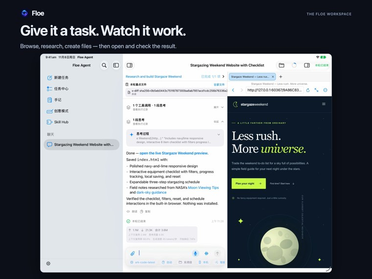

<div align="center">
  
  <h1>Floe Agent</h1>
  <p><strong>An on-device AI workspace, built for iPad.</strong></p>
  <p>Your models. Your files. Your machines.</p>
  <p>Floe Agent is an open-source AI agent for iOS, iPadOS and Android. Work with documents, code and creative projects in one place, with a real Linux environment running on your device. Designed around iPad and Apple Pencil, with native iPhone support and Android-specific device workflows.</p>
  <p><a href="README.zh-CN.md">简体中文</a> · <a href="https://www.floe-agent.com/en?utm_source=github&amp;utm_medium=referral&amp;utm_campaign=readme_en">floe-agent.com</a> · <a href="https://www.floe-agent.com/en/releases?utm_source=github&amp;utm_medium=referral&amp;utm_campaign=readme_en">Releases &amp; updates</a> · <a href="docs/README.md">Documentation</a> · <a href="docs/DISCLAIMER.md">Disclaimer</a></p>
</div>

<p align="center">
  <a href="https://apps.apple.com/app/id6801209053"></a>
  &nbsp;
  <a href="https://www.floe-agent.com/en?utm_source=github&amp;utm_medium=referral&amp;utm_campaign=beta_readme_en#beta"></a>
</p>

[](FloeAgent/project.yml)
[](https://www.floe-agent.com/en/releases?platform=android&utm_source=github&utm_medium=referral&utm_campaign=readme_en)
[](LICENSE)

[Install](#get-started) · [Features](#features) · [Demo](#see-floe-at-work) · [Docs](#documentation) · [Build](#build-from-source) · [Feedback](#contributing-and-license)

## See Floe at work

[](https://www.floe-agent.com/en/features?utm_source=github&utm_medium=referral&utm_campaign=readme_demo_en#film)

[Watch on YouTube](https://www.youtube.com/watch?v=nwesxhIiXuw) · [Bilibili 中文版](https://www.bilibili.com/video/BV1mA4x6nETP/) · [Explore the interactive feature tour](https://www.floe-agent.com/en/features?utm_source=github&utm_medium=referral&utm_campaign=readme_en)

Recorded on iOS/iPadOS. Android's workflows and limits are described in its [own guide](docs/ANDROID_GUIDE.md).

## Get started

Choose a product in the [release centre](https://www.floe-agent.com/en/releases?utm_source=github&utm_medium=referral&utm_campaign=readme_en). It keeps the latest downloads and release notes together, with separate histories for Floe Agent and both Bridge companions.

| Product | Install or explore | What to know |
| --- | --- | --- |
| **Floe Agent · iOS / iPadOS** | [App Store](https://apps.apple.com/app/id6801209053) · [Apply for TestFlight](https://www.floe-agent.com/en?utm_source=github&utm_medium=referral&utm_campaign=beta_readme_en#beta) · [GitHub IPA releases](https://www.floe-agent.com/en/releases?platform=ios&utm_source=github&utm_medium=referral&utm_campaign=readme_en) | iOS/iPadOS 26+. App Store availability follows your storefront; TestFlight availability follows your test group. GitHub IPAs require your own signing. |
| **Floe Agent · Android** | [Download the Full APK](https://www.floe-agent.com/en/releases?platform=android&utm_source=github&utm_medium=referral&utm_campaign=readme_en) · [Setup guide](docs/ANDROID_GUIDE.md) | Android 9+ ARM64, independently distributed. Check the selected release's prerelease status and installation requirements. |
| **Floe Bridge · Mac** | [Companion overview](https://www.floe-agent.com/en/bridge?utm_source=github&utm_medium=referral&utm_campaign=readme_en) · [Downloads](https://www.floe-agent.com/en/releases?platform=bridge&utm_source=github&utm_medium=referral&utm_campaign=readme_en) | Optional menu-bar companion for Floe running on the **same Mac**: terminal, files and MCP. |
| **Floe iOS Bridge** | [Companion overview](https://www.floe-agent.com/en/ios-bridge?utm_source=github&utm_medium=referral&utm_campaign=readme_en) · [Install guide](FloeIOSBridge/INSTALL.md) · [Downloads](https://www.floe-agent.com/en/releases?platform=ios-bridge&utm_source=github&utm_medium=referral&utm_campaign=readme_en) | Separate iPhone/iPad device-control app. Initial setup needs a computer, signing and developer pairing; main Floe integration is outside its current release. |

App Store, TestFlight and GitHub releases update independently. Use the selected release notes and [dated channel status](docs/CURRENT_STATUS.md) to choose a build; publication on GitHub does not establish availability in an Apple channel.

<details>
<summary>Install the iOS IPA with Feather or AltStore</summary>

Use your own signing setup, then add the source with the corresponding button:

<p>
  <a href="https://altdirect.app/?url=https%3A%2F%2Fraw.githubusercontent.com%2FJiangNanGenius%2Ffloe-agent%2Fmain%2Ffeather.json&amp;r=feather"></a>
  &nbsp;
  <a href="https://altdirect.app/?url=https%3A%2F%2Fraw.githubusercontent.com%2FJiangNanGenius%2Ffloe-agent%2Fmain%2Ffeather.json&amp;r=altstore"></a>
</p>

Or copy the source URL manually:

```text
https://raw.githubusercontent.com/JiangNanGenius/floe-agent/main/feather.json
```

[Source and signing guide](docs/FEATHER_SOURCE.md)

</details>

**Your first task:** install Floe → configure a model → create a task → open the resulting file. Start with the [quickstart](docs/QUICKSTART.md), or choose the [iOS/iPadOS](docs/USER_GUIDE.md) or [Android](docs/ANDROID_GUIDE.md) guide. Basic document and file work can be used without an AI provider; AI actions use the model you configure.

## Features

Workflows vary by platform and release. Choose the build described in the linked guide and its release notes.

### On-device work, with your own models

Floe's workspaces and persistent Linux environment run on your hardware. Run shell commands, Python, Node, packages and local web services, then keep the files and execution history with the task. The environment image is downloaded separately; packages must support its architecture.

For AI, connect your own cloud provider using an API key (**BYOK: bring your own key**). Supported iOS/iPadOS devices can also use Apple's system model or downloaded local models in Beta. Android currently uses cloud providers. Device memory, model readiness and the selected release determine which local options are available.

### From a task to an editable result

| Workflow | What you can do | Guide |
| --- | --- | --- |
| **AI tasks & development** | Bring materials, tool actions and output files together; use the terminal, code editor, Git and local previews. | [Tasks](docs/USER_GUIDE.md#3-tasks-and-workspace-ownership) · [Linux & development](docs/USER_GUIDE.md#9-local-terminal-and-linux-performance) |
| **Notes & Office** | Import PDFs and images, annotate with Pencil on iPad, ask about documents, and edit DOCX, XLSX and PPTX. | [Notes](docs/USER_GUIDE.md#7-notes-import-search-and-handwriting) · [Office](docs/USER_GUIDE.md#8-office-edit-annotate-save-and-reopen) |
| **Drawings & 3D** | On iOS/iPadOS, edit 2D drawings and native 3D models, continue with the work assistant, and present or export the result. | [2D drawings](docs/USER_GUIDE.md#14-engineering-drawings-and-ai-review) · [3D workbench](docs/USER_GUIDE.md#3d-models-one-unified-workbench) |
| **Canvas & media** | Organize material on a canvas and work on image, video and audio projects in dedicated editors. | [Canvas & media](docs/USER_GUIDE.md#15-canvas-images-audio-and-video) |
| **Voice & meetings** | Dictate drafts, hold voice conversations, record meetings, transcribe and organize notes with your selected services. | [Voice](docs/USER_GUIDE.md#16-voice-input-and-transcription) · [Meeting workflows](docs/WORKSPACES_GUIDE.md#2-meetings-record-transcribe-minutes--185) |
| **Skills & automation** | Discover reviewed skills, manage their dependencies and versions, and connect configured MCP and automation services. | [Skill Hub on the web](https://www.floe-agent.com/en/skills?utm_source=github&utm_medium=referral&utm_campaign=readme_en) · [Skills & MCP](docs/USER_GUIDE.md#17-skills-mcp-mail-and-automation) |

[Space and specialist workbenches](docs/WORKSPACES_GUIDE.md) add workflows for diagrams, music, LaTeX, GIS, electronics, manufacturing and print preparation, depending on the chosen build. **Features vary by platform and release.** The Android guide covers its phone control, self-ADB, project Linux and external-editor workflows; Android CAD/3D preview is separate from the iOS modeling editor.

## Documentation

Start with your platform; use the shared guide for models, tasks and files.

| Looking for | Start here |
| --- | --- |
| **First result** | [Quickstart](docs/QUICKSTART.md) · [中文快速开始](docs/QUICKSTART.zh-CN.md) |
| **iOS / iPadOS** | [Website guide index](https://www.floe-agent.com/docs/ios/en.html?utm_source=github&utm_medium=referral&utm_campaign=ios_docs_readme_en) · [Full manual](docs/USER_GUIDE.md) · [Workspace tutorials](docs/WORKSPACES_GUIDE.md) |
| **Android** | [Website guide index](https://www.floe-agent.com/docs/android/en.html?utm_source=github&utm_medium=referral&utm_campaign=android_guide_readme_en) · [Android manual](docs/ANDROID_GUIDE.md) · [Android 9/10 USB activation](docs/ANDROID_GUIDE.md#32-android-910-one-time-usb-setup-from-a-computer) |
| **Shared workflows** | [Models, tasks & files](docs/SHARED_GUIDE.md) |
| **Bridge companions** | [Mac Bridge](docs/USER_GUIDE.md#mac-bridge-quickstart) · [iOS Bridge](FloeIOSBridge/INSTALL.md) |
| **Versions & installation** | [Release centre](https://www.floe-agent.com/en/releases?utm_source=github&utm_medium=referral&utm_campaign=readme_en) · [Channel status](docs/CURRENT_STATUS.md) · [Signing & sources](docs/FEATHER_SOURCE.md) |
| **Troubleshooting** | [Common issues](docs/USER_GUIDE.md#20-troubleshooting) · [Support](SUPPORT.md) |
| **Development** | [Engineering guide](FloeAgent/README.md) · [Architecture](docs/ARCHITECTURE_OVERVIEW.md) · [Documentation hub](docs/README.md) |

## Models, permissions and privacy

Cloud model requests go directly to the provider you configure; supported local models perform inference on your device. Floe's maintainer does not provide a model API, model hosting or API credits. Credentials use protected device storage; uploads and remote actions follow the permissions you grant. Review AI-generated content before using it.

[Disclaimer and usage terms](docs/DISCLAIMER.md) · [Security policy](SECURITY.md)

## Build from source

For iOS/iPadOS, use macOS, a full Xcode installation and XcodeGen. See the engineering guide for current SDK, dependency and signing requirements; iOS/iPadOS 26 remains a compatibility target.

```bash
git clone https://github.com/JiangNanGenius/floe-agent.git
cd floe-agent/FloeAgent
bash scripts/gen_project.sh
open FloeAgent.xcodeproj
```

[iOS build guide](FloeAgent/README.md) · [Android Full APK build guide](FloeAndroid/README.md) · [Mac Bridge build guide](docs/FLOE_MAC_BRIDGE.md#building-and-distributing) · [iOS Bridge build guide](FloeIOSBridge/README.md#build-and-sign)

Gitee synchronizes source and release records. See the [mirror guide](docs/FLOE_GITEE_RELEASE_MIRROR.md).

## Contributing and license

**[GitHub Issues](https://github.com/JiangNanGenius/floe-agent/issues) is the main channel for feature requests and bug reports.** Include your version, device and reproduction steps. In-app logs provide optional diagnostic material and are handled as time permits.

Read [CONTRIBUTING.md](CONTRIBUTING.md) before contributing. Report vulnerabilities privately through [SECURITY.md](SECURITY.md).

Original Floe code is licensed under [MPL 2.0](LICENSE). Third-party components retain their own licenses and notices, available in the app under Settings → Diagnostics & About → Third-Party Licenses.
