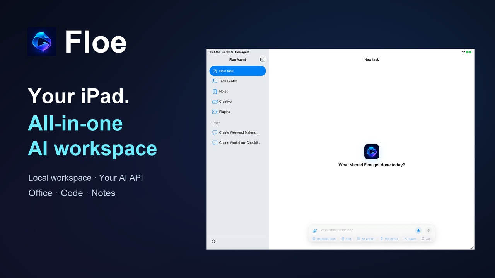

<div align="center">
  
  <h1>Floe Agent</h1>
  <p><strong>Your models. Your files. Your machines.</strong></p>
  <p>Floe Agent is an open-source, iPad-first iOS AI Agent optimized for iOS and iPadOS, with native iPhone support and a separate Android alpha. Bring AI tasks, Notes, Office documents, creative tools, development, voice conversations and skills together — with a real Linux environment on your device that runs code, packages and services, supported local models for on-device inference, and cloud AI using your own API keys (BYOK).</p>
  <p><a href="README.zh-CN.md">简体中文</a> · <a href="https://www.floe-agent.com/">Website</a> · <a href="docs/USER_GUIDE.md">User manual</a> · <a href="docs/README.md">Documentation</a></p>
</div>

[](https://github.com/JiangNanGenius/floe-agent/releases)
[](FloeAgent/project.yml)
[](https://github.com/JiangNanGenius/floe-agent/releases/tag/android/v0.1.0-alpha.15)
[](LICENSE)

[Install](#get-started) · [Features](#features) · [Demo](#see-floe-at-work) · [Docs](#documentation) · [Develop](#build-from-source) · [Contribute](#contributing-and-license)

## Get started

Choose an installation channel on the [website](https://www.floe-agent.com/#download). Explore the [iOS AI Agent workspace for iPad and iPhone](https://www.floe-agent.com/en/ios-ai-agent). Check [current status](docs/CURRENT_STATUS.md) and the installation page for each channel’s version, region and eligibility.

<p align="center">
  <a href="https://altdirect.app/?url=https%3A%2F%2Fraw.githubusercontent.com%2FJiangNanGenius%2Ffloe-agent%2Fmain%2Ffeather.json&amp;r=feather"></a>
  &nbsp;
  <a href="https://altdirect.app/?url=https%3A%2F%2Fraw.githubusercontent.com%2FJiangNanGenius%2Ffloe-agent%2Fmain%2Ffeather.json&amp;r=altstore"></a>
</p>
<p align="center">
  <a href="https://github.com/JiangNanGenius/floe-agent/releases"><strong>Download releases</strong></a>
</p>

<details>
<summary>Copy the source URL manually</summary>

```text
https://raw.githubusercontent.com/JiangNanGenius/floe-agent/main/feather.json
```

</details>

| Channel | Before you install |
| --- | --- |
| iOS / iPadOS · TestFlight | Requires valid beta access. Available builds and expiry appear in TestFlight. |
| iOS / iPadOS · Feather / AltStore | Install the corresponding app, use a button above to add the source, then sign with your own setup. |
| iOS / iPadOS · GitHub IPA | Download the IPA and checksum from Releases. The IPA is unsigned and requires your own signing. |
| Android alpha | Android 9+ (ARM64). Download the signed APK and checksum from the [Android release](https://github.com/JiangNanGenius/floe-agent/releases/tag/android/v0.1.0-alpha.15) and install it manually; GitHub builds automatically check for updates and guide download, verification and system installation. The current alpha already covers cloud AI chat and tasks with your own provider key (BYOK), history and attachments, provider and credential management, MCP connections, an on-device Linux environment with terminal and jobs, the file workspace, a code IDE with completion and run output, Git, a browser, and built-in Office viewing plus basic editing of DOCX, XLSX and PPTX. Alpha15 adds core Notes workflows: text/pages, images/PDF, ink, mind maps, Office links and import/export. Android does not include local language models; Canvas, voice and the Skill Hub store remain on the roadmap. |

For your first iOS / iPadOS task: **install → connect a model → create a task → open the result**. Core Notes, file organization and Canvas work without an AI provider; AI features use your configured provider or a local model supported by your device. On Android: **install → add your cloud provider key → start chatting**; Basic Notes editing works without a provider; AI actions use your cloud configuration. Office files, the file workspace, the Linux terminal and the code IDE are already in the alpha.

[Installation steps](docs/USER_GUIDE.md#1-installation-and-first-use) · [Model setup](docs/USER_GUIDE.md#2-models-and-auxiliary-capabilities) · [Sources and signing](docs/FEATHER_SOURCE.md)

The iOS setup guide offers four recommendations to prefill choices for models, search, voice and workspaces, while keeping every section editable. Continue setup while voice packs, models or environments download, then check progress later. Apple Intelligence is off by default for new users.

## Features

The features below describe Floe core workflows. Availability varies by platform and release; see the installation notes above and the [Android release](https://github.com/JiangNanGenius/floe-agent/releases/tag/android/v0.1.0-alpha.15) for the current Android alpha.

| Workflow | What you can do | Guide |
| --- | --- | --- |
| AI tasks | Continue a task with your material, tool actions and resulting files together. | [Tasks & workspaces](docs/USER_GUIDE.md#3-tasks-and-workspace-ownership) |
| On-device Linux | Run agent code in a persistent, task-owned Linux environment on your device: shell, Python, Node and apt packages, background jobs and local web previews. Requires the verified image download; packages must support the environment's architecture. | [Local terminal & Linux](docs/USER_GUIDE.md#9-local-terminal-and-linux-performance) |
| On-device AI | Run inference on your device with supported local models — the system model or downloaded models (Beta). Availability depends on your device and model status; local models share memory with Linux. | [Model setup](docs/USER_GUIDE.md#2-models-and-auxiliary-capabilities) |
| Notes | Import PDFs and images, search, annotate with Pencil and ask about documents. | [Notes](docs/USER_GUIDE.md#7-notes-import-search-and-handwriting) |
| Office | Create, edit and save DOCX, XLSX and PPTX. Check saved results with complex layouts. | [Documents, sheets & slides](docs/USER_GUIDE.md#8-office-edit-annotate-save-and-reopen) |
| Canvas & media | Organize material on a canvas and use focused image, video and audio workbenches. | [Canvas & media](docs/USER_GUIDE.md#15-canvas-images-audio-and-video) |
| Drawings & 3D | Inspect engineering files, edit supported entities and use Drawing Assistant. Operations vary by format. | [Engineering drawings](docs/USER_GUIDE.md#14-engineering-drawings-and-ai-review) |
| Code & remote | Edit code, track Git changes and work with authorized remote hosts. | [Terminal & ports](docs/USER_GUIDE.md#9-local-terminal-and-linux-performance) · [Remote connections](docs/USER_GUIDE.md#12-remote-hosts-desktops-and-diagnostics) |
| Voice | Dictate editable drafts, hold voice conversations and have final answers read aloud with system, enhanced on-device or configured online voices. Voice is available on iOS; it has not reached Android yet. | [Voice input & read-aloud](docs/USER_GUIDE.md#16-voice-input-and-transcription) |
| Skills & Skill Hub | Install reviewed skills with declared dependencies and version management, keep them updated, and automate with MCP services and mail actions. The Skill Hub store is available on iOS; Android support is on the roadmap. | [Skills, MCP & automation](docs/USER_GUIDE.md#17-skills-mcp-mail-and-automation) |

Cloud model requests go directly to your chosen provider; supported local models run inference on the device. Credentials stay in protected storage on your device. Files, uploads and remote actions follow task permissions, with consequential actions confirmed under the current policy. See [security](SECURITY.md).

## See Floe at work

Recorded on iOS; the Android alpha already includes chat, Office, files, terminal and IDE workflows and keeps growing.

[](https://www.youtube.com/watch?v=OXHntB2dyvo)

[Watch on YouTube](https://www.youtube.com/watch?v=OXHntB2dyvo) · [Bilibili 中文版](https://www.bilibili.com/video/BV1YBpx6QEe1/) · [Explore features on the website](https://www.floe-agent.com/features)

## Documentation

| Looking for | Start here |
| --- | --- |
| How to use Floe | [Illustrated user manual](docs/USER_GUIDE.md) · [中文手册](docs/USER_GUIDE.zh-CN.md) |
| A topic | [Documentation hub](docs/README.md) |
| Installation & versions | [Channel status](docs/CURRENT_STATUS.md) · [Sources](docs/FEATHER_SOURCE.md) · [Release records](docs/releases/README.md) |
| Help & feedback | [Troubleshooting](docs/USER_GUIDE.md#20-troubleshooting) · [Support](SUPPORT.md) |
| Development & integration | [Engineering guide](FloeAgent/README.md) · [Architecture](docs/ARCHITECTURE_OVERVIEW.md) · [Formats & tools](docs/FLOE_1_7_24_CREATIVE_TOOLS.md) |

## Build from source

Use macOS, a full Xcode installation, Swift and XcodeGen. The current iOS 27 path requires Xcode 27; iOS/iPadOS 26 remains a compatibility target.

```bash
git clone https://github.com/JiangNanGenius/floe-agent.git
cd floe-agent/FloeAgent
bash scripts/gen_project.sh
open FloeAgent.xcodeproj
```

See the [engineering guide](FloeAgent/README.md) for dependencies, build parameters and focused tests. For the Android app, see [FloeAndroid/README.md](FloeAndroid/README.md). Gitee synchronizes source and release records; see the [sync guide](docs/FLOE_GITEE_RELEASE_MIRROR.md).

## Contributing and license

Read [contributing](CONTRIBUTING.md) before reporting an issue or working on the project. Use [support](SUPPORT.md) for general questions and report vulnerabilities privately through [security](SECURITY.md).

Original Floe code is licensed under [MPL 2.0](LICENSE). Third-party components retain their own licenses and notices, available in the app under Settings → Diagnostics & About → Third-Party Licenses.
