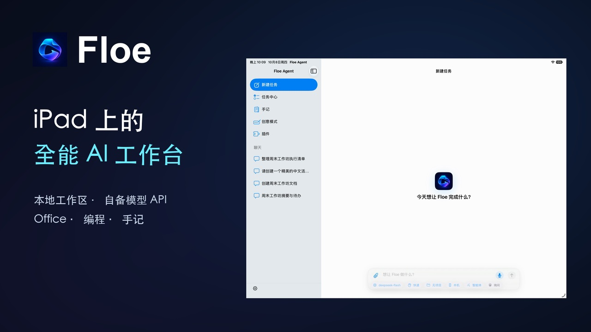

<div align="center">
  
  <h1>Floe Agent</h1>
  <p><strong>你的模型，你的文件，你的电脑。</strong></p>
  <p>Floe Agent 是面向 iOS 和 Android 的开源设备端 AI 智能体工作空间，以 iPad 体验为先，同时原生支持 iPhone。把 AI 任务、手记、Office 文档、创作、开发、语音对话与技能放进同一处——设备端 Linux 环境可直接运行代码、软件包与网页服务，支持的本地模型可在设备端完成推理，云端 AI 使用你自己准备的 API Key（BYOK）。</p>
  <p><a href="README.md">English</a> · <a href="https://www.floe-agent.com/">官网</a> · <a href="docs/USER_GUIDE.zh-CN.md">使用手册</a> · <a href="docs/README.md">文档中心</a></p>
</div>

[](https://github.com/JiangNanGenius/floe-agent/releases)
[](FloeAgent/project.yml)
[](https://github.com/JiangNanGenius/floe-agent/releases/tag/android/v0.1.0-alpha.15)
[](LICENSE)

[安装](#开始使用) · [功能](#主要功能) · [演示](#看看-floe-如何工作) · [文档](#文档导航) · [开发](#从源码构建) · [参与贡献](#贡献与许可证)

## 开始使用

从[官网](https://www.floe-agent.com/#download)选择安装方式；各渠道的版本、地区和资格分别以[当前状态](docs/CURRENT_STATUS.md)及安装页面为准。

<p align="center">
  <a href="https://altdirect.app/?url=https%3A%2F%2Fraw.githubusercontent.com%2FJiangNanGenius%2Ffloe-agent%2Fmain%2Ffeather.json&amp;r=feather"></a>
  &nbsp;
  <a href="https://altdirect.app/?url=https%3A%2F%2Fraw.githubusercontent.com%2FJiangNanGenius%2Ffloe-agent%2Fmain%2Ffeather.json&amp;r=altstore"></a>
</p>
<p align="center">
  <a href="https://github.com/JiangNanGenius/floe-agent/releases"><strong>下载发布版本</strong></a>
</p>

<details>
<summary>手动复制软件源地址</summary>

```text
https://raw.githubusercontent.com/JiangNanGenius/floe-agent/main/feather.json
```

</details>

| 安装方式 | 使用前准备 |
| --- | --- |
| iOS / iPadOS · TestFlight | 需要有效测试资格；可安装构建与到期时间以 TestFlight 为准。 |
| iOS / iPadOS · Feather / AltStore | 先安装对应 App，点击上方按钮添加源，再按自己的签名方式安装。 |
| iOS / iPadOS · GitHub IPA | 从发布页下载 IPA 和校验文件；IPA 未签名，需要自行签名。 |
| Android 测试版 | Android 9+（ARM64）。从 [Android 发布页](https://github.com/JiangNanGenius/floe-agent/releases/tag/android/v0.1.0-alpha.15) 下载签名 APK 与校验文件并手动安装；GitHub版会自动检查更新，并引导下载、校验与系统安装。当前测试版已支持使用自备云端 Key（BYOK）的 AI 对话与任务、历史与附件、服务商与凭据管理、MCP 连接、设备端 Linux 环境与终端／作业、文件工作区、带补全与运行输出的代码 IDE、Git、浏览器，以及内置 Office 查看和 DOCX／XLSX／PPTX 基础编辑。Alpha15已加入手记基础工作区（文本/页面、图片/PDF、笔迹、思维导图、Office关联与导入导出）。安卓不提供本地大语言模型；画布、语音与 Skill Hub 商店继续按路线图推进。 |

iOS / iPadOS 首次使用：**安装 → 配置模型 → 新建任务 → 打开成果**。核心手记、文件整理和画布无需 AI 服务商；AI 功能使用你配置的服务商或设备支持的本地模型。Android 首次使用：**安装 → 添加云端模型 Key → 开始对话**；手记基础编辑无需配置模型；AI功能使用自备云端服务。Office 文档、文件工作区、Linux 终端和代码 IDE 已在当前测试版中可用。

[详细安装步骤](docs/USER_GUIDE.zh-CN.md#1-安装与首次使用) · [模型配置](docs/USER_GUIDE.zh-CN.md#2-配置模型与辅助能力) · [软件源与签名](docs/FEATHER_SOURCE.md)

iOS 设置向导提供四种推荐配置，帮助预填模型、搜索、语音和工作空间等选择，仍可逐项调整。下载语音包、模型或运行环境时可以继续设置，稍后再查看进度；Apple Intelligence 对新用户默认关闭。

## 主要功能

下表介绍 Floe 的核心工作流程，具体可用性因平台与发布版本而异；Android 测试版现状请见上方安装说明与 [Android 发布记录](https://github.com/JiangNanGenius/floe-agent/releases/tag/android/v0.1.0-alpha.15)。

| 工作方式 | 在 Floe 中做什么 | 操作指南 |
| --- | --- | --- |
| AI 任务 | 在同一任务中连续提问、使用资料、执行工具并保留成果。 | [任务与工作区](docs/USER_GUIDE.zh-CN.md#3-新建任务与选择工作区) |
| 设备端 Linux 环境 | 智能体代码直接在设备上的持久 Linux 环境运行：Shell、Python、Node 与 apt 软件包、后台任务和本地网页预览均支持。需下载并校验镜像；软件包必须适配该环境。 | [本地终端与 Linux](docs/USER_GUIDE.zh-CN.md#9-本地终端与-linux-性能配置) |
| 本地 AI | 在设备端使用支持的本地模型推理——系统模型或下载的模型（Beta）。可用性取决于设备与模型状态；本地模型与 Linux 共享设备内存。 | [模型配置](docs/USER_GUIDE.zh-CN.md#2-配置模型与辅助能力) |
| 手记 | 导入 PDF 与图片，搜索、Pencil 批注，并围绕文档提问。 | [手记](docs/USER_GUIDE.zh-CN.md#7-手记导入搜索与书写) |
| Office | 创建、编辑、保存 DOCX、XLSX 与 PPTX。复杂格式需检查保存结果。 | [文档、表格与演示](docs/USER_GUIDE.zh-CN.md#8-office编辑批注保存和重新打开) |
| 画布与媒体 | 在画布组织素材，进入图像、视频和音频工作台处理细节。 | [画布与媒体](docs/USER_GUIDE.zh-CN.md#15-画布图像音视频) |
| 图纸与 3D | 查看工程文件，编辑支持的图元，使用图纸助手。能力随格式而异。 | [工程图纸](docs/USER_GUIDE.zh-CN.md#14-工程图纸与图纸助手) |
| 开发与远程 | 编辑代码、跟踪 Git 变更，并使用授权的远程主机。 | [终端与端口](docs/USER_GUIDE.zh-CN.md#9-本地终端与-linux-性能配置) · [远程连接](docs/USER_GUIDE.zh-CN.md#12-远程设备桌面与网络诊断) |
| 语音 | 语音输入生成可编辑草稿、进行语音对话，并让最终回答使用系统、设备端增强或已配置在线语音朗读。语音已在 iOS 提供，Android 尚未包含。 | [语音输入与朗读](docs/USER_GUIDE.zh-CN.md#16-语音输入与转录) |
| Skills 与 Skill Hub | 安装带精确依赖声明和版本管理的受审技能、统一更新，并使用 MCP 服务与邮件操作自动化。Skill Hub 商店已在 iOS 提供，Android 支持在路线图中。 | [Skills、MCP 与自动任务](docs/USER_GUIDE.zh-CN.md#17-skillsmcp邮件与自动任务) |

云端模型请求直接发送至你选择的服务商；支持的本地模型在设备端完成推理。密钥保存在设备的受保护存储中。文件、上传与远程操作遵循任务权限，重要操作按当前策略确认。详见[安全说明](SECURITY.zh-CN.md)。

## 看看 Floe 如何工作

演示视频基于 iOS 版录制；Android 测试版已包含对话、Office、文件、终端与 IDE 等工作流，并持续扩展。

[](https://www.bilibili.com/video/BV1YBpx6QEe1/)

[在 B 站观看](https://www.bilibili.com/video/BV1YBpx6QEe1/) · [Watch on YouTube](https://www.youtube.com/watch?v=OXHntB2dyvo) · [官网功能介绍](https://www.floe-agent.com/features)

## 文档导航

| 想了解什么 | 从这里开始 |
| --- | --- |
| 如何使用 | [中文图文手册](docs/USER_GUIDE.zh-CN.md) · [English manual](docs/USER_GUIDE.md) |
| 按主题找内容 | [文档中心](docs/README.md) |
| 安装与版本 | [渠道状态](docs/CURRENT_STATUS.md) · [软件源](docs/FEATHER_SOURCE.md) · [发布记录](docs/releases/README.md) |
| 问题与反馈 | [常见问题](docs/USER_GUIDE.zh-CN.md#20-常见问题与排查顺序) · [支持](SUPPORT.zh-CN.md) |
| 工程与集成 | [工程指南](FloeAgent/README.md) · [架构](docs/ARCHITECTURE_OVERVIEW.md) · [格式与工具能力](docs/FLOE_1_7_24_CREATIVE_TOOLS.md) |

## 从源码构建

需要 macOS、完整 Xcode、Swift 与 XcodeGen。当前源码的 iOS 27 路径需使用 Xcode 27；iOS/iPadOS 26 保持兼容目标。

```bash
git clone https://github.com/JiangNanGenius/floe-agent.git
cd floe-agent/FloeAgent
bash scripts/gen_project.sh
open FloeAgent.xcodeproj
```

依赖准备、构建参数与定向测试见[工程指南](FloeAgent/README.md)。Android 应用见 [FloeAndroid/README.md](FloeAndroid/README.md)。Gitee 仅用于源码与发行记录同步，见[同步说明](docs/FLOE_GITEE_RELEASE_MIRROR.md)。

## 贡献与许可证

提交问题或参与开发前，请阅读[贡献指南](CONTRIBUTING.zh-CN.md)；一般问题见[支持入口](SUPPORT.zh-CN.md)，安全问题请按[安全策略](SECURITY.zh-CN.md)私下报告。

Floe 原创代码采用 [MPL 2.0](LICENSE)。第三方组件保留各自许可证与声明，App 内可在“设置 → 诊断与关于 → 第三方开源许可”查看。
