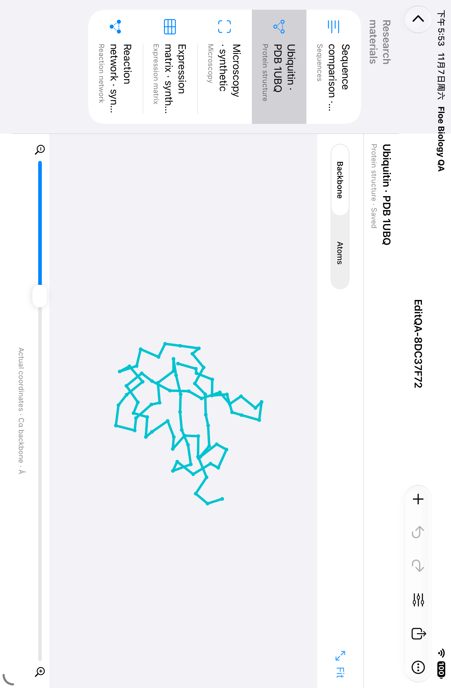

# 生物工作台首轮预研发交付

日期：2026-11-07。范围是独立组件和 iPad 验证宿主；本轮未修改正式 App 入口、版本、签名、TestFlight、Build 315 审核或发布状态。

已形成五类原生工作区、17 项原生方法、28 项可配置科学后端方法，以及项目原件/修订/运行记录/导出链路。开源选型和生物/化学分工见 [研究与设计](FLOE_BIOLOGY_WORKBENCH_RESEARCH_AND_DESIGN.zh-CN.md)，接口和限制见 [组件 README](../FloeAgent/Modules/FloeBiologyKit/README.md)。

## 实际交付

| 交付 | 内容 |
| --- | --- |
| 原生组件 | `FloeAgent/Modules/FloeBiologyKit`：Core、Engine、UI、Samples、WorkerResources 五个产品 |
| iPad 宿主 | `FloeAgent/Qualification/Biology`：真实项目存储和原生计算，可编辑、运行、查看、保存、重开、导出 |
| 科学引擎 | Biopython、Gemmi、scikit-image/tifffile、Scanpy/AnnData、SciPy、libSBML；65 个实际验证环境依赖精确版本与许可元数据 |
| 集成接口 | 必需的宿主授权回调、AI/Notes 回调、任务范围工具、带环境/任务/运行/输入摘要的可信工作任务传输协议 |
| 产物 | 已保存 arm64 **Simulator 验证宿主**压缩包、源码文件摘要、命令、日志、截图及原始失败；不是真机安装包 |

界面用 SwiftUI、UIKit、Canvas 和 Charts；专业数据源自真实坐标、样本或实际计算，没有嵌入 Web 编辑器。真实蛋白输入为 RCSB 1UBQ，其余内置数据明确标为教学合成数据。

## 验证结果

工具链为 Xcode 27.2（27B52）、Swift 6.4.2、iPhoneSimulator 27.2 SDK，最低目标 iOS 26；实际运行于仓库固定复用的 iPad mini（A17 Pro）、iOS 27.0 Simulator。没有创建、克隆、抹除模拟器或使用物理 iPhone。

构建基线 `ad8112351` 加本组件的逐文件 SHA-256 清单；清单与精确命令随各阶段证据保留。Swift 6 已实际编译对象代码，验证不限于 typecheck。

| 验证层 | 实际结果 |
| --- | --- |
| Swift 数值与格式 | Core 10 项通过：翻译/比对、真实 PDB/mmCIF 一致性、面积校准、矩阵标准化、解析解/守恒、非法输入、轴选择、PDB/矩阵/图像/网络/JSON 往返 |
| Swift 生命周期与工具 | Engine 9 项通过：跨实例 CAS、历史与损坏检测、恢复防 ABA、过期结果拒绝、取消后实际停止、主机授权与项目/任务范围、AI 导入→计算→派生→实际字节导出、回包身份/停止确认 |
| Swift 到科学引擎 | 使用精确 Swift 编码请求实际启动测试用 Python worker，得到 Biopython 翻译 `MA`；资源摘要变更后再次定向通过。此 Process 仅存在于 macOS 测试，不存在于产品代码 |
| 成熟引擎 | 12 个不同综合/专项用例按变更边界通过：富 GenBank、邻接树、结构叠合、16 位 TIFF、分割/叠加、PCA/Leiden/UMAP、差异统计、H5AD/MTX、自适应求解/守恒/扫描/SBML，以及编辑和精度边界 |
| 能力与依赖 | 最终只读校验通过：8 个工作资源摘要、65 个精确包版本；真实运行能力探测返回 28 方法、6 个引擎、无缺失项 |
| iPad 五类计算 | 页面数值逐项通过：序列 30 字符；1UBQ 602 聚合物原子、76 残基；图像 2 个对象，面积 37.25/63.25 µm²；矩阵 8 细胞；网络 A(30)=4.97871 |
| iPad 编辑与保存 | 序列替换、撤销、重做、横屏旋转/适配通过；等待保存真实完成后终止进程，重新打开同一项目，研究记录精确恢复通过 |
| iPad 外观与导出 | 中文深色/高对比界面、Files 导出窗口通过。原件/派生格式往返另有组件测试；没有声称验证了所有 Files 提供商的最终落盘 |

科学后端的实际运行环境是 macOS arm64、CPython 3.12。App 的真实 Linux 安装/任务取消、模型调用及后台生命周期尚未接入。未把 Python 测试环境、独立宿主或回调接口当作主 App 的完整接受证据。

## 保留的失败与修复

原始日志和 xcresult 均保留，没有把失败覆盖成成功。

- 首次数值测试使用了不会产生负状态的 RK4 步长；修正测试输入后仍保留负状态拒绝断言。一次新增测试的初始化参数编译错误也保留原日志并修正。
- `ipad-02` 暴露竖屏资料栏收起后缺少切换入口，已补原生资料菜单。
- `ipad-03/04` 暴露底栏标识被容器覆盖、分析方法默认值初始化时机，以及编辑测试光标没有选中完整序列。分别修正标识、方法就绪同步，并增加可操作的清空替换内容及输入断言。
- `ipad-05` 的五类数值全部通过，随后研究记录重开失败。修复编辑器从存储加载修订、保存期间状态/焦点/退出保护，并要求测试等待保存确认；`ipad-06` 定向重测研究记录和编辑/横屏共 2 项通过。未重复未改动的全部科学计算流程。
- App 区域截图在横屏带有错误裁切元数据，保留旧图；后续改取真实前台屏幕截图，人工检查了布局和操作入口。

上游 AnnData/Pandas、SciPy 稀疏迁移及恒定基因统计的告警仍在日志中。无法定义的 Welch 检验结果明确记录为未定义，不伪造数值或 p=0。

## 界面证据

[显微分割结果](qualification/biology-20261107/microscopy-result.png) 与 [重开后的研究记录](qualification/biology-20261107/notes-reopened.png) 为未经改写的实际截图；来源对应关系保存在同目录 `screenshots.json`。

## 后续接入及保留限制

由 App 集成负责人把 `BiologyWorkbench` 接到现有 Space/手记路径，注入现有模型、文件、权限、任务和环境服务；Notes 回写和化学对象引用由宿主解析。高级引擎通过现有 Linux jobs/安装链连接，不能新增主机解释器回退。

本轮宿主只连接原生方法。蛋白显示是实际三维坐标的可旋转投影和 Cα 骨架；未实现 ribbon、密度图或结构预测。复杂 GenBank、海量多文件图像、交互式系统发育树、一般 SBML 方程执行、生物重复统计、真实仪器连接和最近删除恢复 UI 仍有后续工作。真机/Pencil、主 App 入口和真实模型/Linux 作业未验证。

已清理本轮四个可再生构建/测试环境目录，分配量约 1.36 GiB；清理前后观测可用空间增加约 1.37 GiB，期间有其他构建活动，不能把逻辑文件大小当作保证回收量。保留精确 Simulator 宿主、源码、依赖锁、全部必要失败/验收证据和模拟器应用数据。本任务启动的 iPad 已关闭。
