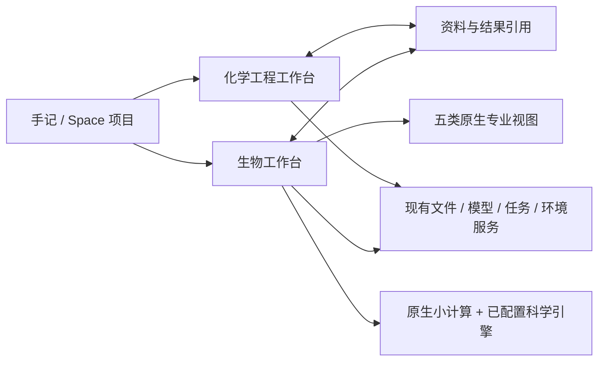

# 生物工作台：开源参考与设计选择

调研日期：2026-11-07。第一轮按用户 QA 覆盖序列、蛋白结构、显微图像、组学和生化网络；专业视图尽量原生；交付独立组件与可操作的 iPad 验证宿主，随后交接 App 集成。

## 生物和化学怎样组织

建议保持“生物”“化学工程”两个工作台入口，允许资料和结果互相关联。生物研究常在序列、结构、图像、矩阵之间切换；化学工程常围绕物质、反应、设备和工艺参数组织。把两套对象直接塞进同一个编辑器会增加初学者的理解成本。这是针对 Floe 当前架构的产品判断。

两者共享文件、模型、任务、环境和保存服务；各自拥有文档状态、选区、撤销和 AI 对话。跨学科项目通过明确引用连接，例如把反应网络的动力学参数关联到化学工程材料，不复制一套全局编辑状态。

## 值得参考的大项目

下表区分“完整产品的设计参考”和“真正接入计算的库”。第一轮没有把这些桌面/网页产品整体移植进 iPad；实际使用的科学依赖见后表。

| 项目与官方来源 | 适合学习什么 | Floe 的选择 |
| --- | --- | --- |
| [UGENE](https://github.com/ugeneunipro/ugene) | 序列、注释、比对、流程的统一工作区；Qt 桌面项目 | 参考资料树和对象组织，原生重做交互；上游 GPL-2.0 |
| [Mol*](https://github.com/molstar/molstar) | 大分子结构选择、表示方式、序列和三维联动 | 作为专业视图能力参考；本轮不用其网页渲染器；上游 MIT |
| [napari](https://github.com/napari/napari) | 多维图像、图层、标签和科学坐标 | 参考通道/z/时间轴与标签图层设计；上游 BSD-3-Clause |
| [CellProfiler](https://github.com/CellProfiler/CellProfiler) | 生物图像分割、测量、表格导出和批处理 | 参考可复现分析步骤与测量结果；[上游 BSD-3-Clause](https://raw.githubusercontent.com/CellProfiler/CellProfiler/main/LICENSE) |
| [Galaxy](https://github.com/galaxyproject/galaxy) | 数据集、任务历史、参数与结果来源 | 参考运行记录和可追溯性；[自 2026-02-25 起项目 MIT，图像/文档另有条款](https://raw.githubusercontent.com/galaxyproject/galaxy/dev/LICENSE.txt) |
| [Scanpy / scverse](https://github.com/scverse/scanpy) | 单细胞表达矩阵从 QC 到降维聚类的流程 | 实际调用其算法，原生显示结果；不把它当作 iPad UI 框架 |

## 本轮实际使用的科学引擎

| 方向 | 引擎与参考资料 | 已实现的调用 |
| --- | --- | --- |
| 序列 | [Biopython](https://github.com/biopython/biopython)；[许可原文](https://raw.githubusercontent.com/biopython/biopython/master/LICENSE.rst) | 富 GenBank 解析/导出、翻译、仿射缺口比对、邻接树；许可为 Biopython Agreement，部分文件可选 BSD-3-Clause |
| 结构 | [Gemmi](https://github.com/project-gemmi/gemmi) | PDB/mmCIF、选择、接触与 Kabsch 叠合；MPL-2.0，另有上游可选条款 |
| 图像 | [scikit-image](https://scikit-image.org/docs/stable/)、[OME-TIFF 格式](https://ome-model.readthedocs.io/en/stable/ome-tiff/) | tifffile 解码、scikit-image 分割/形态学/测量、PNG 标签叠加；保留原始精度和校准 |
| 组学 | [Scanpy 官方教程](https://scanpy.readthedocs.io/en/stable/tutorials/basics/clustering.html) | AnnData H5AD/MTX、QC、标准化、PCA、Leiden、UMAP、明确设计假设的 Welch/BH 对比 |
| 网络 | [SciPy solve_ivp](https://docs.scipy.org/doc/scipy/reference/generated/scipy.integrate.solve_ivp.html)、[libSBML](https://github.com/sbmlteam/libsbml) | 自适应积分、守恒分析、参数扫描；SBML 读取/导出。任意 SBML 公式只展示，不执行 |

精确版本与 65 个依赖的上游许可元数据保存在组件 `Backends/requirements.lock` 与 `dependency-licenses.json`。科学包未链接或捆绑进原生 UI。igraph/leidenalg 的 GPL、libSBML 的 LGPL 等上游分发条件仍需随实际执行环境遵守。

## 初学者能够理解的工作流程

1. 选择或导入资料。入口直接叫“序列”“蛋白结构”“显微图像”“表达矩阵”“反应网络”，并提供明确标注的合成示例。
2. 在中心原生视图检查数据。结构能旋转和选原子，图像能选择通道/z/时间，矩阵能选基因和细胞，网络能改初始量与速率。
3. 打开“分析”，选择方法、参数和已可用环境。小计算直接原生执行；高级方法由现有 Linux 任务链承接。
4. 查看真正的运行状态、数值、表格与图。保留输入版本和方法参数，错误不伪装成成功。
5. 导出原件、当前数据、结果表/文本或完整项目；需要继续编辑的结果另存为带来源的新数据。

iPad 横屏使用资料栏、画布、参数栏；竖屏用“研究资料”菜单和参数弹层。初学者先能看到样例和基础参数，高级 JSON 参数放在明确打开的额外参数中。保存、恢复和历史来自同一项目服务。

## 本轮组件与下一阶段的边界

本轮已有五类原生工作区与实际计算，详见 [组件说明](../FloeAgent/Modules/FloeBiologyKit/README.md) 和 [验收记录](FLOE_BIOLOGY_PREDEVELOPMENT_20261107.zh-CN.md)。RCSB [1UBQ](https://www.rcsb.org/structure/1UBQ) 用作真实结构输入，其余内置数据均明确标为教学合成数据。

下一阶段 App 集成需接入现有入口、文件选择、模型/任务、Notes 返回和真实 Linux 工作环境。更完整的蛋白 ribbon/密度图、海量多文件图像、交互式系统发育树、一般 SBML 方程、结构预测和真实仪器连接仍是独立后续能力。预研样例、组件测试、模拟器宿主与主 App/真机可用分别记录，不能相互替代。
