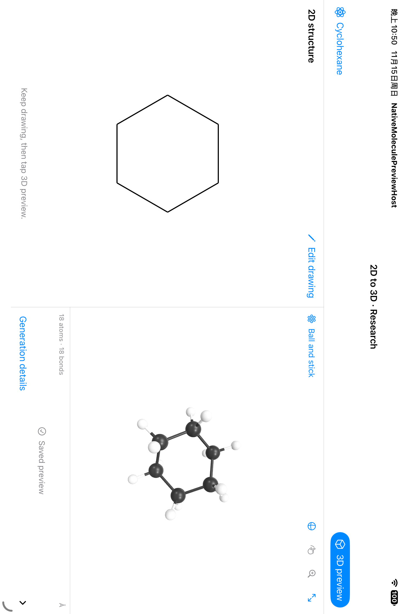
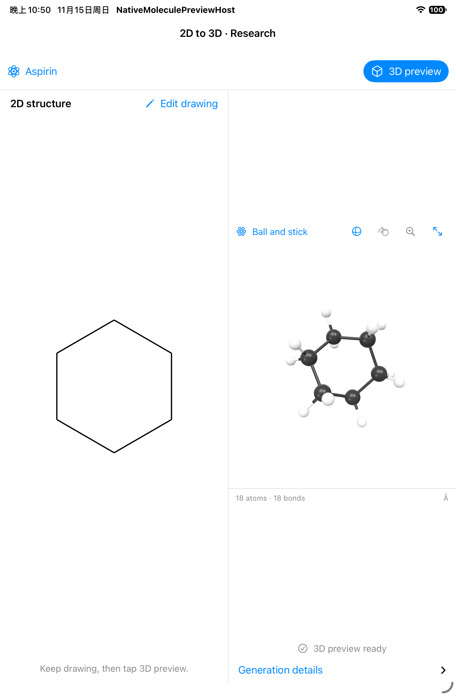

# 二维转三维原生预研发（2026-11-15）

本轮已跑通：**二维分子图 → 本机 RDKit C++ 生成三维构象 → 原生预览**。独立宿主能编辑二维结构、保存后重新生成、使旧预览失效，并在重开后恢复对应预览。计算链路无需启动 Linux、Python、远端服务或模型。范围只覆盖普通分子的三维预览，没有迁移全部化学／生物科学计算，也没有接入正式 App 或更改版本、发布渠道。

## 实现与验证结果

模块为 [`FloeMoleculePreviewNative`](../FloeAgent/Modules/FloeMoleculePreviewNative/README.md)，上游固定 RDKit `Release_2026_09_1` / `fece8caa860bdf6c9c82bdb9253f22a0cf87150c`。原生路径读取 MOL V2000/V3000 或 SMILES 的分子图，补显式氢、使用 ETKDGv3 生成一个构象，再做可选、有界的 MMFF94 优化。返回 CJSON、保留立体信息的 MOL、原始原子到输出的映射及实际引擎／状态。指定手性和双键顺反信息会与生成坐标核对。

| 验证层级 | 实际结果 |
| --- | --- |
| macOS arm64 原生数值验证 | **20/20**。乙醇、苯、环己烷、两种乳酸对映体、E/Z 双键、同位素及带电分子、阿司匹林；另含非法价态、解析前图大小限制、多片段、取消、超时及缺少力场参数等边界。固定种子重复输出一致。 |
| Swift 6 与 C ABI | **2/2**，真实编译、链接和运行，覆盖生成、确定性、非法价态和预取消。 |
| Apple 静态库 | macOS、iPhoneOS、iOS Simulator 三个 arm64 切片均实际编译。只读检查通过；检查真实 Mach-O 平台和最低系统版本，不只看 XCFramework 的 plist。 |
| 独立宿主设备构建 | `generic/platform=iOS` 实际编译、链接通过，设备可执行代码中包含 `fmp_generate`；未签名、未安装到实体设备。 |
| 指定 iPad 模拟器 | 最终 `simulator-03` **2/2 UI 测试通过**：编辑实际二维原件后重新生成、旧预览失效，以及多种分子显示和重开缓存。已核对保存的输入和输出，也已目视检查最终横屏／竖屏原始全屏截图。 |

工具链为 Xcode 27.2（27B52）、Apple SDK 27.2；部署下限 iOS/iPadOS 26、macOS 15。模拟器实际运行 iPadOS 27.2，不能据此称已运行验证 iPadOS 26 或实体 iPad。

Mac M5 Pro 的本轮九个 MOL 例子，计算段中位数约 **14.3 ms**、最大约 **15.3 ms**，不含进程启动和渲染。模拟器已保存结果的计算段约 **1.6–183 ms**，包含首次初始化和不同样例；这不是实体设备或端到端耗时承诺。

完整保留首次 iOS 配置误带桌面字体依赖的失败，以及首轮 UI 开关类型不匹配的失败、原始日志、层级与截图。后续明确关闭未使用的字体依赖，修正控件查找并等待实际绘图就绪；最终通过没有替换或删除原始失败。较早 App 范围截屏存在旋转裁剪问题，最终证据改为原始全屏截屏，没有改写截图像素。

第二张图在同一个原名为 Aspirin 的对象上清空原图、重新画六元环。保留对象身份和名称；新预览实际使用新保存的六元环，而非旧阿司匹林或缓存结果。

## 边界与接入方向

本轮上限为 128 个输入原子、补氢后 384 个原子、一个连通分子。未指定立体信息时，一份预览构象不代表唯一真实结构；没有做蛋白折叠或大规模动力学。预览构象、力场是否收敛及精确科学计算是不同结果。缺少 MMFF 参数时可明确返回未优化预览，不静默换力场；取消和超时采用实际原生阶段检查，非硬实时保证。

正式接入时，普通“三维预览”直接调用本模块；已有坐标优先显示，无坐标才本机生成。按对象身份、原件内容／版本、引擎和选项管理有界缓存；二维编辑后使旧结果失效，迟到结果不得覆盖新原件。预览保留为派生数据，原始 KET、二维 MOL、撤销记录和高级计算输入继续由现有服务管理。高级科学计算继续沿用原有环境和任务路径。

本轮源码、固定依赖／许可证、Swift 接口、构建脚本、测试和独立宿主均在模块目录；`BUILD_SAVED.json` 绑定原生来源与实际库。私有交接保存精确源快照、两个平台的当前宿主产物、原始验收数据和清理记录；它们不是正式 App 的分发包。下一阶段仍需正式 App 入口接入和实体设备性能验证。
