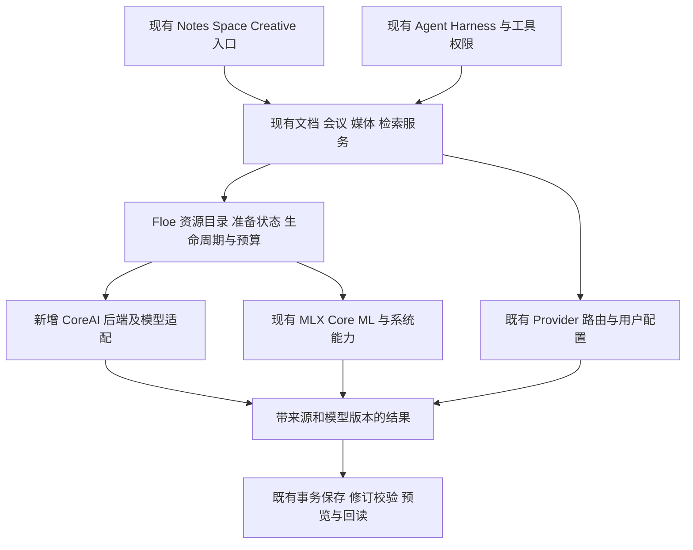

# Floe CoreAI 端侧能力增强研究

研究日期：2026-11-08。状态：技术研究与接入建议，尚未集成 CoreAI。

Floe 已经使用 MLX、Core ML、Foundation Models、Vision 和 NaturalLanguage，但当前 App 源码、包配置与项目配置没有直接接入 CoreAI 或 CoreAIKit。建议把官方 CoreAI 加入现有端侧服务体系，按需复用 CoreAIKit 的模型管线，优先增强会议说话人分离、文档结构识别和跨语言资料检索。现有本地模型、语音和媒体服务继续承担已经覆盖的功能。

## 1 研究基线与框架边界

| 对象 | 本次核验基线 |
| --- | --- |
| Floe | `main`，`941cae725bea1fd36ad7154dc3bc828f1678f4c8`；其他任务的重型编辑器修改保持原状 |
| CoreAIKit | GitHub latest 为 `0.7.3`，发布于 2026-09-24；源码 `f32626037741222c17042cd1bc0301185c077e8e` |
| Apple Core AI Models | 官方 `main` 快照 `22b0eaac4b325b812605a5096acff4880f1c4a36`，2026-11-07 |
| 本机工具链 | macOS 27.2（26B123）、Xcode 27.2（27B52）、Swift 6.4.2、SDK 27.2 |
| Floe 兼容目标 | `project.yml` 的 iOS deployment target 仍为 26.0 |

几个容易混淆的名称：

| 名称 | 职责 | Floe 当前状态 |
| --- | --- | --- |
| Apple **Core AI**，模块 `CoreAI` | 运行自备的 `.aimodel` / `.aimodelc`；控制特化、缓存和 CPU/GPU/Neural Engine 执行 | 尚未直接接入 |
| **CoreAIKit**，`john-rocky/coreai-kit` | 社区 Swift 封装、模型目录、下载和多模态管线 | 尚未接入；不是 Apple 官方 SDK |
| **Core ML**，模块 `CoreML` | 现有 `.mlmodelc` / `.mlpackage` 模型推理 | 已有语音及媒体相关实现 |
| **Foundation Models** | 调用系统模型，也可适配第三方模型 | 已有系统模型适配与工具请求桥接 |
| **MLX** | Apple 芯片上的数组计算及本地语言/视觉语言模型运行时 | 当前主要自备语言模型路径 |

Apple 官方提供 CoreAI 框架与模型导出、优化、Swift runtime 工具；CoreAIKit 则在其上提供更高层封装。系统模型内部使用哪种推理技术，不等于 Floe 已经直接集成了该技术。[Apple Core AI](https://developer.apple.com/core-ai/)、[官方模型仓库](https://github.com/apple/coreai-models)、[CoreAIKit 项目说明](https://john-rocky.github.io/coreai-kit/)。

CoreAIKit 0.7.3 允许 App 保持 iOS/macOS 26 的部署下限，但模型运行要求 27。Floe 可使用编译期模块隔离和运行期 availability 检查，分别保留 26 的既有路径与 27 的增强路径。自备 CoreAI 模型与 Apple 的系统模型应分别判断可用性，不以系统模型是否启用代替 CoreAI 模型准备状态。[0.7.3 发布说明](https://github.com/john-rocky/coreai-kit/releases/tag/0.7.3)。

本机真机、macOS SDK 含 CoreAI，iOS Simulator SDK 不含该框架。模拟器承担入口、降级和服务契约验证；CoreAI 数值、性能、内存和能耗必须在支持的运行设备验证。Mac 结果不能作为 iPad 实测结果。

## 2 Floe 已有基础与实际接入位置

以下是当前源码事实，不代表本轮重新进行了完整 App 或设备验收。

| 领域 | 已有实现 | CoreAI 接入位置 |
| --- | --- | --- |
| 本地 LLM/VLM | `LocalProviderAdapter` → `LocalModelRuntime`；生产 engine factory 当前创建 `MLXTextEngine`；GGUF 保留兼容实现，公开目录以 MLX 为主 | 在现有运行时增加 backend 选择和 `LocalModelTextEngine` 实现，保留原有任务、流式输出、取消和驻留管理 |
| 模型资源 | `LocalModelsCenter`、`LocalModelStore` 已有下载进度、暂停、取消、安装清单、staging 与失败恢复 | 扩展目录格式及模型清单，统一管理 CoreAI 源资产、tokenizer、编译变体与特化状态 |
| 记忆与资料检索 | `MemoryEmbeddingProvider`、SQLite FTS、向量及模型修订标识、混合召回；当前 Apple embedding 采用中英独立通道，并非已对齐的跨语言空间 | 添加多语言 embedding provider，沿用现有资料所有权、排除、删除、来源引用及增量更新 |
| 会议 | 录音、磁盘片段队列、带时间转写、说话人数据结构、个人手记、摘要与待办 | 为片段增加说话人分析，写入既有 `SpeakerID` 和 `TranscriptSegment`；当前实时转写提交没有传入 speaker |
| OCR | `image.ocr` 用 Vision 输出文字与边界框；Notes 已有受授权范围限制的文档搜索 | 增加复杂页面的结构识别，保留原有文字和坐标契约、PDF 保护与缓存版本校验 |
| 语音 | 共享 Whisper 识别运行时、文件转写；MOSS/Qwen TTS、分段播放与前后台释放 | 可替换模型后端进行对比，不另建录音、播放或音频会话体系 |
| 媒体 | VideoToolbox、MetalFX、Core ML；既有分块处理、取消、结果校验与提交路径 | 向现有媒体 engine factory 增加 CoreAI 实现，复用输出管理 |

关键源码入口：

- [本地模型运行时与 Provider](../FloeAgent/Sources/FloeLocalModels/LocalProviderAdapter.swift)（engine factory 约第 203 行；系统模型与普通模型分流约第 1803 行）。
- [引擎生命周期协议](../FloeAgent/Sources/FloeLocalModels/LocalInferenceLifecycle.swift)（第 57 行）与[资源预算](../FloeAgent/Sources/FloeLocalModelCatalog/LocalInferenceResourcePolicy.swift)（第 38 行）。
- [资源目录和安装服务](../FloeAgent/Sources/FloeLocalModelCatalog/LocalModelCatalog.swift)（格式第 158 行、下载第 409 行、清单第 575 行）。
- [Embedding 契约与当前中英实现](../FloeAgent/Sources/FloeAgentRuntime/MemoryEmbeddings.swift)（第 104、252 行）、[App 工厂](../FloeAgent/FloeApp/Memory/GlobalSources/AppGlobalMemoryFactory.swift)（第 66 行）、[资料服务](../FloeAgent/FloeApp/Memory/GlobalSources/GlobalSourceMemoryService.swift)（第 192 行）。
- [会议片段队列](../FloeAgent/FloeApp/Space/Meetings/MeetingLiveTranscription.swift)、[会议智能服务](../FloeAgent/FloeApp/Space/Meetings/MeetingIntelligence.swift)、[说话人与转写模型](../FloeAgent/Modules/FloeMeetings/Sources/FloeMeetings/Transcript.swift)。
- [Vision OCR](../FloeAgent/Sources/FloeExecution/Tools/VisionTools.swift)、[Notes 工具与授权范围](../FloeAgent/FloeApp/Notes/NotesAgentTools.swift)。
- [语音识别运行时](../FloeAgent/FloeApp/Voice/SpeechRecognitionRuntime.swift)、[本地语音合成](../FloeAgent/FloeApp/TTS/LocalSpeechRuntime.swift)、[媒体管线](../FloeAgent/Sources/FloeMedia/MediaEnhancementPipeline.swift)。

## 3 值得增强的产品能力

下面的优先级是基于现有覆盖和接入成本的工程判断，质量收益仍需同输入对照。

| 优先级 | 能力与用户结果 | 建议路线 |
| --- | --- | --- |
| P0 | 各端侧功能共用准备状态、资源预算和失败恢复 | 官方 CoreAI 作为执行底座，Floe 保持资源和任务所有权 |
| P1 | 会议能显示“谁在什么时间说了什么”，摘要能引用该发言 | 先接 Sortformer 说话人分离，复用已有 ASR、会议队列和手记保存 |
| P1 | 用另一种语言找到自己的笔记、会议与工作区资料 | 对比多语言 embedding 与当前中英通道，复用 FTS 和来源引用 |
| P1 | 扫描件中的表格、标题和公式更容易进入可编辑文档 | Vision 保留普通 OCR；GLM-OCR 作为复杂页面的结构化处理选项 |
| P2 | 图片自动标注、素材语义搜索、深度图和选区辅助 | 从 RF-DETR、CLIP、Depth Anything 等小模型切入；按操作接入现有编辑器 |
| P2 | 短文本摘要、分类、提取和轻量问答更快进入可用状态 | 小语言模型作为用户可选辅助路径；使用明确任务与输出约束 |
| P2 | 更强的离线图片问答 | 评估 CoreAI VLM，与现有 MLX VLM 比较；按真实能力声明工具和图片限制 |
| P3 | 本地超分、人声分离、时间序列预测和部分生成式创作 | 接入现有媒体、数据与 Creative 服务，逐个能力评估模型体积和结果质量 |

文本分类、结构化提取和 typed decisions 可以辅助工具候选排序、资料分类和界面建议，但不能代替权限判断或把模型概率当成授权。视觉深度与分割可以辅助 CAD/制造素材处理；它们不直接产生经过约束和精度验证的工程模型。

### 3.1 第一批候选模型与真实下载成本

下表来自 **0.7.3 固定源码内的 `catalog.json`**，单位为十进制 MB。它是下载体积，不是峰值运行内存，也不是 iPad 合格清单。该 tag 的快照有 67 项，当前网站的更多模型和更新示例不能直接套用到这个版本。[固定目录](https://github.com/john-rocky/coreai-kit/blob/f32626037741222c17042cd1bc0301185c077e8e/catalog.json)。

| 候选 | 快照中的 iOS 体积 | 适合用途与接入注意 |
| --- | ---: | --- |
| Depth Anything 3 Small | 55 MB | 小图执行路径、深度辅助；相对深度不能直接当真实尺寸 |
| RF-DETR nano | 108 MB | 对象检测、素材标签；类别、方向与坐标需要适配 |
| Sortformer diar v2 | 238 MB | 最多 4 个说话人的时间归属；iOS 路径是 `h18p.aimodelc`，需另行匹配目标 iPad |
| CLIP ViT-B/32 | 305 MB | 素材图文检索；中英文召回质量分别验证 |
| Qwen3 0.6B | 456 MB | 小型文本与受限工具桥接候选；不能从体积推断复杂 Agent 能力 |
| EmbeddingGemma 300M | 1,278 MB | 多语言资料检索候选；原始模型大小和旧示例中的约数不能替代转换包体积 |
| VoxCPM 0.5B | 1,378 MB | TTS 对照候选；当前 MOSS 包约 369 MB，不能假设切换后更轻 |
| GLM-OCR | 1,677 MB | 复杂页面到结构化文字；需要保留来源页和原图 |
| AdcSR ×4 | 1,825 MB | 图片超分候选；与现有媒体增强效果对照 |
| MinerU2.5 Pro | 2,643 MB | 更复杂文档解析，作为后续按需选项 |
| Qwen3-VL 2B | 3,278 MB | 图片问答；2B 参数量仍可能带来比现有模型更大的资产和内存开销 |

会议、人声分离等 iOS 条目中存在为特定 iPhone 架构编译的资产。应读取 `AIModel.deviceArchitectureName` 选择匹配资产，或从固定源 `.aimodel` 为目标架构编译；“存在 iOS variant”不足以证明适用于 M 系列 iPad。[Apple AOT 编译说明](https://developer.apple.com/documentation/coreai/compiling-core-ai-models-ahead-of-time)、[Sortformer 转换与验证记录](https://github.com/john-rocky/coreai-model-zoo/blob/main/models/sortformer-diar/README.md)。

### 3.2 三个优先场景的实现细节

**会议说话人分离。** CoreAIKit 的 `KitDiarizer` 可以独立于 ASR 使用，这正好允许 Floe 复用现有 Whisper 和时间段结果。0.7.3 的说话人标签仅保证单次 clip 内稳定；每次分析重建内部说话人缓存，不能对每个录音片段调用后把同编号认作同一个人。需要由会议服务持有分析状态和跨窗口映射，保留人工重命名/合并、重叠讲话和未知说话人。首次可以先提供录音后的说话人分析，再接实时链路。长会议使用有界 PCM 和特征窗口，避免把整段录音和全部 mel/DFT 中间数组同时放入内存。[KitDiarizer 源码](https://github.com/john-rocky/coreai-kit/blob/0.7.3/Sources/CoreAIKit/Audio/KitDiarizer.swift)、[组合转写源码](https://github.com/john-rocky/coreai-kit/blob/0.7.3/Sources/CoreAIKit/Audio/MeetingTranscriber.swift)。

**语义检索。** 当前服务已经区分向量的模型、修订和来源。新模型仍需扩展调用契约，区分 query 与 document：CoreAIKit 的 `TextEmbedder` 为两者应用不同提示前缀，现有单一 `embedding(for:)` 不能未经适配就用于两侧。分块还必须按目标 tokenizer 的长度控制，因为该实现会截断超长输入。新增向量空间后增量重建；旧空间继续服务，查询不混用模型、维度或修订。EmbeddingGemma 的多语言定位值得评估，但不能把其模型卡指标当作 Floe 中文扫描件和个人资料的召回结果。[TextEmbedder 源码](https://github.com/john-rocky/coreai-kit/blob/0.7.3/Sources/CoreAIKitEmbeddings/TextEmbedder.swift)、[原模型卡](https://huggingface.co/google/embeddinggemma-300m)。

**结构化文档识别。** 保留 Vision 的快速文字和 bounding-box 结果；复杂页面按用户选择运行 GLM-OCR，产出可追溯的结构化内容。Markdown/HTML 表格需要受限解析、校验和预览，不能直接当 Office 编辑命令。每页保留文件、页码、输入摘要、模型修订及结果版本，通过既有 PDFKitGate 渲染，按页提交和恢复。CoreAIKit 的 `ReadDoc` 示例 README 仍描述较大的 Mac-only Unlimited-OCR，而 0.7.3 的 `CoreAI.read` 实际默认 GLM-OCR，应以固定版本代码和资产为准。[图像操作源码](https://github.com/john-rocky/coreai-kit/blob/0.7.3/Sources/CoreAIOps/CoreAI%2BImage.swift)、[ReadDoc 示例说明](https://github.com/john-rocky/coreai-kit/blob/0.7.3/Examples/ReadDoc/README.md)。

## 4 建议架构

采用“官方执行框架 + 按需复用 CoreAIKit 管线 + Floe 服务所有权”。下面的 CoreAI 后端为拟议新增部分。



具体接缝：

1. **资源管理。** 扩展 `LocalModelRuntimeFormat` 或对应资产描述，保存模型用途、源修订、逐文件摘要、graph/函数契约、tokenizer、架构、最低 OS 和编译选项。大模型不随 App 默认打包，也不在点击一般功能时隐式下载。
2. **执行管理。** 语言模型继续经 `LocalProviderAdapter`；拟议 `CoreAITextEngine` 实现现有引擎契约。视觉、embedding、说话人分离使用各自领域服务，不强行伪装成聊天 Provider。CoreAI 推理是原生服务调用；不新增语言执行工具或回退到主机解释器。
3. **共享资源。** 接入 `HeavyRuntimeArbiter` 和现有内存预留机制，覆盖 MLX、CoreAI、语音、Office 与 Linux guest。后台索引让位于交互；加载、取消、排空和卸载按任务所有权串行处理。不能把 Neural Engine 等同于不占统一内存。
4. **准备状态。** 区分未下载、下载中、校验中、为设备准备中、可用、不可用。模型完成下载不等于可以执行。预先特化安排在资源准备阶段，界面仍能取消并看到失败。
5. **权限与隐私。** 延用现有资料范围和工具权限。用户指定本地处理时，失败保留本地结果与待处理状态；云端继续遵循已有用户配置和调用授权。临时聊天不触发模型安装、索引写入、文件编辑或长期工作。
6. **用户界面。** 增强已有入口和设置；常用页面展示功能、下载大小和可用状态，模型修订、计算单元等留在诊断详情。保留现有模型选择和系统模型启用偏好，不因引入 CoreAI 自动切换。

## 5 直接接包前必须解决的兼容问题

### 5.1 依赖版本约束不相交

Floe 的 `Package.swift` 当前精确锁定 `swift-huggingface == 0.9.0`；CoreAIKit 0.7.3 要求 `from: 0.11.0`。按这两个 manifest，直接加入同一 SwiftPM 图会产生版本约束冲突。CoreAIKit 还精确依赖社区 fork `john-rocky/coreai-models == 0.2.8-zoo`，并非直接使用 Apple 官方 runtime 包。[Floe 包配置](../FloeAgent/Package.swift)、[CoreAIKit 包配置](https://github.com/john-rocky/coreai-kit/blob/0.7.3/Package.swift)。

优先路线是按现有 ThirdParty 约定，选取需要的 CoreAIKit 适配和模型管线，保留 BSD 许可、NOTICE、上游修订和局部补丁，把下载交给 Floe。若改用完整包，则单独资格验证共享 Hugging Face 依赖升级及 tokenizer、MLX、语音影响，不能仅改锁文件求解析通过。即使只链接 Vision product，也不能假定整个 package 的依赖解析冲突自动消失。

### 5.2 模拟器需要隔离整个依赖路径

0.7.3 的 `GraphModel.swift` 直接 `import CoreAI`，Vision target 显式链接 CoreAI。只在 Floe 调用处加 `#available` 或 `canImport` 无法阻止上游 target 为 Simulator 编译失败。应在选用/维护的源码与 target 层同时做模块、源文件及链接设置隔离，再验证 App 的真机和 Simulator 构建。0.7.3 宣称的 deployment 26 兼容也仍需完整 App 链接及旧系统启动验证。

### 5.3 下载与版本行为需要收归 Floe

CoreAIKit 的 `ModelStore` 有 staging 和完整 bundle 后安装，但默认下载失败可返回同模型、同 variant 的**另一修订缓存**；现有磁盘是否完整的判断也不能替代 Floe 的固定清单核验。其文件下载检查体积，不应把它当成已完成逐文件内容摘要验证。推荐使用 `bundleAt:` 等本地加载入口，由 Floe 安装服务提供已确认资产，运行时不偷偷联网或改变修订。[ModelStore 源码](https://github.com/john-rocky/coreai-kit/blob/0.7.3/Sources/CoreAIKitCore/ModelStore.swift)。

### 5.4 模型能力不能按封装名称推定

固定 0.7.3 的 `KitLanguageModel` 通过 tokenizer 和引擎能力决定工具调用及受约束生成；guided generation 要求 sequential/logits 路径。`KitVisionModel` 没有接通工具调用和 guided generation。不能把网站更新后的能力声明直接套用到固定发布版。接入 Floe 时，模型产生的工具请求仍由现有 Harness 审核、执行和回传，不能让封装内部的 Tool 闭包绕过该路径。[语言模型源码](https://github.com/john-rocky/coreai-kit/blob/0.7.3/Sources/CoreAIKit/FM/KitLanguageModel.swift)、[视觉语言模型源码](https://github.com/john-rocky/coreai-kit/blob/0.7.3/Sources/CoreAIKit/Vision/KitVisionModel.swift)。

### 5.5 资源预算需要覆盖实际内存峰值

CoreAIOps 已有共享驻留预算，但 `admit` 在无可回收模型时仍允许加载，其体积估算也不含完整 KV、激活和输入缓存；这不足以承担 Floe 的硬性准入。现有 MLX 的 mmap 110% 规则也不能直接复制到 CoreAI。应按模型和窗口实测峰值，并与其他运行时共同准入。[CoreAIOps 驻留源码](https://github.com/john-rocky/coreai-kit/blob/0.7.3/Sources/CoreAIOps/ModelResidency.swift)。

### 5.6 特化缓存与可恢复源资产分别管理

`.aimodel` 是可移植源资产；AOT `.aimodelc` 按设备架构和最低 OS 生成，仍需在设备上完成部分特化；最终特化缓存与设备及 OS 绑定。OS 更新、源资产变化或系统回收可能让缓存失效。保留可恢复的固定源或匹配编译资产，状态能从可用回到准备中；磁盘预算同时考虑下载 staging、安装资产及特化缓存。计算单元选择从默认配置开始对照，不能承诺所有图都使用 ANE 或都快于 MLX/Core ML。[Apple 缓存管理说明](https://developer.apple.com/documentation/coreai/managing-model-specialization-and-caching)、[GraphModel 的计算偏好实现](https://github.com/john-rocky/coreai-kit/blob/0.7.3/Sources/CoreAIKitVision/GraphModel.swift)。

## 6 分阶段接入与验证

| 阶段 | 可独立交付的结果 | 该阶段需要的验证 |
| --- | --- | --- |
| A 平台接入 | SDK 隔离、固定依赖/源码、Floe 安装与准备状态；用小图贯通真实执行 | 相关 Swift object 编译、App 真机及 Simulator 链接；26 降级路径；Mac 实际加载与数值；目标 iPad 独立记录 |
| B 会议增强 | 原录音保留、说话人时间轴和既有 SpeakerID/修订保存 | 同输入对比人工标注，检查跨窗口换人、重叠讲话、停止/重试、取消及重新打开；记录说话人误差与转写对齐 |
| C 资料增强 | 新 embedding 空间和复杂页面结构识别接入现有资料/Notes 服务 | 中文、英文和跨语言 Recall@k；表格/公式保真与页面引用；模型升级重建、删除与排除、取消和保存回读 |
| D 多模态扩展 | 小型文本、视觉、媒体能力逐项进入现有入口及 AI discovery | 受影响能力的契约、输出质量、冷/热延迟、峰值内存、温控和持续执行；与当前后端同输入对照 |

每一项都记录源 SHA、模型修订与摘要、设备和 OS、冷启动/缓存命中、质量和实际产物。文本另看 prefill、首 token、输出速度；语音另看首音频、实时率及中英混读；图像与文档另看每页/帧延迟和视觉保真。来源示例中的 Mac/iPhone 数字不作为目标 iPad 的性能承诺。

下载完成、编译通过、模型数值通过、完整 App 行为通过和物理设备接受分别记录。保持本地验证优先；Simulator 只承担其能够验证的部分，不创建新设备补位。后续是否调整默认模型或增加大型创作模型，由实际结果决定，不把研究候选全部变成首轮集成依赖。

## 7 本次实际完成的核验

除源码与在线一手资料核对外，做了一个不含模型权重的 SDK 探针：在 `#if canImport(CoreAI)` 内定义 27+ 的 `AIModel(contentsOf:)` 调用，以 **26.0 部署目标进行 object 编译**。

| 目标 | 实际结果 | 证据边界 |
| --- | --- | --- |
| `arm64-apple-ios26.0`，iPhoneOS 27.2 SDK | `swiftc -emit-object` 退出 0；object 含真实 AIModel 引用 | SDK API 能编译；未证明包图、App 链接、旧系统启动或推理 |
| `arm64-apple-macos26.0`，macOS 27.2 SDK | `swiftc -emit-object` 退出 0；object 含真实 AIModel 引用 | 同上；未加载模型 |
| `arm64-apple-ios26.0-simulator`，Simulator 27.2 SDK | `swiftc -emit-object` 退出 0；符号为 `coreAISDKProbeUnavailable` | 证实编译的是无 CoreAI 降级分支，不是模拟器推理 |

命令形式：

```sh
DEVELOPER_DIR=/Applications/Xcode.app/Contents/Developer \
  xcrun swiftc -parse-as-library -emit-object \
  -module-name FloeCoreAISDKProbe \
  -target <上表目标> -sdk <对应的27.2 SDK路径> \
  SDKAvailabilityProbe.swift -o <临时对象文件>
```

探针源码和结果清单保存在本次仓库内的 Git-ignored scratch，临时 object 导出符号证据后清理。本次没有下载模型、添加包依赖、修改 App 实现、启动 Simulator 或执行设备推理。下一项有意义的实施结果是阶段 A 的真实模型与 App 接入验证。

## 8 迁移是否能提升 Floe 性能

补充研究日期：2026-11-08。结论：**CoreAI 有局部优化价值，公开证据不足以支持全面迁移会让 Floe 整体更快、更省内存或更省电。** 应分别评估更换执行后端、改变模型/量化、增加新能力，以及把计算移到 Neural Engine 的效果。

### 8.1 公开同机对照显示收益依赖模型

模型转换作者报告的 M4 Max 对照采用 512-token prompt、1,024-token generation、5 次试验和 Release 构建。CoreAI 使用官方模型配方与 pipelined GPU runner，MLX 为 `mlx-lm 0.31.3`。这些是 macOS 27 beta 时期的公开结果，不是本机 Xcode 27.2 或目标 iPad 的测量。

| 模型 | CoreAI 生成 token/s | MLX 生成 token/s | CoreAI 相对 MLX |
| --- | ---: | ---: | --- |
| Qwen3 0.6B | 484 | 432 | 约快 12% |
| Qwen3 4B | 145.4 | 145.8 | 基本持平 |
| Qwen3 8B | 94.1 | 90.0 | 约快 4.6% |
| GPT-OSS 20B | 78.1 | 100.2 | 约慢 22% |

普通模型两侧同属 4-bit 权重，但 CoreAI 为 block-32、MLX 为 group-64，量化方案并非逐字节相同；GPT-OSS 两侧使用同一 MXFP4 权重。表格只比较该协议的生成吞吐，不能推断首 token、App 帧率或 iPad 耗电。[原始配方、方法与完整对照](https://github.com/john-rocky/coreai-model-zoo/blob/f06611f00c280deca8d0487ca53d2aa0bbdf2a12/knowledge/apple-models-bench.md)。

有些公开的数倍提速来自 CoreAI 内部把逐 token 同步循环换成异步 pipelined engine，不能直接解释为从 Floe 的 MLX 迁到 CoreAI 会获得相同比例。[管线对照及后续修正](https://github.com/john-rocky/coreai-model-zoo/blob/f06611f00c280deca8d0487ca53d2aa0bbdf2a12/knowledge/pipelined-engine.md)。

### 8.2 Neural Engine 可能改善资源竞争，但并非统一提速或省电

把适合的任务从 GPU 移到 Neural Engine，可能减少它与 SwiftUI、Canvas、Office、3D 渲染的 GPU 竞争，这是针对 Floe 工作负载的工程推断。必须用实际计算单元映射和并行操作时的帧时间确认；设置 preferred compute unit 不等于整个图都在该单元执行。

另一组公开研究在 M5 Pro 上以同一 Qwen3-4B FP16 模型比较 CoreAI 的 ANE 与 GPU 路径。1K 上下文生成约为 ANE 14.56、GPU 30.09 token/s；两次完整运行中，短 prompt 处理的 ANE 组件能耗为 GPU 的 0.68–0.81 倍，生成阶段则为 0.86–1.18 倍。其能耗来自未扣空闲功耗的 CPU/GPU/ANE 软件计数器，不能换算成 iPad 续航提升，也不能据此保证 ANE 总是省电。该研究不是与 MLX 的框架对照。[完整模型、重复运行与测量边界](https://github.com/cadamcat/llms-on-apple-neural-engine/blob/4b053327c293e00d1e8d3233c96b8da1139108db/findings/qwen3-4b-graph-capacity/README.md)。

Floe 的 Core ML 媒体配置已经允许 `.all`，Core ML 本身也使用 CPU/GPU/Neural Engine，因此迁移不意味着首次获得 ANE。相同权重代码的 M5 Pro 组件研究中，Core ML 与 CoreAI 的 FP16 速度很接近；某些四位 palette 表达曾出现大差距，但改用直接 INT4 后，Core ML 可达到 CoreAI 对照的 0.952–0.985 倍。这里测的是投影/MLP 组件，不能当成语音或完整语言模型的加速比例。实际图表达与量化经常比框架名称更能解释差异。[同代码组件对照](https://github.com/cadamcat/llms-on-apple-neural-engine/blob/4b053327c293e00d1e8d3233c96b8da1139108db/findings/coreml-coreai-same-codes/README.md)、[直接 INT4 后续验证](https://github.com/cadamcat/llms-on-apple-neural-engine/blob/4b053327c293e00d1e8d3233c96b8da1139108db/findings/coreml-direct-int4/README.md)、[Apple Core ML](https://developer.apple.com/documentation/coreml)。

### 8.3 Floe 当前主模型有额外约束

- 当前公开目录包含 Qwen3.5 4B 和 Qwen3.8 4B Heretic 的 MLX 4-bit 资产，约 3.06 GB。Qwen3.5 是 GDN 混合注意力模型，不能用普通 Qwen3 4B 的结果替它下结论。
- 本次找到的 Qwen3.5-4B CoreAI 模型卡描述的是约 **5.4 GB 的 INT8 GPU 管线**，没有提供该仓库自己的 iPhone 安装变体；它也不能直接替代 Qwen3.8 Heretic 的具体权重。该方案的下载和存储成本高于 Floe 当前 4-bit 资产，运行峰值还需另测。[固定模型卡](https://github.com/john-rocky/coreai-model-zoo/blob/f06611f00c280deca8d0487ca53d2aa0bbdf2a12/models/qwen3.5-4b/README.md)。
- Floe 现有 MLX 路径为了避免历史驻留问题，实际调用 `MLX.compile(enable: false)`；资源紧张时还降低 batch，并使用量化 KV。外部 MLX benchmark 没有复现这一整套 App 策略，所以它不是 Floe 的现行速度基线。该稳定性策略不能为了得到好看数字先行移除。[当前实现](../FloeAgent/Sources/FloeLocalModels/MLXTextEngine.swift)。
- 现有资源档位有至少 8K 的上下文配置。CoreAI 对照需要保留同等实际 prompt、工具往返和上下文能力；靠缩短上下文、减少思考或换小模型得到的结果，应另标为产品方案变化。

### 8.4 对不同性能目标的建议

| 性能目标 | 对 Floe 的判断 |
| --- | --- |
| 主模型回答更快 | 值得验证，尚无当前 4B 权重与目标 iPad 的同条件证据支持直接替换 |
| 边推理边编辑更流畅 | 小型视觉、embedding、语音子模型的 ANE 适配值得优先试；实际 GPU 占用及帧时间必须验证 |
| 减少内存或发热 | 无统一保证；权重精度、KV、输入缓存、特化和持续负载都可能改变结果 |
| 首次打开功能更快 | 预先特化/AOT 能控制 CoreAI 自身的首次准备成本；首次转换后的额外成本仍须计入，不能只看热缓存 |
| 云端回复、数据库、普通编辑、Linux 执行更快 | 不会因更换端侧模型框架自动提速；只可能通过减少本地资源竞争间接受益 |

推荐先选一个现有端侧能力做 A/B，再决定是否扩展迁移。两侧保留相同源权重、输入、输出预算及质量要求；若必须采用不同量化，则把精度和体积差异单独列出。使用现有 Floe 路径记录冷/热首 token、完整任务耗时、峰值与释放后内存，以及边推理边滚动/编辑时的帧时间；能耗测试另记录设备、持续负载和温控状态。Mac 用来验证可行性，目标 iPad 的结果独立判断。

推理速度与整条流程速度也要分开。例如，若推理原本占总耗时 50%，其他环节不变，推理吞吐提高 20% 后，整条流程速度只提高约 9.1%；这是计算示例，不是 Floe 实测。本次补充完成了公开测量、固定源码与 Floe 策略对照，没有新增 App 实现或进行模型 A/B。
