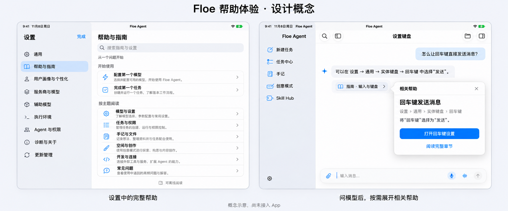

# 帮助中心界面与模型求助规划

日期：2026-11-11。研究对象：iOS/iPad App 的帮助入口、阅读界面、模型读取指南与按需呈现。研究基线为 `ad7ff59f5f3e016c65eec04e0c6e4248abc5c033` 及本次记录的实际文件摘要。本文保留已确认的交互合同，补充[帮助中心总规划](FLOE_IN_APP_HELP_PREDEVELOPMENT.zh-CN.md)；首版源码已进入集成，实际证据边界见总规划第 8 节。

**用户已确定：完整帮助放在设置；界面内的帮助由模型按问题唤出，不在各页面设置文档按钮。模型要能读取指南，说明设置位置，并提供指南引用和“打开此设置”。查看帮助后保留原任务或编辑现场。** 文档预置、GitHub 自动更新和设备新版不被新 App 内置旧版覆盖的要求继续生效。

## 1. 设计方向

上图是使用内置 imagegen 生成的概念稿，参考现有公开 Floe 界面的原生文字、灰白底色和蓝色交互色；不是 App 或 Simulator 截图。设置栏目为节选，既有分类和名称在实现时按当前代码保留，图示不授权删除或改名。图稿[生成提示词](images/help-predevelopment/model-help-concept-20261111.prompt.md)随文件保留。

本次直接采用现有 Floe 的原生视觉体系：系统字体、语义颜色、SF Symbols、原生列表与导航。帮助是阅读界面，重点是找到答案和看清步骤；不改变全 App 的外观系统。入口、问答与弹出的帮助面板分别承担不同任务。

## 2. 完整帮助只在设置中提供入口

推荐路径为 **设置 → 帮助与指南**，在设置列表中紧接“通用”之后，单独一行显示书本图标与文字。这样首次打开设置便可发现，不会被当前二十余个分类挤到列表末端；无需先进入“通用”“诊断与关于”或“更新管理”。具体第二行位置是本轮基于实际列表长度提出的设计建议，用户已确定的是总入口归属于设置。

不增加主侧栏、首页、创作工具栏或每个设置页的帮助入口。既有侧栏底部的设置齿轮、iPhone 的设置导航和外接键盘设置入口继续通向同一个设置中心。

当前 [SettingsRootView.swift](../FloeAgent/FloeApp/Settings/SettingsRootView.swift) 已有 iPad 分类/详情双栏和 iPhone 导航栈；[AppRouter](../FloeAgent/FloeApp/Shell/AppRouter.swift) 通过 `presentedSettings` 显示设置。实施时在现有设置分类和详情路由中增加帮助，不增设顶层 `AppDestination` 或 `MoreDestination`。

### 帮助中心首页与文章

首页先显示“搜索指南与设置”，随后是简短的“开始使用”和按主题组织的原生列表。使用真实主题、可区分的短摘要和系统图标，不做大幅宣传区或重复卡片网格。正文、目录和图片均从当前已选中的同一内容快照读取。

| 形态 | 首页与文章布局 |
| --- | --- |
| 宽 iPad | 复用设置分类/详情两栏。帮助首页放在详情栏；文章在同一详情导航栈推进。阅读时可收起分类栏，文章目录放在工具栏面板中，不再嵌套一个常驻双栏 |
| iPad 窄分屏与 iPhone | 设置列表 → 帮助首页 → 文章，沿原生导航栈推进；保留边缘返回手势和查询状态 |
| 大字号 | 标题、路径和按钮允许换行；主操作与关闭保持可达。布局按当前可用宽度决定，不单凭设备型号维持多栏 |
| 正文 | 以可读行长与段落间距为主，图片按阅读宽度显示并可放大，宽表格独立滚动；中文与英文分别检查实际字宽 |

已核对的现行阅读器可用于借鉴查找与位置管理；正文主原型仍为受控本地 HTML/WebKit。帮助首页、工具栏和呈现容器保持原生。文档版本、来源和检查时间放在主动打开的“文档信息”中；正常页面只需要“可离线阅读”等简短状态。

## 3. 页面内帮助由模型按需唤出

模型回答先说明当前问题，再呈现相关章节。普通页面不出现固定文档按钮；可再次打开的指南引用只跟随相关模型回答存在。模型可以在本轮求助中唤出聚焦面板，不要求用户先找入口、选手册或逐级浏览目录。

### 相关帮助面板

只承载当前问题的标题、必要说明或少量步骤、实际位置、来源引用和一个主要动作。默认不展示整本手册、帮助分类列表、技术版本标识或大段更新日志。

例子基于当前真实界面：

> **回车键发送消息**
>
> 设置 → 通用 → 实体键盘 → 回车键
>
> 将“回车键”选择为“发送”。
>
> 主操作：打开回车键设置
>
> 次操作：阅读完整章节

此路径对照了 [GeneralSettingsView.swift](../FloeAgent/FloeApp/Settings/GeneralSettingsView.swift) 的 Picker、`settings.general.hardwareReturn` 标识与当前本地化字符串。示例指南章节本身需要在内容整理阶段补齐，不能据此声称现有手册已覆盖该问题。

| 当前界面 | 模型呈现方式 |
| --- | --- |
| 宽 iPad，相关回答在屏幕内 | 以该回答的指南引用为锚点呈现一个原生 popover；保留任务和编辑器，避免遮住输入、触发来源或必要内容 |
| iPhone、窄 iPad 或放不下内容 | 使用可关闭的原生 sheet，直接展示相关章节，支持继续展开阅读 |
| 已有另一个帮助面板 | 更新同一呈现会话或先关闭旧面板，不级联堆叠 |
| 任务不在前台、引用已离屏或缺少可靠呈现场景 | 在原任务留下可打开的指南引用；不在别的任务、窗口或页面上弹出 |
| 用户主动关闭 | 当前请求不再次自动弹出；用户可通过回答中的引用重新打开 |

原生 popover 承担短暂、少量的相关内容，窄空间使用 sheet，是本方案依据 [Apple Popovers 指南](https://developer.apple.com/design/human-interface-guidelines/popovers)选定的适配方式。[Apple Offering help](https://developer.apple.com/design/human-interface-guidelines/offering-help)强调帮助应紧扣当前任务、便于关闭，并可直接引导到相关设置；本项具体的设置位置与模型触发流程仍是 Floe 的产品决定。

### 保留工作现场

帮助呈现与原编辑器、选区、草稿、撤销、滚动位置和运行中的任务分离。关闭帮助恢复先前键盘焦点；不会以重建编辑页或切换主任务来实现。已有任务检查器、文件与浏览器面板的路由不被帮助请求替换。

“打开此设置”由用户点击后执行：先结束相关帮助的临时呈现，再由同一场景的原生协调器打开设置并定位目标。返回时能回到来源回答和原帮助内容。切换任务、导航或取消后，迟到的呈现请求不得重新覆盖当前界面。

## 4. 模型读取与呈现接口

以下为建议的编译内工具合同，尚未注册或实现。用户要求的是读取指南并就地帮助，不是把每份手册塞进模型固定提示词。

| 建议工具 | 输入 | 返回与职责 |
| --- | --- | --- |
| `help.search` | 问题、语言及有界结果数量 | 搜索当前指南的主题、正文、术语别名与设置位置；返回章节摘要、稳定引用和内容快照身份 |
| `help.read` | 已返回的指南引用、章节或续读标识 | 读取确切章节、步骤、适用范围与已验证设置目标；长章节分段返回并明确是否截断 |
| `help.present` | 已核验的指南引用、可选章节 | 请求当前主任务的相关帮助呈现；返回实际呈现、留在原回答待打开或已取消等状态，不把“请求已入队”写成“用户已看到” |

搜索和读取是只读工具，通过已有 [ToolCatalog](../FloeAgent/Sources/FloeTools/ToolCatalog.swift) 和 [ToolRunnerRegistry](../FloeAgent/Sources/FloeTools/ToolRunnerRegistry.swift)进入实际模型发现与调用链；在 [AppEnvironment](../FloeAgent/FloeApp/App/AppEnvironment.swift) 统一注册，调用同一帮助内容服务。它们只接受指南身份，不接受任意文件路径、URL、脚本或私有配置；内置指南可用时无需等待 GitHub 下载。

呈现是独立的 App 本地交互，不能混在只读查询中自动发生。按 [AgentTool](../FloeAgent/Sources/FloeTools/AgentTool.swift) 既有 effect、风险和执行边界登记，限定主任务；查询可供合法的子任务读取，子任务不直接弹界面。沿用现有审批与能力服务，已获本轮求助授权的低影响帮助展示不增加逐次确认。执行时的任务、场景与请求代次来自原生上下文，不由模型传参指定另一个窗口。

Plan 模式与[临时会话工具上限](../FloeAgent/Sources/FloeTools/TemporaryChatToolPolicy.swift)分别核对。当前临时名单不含上述工具，不能仅因“公开”或“只读”自动放行；实施时保留既有边界，并明确提供何种指南信息与呈现方式。普通任务的模型求助闭环是首版必需，不以特殊模式扩展替代或拖延它。

### 一份内容与确切版本

用户阅读、模型查询与呈现都经同一服务选取文档。设备文档比 App 内置版新时，模型同样读取设备新版。一次搜索、读取、回答和相关帮助绑定同一个不可变快照；GitHub 更新不能使搜索结果、正文、图片和路径引用混用版本。

返回的引用包含包身份、文档版本、文章/章节身份、适用 App 范围与来源修订，普通界面只显示友好的章节名。引用通过原生结果回执校验后才形成可点动作；不把模型自由生成的文字链接当作可执行的设置路由。历史引用若已无法精确打开，明确提示版本变化，再提供当前对应章节。

## 5. 设置路径必须对应真实界面

指南可以随 GitHub 更新，实际能打开哪些设置由当前 App 的编译内路由决定。增加最小的设置位置目录，将 `SettingsSection`、嵌套页面、控件稳定身份、本地化名称和可用条件关联起来；不读取或输出用户的设置值、Key 或私人数据。

| 实际路径 | 已有证据 | 实现时需补齐 |
| --- | --- | --- |
| 设置 → 通用 → 实体键盘 → 回车键 | GeneralSettingsView 的 `settings.general.hardwareReturn` | 定位请求、滚动与焦点反馈 |
| 设置 → 通用 → 语音输出 | GeneralSettingsView 的 `TTSSettingsView` 导航链接 | `.general` 下嵌套导航目标与返回路径 |
| 设置 → 执行环境 → 本机运行环境 → 内存 | ExecutionEnvironmentView 的 `execution.shared.memory` Picker | 控件定位身份与运行环境未准备时的可用状态；该文件有其他任务的未提交修改，本轮只读 |

当前 [SettingsRootView](../FloeAgent/FloeApp/Settings/SettingsRootView.swift) 的分类选择是内部 State，打开设置默认选择通用；[FloeAppEntryRoute](../FloeAgent/Sources/FloeCore/FloeAppEntryRoute.swift) 尚无设置 URL 动作。因此需要为现有 AppRouter/SettingsRootView 增加类型化的初始目标、嵌套目标和定位请求；不能生成未实现的 `floe://settings/...` 后宣称可打开。

指南中的目标标识必须与当前编译目录交集匹配。目标控件不存在或本机条件不满足时，说明实际限制；若只支持打开上级页面，按钮文案就显示“打开通用设置”等真实目标。按钮仅负责导航，不能把页面打开回执说成“设置已修改”。不为“显示一个帮助”建立任意 GUI 控制或平行权限系统。

## 6. 验证与实施拆分

| 结果 | 验证要点 |
| --- | --- |
| 入口与阅读 | 设置首屏可发现；完整文档入口没有扩散到其他页面；窄屏、大字号、深色、键盘、返回与图片阅读 |
| 模型查询 | 真实工具发现、搜索、读取与引用；回车键、语音输出、Linux 内存等问题取得正确路径；不要求完整手册进入固定提示词 |
| 模型呈现 | 真实当前主任务调用、实际 UI 呈现回执、单面板、取消与任务切换；背景/子任务不会抢占前台 |
| 打开设置 | 用户点击后准确到达可用的分类/嵌套页/控件，显示位置与按钮文案一致；前后设置值不变 |
| 内容版本 | 设备新版、App 内置旧版及 GitHub 更新时，用户和模型选择一致；搜索/阅读/呈现不混用快照 |
| 返回与权限 | 关闭返回原编辑现场；迟到请求失效；Plan/临时模式不被隐式扩大；原服务和其他工具权限不变 |

HLP00 固定本设计和入口；HLP01 补齐指南身份、设置目录及对应内容；HLP02 验证阅读原型；HLP03/HLP04/HLP05 完成离线阅读、搜索与 GitHub 版本行为；HLP07 接入模型查询；HLP08 完成主任务帮助呈现和设置定位；最后由 HLP06 做实际 App 验收。模型读取、呈现与可点设置路径均列为首版要求。

预研阶段完成源码位置核对、设计概念与接口规划。当时固定 iPad Simulator 的独占锁由其他任务持有，包装器未启动子命令；图稿不是无障碍、响应式或运行验收。批准实施后已实现设置唯一入口、回答旁指南卡、短相关帮助、真实引用锚点及可信设置路由，组件证据见总规划第 8 节；完整 App、文件助手内设置层级与实际点击效果仍由集成主线验证。本实施子项未启动设备或自行发布。
