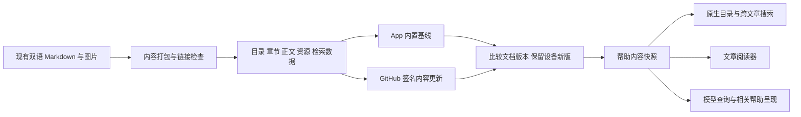

# App 内帮助中心预研与实施规划

日期：2026-11-11。源码调查基线：`f1a505968cf3bb9004c7b3a7ff5f1d19c17458ea`，共享 `main` 工作副本。收尾核对时并发 Android 工作将主线推进至 `ad7ff59f5f3e016c65eec04e0c6e4248abc5c033`；本项已核对的公共内容和更新策略输入摘要保持一致，相关 iOS 更新与阅读源码在这两个提交间没有差异。

用户已确定：**先做 iOS/iPad，内容结构供 Android 共用；首版提供目录、搜索、图文阅读、离线使用和 GitHub 自动更新。App 预置一份文档；设备文档比下一个 App 内置版本更新时，保留并继续使用设备版。完整帮助放在设置；页面内帮助由模型读取指南后按问题唤出，不给各页面常驻文档按钮。模型回答包含实际设置路径、指南引用和用户可点的“打开此设置”。** 本文保留前期预研与已批准的实施合同；当前已进入首版实现，源码与验证边界见第 8 节。概念图和独立探针不作为实际 App 截图或验收结果。

首版同时完成两条路径：用户在设置中主动阅读完整指南，以及用户直接问模型后由模型查询并呈现相关帮助。两者共用内容与版本。正文继续维护在现有中英指南中，打包时产生供 App 消费的目录、章节身份、资源清单与检索数据。界面、内容格式和模型访问分开，后续 Android 可以消费相同内容合同。

界面图稿、入口研究、模型工具与设置定位的详细方案见[帮助中心界面与模型求助规划](FLOE_HELP_UX_AND_MODEL_ACCESS.zh-CN.md)。

## 1. 首版范围与阅读体验

| 范围 | 首版行为 |
| --- | --- |
| 帮助入口 | 设置 → 帮助与指南；建议放在通用之后、首屏可见。不增加其他全局入口或功能页文档按钮 |
| 主题目录 | 快速开始、模型与设置、任务与权限、手记与文件、空间与创作、开发与连接、常见问题；目录来自内容清单 |
| 帮助搜索 | 搜索帮助文章的标题、章节、别名与正文；结果显示文章名、章节名和短摘要，点击直达章节 |
| 模型读取 | 模型可搜索和读取同一当前生效指南，返回确切章节、适用版本与设置路径 |
| 模型呈现 | 用户求助后，模型按需在当前任务呈现聚焦帮助；回答保留指南引用，用户可点击打开实际设置 |
| 文章阅读 | 标题、段落、列表、表格、链接、图片；图片可放大；文字可选择和复制；明暗模式、大字号可读 |
| 文章内查找 | 与跨文章搜索分开；支持前后匹配跳转、无匹配提示及外接键盘操作 |
| 离线使用 | 新安装后首次打开即可阅读内置基线，目录、正文、图片、检索均不要求联网或配置 AI 模型 |
| GitHub 自动更新 | 沿用其他内容文件的更新方式，联网时在服务层检查、下载并核验新的文档版本；离开阅读界面后更新仍由服务持有 |
| App 升级保留 | 文档版本独立于 App 版本；较旧的 App 内置文档不能覆盖设备上已安装的较新文档 |
| 阅读导航 | 文章目录定位、相关文章跳转、返回原文章与原位置；窄窗口和 iPhone 使用逐级导航 |
| 语言与版本 | 跟随界面语言，允许切换中英文；保留同一主题身份；文章显示必要的适用版本与核对日期 |

收藏、阅读历史列表、系统 Spotlight 和自动诊断不进入第一批闭环。模型查询与呈现属于首版；它使用当前任务的既有模型，不新建帮助专用助理会话，也不把整本手册加入固定提示词。首版只保存恢复当前阅读位置所需的少量状态；查询历史不默认持久保存。帮助内的操作说明和代码示例只能阅读或显式复制。

### iPad 布局

完整帮助复用设置的分类/详情双栏，帮助首页与文章在同一详情导航栈推进；阅读时可收起设置分类，文章内目录由工具栏打开，不在设置详情里再嵌套一组常驻双栏。窄分屏和 iPhone 按设置 → 帮助首页 → 文章推进，返回时保留查询和位置。正文保持适当行长，长表格和代码块独立滚动。

模型唤出的帮助在宽 iPad 使用与回答引用关联的短暂面板，窄屏使用原生 sheet；只展示当前问题的相关内容。呈现不替换已有任务检查器或编辑器，关闭后恢复原现场；用户点击“打开此设置”才执行设置导航。

不改变 `FloeAgentApp.swift` 的外层 split view，不复用 Notes、Canvas 或聊天的编辑状态、撤销栈和助理会话。若某入口实际触发根导航，继续遵守现有保存、离开和临时会话生命周期规则。

## 2. 已完成的内容预检

首批内容源为现有三个主题的双语文件：

| 内容 | 中文 | English |
| --- | --- | --- |
| 快速开始 | [QUICKSTART.zh-CN.md](QUICKSTART.zh-CN.md) | [QUICKSTART.md](QUICKSTART.md) |
| 完整手册 | [USER_GUIDE.zh-CN.md](USER_GUIDE.zh-CN.md) | [USER_GUIDE.md](USER_GUIDE.md) |
| 空间与工作台 | [WORKSPACES_GUIDE.zh-CN.md](WORKSPACES_GUIDE.zh-CN.md) | [WORKSPACES_GUIDE.md](WORKSPACES_GUIDE.md) |

对以上六份实际文件完成只读解析，结果如下：

- 源文档合计 **224,254 字节**，共 **124 个标题**、**10 个表格**。
- 共 8 处图片引用，去重后为 **4 张本地 PNG，3,097,148 字节**；没有缺失图片或远端图片依赖。
- 正文加直接引用图片合计 **3,321,402 字节，约 3.17 MiB**。这是当前原始内容大小，不是最终压缩包、App 增量大小或加载内存。
- 本地文件链接目标均存在，但有 **27 个不同目标不在这六份文档内**。首版打包需要为每个目标明确选择“纳入包内”或“打开公开网页”，不能保留无法解析的本地 Markdown 路径。
- 两份完整手册各有重复的 `doc-anchor: section-19`，分别出现在远程设备和临时会话章节前。新阅读器不能直接把这些标记当作唯一章节身份。
- 两种语言的标题数量不完全相同，不能按数组顺序或同名标题自动配对翻译。

四张截图均为 2752 × 2064 像素；若全部按原尺寸解为 RGBA，单像素缓冲合计约 86.7 MiB。这是理论像素占用，不是实测 App 内存。正文应按显示尺寸使用派生图片并按需加载，放大时再读原图；原型阶段观察退出后是否释放资源。

现有 [ContentPackageCodec](../FloeAgent/Sources/FloeSkills/ContentPackageCodec.swift) 将 `content.json` 限为 256 KiB、引用文档数限为 32，其他单文件限为 1 MiB。当前 `home-current.png`（1,090,768 字节）和 `workbench-current.png`（1,142,965 字节）超过单文件上限，不能原样通过这条更新校验。首批优先产生符合限制的显示与放大资源，保留仓库原图；不为帮助中心放宽全部内容包的限制，也不将 124 个标题直接拆成 124 个被引用文档。

公开文档的只读 HTTP 取回确认：[中文手册](https://www.floe-agent.com/docs/zh.html)、[英文手册](https://www.floe-agent.com/docs/en.html)、[中文快速开始](https://www.floe-agent.com/docs/quickstart-zh.html)、[中文工作台教程](https://www.floe-agent.com/docs/workspaces-zh.html)返回 200。取回的页面没有重复 DOM id；源标记重复不等于官网当前存在重复 DOM id，也不构成 App 阅读验收。

### 内容进入 App 前的必要整理

1. 为主题和章节建立独立、稳定、与语言无关的身份，例如 `notes`、`notes.handwriting`。维护旧网址与旧锚点映射，新增章节和改标题不改变身份。
2. 将完整手册按主题和章节组织成可独立打开的阅读单元，保留来源位置与版权信息；通过打包生成派生产物，避免再维护一份 App 专用正文副本。
3. 为首批范围外的链接逐项定策略。用户操作指南可按需要纳入；工程架构、历史资格与发布记录通常保留为公开网页链接，并说明需要联网。
4. 将陈旧的“下一版”“当前内部版本”等相对措辞核对成准确、简短的适用说明。内容核对依据当前交付与源码事实，不根据手册发布日期推定功能已经可用。
5. 为图片补足两种语言的替代文字与说明。图片文件可共用；截图中的平台和版本保持可辨认。

## 3. 显示方案与独立技术探针

### 预研基线的 App 接入现状

| 路径 | 当前已具备 | 本项缺口 |
| --- | --- | --- |
| [ContentUpdatesSettingsView](../FloeAgent/FloeApp/Settings/ContentUpdatesSettingsView.swift) | 帮助包名称、类型及已有内容更新管理界面 | 更新管理条目没有接到面向用户的图文帮助阅读闭环 |
| [ContentUpdateCenter](../FloeAgent/FloeApp/Content/ContentUpdateCenter.swift) | GitHub 内容检查、已安装文件缓存、`installedDocument`、通用内置版本接管规则 | 帮助内置基线尚未注册；需要正文、资源和索引的统一读取快照 |
| [ContentUpdateStore](../FloeAgent/Sources/FloeSkills/ContentUpdateStore.swift) | 持久内容存储、不可变版本、激活状态、事务和降级拒绝 | 帮助阅读会话应绑定同一修订，并验证 App 升级保留行为 |
| [MarkdownRendererView](../FloeAgent/FloeApp/Chat/Render/MarkdownRendererView.swift) | 原生 Markdown block 显示，供聊天等路径使用 | 当前分支没有图片、帮助文章身份与章节锚点 |
| [TextReaderView](../FloeAgent/FloeApp/Reader/TextReaderView.swift) | 通用只读文件/手记文本阅读，含目录、查找、排版偏好与位置恢复 | 不是帮助文章库，缺帮助主题检索与离线图片资源合同 |

已有帮助内容包和文字阅读组件可以复用，但不能据此报为 App 已有完整帮助中心。首版需要接通“可见入口 → 内容快照 → 阅读与资源 → 目录和搜索 → GitHub 更新”的实际路径。

### 候选与建议

内容层以受控 Markdown 为维护源；显示层有两个可验证候选。直接打开在线官网可保留为外部阅读动作，无法单独满足首次离线要求。

| 候选 | 优点 | 本项必须验证的部分 |
| --- | --- | --- |
| 复用工程已有原生 Markdown 组件 | 沿用主题、原生控件和既有文字呈现；减少平行显示实现 | 长文选择、章节锚点、图片离线解析、宽表格、文章内查找与大字号 |
| 原生目录与搜索 + 本地 HTML / WebKit 正文 | HTML 适合文章结构、表格、图片和章节定位；iOS 26 提供 SwiftUI WebKit API | 本地资源边界、WebView 状态和内存、系统查找、大字号与 VoiceOver、外链控制 |
| 直接显示官网页面 | 能使用现有公开内容 | 首次离线、内容版本固定、网页导航与 App 导航协调；不作为首版唯一正文来源 |

**建议以“原生目录与搜索 + 受控本地 HTML / iOS 26 WebKit 正文”为主原型。** 现有 [MarkdownRendererView](../FloeAgent/FloeApp/Chat/Render/MarkdownRendererView.swift) 已有标题、正文、列表、引用、代码与表格显示，但其 block 显示分支没有图片和帮助专用锚点。已有 [TextReaderView](../FloeAgent/FloeApp/Reader/TextReaderView.swift) 提供只读文件/手记的分窗加载、目录、查找与位置恢复，可以借鉴交互和生命周期；它并非现成的图文帮助中心。采用独立帮助正文适配层，可以保留聊天与通用文件阅读器的既有合同。HLP02 用实际样本验证后确定最终主实现。

[Apple 的 WebKit for SwiftUI](https://developer.apple.com/documentation/webkit/webkit-for-swiftui)提供 `WebView`、`WebPage` 和自定义资源方案。其[官方示例讲解](https://developer.apple.com/videos/play/wwdc2025/231/)涵盖本地资源、目录定位、导航策略与文章内查找。方案选择仍以 Floe 实际样本的显示结果为准。

本轮已做独立候选探针：Xcode **27.2 (27B52)**、Apple Swift **6.4.2**，以 **`arm64-apple-ios26.0-simulator`** 为目标，在 Swift 6 严格并发模式下完成 **`-emit-object` 对象编译，退出码 0**。探针包含 `WebView` / `WebPage`、自定义 `URLSchemeHandler`、非持久网站数据、导航策略、禁用页面脚本和 `findNavigator`。

该结果只证明候选 API 可在当前 SDK 与 iOS 26 部署目标下编译。未运行该视图，未验证系统查找与禁用页面脚本的组合、图片显示、无障碍、内存或实际 iPad 体验。对象与命令记录已保存，一次性编译缓存已清理。

## 4. 内容与服务合同草案

以下类型和字段是建议接口，尚未加入产品源码。既有签名内容更新的实际兼容边界在实施前冻结，避免另建下载、信任和安装体系。

当前仓库已定义帮助包 [`floe.help.quickstart`](../content-hub/sources/help/floe.help.quickstart/content.json)，版本为 1.0.0，`documents` 是语言到 Markdown 文件路径的映射（`en` / `zh-Hans`）。首批优先沿用这个稳定包身份并扩展其阅读元数据；已有 1.0.0 的字节与发布记录保持不可变。正文维护侧的 `zh-CN` 与既有内容包 `zh-Hans` 明确映射，不把两者误判为缺失翻译。

| 对象 | 核心字段与规则 |
| --- | --- |
| 内容包 | 沿用既有签名封套的 `id`、`version`、`schemaVersion`、`sourceRevision` 与 App 版本兼容范围；帮助域增加支持语言、文章与资源清单；文件有大小与摘要 |
| 文章 | `articleID`、主题分类、顺序、平台、必要的版本范围、更新时间；不同语言共享同一个 `articleID` |
| 本地化文章 | `locale`、标题、摘要、正文相对路径、正文摘要、章节表、搜索关键词；缺失翻译明确回退到可用语言 |
| 章节 | `anchorID`、标题、层级、别名；身份与序号、标题文本、文件路径分离 |
| 图片等资源 | 包内相对路径、MIME、大小、摘要；只读解析，不允许越过当前包根目录 |
| 导航目标 | `articleID + anchorID?`，阅读期间绑定内容修订；外部 URL 单独分类 |
| 设置目标 | 编译内分类、嵌套页面和控件身份；以当前 App 的实际路由与可用条件核验，供模型说明和用户点击定位 |
| 阅读位置 | 文章与章节身份、章节内相对位置、语言和内容修订；更新后优先恢复章节，不直接复用旧像素偏移 |

服务建议分为内容解析与快照、全文检索、每场景阅读状态三部分。阅读器从同一个不可变快照取得正文、目录、图片与索引；更新时原子切换快照，正在阅读的会话保留原快照至结束，防止新目录配旧正文。搜索任务在查询、语言或快照切换时取消，旧结果不得覆盖新查询。

现有包结构验证只接受 `schemaVersion = 1`；签名条目已有 `minimumAppVersion` / `maximumAppVersion`。帮助域的扩展元数据与旧 `documents` 投影需明确兼容，不直接替换公共封套。首批保留少量物理正文文件，用主题与章节元数据提供逻辑阅读单元；新载荷只供支持它的 App 版本激活。Android 将来复用逻辑身份、正文与资源合同，按自己的版本范围选择内容。

新增文章、章节、图片和检索引用需要帮助域的类型化验证，不能只让旧校验器忽略未知字段后就宣布扩展载荷有效。包内必须能完整解析所有被引用正文、资源与章节；资源类型与路径、数量、大小、摘要和跨语言身份均有确定边界。

首批由 App 资源提供完整内置基线，后续从 GitHub 的既有签名内容源自动更新，文档发布独立于 App 发布。更新沿用其他内容文件的检查周期、网络偏好、失败退避、校验、不可变版本目录、原子安装与恢复机制，并提供手动检查入口。打开帮助时先读取本地版本，检查不阻塞阅读；触发依附 App 启动/恢复活跃与既有内容检查服务，不承诺 App 被系统终止后仍定时执行。

正文修改通过现有内容生产流程生成独立、更高的文档版本，校验链接、资源和载荷后更新 GitHub 内容目录；已发布版本不能就地改字节。客户端继续按冻结的 GitHub commit 取得目录、签名与包，避免检查和下载跨越不同提交。帮助包版本、摘要和来源记录独立保存，不需要跟随 App 版本递增。

阅读页优先呈现内容；更新状态使用简短文案，例如“可离线阅读”“文档已更新”或“更新未完成，仍可阅读已保存文档”。详细版本、核对时间与来源放在可主动打开的文档信息中，失败不反复弹窗打断阅读。当前文章绑定原快照，更新成功后在下次打开或显式刷新时切换。

### 独立版本与 App 升级保留规则

选择依据是同一帮助包的**文档内容版本**，不是 App 版本号、安装时间、文件修改时间或 GitHub 页面更新时间。内置文档、设备已安装文档和远端候选必须进入同一版本比较与完整性校验流程。

| 情形 | 必须采用的行为 |
| --- | --- |
| 设备没有已安装帮助包 | 立即使用 App 预置基线；联网后按策略检查 GitHub |
| 设备 1.2.0，新 App 内置 1.1.0 | 保留并继续使用设备 1.2.0；升级、首次启动和重复引导均不能覆盖 |
| 设备 1.2.0，新 App 内置 1.3.0 | 在兼容和完整性通过后使用较新的 1.3.0；仍按既有策略保留必要恢复数据 |
| 设备版本和内置版本相同 | 不重复安装或切换；同版本异内容须报为不一致，不能静默覆写 |
| GitHub 发布了较新兼容版 | 暂存完整下载，验证成功后原子激活；下一次阅读使用新快照 |
| GitHub 候选较旧、消失、无网络或验证失败 | 保留当前有效设备版与激活指针；这些情况不能触发内容降级 |
| 设备包完整但暂不适配当前阅读器 | 保留包与版本记录，使用可读的兼容快照；不能删除新版或伪报已安装版本回退 |
| 下载中升级 App、终止或退出阅读界面 | 已激活版本继续可读；未验证的暂存内容不能成为生效版本，恢复由服务处理 |

以上数字均为文档版本示例。设备更新包与激活记录放在既有内容持久存储中，不能只放可能被系统清除的缓存，也不能写入 App bundle。内置基线引导只补缺失状态或采用经过比较的较新版本，不能在每次安装新 App 后重新强制播种旧版本。

正常自动选择保持版本单调；显式恢复或修复损坏包与正常更新分开，不因一次失败自动降低版本。更新后正文、图片、目录和搜索索引仍使用同一内容快照。首版包含这条真实 GitHub 更新链路及 App 升级保留行为的验证。

预研基线已具备所需的通用规则：[ContentUpdateCenter](../FloeAgent/FloeApp/Content/ContentUpdateCenter.swift) 将更新存储放在 Application Support，`applyBuiltInBaselineTakeover` 只有在内置版本**严格大于**设备版时才停用已安装副本，并保留历史；[ContentUpdateStore](../FloeAgent/Sources/FloeSkills/ContentUpdateStore.swift) 拒绝普通提交降级和同版本异内容。调查时尚未注册帮助基线，`installedDocument` 也仅提供已安装包的文字读取；本轮实现已补帮助基线与统一快照，组件结果见第 8 节。真实 App 覆盖安装及新的签名帮助包取回仍须分别核验。

帮助内容无权申请模型、工具、终端、文件编辑或账户能力。HTML 候选的静态资源来自核验后的包内资源映射；外部 HTTPS 链接在用户点击后交统一外链流程。页面内容不提供原生执行桥，不加载远程脚本、字体或跟踪资源。

## 5. 搜索设计与质量边界

**跨文章搜索**使用由正文生成的本地章节索引；**文章内查找**交阅读器实现。两个功能共用可理解的文案，查询状态各自独立。

当前语料规模适合先验证有界的本地索引与排序。基本规则为 Unicode 宽度与大小写归一化、标题和章节优先、正文匹配、当前语言优先，以及少量维护的产品术语别名。中文不依赖空格分词；“笔记 → 手记”“Apple Pencil → Pencil / 书写”等别名需按实际语料人工确认。帮助索引只包含公开帮助内容。

本轮在 macOS/Python 上按 124 个标题段落做了一个检索探针。`手记`、`权限`、`语音`、`临时会话`、`Office`、`Linux`、`save reopen`均能返回相应章节候选；但严格要求两个词同时出现的 `Apple Pencil` 英文搜索只命中 Office，漏掉只写 `Pencil` 的手记段落。它证明了简单字面匹配的质量缺口，不能用“有搜索结果”代替相关性验收。

探针 800 次查询平均约 0.093 ms，仅为本机 Python 的热数据扫描观察，不是 Swift、iPad、冷启动、界面延迟或性能承诺。首版不引入向量数据库或模型服务作为搜索依赖；若实际语料与设备测量表明需要更强检索，再评估现有数据库能力。

正式检索用例至少包括：

- 中文术语和常见称呼：手记、笔记、语音、临时会话、权限、模型配置。
- 中英混合与大小写：Apple Pencil、Pencil、PDF、Office、Linux、MCP。
- 多词查询、全角字符、标点、空查询、无匹配、超长输入。
- 标题与正文同时命中时的排序、摘要去重、目录列表不抢占正文结果。
- 点击结果后准确定位；中文和英文切换后目标主题一致；快速连续输入没有过期结果覆盖。

高亮必须保存原文字段的位置映射，不能把归一化字符串的索引直接用到原始 Unicode 文本。语义别名命中可以显示相关章节，无需伪造正文中不存在的逐字高亮。

## 6. 分阶段实施与完成条件

| 编号 | 独立结果 | 必要验证与交接 |
| --- | --- | --- |
| HLP00 界面与入口 | 设置内完整帮助、模型触发的相关帮助及响应式阅读设计 | 见[界面与模型求助规划](FLOE_HELP_UX_AND_MODEL_ACCESS.zh-CN.md)及概念图；不在各页面铺设文档按钮 |
| HLP01 内容合同 | 确定主题、双语 article/anchor 身份、包内资源与外链策略、首批文章范围 | 六份源文档和四张图片清单；27 个范围外目标逐项分类；重复源标记有确定映射；语义字段与现有内容格式兼容 |
| HLP02 阅读器原型 | 用相同样本验证原生 Markdown 与本地 WebKit 候选，选择一个主实现 | 真实图文长文、表格、中文锚点、图片放大、选择复制、文章内查找、大字号、明暗模式、VoiceOver；记录截图与问题后定型 |
| HLP03 离线内置闭环 | 帮助入口、主题列表、文章导航、本地图片和语言切换接入实际 App | 新安装首次无网络可读；文章 A → B → 返回恢复；窄分屏/iPhone 与宽 iPad 可达；关闭帮助后按原有生命周期返回工作区 |
| HLP04 搜索闭环 | 章节索引、术语别名、结果与定位、取消和语言范围 | 上述固定检索语料；搜索结果直达；查询切换与内容更新竞态；实测设备上的延迟与内存 |
| HLP05 GitHub 更新与升级保留 | 接入已有内容更新中心，独立文档版本、内置兜底与不可变阅读快照 | 从 GitHub 检查→下载→验证→激活→离线重开；设备新版跨 App 升级不被旧内置覆盖；相同版本幂等；旧候选、篡改/缺资源、安装中断与重启；正在阅读的旧快照可继续使用 |
| HLP07 模型读取 | 通过现有工具发现与执行链搜索、读取指南及实际设置位置 | 真实模型问题取得正确路径与章节引用；模型与用户的内容版本一致；长文、缺失章节和无匹配有准确结果 |
| HLP08 模型呈现与设置定位 | 由当前主任务唤出相关帮助，用户点击后打开准确设置 | 呈现回执与真实界面一致；任务/场景归属、取消、迟到请求、关闭恢复；实际控件定位且设置值不变 |
| HLP06 App 验收 | 形成可合入的完整帮助中心与维护入口 | 精确源码的本地相关编译、行为测试和真实 App 流程；只使用既有固定 iPad Simulator 并串行占用；清楚区分组件与 App 证据 |

HLP00/HLP01 → HLP02 定型 → HLP03 是第一条可用主线；HLP04/HLP05 及模型侧的 HLP07/HLP08 均为首版必需，最后由 HLP06 验证实际集成。更新检查不阻塞打开本地帮助，但只有人工阅读、没有模型求助或更新保留证据，不能报为首版完成。此规划不包含版本修改、TestFlight 或生产发布。

### 原型样本与观察

使用真实的“手记 / Notes”“权限 / Permissions”“Office”“临时会话 / Temporary session”章节，以及四张现有插图。另补一份合成夹具覆盖当前六份文档里没有的代码块、重复同名标题、超宽表格、长 URL、组合字符和缺失图片。

运行验收关注离线首次进入、重复进出长文的资源释放、图文加载中离开、旋转和窄分屏、键盘出现后的布局、图片放大后的返回，以及外链打开/取消。性能先记录冷/热首次可读时间、查询到结果的时间、峰值与退出后内存，再给出基于固定模拟器实测的目标；本轮不预填设备性能结论。

App 升级保留采用同一 App 数据容器的覆盖安装验证，不能用清空数据后的新安装替代。安装新 App 前保存设备文档版本、摘要和激活身份；新 App 携带更旧文档时，冷启动、进入帮助、自动检查和离线重开后仍应选中原设备新版，原文与资源摘要保持一致。

## 7. 预研阶段证据

预研阶段完成公共内容清点、资源与链接预检、公开文档 HTTP 取回、独立 WebKit API 对象编译和检索可行性探针；随后补充入口、界面、模型读取/呈现合同及设置定位研究。当时固定 iPad Simulator 的独占锁被其他任务持有，包装器未启动子命令；概念图不是实际运行截图。该阶段没有修改产品代码，也没有运行 App 或发布。批准实施后的源码与验证结果另列如下。

## 8. 首版实施与证据边界

2026-11-11 已进入实际源码实施。入口为设置中“通用”后的“帮助与指南”；普通功能页面不增加文档按钮。阅读器采用 SwiftUI 原生目录、搜索与导航，正文由受控本地 `WKWebView` 显示。前期 SwiftUI WebKit API 探针保留为候选研究，不冒充最终实现的运行证据。

| 实现 | 源码与验证 | 后续 App 验证 |
| --- | --- | --- |
| 内容合同与统一版本 | [HelpContracts](../FloeAgent/Sources/FloeCore/Help/HelpContracts.swift)、[HelpContentCenter](../FloeAgent/FloeApp/Help/HelpContentCenter.swift)；准备阶段等待内容服务本地加载，模型查询不启动网络或安装；42 项格式/检索/引用/资源边界断言与 5 项版本/准备/旧引用行为分别通过；内容元数据与帮助清单的源版本必须一致 | 真实数据容器的覆盖安装、冷启动与离线重开 |
| 内置内容与维护 | [生成器](../FloeAgent/scripts/build_help_content.py)产生同一份 App 与 authoring 载荷；六份源指南对应三组双语文章，再加回车键、语音输出、运行环境内存三篇双语说明；首包版本 `1.1.0`。12 篇正文、252 处本地引用、索引到正文锚点、资源摘要与四幅图片的独立解码像素比较通过；22 项生成器检查与只读复现检查通过 | 实际 App 包内资源核对 |
| 完整阅读 | [帮助中心](../FloeAgent/FloeApp/Help/UI/HelpCenterView.swift)、[本地 WebKit 适配](../FloeAgent/FloeApp/Help/UI/HelpArticleWebView.swift)；目录、搜索、语言、查找、复制、图片放大与阅读外观源码已实现，组件对象通过 | 实际 iPad/窄布局、大字号、明暗、图片、键盘、返回及资源释放 |
| 模型读取 | [help.search/read/present](../FloeAgent/FloeApp/Help/Tools/HelpAgentTools.swift)经现有目录与 runner 注册；11 项工具/引用行为通过；Notes/VNC 的精确目录接缝已合，保留后续权限与临时聊天交集 | 实际 App 工具发现、当前模型调用及问题到答案的闭环 |
| 相关帮助与设置 | [呈现协调器](../FloeAgent/FloeApp/Help/HelpPresentationCoordinator.swift)、[本机设置目录](../FloeAgent/FloeApp/Help/HelpSettingsCatalog.swift)；真实回答引用卡、宽布局可见锚点 popover、窄布局 sheet；14 项归属/引用行为通过 | 新增的文件助手内本地设置呈现接缝、原 editor/草稿保持，以及实际控件定位；此前组件对象不作为这条新接缝的 App 证明 |

首批可信设置目标为实体键盘回车键、语音输出和共享运行环境内存。其他文章仍可阅读、搜索和引用；未在本机目录注册的设置不生成伪造按钮。索引与工具记录确切包版本、语言、文章和章节；历史版本不可用时明确要求重新检索，不自动替换正文。

上述组件行为与对象证据不等于完整 App 编译、真实 UI 验收、GitHub 新帮助包发布或真实设备结果。集成主线负责工程资源/测试成员、完整 App 与既有固定 Simulator 验收，以及另行授权的版本与发布流程；本实施子项没有启动设备或自行发布。
