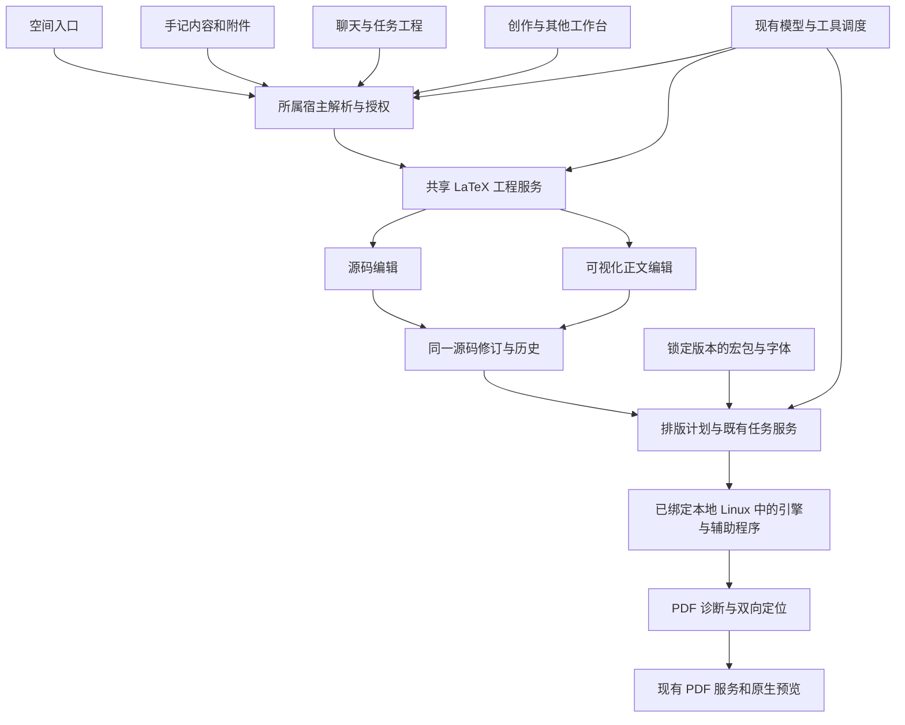

# Floe LaTeX 工作台预研发方案

日期：2026-11-08。状态：共享模块、原生双模式工作台、工程事务与历史、文献及模型适配已实现；独立 iPad 宿主与相关测试已有通过证据。主 App 入口及真实 Linux 全引擎验证仍待完成。

采用原生编辑界面、共享文档核心与统一排版服务。正式模块通过 App 现有、明确绑定任务的本地 Linux 环境和 `exec.shell`／jobs 调用完整 TeX 工具链；原生 Tectonic 实验已隔离。完整目标仍覆盖 LAT01–LAT14，先完成功能与全 App 接入，再做界面优化。

**已核实的许可调整：** Tectonic PDF 后端含 GPL 源码，不能依据其根 MIT 标签直接链接主 App。`FloeLaTeXKit/Package.swift` 不含原生二进制 target，实验放在独立 `Native/Experiment` 包。自有源码继续采用仓库 MPL-2.0；独立环境程序及字体／宏包保留各自条款。详见 [第三方清单](../FloeAgent/Modules/FloeLaTeXKit/THIRD_PARTY.md)。

## 1 已确认的产品决定

| ID | 决定 |
| --- | --- |
| LQA01 | 空间提供主入口，编辑组件、工程、排版、预览和模型操作服务供整个 App 复用。 |
| LQA02 | 长期只做个人与 AI 工作台，不做真人多人实时编辑、协作账户或共享权限系统。个人历史、差异、撤销和多窗口冲突处理仍在范围内。 |
| LQA03 | 源码和可视化写作都是完整主模式，随时切换；可视化正文旁显示最终 PDF，由模板管理成稿版式。 |
| LQA04 | 优先本机运行和苹果原生能力；资源准备好后可离线排版。远程编译不是基础能力的前提。 |
| LQA05 | AI 在已有任务授权内直接修改、排版和修错，保留差异、历史和撤销；不为普通编辑增加逐次确认。 |
| LQA06 | 项目归属随实际来源保留：空间工程归空间，任务产物跟随任务，手记内容留在手记。跨入口访问不自动搬迁或复制原件。 |
| LQA07 | 苹果合规是架构条件；引擎、宏包、字体、脚本和原生辅助程序分别处理。 |
| LQA08 | 引擎、资源安装及依赖策略由工程调研确定，不要求用户选择解释器或判断技术合规。 |

## 2 当前源码和可复用能力

调查基于 `main` 的 `c326895ebc6e15fb3eb1c06d192abb77f76f4f29` 及 2026-11-08 实际工作树。这是初始接入调查快照。工作树仍有其他任务的改动；当前 LaTeX 已接入下述 App 入口，实际编译与使用证据单独记录。

| 已有能力 | 实际入口 | 接入要求 |
| --- | --- | --- |
| 空间持久文件库、工程清单、恢复与回收站 | [PersonalContentLibrary.swift](../FloeAgent/FloeApp/Space/PersonalContentLibrary.swift)，`PersonalContentKind` 第 7 行、原子工程创建第 133 行 | 增加 LaTeX 工程类型、创建/导入和文件预览；库的组织目录不能成为任务执行权限。 |
| 各专业编辑器的承载入口 | [PersonalContentEditor.swift](../FloeAgent/FloeApp/Space/PersonalContentEditor.swift)，`LoadedContent` 第 42 行 | 接入独立 LaTeX 会话，保持外层分栏稳定，按同一保存/返回路径关闭。 |
| 原生作品与助手的访问关系 | [StudioDocumentAccess.swift](../FloeAgent/FloeApp/Space/StudioDocumentAccess.swift)，第 9、34、61 行 | 复用原生授权绑定。当前解析入口面向空间文件库，任务工程和手记附件须通过所属宿主解析，不能全部强行归入空间。 |
| 作品工具、修订读回及写入校验 | [StudioAgentTools.swift](../FloeAgent/FloeApp/Space/StudioAgentTools.swift)，`location` 第 125 行、`read` 第 166 行、`edit` 第 264 行 | 复用当前任务身份和授权检查；LaTeX 模块补齐自身多文件事务及预期修订检查。 |
| 当前作品的运行上下文 | [StudioWorkContext.swift](../FloeAgent/FloeApp/Space/StudioWorkContext.swift)，第 10 行 | 向模型提供捕获的项目引用及可用工具，不能用全局当前选择替代本次运行的绑定。 |
| 手记文件附件和工具链 | [NotesAgentTools.swift](../FloeAgent/FloeApp/Notes/NotesAgentTools.swift)，附件工具注册第 250 行 | 通过手记宿主管理工程附件、公式片段及导出引用；编辑状态和助手会话保持独立。 |
| 后台任务提交与取消 | [BackgroundJobService.swift](../FloeAgent/Sources/FloeExecution/BackgroundJobService.swift)，`submit` 第 157 行、`cancel` 第 605 行 | 原生排版适配到既有服务生命周期，保留来源、任务、环境及取消边界；不能以模型参数伪造原生任务来源。 |
| PDFKit 串行访问和异常转换 | [PDFKitAccess.swift](../FloeAgent/FloeApp/Files/PDFKitAccess.swift)，第 11、31 行 | 最终 PDF 的读取、绘制和检查继续经过现有保护入口。 |
| 公式小图预览 | [FloeDiagramKit/Package.swift](../FloeAgent/Modules/FloeDiagramKit/Package.swift)，第 19 行的 SwiftMath；[NativeRenderer.swift](../FloeAgent/Modules/FloeDiagramKit/Sources/FloeDiagramExchange/NativeRenderer.swift) | 可以评估复用公式的即时编辑反馈；整篇论文仍须由真实 TeX 引擎排版。 |

初始调查时，上述 App 入口尚无 LaTeX 工程链；本轮已新增共享 `Modules/FloeLaTeXKit`、`Qualification/LaTeX`，以及主 App 的 `Space/LaTeX` 原件、会话、排版和授权接线。`OfficeFormulaVerification.swift` 处理电子表格公式缓存核验，与 LaTeX 论文排版是不同能力。

## 3 推荐的共享架构

已新增 `FloeAgent/Modules/FloeLaTeXKit/`，按数据核心、源码解析、资源管理、排版后端、文献、原生界面和独立宿主适配划分 target；正式包只提供一个共享动态产品，避免重复链接服务和全局状态。依赖方向为 UI/集成调用共享服务；排版核心不引用 `AppEnvironment`、空间单例或某个具体聊天视图。

工程引用携带稳定 ID、所属宿主、相对位置和内容修订。所属宿主解析实际目录与访问权；模型不能提供任意绝对路径来获得权限。执行操作另行携带真实任务及环境绑定，目录位置与执行环境分别解析。工程共享不意味着选区、滚动、撤销栈和助手会话共享。

源码工程是权威内容。项目设置保存主文件、引擎配置、资源快照、字体清单和生成规则；私有任务授权、钥匙串引用等不进入可交换工程。可导出标准 `.tex` 多文件 ZIP，不把用户锁在 Floe 专用格式中。

## 4 原生引擎路线与实际发现

### 4.1 推荐顺序

| 路线 | 已核实的基础 | 推荐用途与尚需完成的工作 |
| --- | --- | --- |
| Tectonic 的 XeTeX 实验 | 固定 `0.17.0`／`8c0126a9653239a2e6e0a5274af9b8510f643030`；已完成 arm64 iOS／Simulator 编译、实际 PDF、BibTeX、定位、取消与恢复 | 仅保留为隔离实验。GPL／LGPL 依赖不能用 C ABI 或动态产品名称消除，不进入正式 App 原生依赖图。 |
| 独立 Linux TeX Live 工具链 | 已实现固定 worker、现有 `exec.shell`／jobs 传输适配和真实版本探测合同 | 当前正式路线。使用本任务明确绑定的本地 Linux，按各工具原许可独立运行；独立 Debian 13 ARM64 中四种引擎、Biber、索引／词汇表、宏包及离线样例均已验证；仍需区分主 App 的实际绑定环境与独立验证环境。 |
| 浏览器/WASM 引擎 | SwiftLaTeX 有 pdfTeX/XeTeX 的本地 WebAssembly 路线，项目主许可为 AGPL-3.0 | 保留为比较和兼容性研究对象，主界面优先原生。其许可、完整功能和资源边界需独立评估。 |
| 自写完整 TeX 排版引擎 | 需要重现宏展开、字体、断行、分页、输出及宏包兼容 | 不作为推荐实现路线。自研重点放在编辑、调度、资源、授权和宿主适配。 |

来源：[Tectonic 官方说明](https://tectonic-typesetting.github.io/en-US/)、[发行版](https://github.com/tectonic-typesetting/tectonic/releases/tag/tectonic%400.17.0)、[iOS lib-tex](https://github.com/holzschu/lib-tex)、[SwiftLaTeX](https://github.com/SwiftLaTeX/SwiftLaTeX)。

### 4.2 不能直接照搬的部分

- Tectonic 当前源码的 CoreText 桥接模块以 `target_os = "macos"` 为条件；有 macOS 支持不代表已经完成 iPadOS 支持。[源码](https://github.com/tectonic-typesetting/tectonic/blob/d2224d9ba4185f952fd3d982eccd1f444dbdf895/crates/mac_core/src/lib.rs)
- 其桌面驱动使用 `Command::new` 启动外部工具与 shell，Biber 也通过外部程序调用。因此 iPad 后端应调用引擎库并接入受控服务，不能把桌面命令行启动逻辑原封搬入 App。[驱动源码](https://github.com/tectonic-typesetting/tectonic/blob/d2224d9ba4185f952fd3d982eccd1f444dbdf895/src/driver.rs)
- XeTeX 适配持有全局锁以保护静态状态。原生运行器必须序列化相同引擎的工作，验证失败后的复位、重入和取消；仅调用 Swift `Task.cancel()` 不足以证明 C/Rust 排版已经停止。[引擎源码](https://github.com/tectonic-typesetting/tectonic/blob/d2224d9ba4185f952fd3d982eccd1f444dbdf895/crates/engine_xetex/src/lib.rs)
- a-Shell 当前清单里的部分 TeX 原生依赖指向 `texlive-2022`。本轮实际下载并核对其中的 `bibtex.xcframework.zip`：142,742 字节，SHA-256 与清单的 `70b0608f634e3f7cbac88b8623d28e98113d67c8d5052abefd26e92544c59b80` 一致。其清单只列出 arm64 iOS 真机和 x86_64 模拟器，缺少 arm64 模拟器。该事实仅针对抽查的 BibTeX 包，不外推其他包的架构。[参考清单](https://github.com/holzschu/a-shell/blob/b596fda12e4e67cc0bd360ad0e353edd5ff7fa80/xcfs/Package.swift)

原生实验已完成关键工程验证，但许可核查改变了正式选择：保留原生 UI／存储／预览，排版通过现有本地 Linux 的独立 TeX 工具链执行。实验成功不能代表正式引擎已交付，也不能代表 pdfLaTeX、LuaLaTeX、Biber 或 Apple 审核已通过。

## 5 完整功能清单

以下均为交付目标。分阶段用于建立依赖和验证顺序，不把高级能力从完整范围中删除。

| ID | 能力 | 完成证据 |
| --- | --- | --- |
| LAT01 | 多文件工程、主文件识别和选择、目录、重命名、搜索、拖放、图片/字体/数据资源、ZIP 与系统文件导入 | Overleaf 导出的标准工程可导入；相对路径与大小写保留；导出后可用匹配的桌面工具链构建。 |
| LAT02 | 源码高亮、缩进、折叠、补全、片段、括号匹配、项目搜索替换、定义/引用跳转、大文件编辑、外接键盘与中文输入 | 多文件跳转准确；中文组合输入不被重绘破坏；编辑和保存无丢失。 |
| LAT03 | 可视化段落、标题、列表、样式、链接、脚注、公式、定理/证明、图片与题注、表格、引用 | 修改落到对应源码范围；切换模式、关闭重开和撤销后内容一致。 |
| LAT04 | PDF 分栏、缩放、搜索、页码、选区检查、源码/正文到 PDF 及反向定位 | 同一构建的源图映射与 PDF 配套；旧构建不会定位到新修订。 |
| LAT05 | XeLaTeX、LuaLaTeX/LuaHBTeX、pdfLaTeX，以及传统 LaTeX→DVI/PDF 兼容路径 | 按引擎分别记录能力、资源版本及典型工程结果；不静默换引擎后声称原引擎成功。 |
| LAT06 | 自动多轮排版、辅助文件依赖、缓存、失败日志、取消、离线、前后台恢复和磁盘不足处理 | 自动编号与引用收敛；保留最后成功的 PDF；失败/取消不损坏源文件。 |
| LAT07 | 宏包检索、依赖解析、版本锁定、缺失资源处理、校验下载、离线资源准备和字体管理 | 同一工程可重现资源集合；取消下载可恢复；受引用资源不被误删。 |
| LAT08 | BibTeX/BibLaTeX 与 Biber、文献库编辑、引用键补全、格式选择、重复/缺失引用检查 | 文献正确生成、中文及 Unicode 排序核对；匹配 Biber/BibLaTeX 版本；来源记录和真实引用可追溯。 |
| LAT09 | 学术论文、毕业论文、报告、书籍和 Beamer 模板；学校/期刊自定义 `.cls/.sty` | 模板预览与真实构建一致；模板来源和许可可查；自定义模板原件保留。 |
| LAT10 | AMS 数学、中文、长表格、TikZ/PGFPlots、化学公式、代码高亮、索引、词汇表与缩略词 | 各类真实工程分别排版；需要辅助程序的功能有实际调用及输出证据。 |
| LAT11 | 拼写、字数、静态检查、格式化、差异、未定义引用、溢出和缺字诊断 | 报告定位到源码；格式化可以撤销；视觉问题检查不以进程退出成功代替。 |
| LAT12 | 自动保存、历史版本、人工/AI 修改分组、单次撤销、版本比较、冲突恢复、多窗口和系统文件协调 | AI 与人工并发修改产生明确冲突；取消、崩溃恢复与磁盘不足保留原件。 |
| LAT13 | 最终 PDF、源码 ZIP、投稿资料、文献与图片资源导出；手记/聊天/创作嵌入公式或页面片段 | 片段关联原工程/修订；任务产物与个人原件的生命周期分别核验。Word/Markdown 转换注明保真范围，不承诺任意格式往返无损。 |
| LAT14 | 全 App 模型发现、读取、定位编辑、资源诊断、排版、状态/取消、PDF 检查、修错、历史和导出 | 真实模型经既有工具链完成“导入→修改→排版→检查 PDF→保存→重开”；无界面时仍能完成授权操作。 |

全文工程是持久对象；公式和页面片段是可复用产物。手记、Canvas、聊天和其他专业工作台按实际用途选择嵌入片段、引用工程或打开完整编辑器。

## 6 双模式的保真设计

源码文件、注释、自定义命令和项目资源始终保留。可视化编辑使用带源范围的结构树，局部修改回写对应范围；不把整篇工程转换成富文本再反向重建。源码模式和可视化模式操作同一修订链，撤销按一次用户/AI 操作分组。

原生可视化层先完整覆盖表格 LAT03 所列论文结构，再按宏包扩展可视化适配器。对于无法理解的自定义宏或环境，显示保留原文的可编辑源码片段及对应预览，通过源码入口继续精细编辑。任何适配器都不能静默丢弃、改写或猜测未知宏的意义。

这是一项实际技术边界：tree-sitter-latex 自身说明采用尽力解析，无法处理所有 TeX 构造；unified-latex 也说明复杂宏重定义会超出其假设。它们可作为解析参考或增量语法组件，不能单独证明任意工程可完整可视化编辑。[tree-sitter-latex](https://github.com/latex-lsp/tree-sitter-latex)、[unified-latex](https://github.com/siefkenj/unified-latex)

公式小预览用于输入反馈；右侧最终 PDF 始终来自真实排版服务。快速预览不替代真实字体、分页、交叉引用或宏包验证。

## 7 工具链与资源管理

### 7.1 引擎、宏包与二进制分别管理

| 类型 | 建议处理 |
| --- | --- |
| 原生引擎、链接库和必要辅助程序 | 只有依赖闭包满足既定分发条件时才能进入 App 编译签名。本轮原生 TeX 实验已排除；正式引擎在既有本地 Linux 环境独立安装／运行，不下载并加载新 App 原生插件。 |
| `.tex/.sty/.cls` 等可解释宏源码 | 按文档排版用途建立受控资源目录，记录版本、依赖、来源和许可；用户可查看工程使用的宏定义。涉及脚本和系统能力的依赖需继续分类。 |
| 字体、图片、文献数据和模板内容 | 使用现有下载与文件服务管理，按需准备并提供离线资源集合；核对实际内容和许可。模板里附带的脚本不因属于模板就自动受信任。 |
| `.fmt` 等引擎格式缓存 | 优先由对应内置引擎生成，绑定引擎/资源版本；缓存失效可重建，不能把任意外来格式快照当作通用安全资源。 |
| Lua、Perl、Python 依赖与外部工具 | 逐项决定固定内置适配或既有本机 Linux 环境补充路径；原生运行时/扩展不得借资源下载临时加入。 |

TeX Live 本身同时包含宏、字体、脚本、原生程序及文档；资源管理应识别文件角色和依赖闭包。[TeX Live 指南](https://tug.org/texlive/doc/texlive-en/texlive-en.html)

引擎与资源采用匹配快照。需要保存资源清单、哈希、引擎版本、字体身份和依赖状态；自动更新不改变现有工程锁定的构建输入。不能只扫描 `usepackage`：模板、宏动态读文件、字体映射和辅助程序都可能带入依赖，必须结合包元数据、实际文件解析及构建诊断。

当前安装体验目标为在既有本地 Linux 中准备匹配的 TeX Live 与基础资源，额外资源沿用该环境包管理及受控下载路径，允许主动准备完整离线集合。资源大小以清单和压缩/展开实测决定；旧原生包的下载大小不能代表最终 App 或完整离线资源体积。

### 7.2 辅助功能要形成真实闭环

| 功能 | 实现要求 |
| --- | --- |
| 多轮构建及依赖 | 原生构建计划读取引擎输出与依赖，按辅助文件变化重跑，检测不收敛。兼容常用 latexmk 工作流时单列行为测试，不能仅把循环重跑命名为完整 latexmk 兼容。 |
| 文献 | 固定 worker 已按实际 `.aux`／`.bcf` 分别调度 BibTeX／Biber；正式工具独立运行于已绑定环境。仍需真实文献、Unicode／排序结果与 Biber/BibLaTeX 版本匹配验证，不能将合成协议测试算作已完成。 |
| 索引、词汇表 | makeindex 及对应生成流程；复杂词汇/排序需求按实际后端实现和报告。 |
| 代码高亮 | minted 需要 Python 侧组件；评估固定内置服务，或经已有 `exec.shell`/jobs 走用户解析的本机 Linux 环境。保留明确的原生可用范围和失败提示。 |
| 绘图和转换 | TikZ/PGFPlots 的引擎内功能与依赖外部绘图、EPS 转换、外部化缓存的功能分别注册和验证。 |
| 检查、格式化、字数、差异 | 提供相应服务；采用 ChkTeX、latexindent、TeXcount、latexdiff 等时，分别审计源码/原生依赖及调用边界，不能只声明工具名。 |

Biber 官方说明其 Perl 实现及平台二进制发行；minted 的分发包含 Python 组件。[Biber](https://ctan.org/tex-archive/biblio/biber/base?lang=en)、[minted](https://ctan.org/tex-archive/macros/latex/contrib/minted?lang=en)

基础论文写作优先本机完成；原生编辑器调用明确绑定的本地 Linux 工具链。额外用户脚本同样只复用现有环境与任务服务，携带真实 `environmentID`；不增加 LaTeX 专用任意 Python/JavaScript/Perl 执行工具，不回退宿主解释器。资源不可用、依赖未实现和远程未配置是不同状态。

## 8 模型调用和运行契约

模型使用同一套项目服务；空间、手记和任务助手都经各自宿主提供原生项目引用。建议工具动作覆盖：

| 动作组 | 操作 |
| --- | --- |
| 工程 | 创建、导入、列文件、读取源码/结构、选择模板和主文件、查询实际能力。 |
| 编辑 | 按源码范围或可视化对象修改、管理文件/图片/表格/公式、维护文献与引用；写入附预期修订和幂等请求身份。 |
| 排版 | 检查资源、生成构建计划、启动、查询状态、取消、取结构化日志与诊断。 |
| 检查 | 按构建 ID 读取 PDF 文本、页面图、定位和布局信息，检查引用、缺字、溢出及图表。 |
| 历史与输出 | 查看差异、撤销、恢复版本、保存、导出 PDF/源码/片段，并读回持久结果。 |

最终工具名称、注册和检索沿用现有目录规范；编辑器内助手与普通任务不能注册两套互不相通的执行实现。资源准备复用既有下载/包管理边界，不另造通用语言安装器。

每次构建固定源码快照和资源快照，返回构建 ID、来源修订、引擎、诊断、PDF 与定位文件的身份。用户在排版中继续编辑时，完成结果标注其对应修订；旧结果不得覆盖新内容或伪装成最新预览。

引擎读取和辅助处理限定于获准工程及资源。导入内容、宏包和编译日志都不是授权来源。AI 普通修改、修错和重排版沿用任务授权；外部发送、远程执行等继续使用现有规则。临时聊天保留原有只读上限。

排版失败保留上一次有效 PDF 和本次原始诊断。取消需得到原生引擎或所用执行环境的停止确认；释放文件租约、删除环境和清理工作目录之前必须停止所属工作。Swift 取消、界面关闭和原生计算停止分别验证。

## 9 苹果合规与分发约束

苹果当前开发者协议 3.3.1 B 对解释执行代码作出有条件的允许：不能偏离 App 宣传用途，不能绕过签名或沙箱，也不能成为其他 App 的分发商店；App Review 2.5.1/2.5.2 仍要求公开 API、自包含和功能边界。两者需要同时满足。由此推导，限定于文档排版的宏源码可以作为研究路线；具体下载目录、脚本能力与审核说明仍须按实际实现核查。[开发者协议](https://developer.apple.com/support/terms/apple-developer-program-license-agreement/)、[审核规则](https://developer.apple.com/app-store/review/guidelines/#software-requirements)

实施约束如下：

- 正式包不链接隔离的原生 TeX 实验；未来任何原生引擎和库均需满足既定许可并随 App 签名，使用公开 API，不依赖 JIT、下载后执行的原生插件或私有进程启动机制。
- 自写解释器、WASM、把脚本改名为资源、把模板装进 ZIP，均不能自动改变其审核性质。按实际代码行为分类。
- 任意 shell escape、Lua 的原生模块加载、跨项目文件访问及脚本网络访问，须由受控引擎接口封闭；需要的固定排版辅助功能通过已登记服务调用，不把 App 内部权限交给文档。
- 同一 App 容器包含其他用户文档与凭据，系统沙箱不能替代引擎的项目级输入输出限制。不能只靠扫描危险命令或检查文件名后缀防护。
- 针对无限宏展开、超量输出和原生内存分配设置可验证的边界；进程内引擎的崩溃与取消风险要实测，不假定 iPad 有桌面式独立进程隔离。
- 第三方 AI 获得论文内容时沿用宿主现有隐私披露和必要授权；本机排版与云端模型调用分别说明。
- 保留引擎、依赖、字体、模板和宏包的许可、来源及所需源码材料。Tectonic 主许可为 MIT，其上游组件有多种许可；不能由主仓许可推断所有依赖均可直接分发。[Tectonic 许可](https://github.com/tectonic-typesetting/tectonic/blob/d2224d9ba4185f952fd3d982eccd1f444dbdf895/LICENSE)

审核材料说明固定排版用途、引擎内置方式、宏包/脚本边界、用户源码可见性和项目输入输出限制，提供可运行样例。上述为设计约束和待验证条件，实际审核通过另行记录。

## 10 实施阶段和验收

| 阶段 | 独立产出 | 对应验证 |
| --- | --- | --- |
| L0 原生内核验证 | 最小 Apple 引擎桥接、资源快照和实际 PDF；确认完整引擎组合与辅助程序方案 | arm64 iOS 与 arm64 Simulator 实际对象编译；英文/中文/公式/文献工程；连续重入、取消、超限、原始失败及许可清单。 |
| L1 工程与编辑核心 | 多文件存储、快照、局部编辑、历史、事务、源范围与结构模型 | 注释/自定义宏/文件名往返；冲突、恢复、迟到回调、原子保存、ZIP 路径和资源限制。 |
| L2 原生工作台宿主 | 源码/可视化完整主模式、PDF 分栏、结构编辑、模板与文献操作 | 固定复用 iPad Simulator 的实际输入、切换、预览定位、保存重开和紧凑界面；不创建新设备。 |
| L3 完整工具链 | 补齐 LAT05–LAT11 的主要引擎、文献、宏包、字体和辅助处理 | 各后端真实文档输出；匹配资源版本、离线重跑、缺失包、下载取消与外部依赖路径。 |
| L4 全 App 与 AI 接入 | 空间、手记、聊天/任务和创作调用同一模块，完成模型端到端操作 | 同来源归属、不同会话隔离、真实能力发现、AI 编辑→排版→检查→保存→重开；不能用组件宿主代替全 App 证据。 |
| L5 完整目标核验 | LAT01–LAT14 逐项证据、已知限制、恢复与用户验收材料 | 针对本轮改动的本地构建、行为测试和实际界面；符合当时明确授权的发行范围。 |

每个阶段交接包含源标识、实际命令/结果、精确产物、尚未验证事项和恢复材料。相关构建与模拟器使用串行资源；共享缓存按实际后续用途保留。Swift 6 修改需要实际对象编译；本轮调研文档检查不触发 App 全套构建。

首个组件样例应同时验证英文数学论文、中文多文件论文、带 Biber 的文献工程、TikZ/表格/图片工程及含未知自定义宏的往返工程；在对应边界补充取消、缺包、格式错误和保存冲突。最终 PDF 页图、文字、编号和引用需要检查，退出码成功只是其中一项。

## 11 当前实现与证据边界

| 范围 | 已完成 | 仍需完成 |
| --- | --- | --- |
| LAT01／LAT12 工程与恢复 | 多文件／目录、原子事务、CAS、幂等回放、源快照、历史恢复、ZIP、路径／符号链接／大小限制；35 项相关核心／解析／构建／协议测试通过 | 全 App 多窗口、实际磁盘不足和宿主生命周期验收；拖放及更广泛的 Overleaf 工程兼容 |
| LAT02／LAT03 双模式 | 原生源码高亮、缩进、注释、命令／引用键／标签补全；富文本段落／标题／摘要／列表、公式、普通表格、插图、文献、论文信息；未知结构保留源码；实际连续输入与保存重开通过 | 源码折叠、复杂表格与环境适配、外接键盘和多窗口交互验收 |
| LAT04／LAT06 排版服务 | 同修订 PDF／SyncTeX、保留上次成功结果、实际取消等待、未知 worker 保留快照并阻止重复运行、失败日志与分段产物读回 | 主 App 已接受保护 PDF 预览、源码／PDF 双向定位和真实 run／jobs 所属关系，仍需实际 App 交互、前后台及进程恢复验收 |
| LAT05／LAT08／LAT10 工具链 | 真实 Debian 13 ARM64 中 11 个样例通过：四种引擎、中文、嵌套文件、BibTeX、Unicode Biber、索引／词汇表／术语表、TikZ／PGFPlots、化学、长表、Beamer 及离线；9 项 worker 合同与 4 项最新传输合同通过 | 主 App 实际绑定环境复验；更复杂学校／期刊工程、代码高亮和外部化等辅助流程；独立 VM 不代表 App 已接通 |
| LAT07 资源 | 校验目录、依赖排序、哈希／大小校验、固定版本记录与资源分类 | 主 App 已有检查及安装常用／完整 TeX Live 的固定操作，复用现有 Linux exec.shell／jobs；仍需实际 App 安装交互及更完整的资源目录 UI |
| LAT09 模板 | 论文、中文、毕业论文、报告、书籍、Beamer、绘图共 7 种；隔离原生实验各自生成 PDF，缓存资源后离线重跑成功 | 正式 Linux 工具链复验及学校／期刊模板兼容 |
| LAT11 诊断 | 源范围、缺失／重复引用、日志定位、项目搜索替换、行差异、溢出警告、中文／词数及公式／图表的估算统计 | 外部静态检查／TeXcount／格式化工具的真实环境调用与用户入口 |
| LAT13／LAT14 宿主与模型 | `latex.create/inspect/edit/typeset/restore/export`；真实原始参数授权绑定、租约接口和共享服务；先前 3 项授权／只读／终止判定测试通过，新增授权与 App 契约单独验收 | 空间模板／导入／文件菜单、任务产物返回、手记自有论文列表及 Notes scope 已接入源码；本轮冻结接线已通过主 App 及定向 unit／UI runner 的本地 object／link 构建；8 项新增契约已编译、尚未执行，真实模型完整闭环与片段嵌入尚待验收 |

独立 iPad 宿主已通过“源码输入→可视化插入公式→真实 PDF→关闭重开”，并验证真实 native PDF／BibTeX／SyncTeX／取消恢复。该宿主明确使用隔离的原生实验，不是正式 App 路线。最新增量对象构建通过；2 项实际界面测试覆盖精确补全、触控定位、摘要／正文／列表连续输入、公式、PDF 与保存重开，另有 1 项快速中英文及特殊符号输入回归通过。连续输入的旧范围与空格问题已修复，原始失败证据保留。

本轮源码位于 [模块说明](../FloeAgent/Modules/FloeLaTeXKit/README.md)、[宿主适配](../FloeAgent/Modules/FloeLaTeXKit/Integration/FloeLaTeXHostAdapter/)、[独立验证宿主](../FloeAgent/Qualification/LaTeX/)。实际命令、失败记录、源文件摘要、测试结果及截图保存在本仓库 Git-ignored 的任务证据目录，不将私有操作资料写入公开文档。最新资格使用 Xcode 27.2（27B52），对应当时 `main` 的源码和明确记录的未提交模块摘要。

正式 worker 已通过真实 Linux 文件／网络／进程隔离检查。Lua 字体数据与辅助程序的文件访问由只读工具链／源码挂载及本次输出／缓存限定，不能用单独调整 `openin_any` 代替隔离。合成私有文件和环境变量不可读，源码只读，超时／取消后观察到的进程均已退出。安装包版本、对应源码身份及原始许可单独留存；这些检查不替代主 App 授权、iPad 性能或 Apple 审核。

主 App 已接入空间／任务／手记原件、独立编辑状态、共享模型工具发现、真实运行绑定、现有授权／后台任务、文件产物回传及受保护 PDF。Notes 助手保持 notes purpose 和手记 scope，不能伪装普通任务或扩大原件权限。本轮冻结接线已通过 Xcode 27.2 的实际主 App 与定向 unit／UI runner 构建，源码和产物摘要已保存；这不等于新增测试、实际模型或 App Linux 排版已运行通过。最终模拟器验收由主线统一完成；本任务没有修改版本、签名、标签、正式审核或发布状态。
