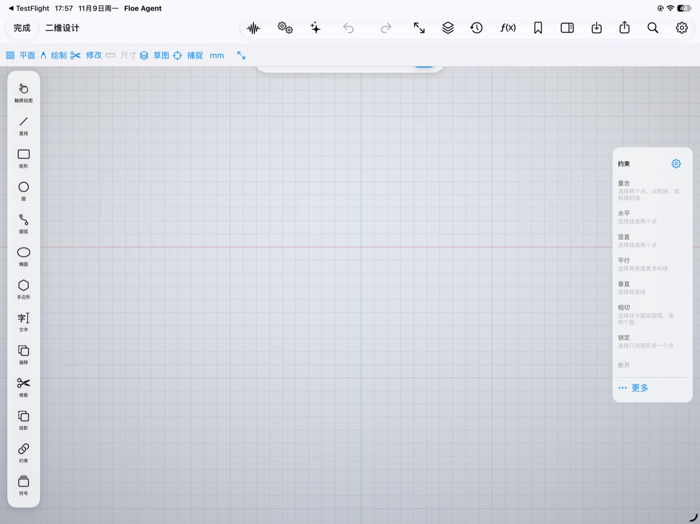

# Floe 下一轮需求问答

2026-11-09。本线程盘点需求、记录问答和当前代码证据；实施、实际 App 验收及交付由主线负责。本稿接续现有 [下一轮计划](FLOE_NEXT_ROUND_ENGINES_AND_USABILITY_PLAN.zh-CN.md)，新增编号使用 RQ，保留原 N01–N35、C01–C67 的身份和负责人。

初查基线为 `main` 的 `bd52f3cf1e19d2ec42d0896cc0c7e22cb6ee364c`。工作区有其他任务正在修改的供应商目录、发布流程及研究文档，均保留。本文的“代码确认”表示已定位当前实现，“用户报告”表示用户反馈，“待复现”表示需要主线在实际界面核对；不把源码阅读写成运行验收。

盘点期间主线推进至 `e2258aaf9ea8c1fa1bd4b56fe95cd24889a2e701`；已对照上述两点间与本稿有关的向导、供应商 UI、内容更新、音乐、手记、聊天和媒体 v2 路径，相关实现未变化。其他线程的目录数据和发布变更由原负责人继续负责。

第二轮问答开始时复核 `main` 的 `c0174f8eac887e74022c93b88fe0dc299203bfc0`，相关 iOS 功能路径没有新增差异；媒体目录／本地路由仍为 107／52，差集 55 项，聊天原生图表仍为五类。以下新增决定是下一轮要求，不代表主线已实施。

随后增量核对至 `b91f7592b7de33bf02807dfddce38bcd35fdccff`。本批新增四张手机截图、一段 4.083 秒录屏和用户上传至自有服务的 326 诊断报告；原始附件及未公开诊断仅保留在私有证据中。截图、视频观察与源代码候选分别记录，没有在用户手机操作、运行 App 或改动业务代码。LaTeX 研究文档仍由原负责人修改，本线程只更新本稿。

Git／GitHub 细化问答时，源码基线为 `09e28187ff143daed14ba21963da1ff2aac7a188`。以下补充为当前源码盘点与用户确认的下一轮范围，未修改 Git 实现，也未对任何仓库执行克隆、提交、推送或合并。

## 已确认的产品决策

| 事项 | 用户确认 |
| --- | --- |
| 工作分工 | 这里做需求问答和盘点，下一轮更新继续由主线负责。 |
| 统一风格 | 原生 iPadOS 风格；工具栏、侧栏、弹窗统一，玻璃效果适量使用。 |
| 向导主要困难 | 新用户不懂供应商、模型、密钥和环境怎么选。 |
| 向导约束 | 不引导用户去哪里获取密钥；讲清每个格子填什么，尽量减少用户必须填写的内容。 |
| 图表定位 | 原生图表是 AI 反馈内容的重要形式，要显著增强表达能力；手动编辑图表沿用 Office 的工具。 |
| 新增界面问题 | 二维编辑器顶部有条带被遮挡，右侧面板不能收起；同时检查同页菜单中的重复功能。 |
| 模型目录问题 | 远程拉取的数据更新会提示更新已有模型信息；随 App 更新带来的数据没有同样提示。 |
| 音乐工作台 | 用户明确反馈该工作台也有界面问题，MIDI 编辑功能不全；作为界面与功能两项重点继续核对。 |
| 地图核心交互 | 用户确认能打开，但平移、选择、绘制或编辑不好用，反馈为基本不可用。 |
| 地图 AI | 用户确认卡住不动发生在地图编辑器里的 AI 操作；本条不扩大为普通聊天或所有工作台都失效。 |
| 功能名称 | 地图入口／编辑界面统一叫“地图编辑器”；流程图相关入口统一叫“流程图”，纠正“地图工程”“示意图／图示”等错位名称，并检查其他异常表述。 |
| 新建文件的保存位置 | 从空间首页新建文件、选择目标位置时，应能直接创建并选中新文件夹，保留当前文件草稿。 |
| 最新版推送 | 用户报告最新版显示“此版本推送不可用”；核对实际安装版本及能力、连接、权限各阶段，不把提示本身当作根因。 |
| 审批模型回显 | 用户报告设置已保存，当前页面不立即显示新选择，退出重进才刷新。 |
| 媒体执行范围 | 第二轮确认：55 项全部纳入本轮，逐项接本地或适配的 AI 服务，不能以隐藏菜单或转为后续计划代替完成。 |
| 图表覆盖范围 | 第二轮确认：比较趋势、统计分布、金融 K 线、关系与层级、流向、时间安排六类一起纳入，列出具体图型逐项验收。 |
| 音乐扩展范围 | 完整常用 MIDI；专业制谱包含总谱／分谱、多声部、记谱排版、鼓谱、六线谱、交换及导出；DJ 为含曲库、波形、BPM／节拍、变速同步、Cue／Loop、混音及录制的双 Deck。 |
| 文档助手生命周期 | 不额外增加关闭文档按钮；按已有返回／切页动作识别离开。离开时询问继续或停止，允许记住选择。切换标签及仅收起助手侧栏均继续运行；运行进度与停止入口保持可达。 |
| 实时转写展示 | 用户选择按说话人呈现对话气泡，合并短片段；底层分段不直接变成一条条独立卡片。 |
| SQL 与闪动 | 用户报告偶发数据库错误并上传日志，附图显示 `SQLite error 4: Database is suspended`；录屏出现新建任务与作品助手之间的页面切换，另有正文位置变化。分别排查，不先认定同一根因。 |
| LaTeX 准备流程 | 按项目实际引用的依赖准备排版能力，不让普通用户在完整／精简工具链下载之间选择。 |
| PCB 元件库 | 扩充常用元件；提供可搜索、可导入的元件库，预置较大的常用库，并支持仓库中的自有元件库独立更新。 |
| 工具箱与滚动 | 文件校验缺图标；局域网发现基本不可用；部分工具界面过于简陋。新工具侧栏偶发滚动不流畅，用户补充“好像是化学编辑器”，作为优先复现对象，尚未确定具体面板。 |
| GitHub 外部反馈 | #22 Gemini 参数兼容修复纳入本轮，但用户明确不验证；#21 GitHub 链接解析纳入本轮并详细化，远程 SSH 复用现有能力；#20 维持此前不纳入内置目录的结论。 |
| 同步优先级 | 先完成已有苹果同步和配置恢复闭环；新增全量会话／作品同步、多系统重建及 S3／WebDAV 同步后端保留后续专项。 |
| 软件内 Git | 本轮先完成日常完整流程：克隆／初始化、分支、差异、暂存提交、历史、拉取推送、可视化冲突解决和失败恢复；连接支持通用 HTTPS／SSH Git 仓库，GitHub 提供原生协作。 |
| GitHub 协作 | 纳入创建／回复 issue、修改推送并创建 PR、评审 PR、处理评审意见和合并；入口为当前项目侧栏与链接详情，处理后能返回原任务。 |
| 冲突与检查 | 用户要求“可视化对照，AI 可直接辅助合并”；PR 显示检查状态、失败日志，AI 能定位修复，并接入重跑／取消。已有 Actions 能力继续复用，缺失的操作补齐。 |
| AI 工具链与目标用户 | 用户强调工具链必须完整，不能假定用户是职业开发者，多数需求由 AI 处理。本轮 Git／GitHub 的界面、工具调用、实际执行、结果回读和失败续接同时闭环；其余已纳入能力按同一标准核对。 |
| 本轮验证强度 | QA25–QA27 已确认：故障流程、改动界面和 AI 闭环实际重验；纯文案／静态映射做真实编译及必要定向组件检查。媒体 55 项／图表 40 项逐项检查组件与产物，App 按功能类别验证。外部环境可用则定向实测，缺条件明确待验，不阻塞测试候选交付。 |

### 第二轮范围决定

| 问答 | 状态 | 交接约束 |
| --- | --- | --- |
| QA01 媒体缺失的 55 项 | 已确认全部纳入 | 见 M01–M55；逐项记录实际执行路径与结果，复用既有能力，不重复造服务。 |
| QA02 AI 原生图表六类 | 已确认六类同时纳入 | 见 CH01–CH40 具体清单；显示、数据和 AI 调用逐项验收，不新增手动制图界面。 |
| QA03 完整常用 MIDI 及专业音乐 | 已确认 | 常用 MIDI 全部纳入，并按 QA04／QA05 完成制谱及 DJ；不能退回只补单音符编辑。 |
| QA04 专业制谱功能包 | 已确认 | 总谱／分谱、多声部、记谱排版、鼓谱与六线谱、交换及导出。 |
| QA05 专业 DJ 功能包 | 已确认 | 双 Deck：曲库、波形、BPM／节拍、变速同步、Cue／Loop、混音与录制。 |
| QA06 图表查看交互 | 已确认 | 点选读值、筛选、缩放、全屏、图片／PDF 导出；保留原数据分享。 |
| QA07 真正关闭文档时的助手 | 已被最新反馈替代 | 用户指出没有统一、明确的关闭动作，且不应另加关闭按钮；改按 QA10 的实际离开策略处理。 |
| QA08 仅收起助手侧栏 | 已确认 | 继续运行，保留可见进度和停止入口。 |
| QA09 返回列表但保留打开标签 | 已由 QA10 统一 | 返回列表按离开处理；切标签不中止。不能用标签缓存或视图消失自行推断停止策略。 |
| QA10 离开文档时的助手 | 已确认 | 询问继续运行或停止，允许记住选择；沿用现有返回／切页入口，不增加关闭文档按钮。 |
| QA11 转写阅读方式 | 已确认 | 按说话人显示气泡，合并连续短片段；逐字稿、时间定位及原始录音仍保留。 |
| QA12 局域网发现目标 | 已确认 | 尽可能发现同网设备，显示 IP／端口／服务，并支持手动目标补充；不只修一个 Bonjour 类型的查询。 |
| QA13 侧栏卡顿现场 | 部分回答 | 用户记得可能是化学编辑器；先核对化学侧栏，项目规模和 AI／渲染状态仍未知。 |
| QA14 GitHub #22 兼容修复 | 已确认 | 纳入本轮修复；用户明确“不验证”，不安排该项专项验证，不以实际账号／网关检查作为完成等待项；不得宣称已验证请求成功。 |
| QA15 GitHub #21 链接能力 | 已确认 | 纳入本轮，并细化仓库、分支／提交、文件、issue 和 PR 的解析、上下文、导入及返回。 |
| QA16 GitHub #21 跨端同步 | 已确认暂缓 | 采纳后续方向；最新要求先做好苹果同步，S3／WebDAV 及多系统环境重建不进入本轮。 |
| QA17 苹果同步范围 | 已确认 | 先修好已有苹果同步和配置恢复闭环；全量会话／文档／作品同步不作为本轮新增范围。 |
| QA18 配置同步故障表现 | 已提问，待答 | 区分另一设备不更新／缺字段、新设备恢复不完整，以及状态／重试不清楚；未得到具体现场前不预判根因。 |
| QA19 软件内 Git 深度 | 已确认日常完整 | 日常完整操作链纳入 RQ38；新增分块暂存、stash、revert、cherry-pick、rebase、标签管理等高级包不作为本轮新增承诺，既有能力保留。读取 GitHub 标签链接仍属于 RQ36。 |
| QA20 GitHub 协作范围 | 已确认完整协作 | 在链接读取之外，纳入 issue 创建／回复、代码修改推送、PR 创建／评审、评审意见处理及合并，详见 RQ39。软件功能范围的确认不等于授权本线程立即操作外部仓库。 |
| QA21 Git 仓库兼容 | 已确认通用 Git | HTTPS／SSH 通用 Git 仓库纳入；GitHub 提供原生 issue／PR 协作，不同时扩展 GitLab／Gitee 等平台的专有协作界面。 |
| QA22 GitHub 协作入口 | 已确认 | 当前项目侧栏＋链接详情页，回到同一任务继续处理；本轮不另建多仓库通知工作台。 |
| QA23 冲突处理方式 | 已确认 | 保留用户原意：“可视化对照，AI 可直接辅助合并”；沿任务既有授权应用解决结果，结果可查看、调整与恢复，不强迫逐个片段手动操作。 |
| QA24 PR 与 Actions | 已确认 | 显示检查状态／失败日志，交给 AI 定位修复，提供重跑／取消。复用现有作业服务；本轮不新增可视化工作流编排／部署管理。 |
| QA25 整体验证力度 | 已确认 | 故障流程、改动界面、AI 闭环实际重验；纯文案／静态映射做真实编译与必要定向组件检查。不重启全 App 全功能矩阵。 |
| QA26 媒体及图表验证 | 已确认 | 媒体 M01–M55、图表 CH01–CH40 逐项做组件／产物检查，App 按功能类别验证；逐项覆盖保留，不要求每项重复走完整 App 与云端模型流程。 |
| QA27 外部环境与交付 | 已确认 | 推送、苹果双端同步、局域网、GitHub 远端等有可用环境就定向实测；缺条件列为待验，不阻塞测试候选交付，不把未验标成可用或关闭失败。用户 iPhone 禁用作测试的既有约束保持。 |

## 已确认的需求

| 编号 | 需求 | 完成时用户能看到的结果 |
| --- | --- | --- |
| RQ01 | 修正二维编辑器顶部遮挡 | 状态文字、当前操作和完成／取消控件完整可见；顶部导航、二维工具条和画布内提示互不遮挡。 |
| RQ02 | 侧面板可收起和重新展开 | 右侧约束面板有明确收起入口和稳定的重新展开入口；收起后释放画布，不丢当前选择、工具、参数或绘图状态。其他编辑器的属性／图层／AI 面板按同一规则盘点。 |
| RQ03 | 原生界面统一 | 导航、工具栏、侧栏、检查器、弹窗、按钮、菜单、字体和间距保持一致；专业编辑功能按情境呈现，保留清楚的主编辑区。 |
| RQ04 | 同页功能去重及命名澄清 | 对每页的顶部、左右面板、底栏、更多菜单和长按菜单按实际命令对照；合并无必要的重复入口，明确名称相同但作用不同的操作。 |
| RQ05 | 设置向导易用性大修 | 每个必填项都有清楚名称、填写说明和准确校验；支持预填及复用已有配置，减少重复输入，高级设置按需展开。 |
| RQ06 | 统一模型数据更新提示 | 远程目录更新与 App 内置目录升级采用一致的差异检查及确认流程，已有模型不会因更新来源不同而漏报。 |
| RQ07 | 增强 AI 回答中的原生图表 | AI 根据数据和问题选择合适图型；覆盖金融、比例、统计、关系和层级等表达，图表与解释、数据、保存和再次打开形成完整链路。 |
| RQ08 | 补齐音乐工作台、完整常用 MIDI、专业制谱及 DJ | 音乐工作台采用统一原生界面；从实际 App 入口完成 MIDI 编辑、录制及导入导出，并完成本轮锁定的制谱和 DJ 功能包，不以预研模块存在代替可用功能。 |
| RQ17 | 修复地图编辑器核心操作 | 地图平移／缩放、要素选择、点线面绘制、节点编辑和要素移动可理解、可操作，保存重开后与实际修改一致。 |
| RQ18 | 统一地图功能名称 | 功能入口和编辑界面使用“地图编辑器／Map Editor”；地图文件、项目名称与功能名称分清，相关菜单、空态和 AI 引用同步。 |
| RQ19 | 统一流程图名称 | 用户指称的流程图入口、标题及相关操作使用“流程图／Flowchart”，思维导图、原理图和统计图仍按实际类型命名。 |
| RQ20 | 清理全 App 异常表述 | 建立统一词表，纠正错译、同物多名、内部术语、僵硬文案及与真实状态不符的提示；中英文同步。 |
| RQ21 | 修复地图 AI 工具链卡住 | 从发起、工具发现、执行到结果显示和保存各阶段都有真实状态；失败可定位原因，操作可取消、可恢复，不永久停在等待。 |
| RQ22 | 新建文件时就地创建目标文件夹 | 在位置选择器当前目录内新建文件夹，创建后可进入并选为目标，继续创建同一份文件，文件类型、名称和草稿保持。 |
| RQ23 | 核查最新版推送不可用 | 核对安装渠道及实际签名能力、系统注册／权限、服务连接、更新提醒和实际通知接收；状态准确、可恢复，相关版本确实具备其承诺能力。 |
| RQ24 | 审批模型设置即时回显 | 选择并保存审批模型后，本页立即显示真实的新值；失败显示错误并保持原值；重进及重启读回一致。 |
| RQ25 | 明确并统一文档助手生命周期 | 切换标签继续运行；离开文档时询问继续或停止并允许记住选择，沿用现有导航动作。运行归属、进度、停止及结果可找到，旧任务不串入新标签。 |
| RQ26 | 修复偶发数据库挂起错误 | 用户在前台打开／新建／切换内容时不遭遇失配的数据库挂起状态；暂停和恢复顺序正确，失败保留原件与当前上下文并可恢复，普通弹窗不直接暴露 SQL。 |
| RQ27 | 重整会议实时转写 | 按说话人显示对话气泡，合并连续短片段；实时尾句、分句、说话人、时间定位、回听、纠错和双语形成可阅读的流程。 |
| RQ28 | 修复对话页面闪动及错位跳转 | 同一作品助手的路由、标题和正文稳定；流式输出、审批、历史重载及归档刷新不把用户弹回新建任务，也不反复拉动阅读位置。 |
| RQ29 | LaTeX 按项目依赖自动准备工具 | 排版时识别所需基础引擎、宏包、文档类、字体和参考文献工具，补齐缺项后继续；普通流程不要求选择常用／完整下载档位。 |
| RQ30 | 补齐 LaTeX 预览空态与排版入口 | 没有 PDF、正在排版、失败、显示旧 PDF 及最新 PDF 的状态准确；手机独立预览里能直接执行有效下一步，不仅显示一个在当前页找不到的“排版”操作名称。 |
| RQ31 | 建立可搜索、导入及更新的 PCB 元件库 | 有足够的常用符号与封装、明确引脚映射及库来源，搜索后能预览和放入原理图／PCB；外部库导入和自有库更新保持原件与已有设计稳定。 |
| RQ32 | 工具箱图标与专业操作界面修整 | 文件校验图标在支持系统可见；各工具按实际输入、运行、结果、复用和错误恢复组织界面，符合统一原生风格，避免只有少量字段的未完成流程。 |
| RQ33 | 修复局域网发现操作链 | 可理解地选择发现范围，处理本地网络权限、扫描、取消、结果解析及后续检测；无设备、未获权限、服务不在发现范围和执行失败准确区分。 |
| RQ34 | 改善新工具侧栏滚动性能 | 优先复现化学编辑器侧栏卡顿；在实际项目、滚动／展开、画布渲染和 AI 更新下保持交互响应，任务及编辑状态不因滑动重启或丢失。 |
| RQ35 | 修复 Gemini 推理参数兼容 | 按实际配置的模型及协议传递合法推理强度，区分目录元数据与请求适配；用户要求本项修复但不验证，交接明确保留未验证状态。 |
| RQ36 | 原生解析 GitHub 链接并接入上下文／项目 | 聊天、手记和工作区能识别常用 GitHub 链接，读取对应仓库／修订／文件／issue／PR，展示来源并按用户动作接入当前上下文或原生项目，不只当普通网页。 |
| RQ37 | 完成苹果端同步，优先闭环配置 | 本机保存、排队、上传、接收、应用、即时回显、冲突与失败恢复完整；复用 CloudKit 和既有凭据同步机制。本轮先完成已有苹果同步及配置恢复，新增全量会话／作品及 S3／WebDAV 同步后续处理。 |
| RQ38 | 完成软件内日常 Git 流程 | 通用 HTTPS／SSH 仓库可导入或初始化为真实项目，完成分支、差异、暂存提交、历史、拉取推送、可视化及 AI 辅助冲突解决，状态更新与恢复完整。 |
| RQ39 | 完成 GitHub 原生协作流程 | 从项目侧栏或链接处理 issue、PR、评审意见、检查失败及合并，操作有实际远端结果，可返回同一任务继续，复用账号、Git 和 Actions。 |
| RQ40 | 完成面向非开发者的 AI 工具链 | 用户用自然语言提出目标，AI 能串起本轮纳入的实际功能；Git／GitHub 覆盖从问题理解到修改、检查、冲突、提交、协作和远端回读，普通用户无需手写命令或拼工具参数。 |
| RQ41 | 修正任务状态通知误报 | 用户追加反馈：任务已经完成，或 App 被挂起时，顶部仍可能提示任务失败。完成、真实失败、暂停／恢复与后台执行窗口结束分别按真实状态呈现；旧快照、过时通知及延迟回调不得覆盖新状态。 |
| RQ42 | 文件回收站命名及开关 | 文件里的“最近删除”统一称为“回收站”；设置提供默认开启的“使用回收站”。关闭后，文件列表删除须确认永久删除；既有回收站内容保留，仍能恢复或清理。 |
| RQ43 | 修复化学工程无法删除 | 修复文件列表删除化学工程时的 Unauthorized；沿原生会话、工作停止、原件归属和文件路径检查完成删除，不跳过安全检查。 |
| RQ44 | 回收站批量管理 | 提供全选／取消全选、多选、批量恢复及批量永久删除；确认显示数量，部分失败保留失败项和选择，支持超过一批存储事务的全选。 |
| RQ45 | 音乐与视频时间轴操作 | 修复音乐时间轴不能拖动或不符合惯例，并核查视频；播放头／标尺定位、横向滚动、双指缩放和片段移动／边缘修剪各自可用，不互相抢占手势。 |
| RQ46 | 图乐园回执、图标及模型接入 | 修复已生成图片仍报路径／大小不受支持的问题，补齐 Apple 能力图标；作为生图模型可选择，在 Foundation Model 下方提供独立自动参与开关。自动优先已配置云端；关闭开关只取消自动参与，明确指定图乐园仍可用，实际系统／设备／地区限制照实反馈。 |
| RQ47 | 工具箱浏览器去掉任务接管 | 工具箱浏览器由用户直接使用，不显示“交还给模型”“接管浏览器”或通知原任务的提示；保留标签页、下载与设置，不改变其他任务浏览器的归属或接管状态。本地服务预览遵循相同规则。 |
| RQ48 | 文件写入和编辑的原生差异预览 | 结果直接说明具体行号及增删内容，不再只能打开代码／`.diff` 附件。实际增删合计不超过 5 行时默认展开；更多改动默认显示新增／删除行数，可展开查看。展开区限高并在内部滚动，可另行查看完整差异；预览提案与已实际写入的结果分别表达。 |

RQ41–RQ48 是本轮追加项，保留此前 RQ01–RQ40、媒体 M01–M55 与图表 CH01–CH40 的原编号。定向验证覆盖异常收尾、暂停／恢复、过时通知回调、真实失败，以及文件删除、恢复、批量管理、时间轴手势、图乐园回执／路由、工具箱浏览器和文件差异呈现；不因这些追加项重启未改动的全量回归。

RQ48 的初始展开高度按 iPad 320 pt、紧凑宽度 240 pt 处理，并结合实际可用高度收缩。小改动先展示真正变更的行和必要上下文；大文件按需读取，保留原差异产物。缺少旧内容、二进制文件、未应用提案或不完整差异须如实呈现，不伪造零改动或已写入状态。既有聊天、手记助手和作品助手沿相同的工具结果组件接入。

## 二维编辑器截图与代码初查

主线复现时补记该现场对应的安装版本及构建号。

1. **打开二维编辑页：存在遮挡。** 截图顶部二维工具条下方只露出一小段白色浮条和蓝色控件。代码中的草图状态条包含状态及“完成”操作，与其形态、位置相符；具体被遮控件和布局原因仍需实际复现。
2. **使用右侧约束：缺少收起操作。** 截图右侧标题旁为齿轮；当前代码中该按钮只打开约束设置，宽屏面板没有手动折叠状态。
3. **选择绘图工具：同页多处提供相同命令。** 顶部绘制菜单与左侧工具列均提供直线、矩形、圆等。应确定一个主要操作位置；需要保留的情境快捷入口须有明确价值。
4. **结束操作和退出：名称混淆。** 画布内的“完成”结束当前绘图工具，导航栏的“完成”保存并关闭工程，不能仅按文字相同就删除其中一个。

截图保留了大面积画布及可识别的工具分组。小字号标签、密集图标、浅色的禁用说明和多条悬浮控件增加理解负担；对比度、读屏顺序、触控命中和键盘操作仍需实际界面检查，不能仅凭截图判定无障碍合规。

| 代码证据 | 当前事实 |
| --- | --- |
| [FloeCAD2DWorkbenchView.swift](../FloeAgent/ThirdParty/FloeCADKit/Sources/FloeCAD/Floe/FloeCAD2DWorkbenchView.swift) 第 11–12 行 | 二维入口复用 CAD 编辑器，并在顶部插入 `CAD2DDraftingBar`。 |
| [FloeCADEditorView.swift](../FloeAgent/ThirdParty/FloeCADKit/Sources/FloeCAD/WorkbenchUI/FloeCADEditorView.swift) 第 1683–1693、1993–2047 行 | 视口忽略安全区；草图状态与操作作为顶部 overlay。它们与外层工具条的布局关系是遮挡排查点，尚非已复现根因。 |
| [SketchConstraintRail.swift](../FloeAgent/ThirdParty/FloeCADKit/Sources/FloeCAD/WorkbenchUI/SketchConstraintRail.swift) 第 33–54、93–106 行 | 只按尺寸自动选择展开面板或紧凑菜单；齿轮打开设置，没有手动收起和恢复入口。 |
| [CAD2DDraftingBar.swift](../FloeAgent/ThirdParty/FloeCADKit/Sources/FloeCAD/Floe/CAD2DDraftingBar.swift) 第 18–34、46、56–60 行 | 顶部提供绘制／修改菜单和 `fitView()`。 |
| [ToolPaletteView.swift](../FloeAgent/ThirdParty/FloeCADKit/Sources/FloeCAD/WorkbenchUI/ToolPaletteView.swift) 第 155–167、609–636 行 | 左侧提供绘图及约束菜单，与顶部绘图和右侧约束存在操作重叠。 |
| [FloeCADEditorView.swift](../FloeAgent/ThirdParty/FloeCADKit/Sources/FloeCAD/WorkbenchUI/FloeCADEditorView.swift) 第 835–863、2324–2328 行 | 草图“完成”取消当前工具；顶部另有 `fitView()`，与二维工具条的适应图纸为同一命令。 |
| [PersonalContentEditor.swift](../FloeAgent/FloeApp/Space/PersonalContentEditor.swift) 第 234–237、382–400 行 | 外层“完成”保存并关闭工程，与草图“完成”含义不同。 |

RQ01／RQ02 的主线验收应覆盖 iPad 横竖屏、分屏／窗口缩窄、较大字体和键盘出现的布局；收起与重新展开后继续同一绘图操作，再保存重开。这里不新增模拟器运行或改动编辑器代码。

## 全 App 界面与菜单盘点范围

RQ03／RQ04 覆盖整个 App。本次截图只能确认二维页的可见问题，下表作为主线后续逐页检查的范围，不将其他页面预先认定为存在同样缺陷。

| 页面族 | 重点核对 |
| --- | --- |
| 任务首页、历史及对话 | 导航和搜索、任务菜单、输入区、工具结果卡、正文内图表及预览；同一操作是否在标题、更多和卡片上无必要重复。 |
| 空间、手记、文件及作品库 | 入口分组、新建／导入、搜索／筛选、列表与网格、单项与批量操作、最近删除；打开与返回同一原件。 |
| 二维／三维 CAD、建筑、Mesh、工程图 | 共用外层结构，按二维／三维情境呈现工具；状态、约束、对象、图层、参数及助手面板的空间分配和收起方式。 |
| 流程图、画布、地图、化学、生物及 LaTeX | 主编辑区、工具列、属性与结果、保存状态、导出和助手；避免嵌套导航和不同模块各自追加一套退出按钮。 |
| 图片／绘画、视频、音乐及会议 | 素材、时间线／播放、录音／转写、属性与 AI、导出；重要操作和结果在紧凑窗口及键盘出现后仍可达。 |
| 打印、加工、仿真及网络工具箱 | 输入准备、连接／计算、真实预览、进度、取消、结果和导出；设置图标应明确作用范围。 |
| 设置、向导、模型及资源管理 | 统一表单字段、状态、选择器、弹窗及错误位置；减少同时暴露的专业选项和重复填写。 |

去重按实际动作及上下文判断：同页重复的主入口优先合并；长按快捷项、选中对象的情境操作和不同层级的设置可以保留，但名称与作用要清楚。页内结束绘制、保存工程、关闭窗口和取消弹窗分别表达，不合成含义不明的“完成”。

## 设置向导

完整设置范围继续保留。现有代码包括模型、创作、搜索、语音、文件与环境、个性化与记忆、权限、后台、同步与存储、Skills 十组及完成摘要；已有上一步、下一步、稍后、续接和后台资源准备，应沿用这些能力改善引导。

RQ05 的填写流程要求：

- 选择现有服务类型后，预填适用的接口、协议和模型元数据；自定义接口及高级参数仍可修改。
- 明确区分必填、可选和已填好的项目；给出字段用途和输入格式，错误直接定位到对应字段。
- 复用用户已有服务、模型及已保存选择；辅助用途给出适用默认值，减少重复选择与重复填写。
- 让新用户理解主对话模型、看图／创作模型和执行环境各自何时需要；按所选用途展开相关内容，保持全部设置可达。
- 不提供获取密钥的去向、申请入口或教程。说明仅限当前字段需要什么、如何填写以及如何验证。
- 区分“设置已保存”“资源准备中”“连接检查结果”和“当前可用”；失败提供下一步操作，长下载保留进度、取消、重试和稍后继续。
- 原有已配置服务继续可用；不能以未完成向导或开发者尚未实测为由禁止用户使用。

当前代码的具体摩擦：

| 观察 | 证据及后续要求 |
| --- | --- |
| 首组即呈现多种预设、供应商、主模型、辅助模型、本机模型及系统智能选项 | [SetupGuideSections.swift](../FloeAgent/FloeApp/Onboarding/SetupGuideSections.swift) 的 `SetupChatModelsSection`。需要明确主次和填写顺序；“添加你常用的模型服务”等现有短说明不足以帮助不懂术语的新用户做选择。 |
| 向导直接打开通用供应商编辑表单 | 同文件 `ProviderEditorView(center:existing:)`；[ProviderEditorView.swift](../FloeAgent/FloeApp/Providers/ProviderEditorView.swift) 表单包含用途、服务、接口、凭据、同步、测试与模型。需要在保留真实编辑器的同时减少首次填写负担。 |
| 向导入口没有传入可更新供应商目录和刷新回调 | [SetupGuideSections.swift](../FloeAgent/FloeApp/Onboarding/SetupGuideSections.swift) 的两个供应商编辑入口；[ProviderCatalogAddView.swift](../FloeAgent/FloeApp/Providers/ProviderCatalogAddView.swift) 第 73、110 行仅在传入目录时展示目录结果及刷新。主线需核对与设置页的可选服务是否一致。 |
| 完成摘要的服务“已就绪”来自配置解析 | [SetupGuideSectionViews.swift](../FloeAgent/FloeApp/Onboarding/SetupGuideSectionViews.swift) 第 1256–1263 行；[ConversationCenter.swift](../FloeAgent/FloeApp/Remote/ConversationCenter.swift) 的 `hasConfiguredProvider` 仅判断是否能解析默认服务和模型。它不是实际请求成功证据，摘要应准确说明状态。 |

## 模型目录随 App 更新

RQ06 以用户报告为原始问题，主线需要用旧配置升级新 App 复现。当前代码已有更新提示及人工确认，应修正检测和状态衔接，复用既有流程。

| 当前证据 | 可能影响 |
| --- | --- |
| [ContentUpdateCenter.swift](../FloeAgent/FloeApp/Content/ContentUpdateCenter.swift) 的 `builtInBaselines`、`applyBuiltInBaselineTakeover`、`providerCatalogIndex()` | 内置与已安装目录有版本优先级；内置内容更新、内置基线版本及有效目录选择必须保持一致。当前工作区供应商目录正由其他任务更新，不能将其未完成状态当成最终缺陷。 |
| [ProviderListView.swift](../FloeAgent/FloeApp/Providers/ProviderListView.swift) 第 83–99 行 | 页面加载、下拉及安装状态变化会重算更新提示；随 App 升级后的重算需独立核对。 |
| 同文件第 274–281 行 | 没有旧目录签名时，直接记录当前签名并返回“无目录更新”。这是旧用户升级时漏报的一个排查点，尚未运行复现。 |
| 同文件第 308–312 行 | 打开目录审阅就记录签名并移除提示项。应区分打开审阅、取消和成功应用，避免未采用的更改被当作已经处理。 |

验收情境包括：仅内置目录更新、仅远程目录更新、两者并存且版本不同、没有旧签名的老用户、有人工覆盖字段、无实际变化以及用户稍后处理。提示需说明受影响模型和变更内容；确认后才更新适用字段，保留密钥、用户自定义接口／名称、启停、默认模型及显式覆盖。相同有效数据不反复弹窗，未处理更新可再次查看。

## AI 原生图表

RQ07 扩展回答能力，不新增手动制图工作台。模型应根据问题选型，在正文合适位置配合解释和表格展示，用户可继续用自然语言要求比较、重画或解释。

### 当前原生能力

代码确认聊天图表目前为折线、柱形、面积、饼图、散点五类。饼图已支持，但当前固定画成带内孔的环形；K 线不在现有模型工具和渲染类型中。Office 演示文稿生成另用一套图表结构，不能把其能力计入聊天原生图表。

| 环节 | 当前事实 | 下一轮应补的能力 |
| --- | --- | --- |
| AI 可生成类型 | [PresentationArtifactTool.swift](../FloeAgent/Sources/FloeExecution/Tools/PresentationArtifactTool.swift) 第 20、77–105 行：工具及类型枚举均为五种。 | 新类型同时进入模型说明、结构定义、校验和渲染，避免只有界面或只有工具声明。 |
| 数据表达 | 同文件第 21–34 行：每个点仅有字符串 `label` 和数值 `value`。 | 区分类目、数值 X、日期／时间；支持 OHLC、区间、大小等多字段数据及系列级图型。 |
| 现有散点语义 | [RichArtifactView.swift](../FloeAgent/FloeApp/Chat/Render/RichArtifactView.swift) 第 222–224 行：X 使用字符串类目。 | 支持真实数值坐标，保留数值间距，不能把数值 X 当等距类别。 |
| 比例语义 | 同文件第 219–221 行：固定内孔 0.45，负值用 `max(0, value)` 截断。 | 分清饼图与环形图；非法比例数据有清楚处理，不静默篡改数值。 |
| 数量和性能 | [PresentationArtifactTool.swift](../FloeAgent/Sources/FloeExecution/Tools/PresentationArtifactTool.swift) 第 149–155 行：最多 16 系列、合计 2000 点。 | 对金融／长时序和大数据设置明确范围，按需读取或合理聚合；不能靠取消边界获得表面支持。 |
| 查看交互 | [RichArtifactView.swift](../FloeAgent/FloeApp/Chat/Render/RichArtifactView.swift) 第 202–234 行：当前为图、图例和分享按钮。 | 补齐已确认的点选读值、筛选、缩放和原生图表全屏查看。 |
| 分享 | 同文件第 229 行只分享 `.chart.json` 数据文件。 | 增加用户能直接查看的图片／PDF 等导出，保留原数据分享。 |
| 保存和重开 | [PresentationArtifactTool.swift](../FloeAgent/Sources/FloeExecution/Tools/PresentationArtifactTool.swift) 第 184–214 行保存结构文件及引用；[RichArtifactView.swift](../FloeAgent/FloeApp/Chat/Render/RichArtifactView.swift) 第 115–150 行读回并校验。 | 复用已有保存与归属机制；扩展结构需兼容原五种和旧历史，后续 AI 重画保留可追溯原图。 |

### 图表覆盖范围

用户已确认六类全部纳入。以下把图型与变体展开为可逐项验收的 40 项；现有五类也必须通过同样链路，不能只验新增渲染。CH 编号是验收身份，不要求每项都实现一套独立引擎；相同底层能力可复用，原有图示组件也可用于 AI 回答。

| 图表族 | 具体类型及验收身份 | 必须保留的数据语义 |
| --- | --- | --- |
| 比较、趋势与构成 | CH01 折线；CH02 纵向柱形；CH03 横向条形；CH04 分组柱形／条形；CH05 堆叠柱形／条形；CH06 百分比堆叠柱形／条形；CH07 面积；CH08 堆叠面积；CH09 百分比堆叠面积；CH10 折线与柱形组合；CH11 小多图；CH12 饼图；CH13 环形。 | 分类、数值轴及时间轴明确区分；分组／累计／百分比正确，组合图的单位和轴归属可理解。饼图与环形各有正确表现，负值或不适用数据有明确反馈。 |
| 统计分布与不确定性 | CH14 直方图；CH15 箱线；CH16 小提琴；CH17 密度分布；CH18 误差棒；CH19 置信区间带。 | 频数与密度、分箱、分位数／离群值、上下界和置信含义清楚；不把原始样本、已聚合统计和模型假设混用。 |
| 金融与区间 | CH20 K 线；CH21 OHLC；CH22 成交量；CH23 均线与价量组合。 | 开高低收、日期、涨跌及成交量明确；排序与缺失时点合理，均线周期／算法有说明，不能拿一个 value 字段冒充 OHLC。 |
| 关系与层级 | CH24 散点；CH25 气泡；CH26 热力；CH27 雷达；CH28 极坐标；CH29 平行坐标；CH30 矩形树图；CH31 旭日图；CH32 关系网络；CH33 树状层级。 | 散点使用真实数值坐标；大小、颜色、维度、边权和父子关系有语义，层级和关系图能表达多个节点及连接。 |
| 变化与流向 | CH34 瀑布；CH35 漏斗；CH36 桑基；CH37 弦图。 | 增减与总量、阶段顺序、来源／目标及流量正确；非法负流量或不完整节点有明确处理。 |
| 时间安排 | CH38 时间线；CH39 甘特；CH40 日历热力图。 | 日期／时区、开始结束、持续时间、里程碑及日期聚合正确；不是把所有日期作为等距普通分类。 |

流程图、思维导图和其他工程图示仍按其真实类型命名；此处的关系网络与树状层级指 AI 回答中的数据表达，不另建手动编辑入口。新增清单外图型单独记账，不以“支持所有图”作为无法验收的无限承诺。查看交互按 QA06 已确认范围实施。

主线需要逐项确认：AI 可发现并生成的类型、真实数据字段与时间／单位语义、系列与组合、原生渲染、空数据及非法数据提示、正文呈现、保存重开、分享导出和后续 AI 修改。同一数据跨生成、显示及导出保持一致，禁止静默换成另一种图或丢弃系列。

## 音乐工作台与 MIDI

RQ08 按实际 App 入口检查，区分原生音乐编辑器、旧工作台与独立预研模块。主线接入哪套界面，就以该界面能完成的操作结项。

| 范围 | 盘点和后续完成标准 |
| --- | --- |
| 钢琴卷帘与音符 | 新增、删除、选择／框选／多选、移动、改长短、复制剪切粘贴、吸附和量化、撤销重做；操作后听到及保存的音符与画面一致。 |
| 轨道及片段 | 新建、命名、选择、移动、复制／分割／合并、静音／独奏、缩放滚动；多轨状态不混淆。 |
| 力度与表达 | 音符力度、CC 控制器、延音踏板和弯音；明确哪些能编辑、哪些仅保留导入数据、哪些会在导出丢失。 |
| 时序与 MIDI 身份 | 速度、拍号、时间刻度、通道、程序及鼓轨，跨导入、编辑、播放和导出保持正确语义。 |
| 输入与播放 | MIDI 文件导入、实时录制、回放和循环；键盘输入与录制中的音符、控制器及时间归属清楚。 |
| 保存和 AI | 关闭重开保留全部已编辑事件；AI 能读取及修改同一原件，实际修改可观察、可撤销并保存。 |
| 原生界面 | 轨道列表、时间线、钢琴卷帘、键盘、力度／控制器、检查器、播放／录制及助手合理分区；侧栏可收起，主编辑区和关键控件可达。 |

### 当前能力与具体缺口

实际入口为 [PersonalContentEditor.swift](../FloeAgent/FloeApp/Space/PersonalContentEditor.swift) → [MusicEditorView.swift](../FloeAgent/FloeApp/Space/Music/MusicEditorView.swift) → [MusicWorkbenchView.swift](../FloeAgent/FloeApp/Workbench/Music/MusicWorkbenchView.swift)，使用同一 `MusicProjectSession`。当前代码已经有乐谱、鼓机、DJ 等入口，这些入口与 MIDI 钢琴卷帘的完整性分别验收。

| 能力 | 当前代码确认 | 需求归类与证据 |
| --- | --- | --- |
| 音符基础编辑 | 有点按新增、单选、删除、拖动音高／起点、单音符力度和时长滑杆。 | 保留并实际验收；[MusicInstrumentEditors.swift](../FloeAgent/FloeApp/Workbench/Music/MusicInstrumentEditors.swift) 第 7–104 行。 |
| 多音符编辑 | 选择状态仅为一个 `selectedNote`；当前卷帘没有音符多选、框选、批量移动和音符级剪切复制粘贴。 | 补齐基本 MIDI 编辑操作。片段复制是另一层操作，不能替代音符编辑。 |
| 时长与网格 | 音符长短只用滑杆修改；卷帘网格固定为每四分音符 4 格，拖动按该网格吸附。 | 补音符边缘改长短、可选网格与自由移动。编排栏的吸附／缩放只传给 `MusicArrangementTimeline`，未控制钢琴卷帘。 |
| 量化、移调、力度和模板 | 已有片段级量化（含强度和结尾）、移调、力度增减及起步模板。 | 不重复列为未实现；[MusicEditingActions.swift](../FloeAgent/FloeApp/Workbench/Music/MusicEditingActions.swift) 第 14–32、172–210 行。多选音符后的局部处理仍需补。 |
| MIDI 导入 | 原始 SMF 文件保留；可编辑投影明确只读入音符和速度，创建轨道时统一命名 Synth 并使用默认合成器，拍号设为 4/4。 | 补导入的控制器、拍号、音轨名、程序及乐器信息和保真说明；[MIDINoteImport.swift](../FloeAgent/Modules/FloeMusicKit/Native/Sources/FloeMusicNative/MIDINoteImport.swift) 第 9–11、20–27、30–50 行。 |
| 控制器编辑 | 底层有 `MusicMIDIControllerPoint`，支持存储 CC 和弯音；当前钢琴卷帘 UI 未提供控制器编辑轨。 | 属于数据结构已有、可视编辑未闭环；[MIDI.swift](../FloeAgent/Modules/FloeMusicKit/Sources/FloeMusicCore/MIDI.swift) 第 69–105 行。控制器的通道归属也需在多通道设计中确认。 |
| 演奏录制 | 有键盘音符录制；踏板、弯音、调制当前只发给实时乐器，没有加入录制片段的控制器点。 | 补录制表达信息及重放一致性；[MusicProjectSession.swift](../FloeAgent/FloeApp/Space/Music/MusicProjectSession.swift) 第 513–557 行。实际演奏与听音未在此线程验证。 |
| 播放控制器范围 | 本机离线渲染当前只接受 CC1、CC64 和以 128 表示的弯音，其余控制器报不支持。 | UI、AI、导入和导出所宣称的控制器范围须与播放一致；[OfflineRenderer.swift](../FloeAgent/Modules/FloeMusicKit/Native/Sources/FloeMusicNative/OfflineRenderer.swift) 第 153–160 行。 |
| 速度与拍号 | 主栏有 BPM 输入，拍号只显示；底层及 AI 编辑契约有速度／拍号及完整 tempo map 操作。 | 补清楚的拍号及变速编辑入口和正确小节尺；[MusicWorkbenchView.swift](../FloeAgent/FloeApp/Workbench/Music/MusicWorkbenchView.swift) 第 165–172、282–285 行。当前编排小节刻度还按每 4 拍绘制，见 [MusicArrangementTimeline.swift](../FloeAgent/FloeApp/Workbench/Music/MusicArrangementTimeline.swift) 第 91–97 行。 |
| 编曲 MIDI 导出 | 编曲导出页提供总混音、分轨音频、工程包；没有把当前已编辑编曲导出为标准 MIDI 的选项。 | 补 MIDI 导入→编辑→标准 MIDI 导出。原始导入文件及乐谱模块导出不能替代编辑后编曲；[MusicProjectDelivery.swift](../FloeAgent/FloeApp/Workbench/Music/MusicProjectDelivery.swift) 第 82–99 行和 [MusicProjectSession.swift](../FloeAgent/FloeApp/Space/Music/MusicProjectSession.swift) 的 `exportOriginals`。 |
| AI 与保存 | `studio.edit` 的音乐契约已有原件、修订、音符与控制器点，原生会话负责提交与撤销。 | 继续用同一原件补齐新增能力；[StudioTypedEditExamples.swift](../FloeAgent/FloeApp/Space/StudioTypedEditExamples.swift) 第 73 行。本次不宣称真实模型、演奏或重开运行验收。 |

### 界面与重复入口

- 宽屏效果器检查器固定显示，当前没有单独收起开关。底部“展开或收起编辑器”只改变编排区和底部编辑区，不会隐藏右侧检查器。见 [MusicWorkbenchView.swift](../FloeAgent/FloeApp/Workbench/Music/MusicWorkbenchView.swift) 第 62–70、245–266 行。
- 宽屏同时显示编排栏和钢琴卷帘时，两处都有完全相同的 `MusicEditingActionsButton`，并复用 `music.midiTools.open` 标识。见该文件第 208 行及 [MusicInstrumentEditors.swift](../FloeAgent/FloeApp/Workbench/Music/MusicInstrumentEditors.swift) 第 22 行；应确定一个主要入口或明确上下文。
- 素材窗口和加轨菜单都能触发同一个音频／MIDI 导入；评估快捷入口价值，避免主页面堆叠入口。单音符操作、片段操作和工程操作应各归其层级，减少含糊的工具菜单。
- 外层工程导航、内部标题条、播放条、编排工具条和底部切换条叠加；底部编辑区采用固定／比例高度。主线需要从实际音乐界面核对纵向占用、文字、可点击区域、窗口缩放及键盘遮挡。本次没有音乐现场截图，不把这些代码候选写成已经完成的视觉审查。

完整常用 MIDI 已确认全部纳入：音符多选与批量编辑、力度、控制器／踏板／弯音、速度拍号、录制及标准 MIDI 导入导出。专业制谱按 QA04 包含鼓谱与六线谱；DJ 按 QA05 完成专业双 Deck 功能。现有制谱、DJ 和编排能力先复用并补通真实入口，不将它们整体误报为不存在；新增专业能力仍须分别完成实际编辑／演奏、保存重开、导出及 AI 操作链。

## 其他功能闭环盘点

以下为本次新增的代码初查项。它们与 RQ01–RQ08 一并交主线评估；标为产品问答的项目需明确预期体验，不能把当前有意限制直接当成 bug。

| 编号 | 操作链与当前缺口 | 主线后续完成标准 | 证据 |
| --- | --- | --- | --- |
| RQ09 | 手记搜索→Office 正文：能搜到，但打开后仅提示匹配位于正文，没有正文定位和高亮。 | 到达对应内容，用户能确认命中位置并继续查看上下文；有多个命中时可切换。 | [NotesRootView.swift](../FloeAgent/FloeApp/Notes/NotesRootView.swift) 第 327–355 行；[NotesDocumentEditor.swift](../FloeAgent/FloeApp/Notes/NotesDocumentEditor.swift) 第 651–653 行。 |
| RQ10 | 手记搜索→思维导图：外层仅更新节点 ID，内部画布没有接收搜索焦点的输入。 | 滚动／缩放到对应节点并清楚标识，保持当前导图及编辑状态。 | [NotesDocumentEditor.swift](../FloeAgent/FloeApp/Notes/NotesDocumentEditor.swift) 第 314–318、645–649 行；[NoteMindMapView.swift](../FloeAgent/FloeApp/Notes/NoteMindMapView.swift) 的内部 `selectedID` 与单向 `onSelection`。 |
| RQ11 | 普通聊天→存到手记：已有保存按钮和回调，但只有手记助手传入回调，普通聊天默认没有此入口。 | 用户能把选定回答存入新手记或指定已有手记，有成功反馈和打开入口；内容继续由手记独立持有。 | [AssistantMessageView.swift](../FloeAgent/FloeApp/Chat/AssistantMessageView.swift) 第 54–56 行；[ThreadDetailView.swift](../FloeAgent/FloeApp/Chat/ThreadDetailView.swift) 的 `onSaveToNotes`；[NotesAssistantPanel.swift](../FloeAgent/FloeApp/Notes/NotesAssistantPanel.swift) 第 56 行是当前提供该回调的调用处。 |
| RQ12 | 手记助手→结构化问答及丰富回答：专用目录不含 `user.ask`、`chat.present` 或原生图表生成工具。模型仍能用普通文字澄清，但没有普通聊天的这些工具入口。 | 已确认全部接入结构化提问、原生图表和交互回答，仍只操作当前授权手记，保留原件归属与执行边界。 | [NotesAgentTools.swift](../FloeAgent/FloeApp/Notes/NotesAgentTools.swift) 第 267–288 行；[ConversationCenter.swift](../FloeAgent/FloeApp/Remote/ConversationCenter.swift) 第 3882–3887 行做实际工具目录交集。 |
| RQ13 | 交互内容→继续分析／保存：失效会话的回调守卫直接返回；模块读取状态或导出失败后只显示 fallback 文案。 | 给出可理解的失败原因和有效恢复动作；过期或归属改变时提示回到原会话或重新生成，保留所有权和临时会话限制。 | [InteractiveAnswerView.swift](../FloeAgent/FloeApp/Chat/Interactive/InteractiveAnswerView.swift) 第 86–97 行；[InteractiveContentView.swift](../FloeAgent/Modules/FloeInteractiveContent/Sources/FloeInteractiveContentWebKit/InteractiveContentView.swift) 第 58–72 行。 |
| RQ14 | 图片／视频工具目录→执行：目录 107 项，本地命令路由 52 项，55 项没有本地路由；选择未接项后显示执行服务尚未接入。 | 用户已确认 55 项全部纳入本轮。逐项接本地或适配的 AI 服务，完成原件修改、撤销、预览和导出；不能改成隐藏／暂缓。菜单目录存在及“在助手中继续”不能算该项原生操作完成。 | [MediaPreparedBundledCatalog.swift](../FloeAgent/Sources/FloeWorkbench/PreparedTools/MediaPreparedBundledCatalog.swift)；[MediaV2Commands.swift](../FloeAgent/FloeApp/Workbench/MediaV2/MediaV2Commands.swift) 第 88–103 行；[MediaV2Workspace.swift](../FloeAgent/FloeApp/Workbench/MediaV2/MediaV2Workspace.swift) 第 328–339 行。本次按实际两份清单计算 107／52／55。 |
| RQ15 | 图片／视频撤销→重做：工具栏重做为空操作并永久禁用，会话只提供撤销。 | 补齐真实重做栈及 UI 状态；新编辑后的分支、保存重开和 AI 事务边界按现有原件机制处理。 | [MediaV2Workspace.swift](../FloeAgent/FloeApp/Workbench/MediaV2/MediaV2Workspace.swift) 第 98–99 行；[MediaV2Session.swift](../FloeAgent/FloeApp/Workbench/MediaV2/MediaV2Session.swift) 的 `canUndo`、`undo()`。 |
| RQ16 | 视频变速→带原声预览／导出：有变速操作，但准备视频原声时要求速度等于 1。 | 补齐变速后原声处理或提供清楚、可操作的限制；编辑可用性、预览和最终导出保持一致。 | [MediaV2Session.swift](../FloeAgent/FloeApp/Workbench/MediaV2/MediaV2Session.swift) 第 306–324 行，`clip.speed != 1` 会报 `retimed source audio` 不支持；实际文件情境待复现。 |

### RQ14 的 55 项执行清单

以下按真实目录 ID 逐项交接。该数量是媒体 v2 命令链的差集，不表示 App 其他位置都没有相关能力；可复用已有本地服务或用户已配置的适配 AI 服务。

| 编号 | 工具 | 目录 ID |
| --- | --- | --- |
| M01 | 魔棒 | `image.wand` |
| M02 | 主体选择 | `image.subject` |
| M03 | 边缘优化 | `image.refine-edge` |
| M04 | 扩展／收缩 | `image.expand` |
| M05 | 平滑选区 | `image.smooth` |
| M06 | 渐变填充 | `image.gradient` |
| M07 | 涂抹 | `image.smudge` |
| M08 | 模糊画笔 | `image.blur-brush` |
| M09 | 锐化画笔 | `image.sharpen-brush` |
| M10 | 描边与阴影 | `image.layer-effect` |
| M11 | 图像尺寸 | `image.resize` |
| M12 | 画布尺寸 | `image.canvas-size` |
| M13 | 透视变换 | `image.perspective` |
| M14 | 自由变形 | `image.distort` |
| M15 | 形状布尔运算 | `image.boolean` |
| M16 | 沿路径文字 | `image.path-text` |
| M17 | 文字转轮廓 | `image.outline` |
| M18 | 污点修复 | `image.heal` |
| M19 | 仿制图章 | `image.clone` |
| M20 | 修补 | `image.patch` |
| M21 | 对象移除 | `image.remove` |
| M22 | 移除背景 | `image.background` |
| M23 | 内容感知填充 | `image.content-fill` |
| M24 | 局部 AI 重绘 | `image.inpaint` |
| M25 | AI 扩图 | `image.outpaint` |
| M26 | 曲线 | `image.curves` |
| M27 | 色彩平衡 | `image.balance` |
| M28 | LUT 与滤镜 | `image.lut` |
| M29 | 降噪与锐化 | `image.denoise` |
| M30 | 倒放 | `video.reverse` |
| M31 | 定格 | `video.freeze` |
| M32 | 嵌套片段 | `video.nest` |
| M33 | 色度抠像 | `video.chroma` |
| M34 | 混合模式 | `video.video-blend` |
| M35 | 运动跟踪 | `video.tracking` |
| M36 | 画面防抖 | `video.stabilize` |
| M37 | 动画曲线 | `video.graph` |
| M38 | 运动路径 | `video.motion-path` |
| M39 | 动态图形标题 | `video.motion-title` |
| M40 | 动画预设 | `video.preset-motion` |
| M41 | 语音转字幕 | `video.transcribe` |
| M42 | 批量样式 | `video.caption-style` |
| M43 | 字幕翻译 | `video.translate` |
| M44 | 曲线 | `video.video-curves` |
| M45 | 色轮 | `video.wheels` |
| M46 | HSL 二级调色 | `video.video-hsl` |
| M47 | LUT | `video.video-lut` |
| M48 | 波形／矢量示波器 | `video.scopes` |
| M49 | 镜头色彩匹配 | `video.color-match` |
| M50 | HDR 与色彩管理 | `video.hdr` |
| M51 | 均衡器 | `video.eq` |
| M52 | 压缩与限幅 | `video.compressor` |
| M53 | 背景降噪 | `video.noise` |
| M54 | 旁白自动压低配乐 | `video.duck` |
| M55 | 人声分离 | `video.voice-separate` |

每项保留其适用输入、参数与实际执行结果，记录实现为本地还是适配服务。交互型工具需能直接操作当前选区／图层／片段；分析型工具需给出真实分析结果。AI 作业须绑定当前原件及修订，等待期间有真实状态，可取消、失败可重试，迟到结果不能覆盖后续编辑。需要服务配置时准确说明缺什么，复用现有配置入口；不要求开发者购买或实测所有外部账号才开放用户调用。

此前通知／后台、PCB 加工、科学引擎、LaTeX 及其他模块的原有工作继续沿现有计划和负责人推进。本次没有用旧报告替代当前实现，也没有把未做真实账号／物理设备验收列为新增缺功能。每个纳入项的闭环统一核对：入口可达、输入清楚、真实执行、可见结果、保存重开、返回原件、AI 调用及失败／取消恢复。

## 同页重复操作清单

| 页面 | 重复或混淆项 | 处理要求 |
| --- | --- | --- |
| 二维 CAD | 顶部绘制菜单与左侧工具列的直线、矩形、圆等。 | 确定主要入口，保留有实际价值的情境快捷方式。 |
| 二维 CAD | 顶部导航和二维工具条的适应视图均为 `fitView()`。 | 优先合并同屏重复命令。 |
| 二维 CAD | 左侧约束菜单与右侧约束面板的重合、水平、竖直、平行等。 | 与 RQ02 的可收起面板一起定布局和入口。 |
| 二维 CAD | 导航“完成”和草图“完成”名称相同、动作不同。 | 区分结束绘制与保存退出，保留各自作用。 |
| 音乐 | 编排栏及钢琴卷帘各有同一个 MIDI 工具按钮。 | 统一入口或明确片段与音符上下文，不保留同屏无差别重复。 |
| 手记思维导图 | 常驻快捷栏与展开头部分别提供添加子主题、添加同级主题，并复用相同标识。 | 头部展开时避免两套同时出现，折叠后保留可达入口。见 [NotesDocumentEditor.swift](../FloeAgent/FloeApp/Notes/NotesDocumentEditor.swift) 第 294–301、972–979 行。 |

不同文档形态中的同名插入菜单、互斥宽窄布局的助手按钮，不计作同屏重复；按实际同时显示的状态验收。

## 地图编辑器交互与 AI

RQ17 和 RQ21 为用户明确报告的高优先级问题。用户确认地图能打开，主要是移动、选择、绘制及编辑操作不好用；AI 卡住也明确发生在地图编辑器内。当前源码已能找到工具入口及执行链，本次未复现具体卡点，不将它们写成“功能完全没有实现”。

| 操作链 | 当前代码与排查位置 | 主线完成标准 |
| --- | --- | --- |
| 打开并选择地图工具 | [GISProjectEditor.swift](../FloeAgent/FloeApp/Space/GIS/GISProjectEditor.swift) 接 `GISEditorView`；[GISNativePanels.swift](../FloeAgent/Modules/FloeGISKit/Sources/FloeGISKit/GISNativePanels.swift) 有选择、点／线／面、节点、移动、多选、捕捉及手指绘图。 | 从空间打开实际地图，工具可找到且状态清楚；图层未选择／锁定等不能编辑的原因与处理方法可见。 |
| 导航与编辑手势 | [input.js](../FloeAgent/Modules/FloeGISKit/Web/input.js) 第 15–55 行区分鼠标、Pencil、手指与多指；[view.js](../FloeAgent/Modules/FloeGISKit/Web/view.js) 第 90–110 行接平移、选择及绘制／修改／移动。 | 手指默认导航、鼠标／Pencil 编辑、显式手指绘图开关和多指缩放各按约定工作；避免地图平移与移动要素、滚动与绘制互相抢手势；二维保持正对地图。 |
| 修改后反馈与保存 | `view.js` 用 `feature.add`、修改及移动提交回原工程；Swift 原生面板从 presentation 刷新状态。 | 选中、绘制中、完成／取消、节点变化立即可见；撤销重做、保存及重开一致，失败保留修改并解释原因。主线对照实际随 App 打包的离线资源及安装构建验证。 |
| AI 调用及归属 | [GISProductionTools.swift](../FloeAgent/FloeApp/Space/GIS/GISProductionTools.swift) 的 `gis.create/describe/query/invoke/import/export` 沿同一原件和授权会话；[ToolSession.swift](../FloeAgent/Modules/FloeHeavyEditorSupport/Sources/FloeHeavyEditorSupport/ToolSession.swift) 第 45–85 行等待引擎、执行并释放占用。 | 从地图里的助手发起一个可观察修改，实际落在同一地图；工具结果能打开／定位，并确认已保存。保持现有授权、修订和取消边界。 |
| 卡住与恢复 | [EditorController.swift](../FloeAgent/Modules/FloeHeavyEditorSupport/Sources/FloeHeavyEditorSupport/EditorController.swift) 第 147–154 行已有 30 秒就绪等待，第 185–204 行把命令串行排队，第 305–355 行执行 JavaScript 并提交；[runtime.js](../FloeAgent/Modules/FloeHeavyEditorSupport/Web/runtime.js) 第 173–199 行等待原生答复，取消当前只触发 abort／配置回调。 | 分清等就绪、排队、授权、执行、保存及回传；健康的长操作有真实进度和取消，异常等待能结束并释放占用。重点核对待答复请求、串行队列及取消传播，不能仅停止转圈或伪报成功。这些是排查点，尚非本次已复现根因。 |

地图宽屏的图层列和属性列同样纳入 RQ02：当前 [EditorView.swift](../FloeAgent/Modules/FloeHeavyEditorSupport/Sources/FloeHeavyEditorSupport/EditorView.swift) 根据 1000／1250 宽度固定展示两列，窄屏使用弹层；主线需核对宽屏收起／恢复、地图有效操作面积及窗口变化后的状态。

## 名称与普通界面文案

RQ18–RQ20 按用户确认的叫法整理，不批量改动用户自定义文件名。内部类型、工具标识、扩展名和已有原件继续保持兼容；本线程只更新需求记录。

| 对象 | 当前／用户报告的表述 | 统一方向及检查范围 |
| --- | --- | --- |
| 地图功能 | 用户报告“地图工程”；当前 [PersonalContentService.swift](../FloeAgent/FloeApp/Space/PersonalContentService.swift) 第 269 行为“地理信息／Geography”，[GISWorkbench.swift](../FloeAgent/Modules/FloeGISKit/Sources/FloeGISKit/GISWorkbench.swift) 及 [main.js](../FloeAgent/Modules/FloeGISKit/Web/main.js) 用“地理信息／GIS”。 | 功能和编辑界面统一“地图编辑器／Map Editor”；文档称“地图”，确需描述保存容器时称“地图项目”。覆盖首页、新建、文件类型、默认名称、编辑页、导入导出、助手及无障碍标签。GIS 可留在专业详情，不与普通功能名称混用。 |
| 流程图功能 | 用户报告“示意图”；当前 `PersonalContentService.swift` 第 259 行为“图示／Diagram”，模块流程模板已有“流程图／Flowchart”。 | 用户所指入口统一“流程图／Flowchart”。真实思维导图、甘特、组织结构、原理图、统计图按各自类型命名，不用全局文字替换抹平含义。 |
| 服务未支持 | “此工具的执行服务尚未接入。” | 普通界面说明“此功能暂不可用”及可行下一步；服务接线和技术原因放详情。见 [MediaV2Workspace.swift](../FloeAgent/FloeApp/Workbench/MediaV2/MediaV2Workspace.swift) 第 338 行和命令错误文案。 |
| 等待首份生成结果 | “在对话中发送请求；出现真实修订后这里立即显示预览，不展示占位内容。” | 说明用户如何发起和何时看到结果，例如“在对话中描述需求，生成后会在这里显示预览。”见 [DesignConversationPageView.swift](../FloeAgent/FloeApp/Workspace/DesignConversationPageView.swift) 的 `design.page.awaitingFirstResult.detail`。 |
| 尚不支持生成 | “当前版本尚未接入此输出类型的首个结果生成。” | 直接说暂不支持生成什么、能选择什么；保持真实能力限制。见 [DesignWorkflowPanel.swift](../FloeAgent/FloeApp/Workspace/DesignWorkflowPanel.swift) 使用的 `design.owner.generate_unavailable_not_connected`。 |
| 文件预览失败 | “此格式的查看器尚未接入／Decoder not available”。 | 中英文均说明暂不支持预览该格式并给出可行操作，去掉“接入／Decoder”之类内部角度。见 [EngineeringFilePreview.swift](../FloeAgent/FloeApp/Workspace/EngineeringFilePreview.swift) 第 1140–1144 行。 |
| 音乐及媒体保存状态 | “已保存 · r…”。 | 普通状态显示“已保存”；技术修订编号进入明确打开的版本／详情。见 [MusicWorkbenchView.swift](../FloeAgent/FloeApp/Workbench/Music/MusicWorkbenchView.swift) 第 117 行和 `MediaV2Workspace.swift` 第 97 行。 |
| 图像文档类型 | “分层原件／Layered original”。 | 按实际对象说明“分层图像”或“图像工程”；保留用户确实需要区分原文件／副本的恢复、导出语境。见 `MediaV2Workspace.swift` 第 383 行。 |

统一词表同时覆盖任务／对话、文件／文件夹／项目／作品、助手、设置、保存／完成／退出、导入／导出／分享及审批。主线按界面上下文判断，不因关键词就删除正常专业用语：图层、要素、坐标系、属性表、SQL 和建筑中的宿主墙等可以保留。普通错误应说明发生了什么及下一步；内部命令、字段、回执、事务和原始异常留在详情。涉及“已保存”“已就绪”“可用”或隐私承诺的文案，对照实际数据流和状态核对准确性。

## 新建文件的位置选择

RQ22 的目标流程是：空间首页 → 新建文件 → 选择目标位置 → 在当前目录新建文件夹 → 进入并选用新文件夹 → 创建文件。用户不需要退出新建流程去其他页面先建文件夹。

当前主线 [SpaceRootView.swift](../FloeAgent/FloeApp/Space/SpaceRootView.swift) 第 1018–1021 行在新建请求中固定目录；[PersonalContentNamingSheet.swift](../FloeAgent/FloeApp/Space/PersonalContentNamingSheet.swift) 第 54–56 行只显示位置，第 112–115 行使用该目录创建。文件库已有 [PersonalContentLibrary.swift](../FloeAgent/FloeApp/Space/PersonalContentLibrary.swift) 的 `createFolder`；[PersonalLibraryActionSheet.swift](../FloeAgent/FloeApp/Space/PersonalLibraryActionSheet.swift) 的移动／复制位置页已有新建文件夹入口。需求应沿现有目录及创建服务补齐新建文件这条路径，实际选择器以用户安装版本复现。

完成时应支持明确的新建文件夹入口、名称校验、重复名和不可写位置提示。成功后刷新目录并能直接选用；切换、返回或失败不丢文件名、类型、模板及草稿。取消文件夹命名不创建空文件夹；已确认创建的文件夹保留，不能因取消后续文件创建而被静默删除。最终文件确实保存于所选新目录，重新打开可找到。

## 推送状态与审批模型刷新

**RQ23 推送：** 原始报告为最新版显示“此版本推送不可用”。当前主线的文案包括“此安装的推送能力尚未确认”“此安装暂不能连接推送服务”等，与报告不完全一致；应先记录用户实际版本、构建和安装渠道，再核对精确产物，不能以当前源码文案改变认定现场已修复。

- [APNsSettingsView.swift](../FloeAgent/FloeApp/APNs/APNsSettingsView.swift) 第 56–66 行区分关闭、failure、未连接、通知权限及后台刷新；failure 优先显示。
- [APNsCenter.swift](../FloeAgent/FloeApp/APNs/APNsCenter.swift) 第 371–378 行分别处理未配置 transport、签名环境未知、等待系统设备登记；[APNsModels.swift](../FloeAgent/FloeApp/APNs/APNsModels.swift) 第 195–207 行还区分安装证明／渠道拒绝、服务登记和临时连接错误。
- 主线需要从实际包的推送 entitlement／签名、渠道识别、系统注册、服务登记一路核对到更新提醒与实际送达；错误原因不混报，给出适用重试或设置入口。系统允许通知、服务已连接、版本提醒可用、实际收到通知分别结算。本线程不接触用户真机或修改推送／发布配置。

**RQ24 审批模型：** 页面实际名称为“Agent 与权限”。用户确认配置已保存，但必须退出重进才显示；需求是同页立即回显新值，保存失败明确告知并保留原值，退出／重进及重启后读回一致。

[AgentPermissionsView.swift](../FloeAgent/FloeApp/Settings/AgentPermissionsView.swift) 第 17 行仅观察 `SettingsCenter`；第 48–51、142–155 行从嵌套的 `ConversationCenter` 读模型和选择并异步保存。主线需核对这个通知／观察链，而非仅确认保存函数成功；当前还未运行复现以确定根因。验证选择、切换、清空及保存失败；连续更改按最终成功选择显示，不依赖导航触发刷新，其他设置值不受影响。

## 文档助手退出、标签切换与后台运行

RQ25 覆盖手记正文、Office、思维导图及空间作品编辑器中的文档助手。用户纠正：没有统一明确的“关闭文档”动作，单独加关闭按钮也不合适；本轮沿用现有返回、完成及切页动作。QA10 已确认：助手仍在运行而用户离开文档时，询问继续或停止，并允许记住选择。多标签之间切换则继续运行，不触发离开询问。仅收起侧栏仍是独立 QA08，不把原推荐当成已批准规则。

### 行为边界

| 用户动作 | 当前产品决定 | 完成标准 |
| --- | --- | --- |
| 文档 A 切到文档 B，A 标签仍打开 | 已确认：A 助手继续运行。 | 任务及修改仍归 A；B 的助手、输入、选区和撤销栈独立。切回 A 能看到连续进度及结果，不重复发起请求。 |
| 通过现有返回／完成／切页动作离开文档；若有关闭标签动作也适用 | 已确认：运行中询问继续或停止，可记住选择。 | 用户选择后，按对应策略处理任务和原件保存，再完成导航。继续则可找到后台任务及停止入口；停止则真实终止本次运行并保留历史和已提交修改。未运行时不弹此询问。 |
| 仅收起助手侧栏，文档仍打开 | 已确认继续运行。 | 面板显示与任务运行分开；标签／工具栏保留运行状态及停止入口，重新展开接回同一任务。 |
| 返回文档列表，但保留此前打开的标签 | 已由 QA10 统一：本次离开询问继续或停止。 | 只处理本次离开所关联的助手，不能连带停止其他已打开文档的任务；标签恢复记录不代替运行选择。 |
| 弹窗、预览或布局变化暂时遮住文档 | 作为临时界面覆盖处理；不能冒充真正关闭。 | 不因编辑视图暂时移除而误停运行，也不能把它当作新开文档重新启动任务。 |
| App 暂时进入后台／锁屏 | 不等同于用户关闭文档，沿用既有后台任务机制。 | 显示实际运行、等待或中断状态；受系统限制时不伪报仍正常执行，不承诺 App 被结束后仍在本机运行。 |

### 当前代码确认

| 路径 | 已确认事实与主线排查点 |
| --- | --- |
| [NotesDocumentTabs.swift](../FloeAgent/FloeApp/Notes/NotesDocumentTabs.swift) 第 7、28–39 行；[NotesRootView.swift](../FloeAgent/FloeApp/Notes/NotesRootView.swift) 第 78–88 行 | 只有当前文档挂载编辑视图，其他标签保留导航状态；切换使用 `session.select`，关闭使用 `closeTab`。不能直接按视图消失统一取消助手，否则切标签会误停。 |
| [NotesSession.swift](../FloeAgent/FloeApp/Notes/NotesSession.swift) 第 303–340 行 | `select` 等待保存及离开检查后换文档；`closeTab` 移除标签并保存导航状态。当前两条路径没有调用文档助手停止。 |
| [NotesDocumentEditor.swift](../FloeAgent/FloeApp/Notes/NotesDocumentEditor.swift) 第 277、409、851–853 行 | 助手关闭按钮只设置显示状态；编辑视图消失保存页面与标签状态；返回手记调用 `select(nil)`。因此返回列表和关闭标签也需单独定义。 |
| [NotesAssistantPanel.swift](../FloeAgent/FloeApp/Notes/NotesAssistantPanel.swift) 第 65–98、101–118 行 | 助手会话与文档持久绑定；消失时只移除页面捕获映射，未停止模型运行。显式“重新开始”才停止旧助手并创建新会话。停止、重新开始、收起侧栏不能混作同一操作。 |
| [ThreadDetailView.swift](../FloeAgent/FloeApp/Chat/ThreadDetailView.swift) 第 317–320 行；[ThreadDetailViewModel.swift](../FloeAgent/FloeApp/Chat/ThreadDetailViewModel.swift) 第 2531–2551 行 | 页面消失停止界面订阅及文字动画；这不是运行取消。界面内部的 `isRunning=false` 也不能证明服务已结束；标签和任务列表应观察真实运行状态。 |
| [StudioAssistantView.swift](../FloeAgent/FloeApp/Space/StudioAssistantView.swift) 第 26–36、70–80 行；[StudioAgentTools.swift](../FloeAgent/FloeApp/Space/StudioAgentTools.swift) 第 63–106 行 | 空间作品助手关闭仅隐藏面板；协调器按作品复用持久会话，使用普通任务会话。不能假定只面向 `.notes` 的停止函数已覆盖这些作品助手。 |
| [PersonalContentEditor.swift](../FloeAgent/FloeApp/Space/PersonalContentEditor.swift) 第 91–105、128–135、382–400 行 | 退出主要执行原件保存、会话释放及界面关闭，没有统一取消作品助手运行。不同原件的保存／占用检查仍需保留。 |
| [GISProjectSession.swift](../FloeAgent/FloeApp/Space/GIS/GISProjectSession.swift) 第 188–200 行 | 正常关闭先检查工作／模型占用；`presentationEnded` 明确不停止服务持有的模型编辑，作业占用继续保护原件。这是当前存在的后台存活设计，不能仅关掉画布就当任务已停。 |
| [ConversationCenter.swift](../FloeAgent/FloeApp/Remote/ConversationCenter.swift) 第 7116–7139、7160–7178 行 | 现有运行取消会传播到拥有者任务与运行服务；手记“重新开始”的停止还阻止尚在准备中的启动并等待旧运行退出。主线应复用相应机制，按文档／会话身份接入，不停留在移除视图或停止动画。 |

以上为当前 `c0174f8ea` 的源码核对，本线程未运行 App，未验证用户安装版本的具体退出路径。已找到多个不同处理点，尚不能宣称已覆盖所有编辑器或已确定某个退出回调为唯一根因。

### 统一执行与验收要求

- 文档、助手会话和具体运行保持稳定归属；视图显示状态与任务状态分开。切换标签、面板重建及临时遮挡不改变正在执行的原件，不重新触发同一请求。
- 离开询问由真实导航意图触发，不能挂在所有视图消失回调上；切标签、弹窗覆盖、键盘和窗口布局变化不弹。文案明确“继续运行／停止任务”，继续仍处理原来的这份文档及本次任务，停止不等于删除内容；取消导航时仍留在原文档。记住的策略可在设置中查看和更改，作用范围文案清楚，显式停止始终有效，不因此扩大工具授权。
- 非当前标签的助手若需要原文、选区或页面截图，仍只能读取其自身文档。当前手记视图消失会移除页面捕获映射，主线须检查切换后的工具是否仍能完成读取；通过稳定的原件／快照或准确的等待反馈处理，不借用新标签的页面，也不永久卡住。
- 若按用户选择停止，覆盖准备附件、等待审批／用户答复、模型流式回复、工具排队和正在执行等阶段；禁止晚到的启动或结果重新激活旧任务。按真实取消进度显示“正在停止／已停止”，不能只关转圈。
- 停止本次运行不等于删除对话、清空文档或回滚全部已完成修改。已提交结果保留；正在提交的操作依既有原子保存／修订机制完成或回退，失败或未保存时准确反馈。
- 快速切换、关闭后立即重开及再次发起任务时，旧回调不能影响新任务或另一文档；保留原件修订、所有权和撤销边界。关闭 A 不得停止仍打开的 B 助手。
- 后台继续若获选，必须能从文档标签、列表或现有任务入口找到原运行、查看状态、回到原件并停止。不得因助手会话被归档而把仍运行任务从所有可见入口隐藏。
- 不一刀切取消其他会话或独立服务持有的录音、下载、导出和计算；助手本次运行所拥有的工具／子作业则按其取消和提交边界处理。
- 主线逐项操作验收：A／B 都运行时反复切换；关闭当前和非当前标签；收起再展开助手；回到列表；准备／审批／工具执行时退出；关闭后立即重开；一次保存失败与一次取消失败。每次同时核对任务真实状态、原件保存、对话重开及停止入口，不仅查看按钮文字。

## 新截图、录屏与服务器诊断

### RQ26 数据库挂起错误

用户图 2 在空间页面显示：`SQLite error 4: Database is suspended - while executing BEGIN DEFERRED TRANSACTION`。本次已从用户自有服务只读取得同日新上传的 1.8.6（326）反馈，18 个事件中包含 17 个诊断分段，按传输协议的分段序号完整拼回。截图自身未显示构建号，不能仅凭图像替代版本绑定。

当前取得的诊断没有 SQL 错误原文或数据库挂起／恢复事件；有会话历史重载失败与审批模型超时记录。因此，截图确认问题存在，上传日志尚不足以确定事务为何在挂起状态开始。原始反馈、诊断、符号回执及图片仅保留私有证据；没有改变服务器、反馈状态或线上配置。

| 源码排查点 | 当前确认与主线要求 |
| --- | --- |
| [StorageSuspensionCoordinator.swift](../FloeAgent/FloeApp/App/StorageSuspensionCoordinator.swift) 第 90–105、131–156、272–315 行 | 已有后台挂起、前台恢复及有限后台操作的准入；需要用实际离开／回前台、弹窗和导航时序确认挂起标志与数据库真实状态一致。不能取消系统保护来掩盖错误。 |
| [DatabaseManager.swift](../FloeAgent/Sources/FloePersistence/DatabaseManager.swift) 第 229–276 行 | 挂起会中断不安全事务，已有写队列排空机制；核对所有调用者是否走正确的操作预算与恢复入口，晚到的后台收尾不能重新挂起已回到前台的数据库。 |
| [ConversationCenter.swift](../FloeAgent/FloeApp/Remote/ConversationCenter.swift) 第 1391–1407 行 | 历史加载失败只记固定警告，不能由此还原 SQL、生命周期和具体操作之间的关系。补有界、脱敏的错误码及状态诊断，保留原始失败，不把敏感查询内容和绑定值写入普通日志。 |

验收覆盖前台打开／新建、返回后重进、快速后台／前台切换、系统界面暂时覆盖、后台预算到期及多场景竞争。失败时保留草稿与原件；真正恢复后可继续，避免重试导致重复创建或重复写入。普通提示说明“暂未完成／可重试”，技术错误放在诊断详情，不能只改掉弹窗文字。

### RQ27 会议转写按说话人组织

用户图 4 显示，几秒内的短片段各占一块，重复显示“发言”和时间，短句之间留有大面积空白。用户已选择**按说话人呈现对话气泡，合并短片段**。本条改进阅读组织，不以后台音频必须采用同样长度分段为前提。

- 同一说话人连续的短片段合入自然句段；说话人变化、明显停顿或段落结束时再分气泡，不按每个网络响应创建一个气泡。
- 识别中的尾句在当前末尾气泡更新，最终确认后稳定保留；历史内容不反复跳动或从头重排。用户正在回看时不强行拉回末尾，提供回到实时位置的入口。
- 句段展示完整标点及合理间距，原始时间映射与录音保留。点气泡／句段能回听相应范围，更正后保存重开一致；合并显示不能破坏定位与引用。
- 说话人标签、修改／合并说话人和未知说话人的状态清楚；尚未识别时明确说明，不把不确定结果冒充识别完成。不能因为文字相同就删掉真实重复发言；跨片段重复需结合时间和识别状态判断。
- 双语按同一气泡中的原文与译文对应呈现，翻译中的状态、失败及重试可见；纠错后的译文须重新核对，不能显示对应旧原文的译文。
- 录音、转写、翻译、重点及助手分别呈现真实状态；保留已保存音频及停止后的尾段回流。此条沿用原 N06 的会议服务归属，不把关闭侧栏或文档助手当作停止录音。

代码确认：[MeetingProjectView.swift](../FloeAgent/FloeApp/Space/Meetings/MeetingProjectView.swift) 第 284–321 行直接逐段绘制标题、时间、正文和分隔线；[MeetingLiveTranscription.swift](../FloeAgent/FloeApp/Space/Meetings/MeetingLiveTranscription.swift) 第 202–227 行逐个持久化识别结果，已有按时间范围避免重试重复的处理。主线应在稳定的识别片段上构建展示分组，保留原始片段身份、人工纠错、翻译及引用关系，不改成每次重新生成整段逐字稿。

### RQ28 页面切换闪动与流式布局

用户录屏共 4.083 秒。抽帧观察为：开头显示“新建任务”，约 0.9 秒进入 LaTeX 作品助手及审批内容；随后正文明显上移并持续更新，约 3.25 秒又显示“新建任务”。录屏没有足够信息区分每个切换是否由用户手势或程序触发，因此只记录可见变化及用户报告，不直接认定为某个动画或单一回调造成。

| 确认的代码关系 | 主线核对 |
| --- | --- |
| [StudioAgentTools.swift](../FloeAgent/FloeApp/Space/StudioAgentTools.swift) 第 63–106 行将作品助手会话归档；[ConversationCenter.swift](../FloeAgent/FloeApp/Remote/ConversationCenter.swift) 第 1656–1670 行按普通历史可见性移出列表。 | 归档作品助手仍可能是当前有效文档会话，不能把普通历史列表中没有它当作已删除。 |
| [FloeAgentApp.swift](../FloeAgent/FloeApp/App/FloeAgentApp.swift) 第 766–776 行从普通会话和当前临时会话构造可用集合；[AppRouter.swift](../FloeAgent/FloeApp/Shell/AppRouter.swift) 第 482–488 行在当前 ID 不在集合时回到新建任务。 | 这是匹配视频现象的具体排查路径，尚未通过实际 App 证实为此次触发原因。上述四个导航／会话路径在 326 冻结源与本次核对源之间未变化。 |
| 图 3 显示“本轮已结束”，顶部仍有进度形状；视频还有等待审批状态。 | 分清当前任务与全局后台任务状态，标明指示器所指对象；不能仅见一个圆圈就断定当前任务仍执行，也不能把界面动画停止当实际完成。 |

主线验收需覆盖作品助手打开／返回、历史刷新、归档投影、等待审批及回复流式更新。保持当前文档／会话／草稿，只有真实导航或删除才改变路由；加载或重载期间给出稳定状态，不能先显示一个可操作的新任务页再跳回。正文新增、思考区、工具卡和键盘变化不反复抢占滚动位置；核对原始流事件与渲染后文本，区分模型内容重复与客户端重复拼接。审批模型超时应有清楚的后续动作及中英文提示，沿用既有权限机制。

### 上传报告中的 CPU 诊断

本次 326 报告另有一条 CPU 异常摘要。已用留存的 326 符号验证二进制 UUID 一致，并还原 12 个保留的应用采样帧，落在 ARM64EMU 的 `hart_main`、`pd_step`、取指和 MMU 路径；完整调用树未随该上传摘要保留。它提供 Linux 运行工作线程的性能线索，不能据此证明 SQL 错误、导航闪动、化学侧栏卡顿或先前 325 假死由同一原因造成。

Apple 将 CPU 异常定义为短时间过多使用 CPU，报告可能对应致命或非致命异常；不能把这一摘要直接当作本次 SQL 问题的崩溃栈。[Apple CPU 诊断说明](https://developer.apple.com/documentation/metrickit/mxcpuexceptiondiagnostic)

## LaTeX 依赖准备与预览

**RQ29 已由用户明确要求：按引用准备所需依赖，取消普通流程中的工具链档位选择。** 当前 [LaTeXProjectSession.swift](../FloeAgent/FloeApp/Space/LaTeX/LaTeXProjectSession.swift) 第 103–112 行仍提供检查、安装常用和安装完整工具链菜单；本轮需接续原 LaTeX 负责人已有成果调整产品流程，不把当前两个安装选项改名后继续让用户猜。

1. 点击排版后，核对当前原件的主文件、引擎和修订。准备最小可用基础排版能力，按 `documentclass`、`usepackage`／`RequirePackage`、引用文件、文献及字体声明形成依赖计划，并结合编译器报告补齐间接依赖。不能只用一次字符串搜索就宣称依赖完整。
2. 已安装且满足要求的内容复用；缺少的宏包、文档类、字体或参考文献工具按适配的资源目录与版本准备。遵守已有任务、网络及执行环境权限，在解析出的 Linux 环境执行；不回退到宿主解释器或另造安装链。
3. 普通用户看到“正在准备排版所需内容”、必要的下载量、真实进度、取消和重试，准备完成后继续原次排版。断网或失败说明缺少的项目与可采取的操作，保留已完成下载和作品；不反复要求选择全量或精简档位。
4. 依赖跟随原件和环境，项目内容变化时核对修订。排版结果、日志及预览仍归属于其实际输入，旧结果不能冒充最新内容；配置及资源诊断可放在主动打开的详情中。
5. 针对普通英文、中文／CTeX、APA／文献工具、TikZ／图形包、项目自带 `.sty`／`.cls`、缺失字体、离线复用及取消后重试逐项验收。现有真实 PDF、SyncTeX 和导出证据按未变更范围复用。

**RQ30 来自用户图 1 的可见空态：** 手机独立预览只有“完成”和“点击‘排版’生成 PDF”的说明，当前页没有对应可见排版动作。源码 [Workbench.swift](../FloeAgent/Modules/FloeLaTeXKit/Sources/FloeLaTeXUI/Workbench.swift) 第 80、148–157 行的预览弹页及空态与此一致。主线补一个有效的下一步：可在该处触发原有排版，或明确回到排版操作；不新增另一套编译。没有 PDF、准备中、排版中、失败、旧版本及最新 PDF 分别呈现，失败可返回定位，成功后同一预览自动更新。截图不能证明此次此前已经成功生成过 PDF，需与真实排版回执分开核对。

## PCB 元件库

RQ31 是新增明确需求：扩大元件覆盖，具备元件库、搜索及导入，并能由自有仓库分区维护更新。当前实际入口 [ElectronicsEditorSurface.swift](../FloeAgent/FloeApp/Space/Electronics/ElectronicsEditorSurface.swift) 使用原生 `EDWorkbenchView`；[EDABuiltinLibrary.swift](../FloeAgent/Modules/FloeElectronicsKit/Sources/FloeElectronicsUI/EDABuiltinLibrary.swift) 新项目种子只有 8 个基础符号、5 个封装。[EDPartChooser.swift](../FloeAgent/Modules/FloeElectronicsKit/Sources/FloeElectronicsUI/EDPartChooser.swift) 已有按名称搜索，但数据仅来自当前项目的符号／封装，不能算可扩展的库管理。[ElectronicsProjectImport.swift](../FloeAgent/FloeApp/Space/Electronics/ElectronicsProjectImport.swift) 是整个 Floe 原生工程导入，不能代替外部符号／封装库导入。

### 本轮交付范围

| 环节 | 要求 |
| --- | --- |
| 预置与覆盖 | 基础常用元件离线可用，扩展常用大库有可浏览和下载的明确入口。覆盖无源器件、二极管／LED、晶体管／MOSFET、电源、模拟／运放、数字逻辑、MCU、连接器、开关／继电器、晶振、传感器及常用模块；首批目录列出具体型号／变体及支持的符号、封装。 |
| 搜索和预览 | 按型号、名称、别名、厂商、分类、参数、引脚数和封装搜索／筛选，给出符号、引脚及封装预览，标清通用示意与真实型号。结果能实际放入原理图／PCB，最近使用和收藏可复用。 |
| 符号与封装关系 | 符号、具体器件和封装关联清楚；引脚编号与焊盘映射可核对，不因名称相近自动套错封装。保留原理图、PCB、BOM 及后续导出的身份关系。 |
| 外部库导入 | 有独立导入库入口，选择文件／库目录或压缩包后识别格式、预览数量与兼容性，再入库并可搜索、放置、保存重开。名称冲突、版本、依赖和不支持图元有准确反馈，不能静默丢引脚或封装。 |
| 自有元件库 | 在仓库独立区域维护库索引、分类、元件数据、来源、许可证、版本和变更记录；通过既有内容更新机制分发，索引与内容包分离，按分类更新。原始数据与可安装包明确对应，用户库和自建元件独立保存。 |
| 更新与旧工程 | 下载可见、可取消、失败可恢复；已使用元件的工程保留固定版本／快照。库升级不静默改变旧设计，升级或替换已有器件时核对差异及引脚／封装映射。 |
| AI 操作 | AI 可搜索真实可用库、读取元件属性与映射，在授权原件中放置／替换并回读结果；不能虚构型号或用通用图形冒充已存在的具体器件。 |

首批来源建议采用 **KiCad 官方符号库、封装库，加 Floe 自有常用器件目录**；首批导入格式建议支持 KiCad 符号／封装及 Floe 自有库包。KiCad 官方将符号、封装、3D 模型和模板分别维护，适合独立更新；这是一项主线选型建议，尚不是已经打包或通过导入验收的产物。[官方库说明](https://www.kicad.org/libraries/download/)

库源和重新分发包保留各自许可证、归属及修改记录，不能把第三方库作为自有原创。KiCad 对库的重新分发有明确要求，集成时按其库许可证处理。[官方许可证](https://www.kicad.org/libraries/license/) 3D 资源依现有 PCB 范围关联到具体封装，和符号／封装包分别管理。

## 工具箱与侧栏滚动

### RQ32 图标及工具操作界面

用户报告“文件检验”无图标；当前正式功能文案为“文件校验”。[ToolboxViews.swift](../FloeAgent/Modules/FloeToolbox/Sources/FloeToolboxUI/ToolboxViews.swift) 第 25、35 行使用 `checkmark.document`。这只确认了符号配置，仍需在支持的 iOS／iPadOS 版本和实际入口验证可用性及回退，不能只看到字符串就认定图标可见或已确定根因。

[UtilityWorkbenches.swift](../FloeAgent/Modules/FloeToolbox/Sources/FloeToolboxWorkbenches/UtilityWorkbenches.swift) 第 142–160 行已有算法、选文件、进度／取消、摘要及比较结果，应保留并整理成清楚流程。统一文件身份、算法、结果、复制／分享、匹配状态及失败恢复；已有能力不重新当作从零开发。

部分工具界面简陋纳入 RQ03 的原生风格修整，并按实际用途验收：网络诊断的目标、进度和结果列表；连接工具的配置、连接／收发、历史和断开；文本／文件工具的输入、处理、结果与复制导出；终端／远程工作区的环境、连接、文件和辅助面板。功能主次、错误位置、空态、紧凑布局及重复入口一并核对，不以加边框或装饰代替完成流程。

### RQ33 局域网设备与服务发现

QA12 已确认：**尽可能发现同网设备并显示 IP／端口／服务，支持手动目标补充。** 当前实际工具箱链是 [ToolboxRootView.swift](../FloeAgent/FloeApp/Space/Toolbox/ToolboxRootView.swift) 第 81–82 行 → [DiagnosticWorkbench.swift](../FloeAgent/Modules/FloeToolbox/Sources/FloeToolboxWorkbenches/DiagnosticWorkbench.swift) → [DiagnosticService.swift](../FloeAgent/Modules/FloeToolbox/Sources/FloeToolboxDiagnostics/DiagnosticService.swift) → [WiFiAndRoaming.swift](../FloeAgent/Modules/FloeToolbox/Sources/FloeToolboxDiagnostics/WiFiAndRoaming.swift)，并非只看 AI 的同名工具即可结项。

- 当前默认服务类型为 `_http._tcp`，固定发现约 3 秒，界面要求用户直接填写类型；结果结构只有名称、类型和域名。应提供常见设备／服务预设、清楚的网络范围和时长，逐步展示可用设备及地址、端口、服务和发现来源，不让普通用户先懂协议字符串。
- 当前 Bonjour 路径只将 `.failed` 当作错误，没有单独处理等待状态。主线核对本地网络权限、浏览就绪、拒绝／受限和超时；没有发现结果不能统一报告“没有设备”。
- 自动发现与用户手动添加 IP／主机名、已有目标及服务检测互补；显示真实可验证的结果和发现范围，不能把没有服务广播的设备武断标为离线，也不能承诺未实际探测的设备已发现。
- 结果可选择并进入已有端口检测、连接或适用工具，刷新去重、取消、重试、保存及历史复用完整。服务名尚未解析成地址时准确显示状态，不伪造 IP 或端口。
- AI 路径 [LANDiscoveryService.swift](../FloeAgent/Sources/FloeExecution/LANDiscoveryService.swift) 是另一套实现，当前支持六种预设服务并尝试解析地址；与工具箱的范围、权限及错误语义应对齐。核对 [project.yml](../FloeAgent/project.yml) 已声明的 Bonjour 服务和实际使用范围，保留既有网络权限边界。

本线程没有扫描用户局域网。主线需用实际可用网络和已知在线设备验收，区分服务发现、地址解析、端口检测及真实连接，保留原始失败；模拟器或静态代码结果不能替代对应网络环境的实际效果。

### RQ34 新工具侧栏滚动

用户记得“好像是化学编辑器”，故先将化学编辑器侧栏作为优先复现对象，具体左右面板、项目大小及是否同时运行 AI 仍待确认。范围包括列表上下滚动、展开折叠、选中对象改变、画布渲染、助手更新、键盘和窗口缩窄时的响应。

主线对实际卡顿采样，区分主线程同步计算／文件访问、列表布局、画布重绘和后台计算竞争，再按证据修整。长列表、属性及结果按需更新，稳定保留滚动和选中状态；不能以删掉专业内容、停止用户任务或只改滚动动画作为通过。验收记录实际项目和操作、帧时长／主线程证据以及修整后的连续滚动效果；326 的 CPU 工作线程诊断仅作为独立线索，不代替化学侧栏复现。

## Build 325 的新 TestFlight 反馈

用户补充：该报告来自 iPad 的 TestFlight，虽然是 325，现场对应此前原因未明的假死问题。本线程前次只读核对确认 Apple 收到两条 1.8.5（325）的 iPad 崩溃反馈；当时反馈详情能读取，但两条关联的崩溃日志及日志关联接口均返回 `404 NOT_FOUND`。另查 325 的 `HANGS` 诊断签名接口也返回 404，网页未取得可读的调用栈或报告下载。原始 API 响应、失败回执及核对结果仅保存在私有证据目录，不写入本稿。后续新上传的 326 手机诊断另列于上节，不与这两条 325 iPad 反馈混计。

因此，目前完成的是确认报告来源和检查可获取证据，尚未读到原始崩溃栈，不能确定 watchdog、内存终止、死锁或具体故障函数，也不能用它证明此前修复已解决假死。Apple 的[测试员反馈说明](https://developer.apple.com/cn/help/app-store-connect/test-a-beta-version/view-tester-feedback/)也说明，无响应情形的反馈压缩包可能不含崩溃报告；这一一般限制不能证明本次 404 的具体原因。

此项接续原 N34／N35，不重复新建 RQ 或据反馈文字认定 Linux／地图等模块为根因。主线取得完整 `.ips`、hang／watchdog 记录后，应核对发生时间、325 的冻结来源 `950f0d7c782eb1d67b4d0cb2dcfb0643a32c0217` 和匹配符号，再定位主线程及等待链；当前不改变用户此前暂缓无证据深查、由主线负责实施的分工。

## GitHub Issue 审阅与本轮采纳

已通过 GitHub 连接器读取全部状态的 issue 集合、三条正式 issue 正文和评论。初次审阅时有 3 条正式 issue：#21／#22 开放，#20 已关闭；集合中的其余 17 条是 PR 历史，不当作 17 条新的外部需求。远程 `main` 与当次源码核对均为 `b91f7592b7de33bf02807dfddce38bcd35fdccff`。

随后用户明确授权“回复一下并 close”。已于 2026-11-09 回复并关闭 [#21](https://github.com/JiangNanGenius/floe-agent/issues/21#issuecomment-6737835978) 和 [#22](https://github.com/JiangNanGenius/floe-agent/issues/22#issuecomment-6737844033)，逐条读回评论正文及 `closed` 状态。回复说明已记录采纳／复用／暂缓范围，关闭表示本次分流讨论结束，不表示新增功能已实现、验证或发布。#20 维持原结论。

| Issue／子项 | 已有情况 | 本轮决定 |
| --- | --- | --- |
| [#22 Gemini 推理参数](https://github.com/JiangNanGenius/floe-agent/issues/22) | 模型目录已更新，参数适配仍有具体缺口；已回复并关闭讨论。 | 已采纳为 RQ35；按用户要求修复但不验证，实施仍待主线。 |
| [#21 跨端会话／工作区同步](https://github.com/JiangNanGenius/floe-agent/issues/21) | 现有 CloudKit 配置同步及网络文件挂载不等同于完整跨端会话同步。 | 先做 RQ37 苹果同步闭环；S3／WebDAV 同步后端暂缓。 |
| #21 多系统工作区及环境重建 | 已有 Mac／SSH 工作区镜像与环境身份；不能据此宣称 Windows、Linux、macOS 全部跨端重建完成。 | 采纳方向，另列后续专项，不扩成本轮全平台工程。 |
| #21 远程 SSH 执行 | 已有可信环境绑定、任务运行位置、远端文件镜像和 shell 后端。 | 复用既有能力，不重新从零开发；本次源码核对不冒充真实服务器验收。 |
| #21 GitHub 链接识别与上下文 | 已有 GitHub 登录、仓库、克隆和 Actions；尚未找到覆盖各种链接的统一原生上下文入口。 | 已采纳为 RQ36，具体范围如下。 |
| [#20 Demon Route 内置预设](https://github.com/JiangNanGenius/floe-agent/issues/20) | 维护者此前已明确不计划纳入内置目录，以 `not_planned` 关闭。 | 已有处理结论，本轮沿用。自定义兼容服务仍按现有开放配置能力使用；“已处理”在这里指已有决策，不是完成某项兼容修复。 |

### RQ35 Gemini 兼容修复，明确不验证

现有 [ProviderCatalog.json](../content-hub/providers/ProviderCatalog.json) 与 [curated-overrides.json](../content-hub/providers/curated-overrides.json) 已含 `gemini-3.8-flash`／`gemini-4-argon` 及推理能力元数据；目录变更见 [9afe9c8c5](https://github.com/JiangNanGenius/floe-agent/commit/9afe9c8c5)。它解决模型信息，不能代替请求参数适配。

[ProviderTraits.swift](../FloeAgent/Sources/FloeCore/ProviderTraits.swift) 第 43–48 行的 OpenAI 推理族识别不含 Gemini；[ReasoningCompatibility.swift](../FloeAgent/Sources/FloeProviders/ReasoningCompatibility.swift) 第 46–95 行也没有 Gemini 分支。官方 Gemini 聊天预设是 `.custom`＋OpenAI Chat Completions，因此用户选定的非自动推理强度会沿当前分支遗漏。[ProviderAdapter.swift](../FloeAgent/Sources/FloeProviders/ProviderAdapter.swift) 第 1160–1181 行把该结果直接用于请求。这是源码确认的缺口，不表示已经在报告者的网关复现。

- 为实际已配置的 Gemini 模型及适配协议补齐合法的强度映射，保留用户覆盖；官方兼容聊天接口使用适用的 `reasoning_effort`，不重复同时发送另一套 thinking 参数。
- 两个模型的可用档位按官方规格处理，不将 `minimal`、`max` 或 `xhigh` 当成它们的原生档位。缺省不传参数时会采用模型默认值，网关显示 `-` 本身不能证明模型不推理。[官方思考配置](https://aistudio.google.com/docs/thinking)、[官方 OpenAI 兼容说明](https://ai.google.dev/gemini-api/docs/openai)
- 当前聊天 [OpenAIChatCompletions.swift](../FloeAgent/Sources/FloeProviders/Wire/OpenAIChatCompletions.swift) 没有 `temperature`、`top_p`、`top_k`、`candidate_count` 字段；保留这一既有行为，不把它们重复列为尚未删除的发送参数。
- 复用现有聊天适配器。本次工厂只有 Responses、Chat Completions 和 Anthropic Messages 三种聊天协议；issue 将兼容接口与原生 Gemini 接口一起描述，不能据此擅自把新增完整原生 Interactions／generateContent 聊天适配器算入本修复。

**用户已明确“兼容修复，但是不验证”。** 本项不安排专项验证，不新增本项测试、真实账号调用、网关比对或运行验收等待项。实施交接应明确写“兼容代码已修改，尚未验证”，不得编造请求成功或测试通过。这里仍只记录要求，由主线实施。

### #21 已有远程能力与新增能力的分界

远程 SSH 已沿实际路径接入：[TaskExecutionEnvironmentCenter.swift](../FloeAgent/FloeApp/Execution/TaskExecutionEnvironmentCenter.swift) 解析并绑定运行位置，[EnvironmentRegistry.swift](../FloeAgent/Sources/FloeEnvironments/EnvironmentRegistry.swift) 的 `ensureRemoteSessionContainer` 保存主机、原件目录、系统及运行代际；[TaskExecutionTargetServices.swift](../FloeAgent/FloeApp/Execution/TaskExecutionTargetServices.swift) 和 [TaskWorkspaceMirror.swift](../FloeAgent/FloeApp/Execution/TaskWorkspaceMirror.swift) 处理远端目标与文件同步；[AppEnvironment.swift](../FloeAgent/FloeApp/App/AppEnvironment.swift) 的可信 resolver 接入 [RemoteEnvironmentShellBackend.swift](../FloeAgent/Sources/FloeExecution/RemoteEnvironmentShellBackend.swift)。因此不能将它误判为只存在一个手动 SSH 终端。

[TaskRemoteEnvironmentLiveTests.swift](../FloeAgent/Tests/FloeAppTests/TaskRemoteEnvironmentLiveTests.swift) 也已有隔离远端流程的测试入口；本线程没有运行它，不将测试文件存在视为通过。Mac Bridge 的同机回环定位保留，远程目标沿已有 SSH 边界接入。既有 [WorkspaceCenter.swift](../FloeAgent/FloeApp/Workspace/WorkspaceCenter.swift) 的 SMB／WebDAV 网络挂载也继续按当前功能维护；它与暂缓的跨端同步后端是不同能力。

### RQ36 GitHub 链接的具体范围

本轮覆盖 GitHub 仓库、分支／标签、提交、文件、issue 和 PR 的原生识别、读取、上下文绑定及按需项目导入。首轮面向 `github.com` 与对应原始文件链接，复用当前 GitHub 账号、凭据、Git、文件预览和项目服务。

| 链接类型 | 原生识别及读取 | 用户可完成的操作 |
| --- | --- | --- |
| 仓库首页／Git 地址 | owner、仓库名、默认分支、说明、README 及按需目录；识别带／不带 `.git` 的常用形式。 | 预览仓库、交给当前助手解释或选择打开为项目。只读取上下文时无需先克隆整个仓库。 |
| 分支／标签与目录 `tree` | 明确解析 ref 和目录，处理分支名含斜杠等歧义，解析到真实提交。 | 指定分支／标签查看目录、按该修订导入；不把链接中的目录误当分支。 |
| 提交 `commit` | 提交身份、说明、父提交和修改文件，按需加载差异。 | 解释改动、比较有关文件或打开该修订；引用可回到原始提交。 |
| 文件 `blob`／对应 raw 链接 | 仓库、ref、真实提交、路径、类型与行锚点，保留选定行范围。 | 预览文件、解释／引用指定代码或在已导入项目中定位；图片／PDF 等复用现有合适预览及保护路径。 |
| issue 及评论锚点 | 标题、状态、正文、标签及用户所指评论；评论和附件按需读取。 | 总结问题、对照项目定位、将选定内容存到手记；保留问题／评论来源链接。 |
| PR、文件与评审锚点 | 状态、base／head 及提交、说明、修改文件、按需差异和有关讨论。 | 解释 PR、查看指定文件／评审上下文、在项目里定位；fork 的 head 与目标仓库清楚区分。 |

#### 入口与完整操作链

1. **聊天／任务：** 粘贴链接后可识别为原生来源卡片，发送问题时按实际指令读取。卡片展示仓库／修订或 issue／PR 身份，可展开、复制原链接和继续分析，读取状态及失败明确。不能只有一个泛化网页摘要。
2. **手记：** 保留原链接和用户正文，支持展开来源卡片或主动交给当前文档助手；保存与重新打开保留引用。手记编辑状态、选择和助手会话继续独立于普通聊天。
3. **工作区／项目：** 使用“打开为项目／导入项目”等明确动作，选择已有项目或新目标位置；可就地创建文件夹，复用 RQ22。原生克隆复用 [SourceControlCenter.swift](../FloeAgent/FloeApp/Workspace/SourceControlCenter.swift) 的既有 Git 服务，不另造一套仓库数据存储。
4. **已有项目复用：** 仓库与路径匹配时可直接定位；不同 ref 或有未提交修改时，明确选择只读修订视图或另一导入位置，保留当前工作。不能因打开一个链接就隐式切换并覆盖正在编辑的项目。
5. **来源一致：** 解析结果绑定实际读取的仓库、提交、路径及行／评论锚点；助手答案保留可回查来源。刷新到新提交时明确更新来源，不用新内容冒充此前消息或手记的旧快照。
6. **私有仓库：** 复用现有 GitHub 登录与凭据存储。未登录、无权限、不存在／已移动和网络失败分别给出适用操作；认证后能重试同一个链接和上下文，避免重新粘贴。凭据不写入卡片、原链接、手记或模型上下文。
7. **规模和长任务：** 大文件、长讨论、大型差异及仓库导入按需加载，有真实进度、取消、重试和读取范围说明；任务由服务持有，切标签或关闭预览不导致重复下载／克隆。只有实际取得并完整保存的结果才显示完成。
8. **返回与后续操作：** 查看代码／差异后返回同一任务、手记或项目位置。导入完成可打开真实项目，继续编辑、保存重开；读取失败保留原链接和草稿，不制造空项目成功记录。
9. **边界：** 仓库正文、issue 和 PR 评论作为不可信内容，不能授予执行／写入权限。链接识别本身不隐式执行仓库内容或发布更改；用户后续已确认的协作范围见 RQ39，外部评论、合并、提交代码及执行仓库脚本继续沿现有任务授权和审批路径处理。

主线以六类真实链接及各自深层锚点逐项验收，并覆盖带斜杠的 ref、中文／空格路径、公开／私有来源、无权限、已删除或移动、大型内容、取消重试及已有脏项目。该验收要求属于 RQ36，不套用 RQ35 的“不验证”豁免。本线程未实现或运行这些流程。

## RQ37 苹果端同步优先闭环

用户已确认先做好已有苹果同步和配置恢复闭环；**新增 S3／WebDAV 同步后端暂缓**。本轮修现有苹果同步链，全量会话／文档／作品同步保留后续专项，不因 #21 采用方向就自动纳入全平台建设。

### 当前已接入的范围

| 来源 | 当前确认 |
| --- | --- |
| [ConfigSyncEngine.swift](../FloeAgent/Sources/FloeSync/ConfigSyncEngine.swift) 第 11–18 行 | 当前配置记录类型为供应商、模型、偏好、远程主机和凭据描述。不是只有一个没有后端的同步开关。 |
| 同文件第 1010–1053、1078–1158 行 | 已有记录打包及接收应用、模型先于供应商到达时的延后处理、偏好引用校验及设备本地模型排除；这些机制需要沿用和核对实际链路。 |
| [ModelSelectionPreferences.swift](../FloeAgent/Sources/FloeCore/ModelSelectionPreferences.swift) 第 18–43 行 | 同步中的 Preference 目前具体为默认／辅助／画布／视觉／审批／包审核／图像／视频等模型选择及相关偏好。不能据记录名推断全 App 每个设置都已经参与同步。 |
| [SyncSettingsView.swift](../FloeAgent/FloeApp/Settings/SyncSettingsView.swift) 第 31–145、168–195 行；[SettingsCenter.swift](../FloeAgent/FloeApp/Settings/SettingsCenter.swift) 第 293–307 行 | 已有总开关、配置开关、凭据独立开关、状态、手动同步和失败重试；手动同步后会重载配置。不能把这些已有入口重复列作完全缺失，也不能仅凭入口存在宣称跨设备已成功。 |

### 本轮基础闭环

- 建立可跨设备配置的字段清单，逐项核对本机保存、变更入队、服务确认、另一设备接收、应用和界面即时回显。供应商／模型、能力及参数覆盖、默认及辅助用途、审批选择、远程主机等引用关系完整；其他可携带偏好按实际存储补齐漏项，设备本地路径、运行资源和系统权限分别表达。
- 配置元数据与密钥材料分开。保留凭据同步的独立选择和现有安全存储；元数据先到、密钥后到时显示真实等待并自动刷新，不能永久卡在旧状态，也不能把有模型记录但没有可用凭据显示成已经可以调用。
- 同步接收后，供应商页、模型选择器、审批设置、向导和相关消费者直接看到新值，不依赖退出重进。服务已上传与另一端已应用是不同状态，不用一个笼统“已同步”掩盖未完成阶段。
- 新设备恢复、离线积累后上线、App 重启、暂停后重新开启、iCloud 暂不可用、账号变化、同时修改、删除及旧客户端字段缺失分别处理。保留本机未完成更改与明确冲突，不靠清空配置或覆盖整份记录来恢复。
- 模型、供应商、主机及凭据按稳定身份和依赖顺序合并；引用对象晚到可续接，删除与更新竞争可解释，不能出现默认项指向不存在对象、同一服务重复创建或旧删除记录重新复活。
- 状态和失败提供用户能采取的下一步、上次成功及手动重试；同步作业由服务持有，设置页轮询仅负责显示。配置同步与 iCloud Drive 文件能力的判断符合各自真实服务，不把不同服务的开关／错误混报。
- 按支持的苹果形态做实际双端保存→同步→接收→显示→使用／重开的核对，并遵守现有设备约束。若尚无真实 CloudKit 双端结果，交付明确标注，不能用本地测试或界面开关替代完成证据；此项不受 RQ35 的免验证要求影响。

QA18 用于补齐用户所遇到的具体失败现场；本次只有源码范围与机制核对，尚未判定哪一个回调或 iCloud 状态是用户问题的根因。

### 后续专项，暂缓实施

| 身份 | 方向 | 与本轮关系 |
| --- | --- | --- |
| FUT01 | S3／WebDAV 等跨平台会话、工作区及可恢复任务状态同步。 | 保留 #21 来源和方向；先完成苹果闭环，当前不建设新后端，不列为本轮发布等待项。 |
| FUT02 | Windows／Linux／macOS 的可重建环境声明及工作区同步。 | 复用已有环境身份、SSH 和镜像能力，按各系统重建依赖及明确运行归属；完整多系统工程后续单独锁范围，不将某台 SSH 可连接等同于全平台完成。 |

## RQ38 软件内 Git：日常完整流程

用户已通过 QA19–QA21 确认本轮完成日常 Git，支持通用 HTTPS／SSH 仓库；通过 QA23 确认可视化对照和 AI 直接辅助合并。本节区分现有入口与需要补齐的实际流程，不能把下列既有方法重复标成从零新增，也不能把源码存在写成 App 已可用。

### 当前代码与需要核对的缺口

| 路径 | 源码确认 | 本轮需要完成 |
| --- | --- | --- |
| [GitHubSettingsView.swift](../FloeAgent/FloeApp/Settings/GitHubSettingsView.swift)；[SourceControlCenter.swift](../FloeAgent/FloeApp/Workspace/SourceControlCenter.swift) | 已有登录、仓库列表／创建和克隆；设置页克隆到当前工作区子目录，`clone` 完成后该路径中未见自动切入新项目的步骤。 | 从项目入口粘贴仓库地址，选择目标位置／新建文件夹、明确仓库身份，克隆完成后直接打开实际项目；已克隆仓库可复用。设置页保留账号配置职责，避免重复的日常操作菜单。 |
| [LocalGitService.swift](../FloeAgent/Sources/FloeGit/LocalGitService.swift) 的 `validateRemote`、凭据回调及 `authenticatedRemoteOperation` | 当前仅接受 `github.com`／其子域的 HTTPS，凭据回调只有用户名／令牌；远程操作查找固定 `origin`。 | 支持用户确认的通用 HTTPS／SSH 地址及主机／凭据绑定，选择或配置远程和上游分支。GitHub 凭据不能附到其他服务；SSH 沿既有可信主机与密钥存储能力接入，失败能在原任务续接。 |
| [SourceControlView.swift](../FloeAgent/FloeApp/Workspace/SourceControlView.swift)；`LocalGitService.snapshot` | 已有新增／修改／删除／重命名／冲突等状态、文件树、单文件／全部暂存和取消暂存；快照每个路径携带一个 `staged` 布尔值。 | 专门核对同文件同时有已暂存与未暂存修改的显示、两区差异及提交内容，不能将另一部分隐藏或一并提交。批量操作和触控／键盘／辅助功能入口可达。此处是源码发现的核对点，尚未做运行复现。 |
| `LocalGitService.diff`／`diffStaged`；`SourceControlView` | 已有文本差异查看；最近提交界面最多显示 20 条摘要，当前列表不是可进入提交细节的按钮。 | 按工作区／暂存区／历史提交正确查看差异、修改文件和文件内容；历史可继续加载并定位，返回保持位置。重命名、删除、二进制及大型差异有准确显示，不用空白伪装无变化。 |
| `LocalGitService.switchBranch`／`createBranch`；分支弹窗 | 已有本地分支列举、创建、切换和合并，脏工作区切换会拒绝。 | 展示当前与远端分支，完成远端分支检出及跟踪；未提交修改、同名分支、游离修订等情况给出保留工作并继续的实际操作。日常流程不要求用户理解错误英文或自己查 Git 命令。 |
| `pullFastForward`／`pullMerge`／`push`；同步区 | 已有快速前进拉取、拉取并合并和非强制推送；界面同时显示“拉取”“拉取并合并”，当前快照无领先／落后数。 | 清楚呈现本地修改、待推送／待拉取、当前远端及跟踪状态；按实际分叉情况选择正确下一步，统一重复入口或清楚解释不同作用。首次推送、无上游、认证失败、远端拒绝与分叉分别可处理。 |
| 冲突弹窗；`resolveConflict`／`abortMerge` | 已有原始文本编辑与“标记已解决”，最后一个冲突解决后服务会创建合并提交；已有中止合并。 | 本地／远端／合并结果可视化对照，能逐块或整文件处理并保存；AI 可沿现有任务授权直接辅助解决。文本、二进制、删除／修改等冲突按实际类型处理，未解决内容不得报完成，完成前后状态可回查。 |
| `discard` 与恢复副本提示 | 已有放弃更改前保存恢复副本的实现与提示。 | 保留该机制，提供清楚的恢复入口与实际恢复结果；中止合并、丢弃修改、网络中断和重开项目后，未完成工作及可恢复内容均可定位，不能只给一个副本路径。 |
| Git 网络回调及 `SourceControlCenter.perform` | 已有忙碌状态及凭据回调；本次路径未见克隆／传输进度和取消回调。 | 长操作有真实进度、可用的取消和重试；由服务持有，切换页面不重复操作，失败保持已有项目和用户内容。不能只在视图显示无期限转圈。 |
| `refreshRepository`／`republishAfterMutation`；[SourceControlRootIdentityTests.swift](../FloeAgent/Tests/FloeAppTests/SourceControlRootIdentityTests.swift) | 已有仓库变更通知、工作区身份校验及异步刷新代际，避免 A 仓库结果写入 B 界面；已有相应测试入口。 | 沿用这些约束并覆盖多标签项目、子目录、worktree 与后台返回；Git 操作始终绑定实际仓库／分支／修订，文件编辑器、项目树与状态页立即一致。本线程未运行这些测试。 |

### 本轮完成标准

- 公开／私有 HTTPS 与 SSH 仓库均沿真实传输工作，离线本地初始化和提交不依赖 GitHub 登录。身份与凭据配置可理解，复用已保存信息，不要求普通用户填写内部工具参数或把密钥拼进 URL。
- 可完成“导入／新建项目 → 修改文件 → 查看差异 → 选择本任务更改 → 暂存提交 → 推送 → 另一修订拉取 → 解决冲突 → 保存重开”。已暂存但与本任务无关的内容同样不能被混入本次提交。
- 每步都核对真实仓库状态和结果，提交有真实提交 ID，推送有远端分支／提交回读；本地提交成功与远端同步成功分别表达。取消、失败、切页和 App 重开后能从已有状态继续。
- 新增分块暂存、stash、revert、cherry-pick、rebase、标签管理、强制推送及完整历史重写不作为本轮新增功能包；保留既有能力。读取标签修订或查看过去提交不受此限制，仍属于既定读取／历史范围。
- 分支分叉、冲突及恢复不能成为 AI 链路尽头，具体工具和非开发者流程要求见 RQ40。

## RQ39 GitHub 协作：问题到 PR 与合并

用户已通过 QA20、QA22、QA24 确认完整原生协作、当前项目侧栏＋链接详情入口，以及 PR 的检查／失败日志和重跑／取消。本轮不新建跨仓库通知工作台，不扩展 GitLab／Gitee 专有协作界面，也不新增可视化工作流编排或部署管理。

现有 [GitHubService.swift](../FloeAgent/Sources/FloeGit/GitHubService.swift) 已含设备登录、账号、仓库列表及创建；本次该服务方法清单未见 issue／PR／review 的完整原生接口。既有 [GitHubActionsService.swift](../FloeAgent/Sources/FloeGit/GitHubActionsService.swift) 和 [GitHubActionsJobCenter.swift](../FloeAgent/FloeApp/Workspace/GitHubActionsJobCenter.swift) 已有工作流触发、运行／任务状态、日志、取消和产物服务，应复用。当前核对路径尚未发现原运行的重跑入口；需要补接时，不能将新 dispatch 一次等同于对原 run 重跑。

| 操作链 | 用户与 AI 能完成的结果 |
| --- | --- |
| 找到并读取问题 | 项目侧栏可查看／检索 issue、PR 和状态；链接定位特定对象、文件、评论及评审位置。详情与讨论按需加载，区分未读到、权限不足与没有内容。来源绑定 RQ36 的真实修订与对象。 |
| 创建／回复 issue | 可组织标题、正文、评论并更新问题状态，草稿及失败输入保留；发布结果显示实际对象／评论链接，回读确认。遇到网络结果不明先核对，不盲目重复发布。 |
| 从问题进入修复 | 关联当前任务、正确项目和 issue；AI 能在保留现有修改的前提下选择／建立工作分支，读取需要的文件、修改并执行相关检查。用户无需手动翻译成分支、命令和工具参数。 |
| 提交与创建 PR | 本次改动可查看，选择正确 head／base、提交及推送；PR 标题、说明与实际差异对应，创建后回到真实 PR 详情。跨 fork、权限不足、分支不同步和重复 PR 给出适用流程。 |
| 阅读与发起评审 | 查看 PR 文件差异及评论线程；支持代码行评论、一般评论及适用的评审结论，保留草稿和发布状态。评论必须绑定正确提交与行位置，旧修订的评审不能悄悄落到新代码。 |
| 处理评审意见 | AI 能定位有关代码、解释／修复、执行相应检查、追加提交及回复，刷新 PR 与评审状态。处理后能返回同一任务，不能把回复成功当作代码已修改或问题已解决。 |
| 检查失败与重跑 | PR 显示实际检查状态和失败任务；按权限读取有界日志，AI 结合当前提交定位修复，复用既有作业服务重跑／取消。区分排队、运行、失败、取消及完成，展示实际 run 和提交；日志缺失时不伪造通过。 |
| 合并及后续状态 | 展示平台允许的合并方式，按真实权限、分支保护、评审与检查状态处理；合并对象绑定最新 head，过期时刷新。实际合并、问题状态、远端分支和本地工作区分别回读，不把按钮点击成功当成全部完成。 |
| 返回、恢复和授权 | 任务、项目和来源引用保持关联；离开后作业生命周期遵循现有规则，重开能看到真实进展。远端写入复用已有任务授权和审批，不因 issue 正文或仓库脚本自授权限，也不为每次普通局部编辑重复建立一套审批。 |

## RQ40 AI 工具链完整与非开发者流程

用户补充原话：“AI 的工具链一定要完整，不要假定用的人都是职业开发者，大部分人都是靠 AI 处理大部分需求。”本轮 Git／GitHub 以此作为硬性完成标准；媒体、地图、音乐等已纳入需求也核对相应的工具发现、实际调用、结果保存与恢复，不仅修可见菜单。

### 当前可确认的工具差距

[AppEnvironment.swift](../FloeAgent/FloeApp/App/AppEnvironment.swift) 已调用 `registerGitTools`。当前 [GitToolRegistration.swift](../FloeAgent/Sources/FloeGit/GitToolRegistration.swift) 注册 14 项：状态、差异、历史、初始化、暂存、提交、创建／切换分支、抓取、快速前进拉取、推送，以及 GitHub 仓库列表、克隆和创建仓库。此清单中尚无取消暂存、恢复更改、合并、读取／解决冲突、中止合并，以及 issue／PR／review 完整协作工具；不能以原生服务或 UI 有方法代替 AI 已能调用。当前 `git.pull` 遇到分叉或脏工作区会拒绝，更需要有后续可执行路径。

| 环节 | 主线必须打通的要求 |
| --- | --- |
| 理解目标与发现能力 | 普通用户可以说“看看这个问题并修好”“处理这些评审意见”“同步这个项目”。AI 能发现当前可用 Git／GitHub 能力及前置条件，不能因为某个工具未注册／未路由而卡住或虚称已经处理。 |
| 确认实际对象 | 复用任务、项目、仓库、运行环境、分支及来源修订身份。能从已有上下文确定就直接推进；确实无法确定、会改变处理对象或缺少授权时才询问具体选择，不让用户填写工具 ID、JSON、内部路径或协议参数。 |
| 读取与执行 | RQ36、RQ38、RQ39 纳入的必要操作均有实际可调用路径，覆盖准备项目、读写文件、差异、分支、暂存／取消暂存、提交、同步、冲突、恢复与协作。合理复用现有服务和注册机制，不另造隔离的 Git 数据库或平行执行系统。 |
| 检查代码 | 需要运行代码／检查时使用当前绑定的既有执行环境和 `exec.shell`／作业生命周期。不要隐式落到宿主解释器，不要求用户自己打开终端接续 AI 未完成的流程。环境缺依赖或执行失败有真实状态与可执行下一步。 |
| 授权与变更归属 | 普通任务已授权的可逆局部编辑、冲突修复和相关检查持续推进；提交内容只属于当前任务，不混入用户或其他任务未完成工作。发布评论、推送、评审、合并及其他外部变更沿既有授权处理，仓库正文／工具输出不提供权限。 |
| 真实反馈 | 工具返回结构化对象身份、提交／PR／run／评论 ID、实际状态及可恢复错误，AI 据此继续下一步。用户看到自然语言进展和必要结果链接；内部诊断按需展开，不能只显示工具名称、原始 SQL／HTTP 或无期限转圈。 |
| 长任务与续接 | 克隆、检查、同步及远端作业由服务持有，有界进度、取消和重试；界面重建／标签切换不重复副作用。离开策略沿已确认生命周期执行；取消后停止后续动作，已发生远端结果仍需回读并保留。 |
| 完成判定 | 状态、文件保存、提交、推送、PR、检查及合并分别核实。无法完成时明确卡在哪一步、已保留什么、怎样续接；不把 API 返回、文本承诺或本地成功当作整个需求完成。 |

### 以自然语言走完的验收场景

1. **公开项目问题修复：** 从 issue 链接提出需求，AI 读取并定位项目，完成修改／相关检查，按授权提交推送并创建真实 PR，结果可回查并可在项目中重开。
2. **私有仓库与 SSH：** 复用已保存认证，缺少必要配置时用普通语言说明最少所需项；完成认证后续接原任务，日志、回答、链接和项目文件不携带凭据。
3. **分叉与冲突：** 拉取遇到分叉／本地修改后仍能保护原工作、可视化对照并由 AI 辅助解决，继续到可核对状态；多标签切换不改错仓库，失败能恢复。
4. **评审和失败检查：** 读取指定评审意见／失败日志，定位到相应修订，修复并检查，更新 PR、回复和重跑，按授权及真实仓库规则执行合并；返回原任务仍能看到结果。
5. **中断恢复：** 网络中断、权限失效、取消、离开或 App 重开不会生成重复评论／PR／作业，也不会丢本地未提交内容；能查明已发生结果再继续。

主线验证这五条真实调用链和对应原生入口，分别记录源码／组件、App 运行及远端结果。测试和运行范围按实际变化选择；RQ35 的“不验证”豁免只适用于 Gemini 参数兼容，不延伸到这些 Git／GitHub 链路。本线程只完成需求与源码盘点，尚未实现或运行上述场景。

## 本轮验证分工：QA25–QA27 已确认

本节是用户随后确认的验证执行方式，用于细化前文的“逐项验收”，不减少已纳入的功能数量，也不把组件结果提升为实际 App／外部服务通过。此前逐项列出的情境优先由针对性组件用例覆盖，实际 App 选择能够代表变更边界的流程；不将每个参数组合、供应商或图型都重复走一遍完整 App。

### 四种结果分别记账

| 方式 | 本轮含义 | 可以报告的结果 |
| --- | --- | --- |
| 代码／组件验证 | 核对实际调用路径，进行受影响目标的真实编译及必要定向检查；逻辑、数据、事务、持久化与取消边界按影响选择可执行用例。纯文案及低影响菜单整理不另写镜像式测试。Swift 6 相关修改保留实际 SIL／对象编译要求。 | “已编译／组件用例通过”，不等于实际界面、模型或外部服务已验证。 |
| 实际 App 重验 | 对已报故障、改变后的界面及 AI 闭环，在本地既有复用 iPad 模拟器中走受影响流程；查看真实界面、工具执行、数据结果和必要的保存重开。紧凑宽度按影响补查，不为每个修改重跑所有页面。 | 明确通过的是哪个实际 App 流程与布局；不外推为全 App 或真机通过。 |
| 真实外部环境重验 | 可用条件下，定向核对系统／网络／云端的实际结果。只操作已授权的环境及测试对象，GitHub 等外部写入优先使用专用测试对象；复用已有账号／配置，不建立全部供应商实测矩阵。 | 区分包内能力、服务状态与真实送达／应用／远端提交等结果。缺条件写“代码／模拟检查通过，实际环境待验”，不阻塞测试候选交付。 |
| 复用已有证据 | 证据有明确来源、构建输入／产物、命令与结论；对照本轮差异确认其覆盖路径、依赖、输入及执行环境未受影响。变化只触及局部时，仅补该局部与必要集成点。 | 保留原证据的日期、目标与限制，说明复用范围；不能把过去的失败、未跑项目或旧安装版本写成本轮新通过。 |

**RQ35 保持独立豁免：** Gemini 参数兼容修复不安排本项专项验证，不新增请求测试、真实账号调用或网关比对。正常整包构建若自然编译到该文件，不能因此把本项写成“已验证兼容”。S3／WebDAV 新同步后端、多系统重建及未采纳的高级功能不安排本轮验证。

### RQ01–RQ40 的具体安排

下表中的“实际重验”均限定受影响路径，不要求无限压力测试、全页面遍历或所有供应商账号。组件与 App 可复用同一份样例和产物，不重复安装、下载及全量编译。

| 需求 | 代码／组件覆盖 | 需要实际重验的部分 |
| --- | --- | --- |
| RQ01–RQ02 二维遮挡与面板 | 布局状态、面板开合及编辑状态保持；受影响目标编译。 | 当前绘图工具下看顶部完整可见；收起／展开右侧面板并继续编辑。iPad 正常与缩窄布局，键盘／较大字体等按此次改动影响补查。 |
| RQ03–RQ04、RQ32 原生风格、重复入口、工具箱 | 核对命令身份、各入口调用与本地化；共享控件复用检查。 | 看改动后的主要页面及菜单、文件校验图标，操作保留入口并返回原流程。只改名称的部分可归入下方文案检查，不独立巡检全 App。 |
| RQ05 设置向导 | 字段校验、预填复用、必填及依赖关系定向检查。 | 一次新用户设置与一次复用已有配置；看实际输入、校验定位、返回和完成后的可用配置。无需遍历所有供应商或验证所有密钥。 |
| RQ06 模型更新提示 | 用内置／远程版本、旧记录、自定义覆盖、无变化与稍后处理等固定数据覆盖差异与迁移。 | 通过本地可控数据看内置更新和远程更新进入同一提示流程，确认后即时回显且不会重复提示；无需等真实线上目录再次更新。 |
| RQ07 图表 | CH01–CH40 逐项检查结构、数据语义、校验、真实渲染产物和旧记录兼容；保留各项身份与结果。 | 按六个图表族选择代表，核对 AI 工具到正文渲染、已锁定的查看交互、保存重开及导出。无需每种图重复发起云端模型请求。 |
| RQ08 音乐／MIDI／制谱／DJ | 对本轮确定的功能逐项做音符／控制器／速度拍号／导入导出等组件和产物检查，按实际影响核对音频与交换文件。 | 分别走 MIDI 编辑与回放／导出、制谱及 DJ 的代表操作；查看／听取实际结果并保存重开。专业功能包待 QA04／QA05 锁定后选样，不额外扩成外设或所有乐器矩阵。 |
| RQ09–RQ10 搜索定位 | 命中位置、文档／节点身份和焦点传递检查。 | Office 正文和思维导图各一次搜索、定位／高亮、继续查看与返回，避免只测查询返回。 |
| RQ11、RQ13 存到手记与交互恢复 | 保存归属、会话失效／错误分支及持久化定向检查。 | 从普通聊天保存实际内容到手记并重开；交互内容做一次继续／保存与一次失效恢复，保留原任务和草稿。 |
| RQ12 手记助手丰富回答 | 结构化问答、原生图表及交互回答均已确认；检查实际可发现目录、权限及当前文档归属。 | 对问答／图表／交互能力走代表闭环，保持手记与普通聊天的原件、助手会话及授权边界。 |
| RQ14 媒体 55 项 | M01–M55 逐项记录实际路由、参数、结果、原件修订及恢复边界；本地效果检查真实产物，AI 服务适配用受控响应检查协议与写回，明确未做真实云端效果验证的项目。 | 按绘制／选择／调整／变换／导出等实际执行类别检查代表入口，覆盖本地处理和已有可用 AI 服务路径。遇到该类真实失败或算法独有风险，再补相应项；不是抽几项后把其余 55 项全部标为通过。 |
| RQ15–RQ16 重做与视频变速 | 编辑历史分支、撤销重做、时间线及音视频时长／结果定向检查。 | 实际编辑→撤销→重做；变速后预览并导出，查看视频及听取原声，核对保存重开。 |
| RQ17、RQ21 地图交互及 AI 卡住 | 坐标、选择／绘制／编辑、桥接与资源打包、工具发现、取消和写回检查。 | 平移缩放、选择、点线面编辑，以及自然语言→实际工具→可见修改→保存重开。至少覆盖原“卡住”路径和可用的失败／取消恢复。 |
| RQ18–RQ20 纯名称与普通文案 | 检查统一词表、中英覆盖、同物同名、格式参数／资源键及编译。 | 纯名称／静态文案不单独重跑各页面；随相应界面验收顺带查看。若改变状态判断、菜单动作或出现布局影响，则重验该受影响点。 |
| RQ22 新建目标文件夹 | 路径与错误处理按实际影响检查，不为简单 UI 改动新增一套重复测试。 | 从空间新建文件→选择位置→新建文件夹→选中并保存同一文件，确认草稿保留和实际位置。 |
| RQ23 推送 | 实际产物的 entitlement／签名／渠道、状态映射与失败提示检查。 | 有已授权环境则核对系统登记、服务登记和真实通知；无环境标明“实际送达待验”，不以模拟器或 entitlement 存在宣称已收到。 |
| RQ24 审批模型即时回显 | 保存、观察通知、并发选择和失败保持原值检查。 | 同页选择／更改／清空后即时显示，重进／重启读回；不需要真实调用每个审批模型。 |
| RQ25–RQ26、RQ28 生命周期／SQL／闪动 | 真实存储的暂停恢复、事务与失败恢复，运行取消／晚到回调、路由和流式状态定向检查。 | 双文档／标签切换、实际离开与继续／停止、前后台／临时遮挡、审批／流式更新，核对任务与保存。保留原失败；偶发问题未复现时明确“定向修复与检查通过，原现场待确认”，不声称根因已证实。 |
| RQ27 转写气泡 | 用固定短录音及识别事件覆盖短片段合并、说话人、尾句、时间定位和双语状态。 | 在实际 App 看实时合并、滚动稳定、回听／纠错和保存；复用事件回放检验 UI，不遍历全部转写供应商。模拟／文件输入与真机实时录音分别标注。 |
| RQ29–RQ30 LaTeX 按需准备与预览 | 覆盖依赖规划、缺包／字体／文献工具、修订、离线复用及取消重试；复用未变更的 PDF／SyncTeX 等既有真实产物证据。 | 实跑本轮改变的“缺依赖→准备→继续排版→预览”路径，以及已有依赖复用／失败恢复的代表情境；看预览空态下一步与 PDF 更新。未改变的旧排版样例不重跑全套。 |
| RQ31 PCB 元件库 | 已选格式解析、索引／搜索、符号／封装与引脚映射、版本及旧设计保持检查。 | 用代表库搜索、预览、导入、放置并保存重开；查看实际引脚／封装，缺件或导入失败能恢复。无需遍历整个大型元件库。 |
| RQ33 局域网发现 | 权限／扫描／取消／地址和服务解析以固定数据及受控服务检查。 | 有可用授权网络则用已知在线目标核对 IP／端口／服务及连接；缺环境标明待验，不以模拟发现结果宣称真实同网设备可用。 |
| RQ34 侧栏滚动卡顿 | 核对实际更新、计算／I/O、列表和画布依赖，必要时做针对性采样。 | 对实际疑似化学侧栏连续滚动，结合内容及 AI 更新查看／采样；未复现则保留现场未知，不以删内容或动画改变作为修复通过。 |
| RQ35 Gemini 参数兼容 | 不安排该项专项验证；普通构建若涉及其源码仅记录正常编译。 | 按用户原决定，不做真实账号调用、请求参数测试或网关对照，明确兼容修复未验证。 |
| RQ36 GitHub 链接 | 六类链接及各深层锚点逐项做解析／来源、固定数据、权限和失败恢复检查。 | 在实际 App 代表性读取并关联项目／任务，检查私有认证续接、不同 ref／脏项目保护及导入保存；真实远端可用则实测，缺条件保留相应待验项。 |
| RQ37 苹果同步 | 字段、引用顺序、冲突／删除、凭据晚到、离线及 UI 应用检查；元数据和密钥分别记账。 | 有已授权双端和 iCloud 条件则实测保存→上传→接收→应用→即时可用；无条件保留双端待验，不因单机或模拟成功宣称同步闭环已通过。 |
| RQ38 日常 Git | 使用隔离仓库覆盖分支、差异、暂存／取消暂存、提交、拉取／冲突、恢复、工作区身份；通用 HTTPS／SSH 按适配与可用传输分层检查。 | 实际 App 走导入、编辑、提交、同步与可视化／AI 冲突解决，回读实际提交；外部服务器不可用时可用受控仓库验证本地链，保留真实传输待验。 |
| RQ39 GitHub 协作 | issue／PR／review、状态、日志、幂等／失败与取消等组件合同检查。 | 有已授权可用环境则在专用测试对象上走 issue→修复→PR→评审／检查失败→更新／合并并回读；无条件保留远端待验，不能把模拟返回提升为真实协作通过。 |
| RQ40 完整 AI 工具链 | 对所有本轮变更的工具，覆盖发现、路由、参数、权限、任务／原件归属、实际执行、返回和恢复；不只统计注册数量。 | 按本轮改变的能力族选自然语言代表任务，从用户需求走到实际保存结果；Git／GitHub 及地图原卡住链优先。复用工具／状态组件案例覆盖组合，不要求所有功能乘以所有模型。 |

### 旧证据复用与候选交付

- [上一轮接入检查点](qualification/next-round-integration-20261108/README.md) 已分别记录 84 个不同定向用例、具体 App 观察和未通过／未完成边界。这是可供按差异挑选复用的来源，不是本轮 40 项已通过的总证明；其中失败的自动化 UI 和未完成的会议操作不得转写为通过。
- 未改变的科学／几何引擎、底层编辑保存、LaTeX 输出等沿用其明确证据；若本轮修改了公共服务、存储格式、工具协议、渲染或生命周期，只补受影响用例和相应集成点，不从头重启历史全矩阵。
- 每项结果使用“未修改而复用／已编译／组件及产物通过／实际 App 通过／外部环境通过／待验／失败”分开记录，并保留源码、产物和原始失败。没有可用供应商账号／外部服务，不关闭用户已经配置的能力，也不要求开发者先取得所有服务的付费账号。
- 功能验证通过后复用同一候选与精确产物；正常编译、签名、版本、上传和渠道状态核对仍按实际交付要求执行，不为重试上传或记录证据重复全量构建。这里仅锁验证方式，不新增发布授权或改变既有正式 App Store 状态。
- 本线程仍只盘点和讨论，没有启动上述测试、模拟器、真机或外部 Git／网络操作；主线按本节实施验证，物理设备约束与相关资源锁保持。

## 问答状态与主线交接

已确认项见首表及第二轮决定。媒体 55 项、图表六类、完整常用 MIDI 及专业制谱／DJ 已进入本轮。文档助手切换标签不中止、离开时询问并可记住选择、按说话人气泡合并转写，以及设备／地址／端口／服务发现均已确认。不增加关闭文档按钮。GitHub 反馈新增 RQ35 的兼容修复免验证、RQ36 链接能力，以及 RQ37 苹果同步优先；S3／WebDAV 和完整多系统重建暂缓。

Git／GitHub 后续六项问答 QA19–QA24 已确认：日常完整 Git、通用 HTTPS／SSH、原生 issue／PR／review 与合并、项目侧栏＋链接详情、可视化及 AI 辅助冲突解决、检查失败／重跑／取消，新增 RQ38／RQ39。用户进一步要求非开发者可依靠 AI 完成主要需求，新增 RQ40；不能交付只有菜单、工具注册或半途要求用户手敲命令的流程。

验证方式 QA25–QA27 已确认，见上一节逐项表：核心故障、改动界面与 AI 闭环实际重验；纯文案／静态映射做代码与必要组件检查；媒体 55／图表 40 逐项组件及产物覆盖、App 按类检查；外部有环境就定向实测，缺条件明确待验且不阻塞测试候选。原有 RQ35 免验证及未变更证据复用保持。

主线启动时用户已明确回答专业制谱、双 Deck DJ、图表查看交互、仅收起侧栏继续、手记助手丰富回答及既有苹果同步范围，已更新上述决定。QA13 化学侧栏具体负载和 QA18 配置同步具体失败现场仍属复现信息不足，不是本轮实施前置，不推定它们与数据库或 CPU 诊断同根。

本次追加的地图问答已回答：核心问题是能打开但交互不好用；AI 卡住范围为地图编辑器内。新建位置中创建文件夹、推送异常和审批模型回显按用户原始描述入账，无需用户重复解释。

本线程未修改业务代码、未运行 App／模拟器、未执行 App 构建或版本发布；已按用户授权回复并关闭 GitHub #21／#22。主线接手时按实际版本增量复核并安排实施，优先处理地图交互／AI 卡住、妨碍编辑的遮挡／面板、数据库挂起、对话跳转、音乐 MIDI、向导填写和模型升级漏提示，并统筹全 App 界面、图表表达、名称、位置选择、推送、设置回显、文档助手生命周期、会议转写、LaTeX 按需准备、PCB 元件库、工具箱、化学侧栏性能，以及 RQ35–RQ40；已有负责人范围和验证证据保持。
