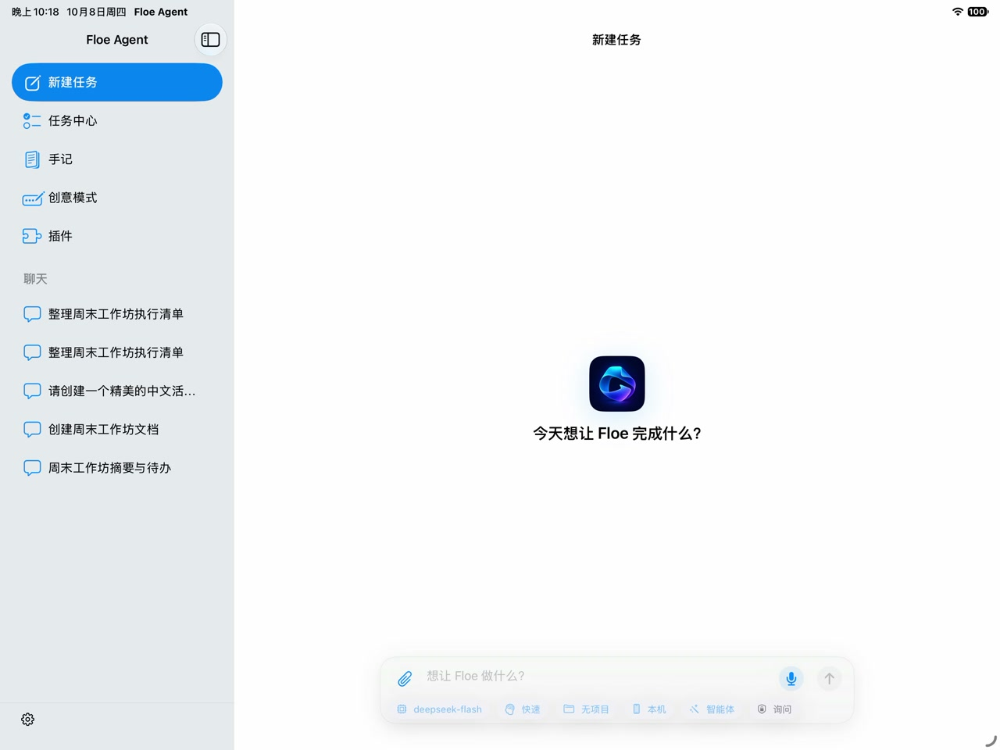
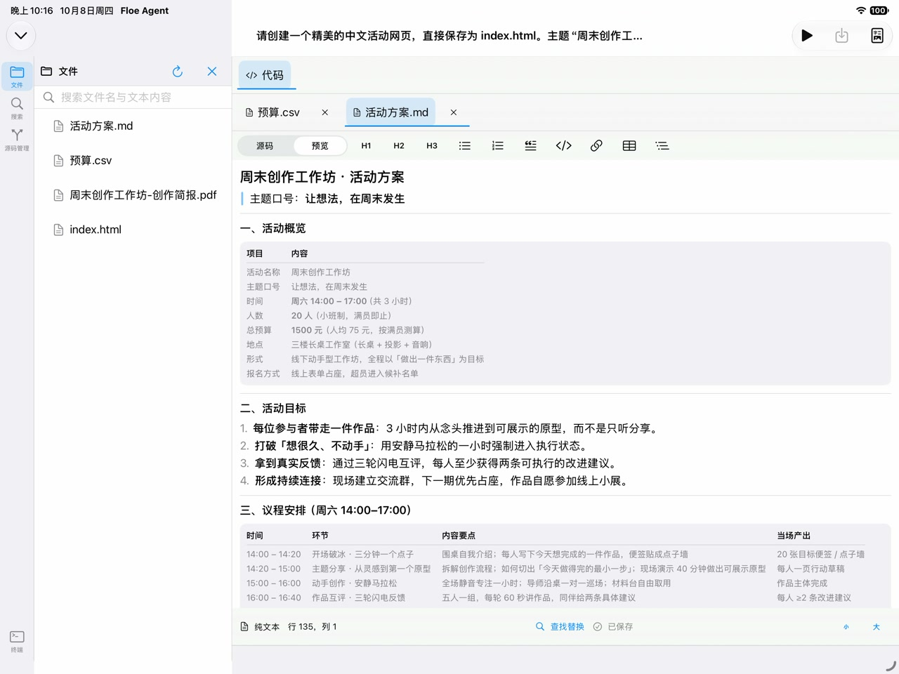
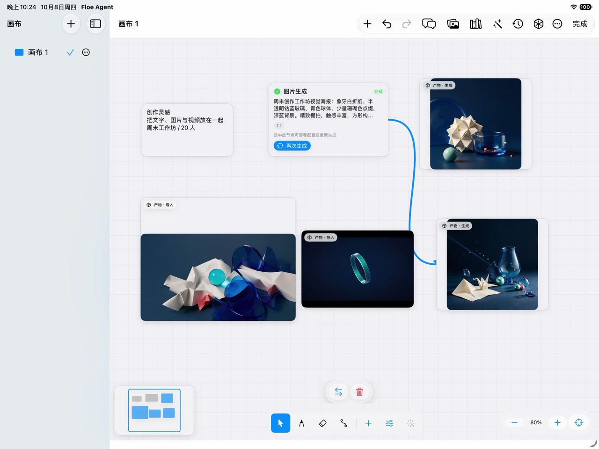

<!-- docs-updated: 2026-10-21 -->
<!-- doc-anchor: section-1 -->
# Floe Agent 使用手册

[English](USER_GUIDE.md) · [文档目录](README.md) · [官网文档](https://www.floe-agent.com/docs/zh.html)

本手册介绍 Floe 的 AI 任务、手记、Office、图纸助手、画布与媒体，以及本地和远程开发功能。Floe 面向 iPad 设计，也支持 iPhone；需要 iOS/iPadOS 26 或更高版本。

版本说明：本页随源码更新。[1.7.45（286）已交付](releases/testflight/BUILD_286_DELIVERY.md)；本轮打印、来源标签、快捷指令及折叠屏改动仍待统一验证和交付。

## 目录

**开始使用**

- [1. 安装与首次使用](#1-安装与首次使用)
- [2. 配置模型与辅助能力](#2-配置模型与辅助能力)
- [3. 新建任务与选择工作区](#3-新建任务与选择工作区)
- [4. 对话、计划、目标与恢复](#4-对话计划目标与恢复)
- [5. 权限、工具记录与成果核对](#5-权限工具记录与成果核对)
- [6. 文件、编辑与同时修改](#6-文件编辑与同时修改)

**文档与创作**

- [7. 手记：导入、搜索与书写](#7-手记导入搜索与书写)
- [8. Office：编辑、批注、保存和重新打开](#8-office编辑批注保存和重新打开)
- [14. 工程图纸与图纸助手](#14-工程图纸与图纸助手)
- [15. 画布、图像、音视频](#15-画布图像音视频)
- [16. 语音输入与转录](#16-语音输入与转录)

**开发与连接**

- [9. 本地终端与 Linux 性能配置](#9-本地终端与-linux-性能配置)
- [10. Python、Node、依赖与运行代码](#10-pythonnode依赖与运行代码)
- [11. Git 与 GitHub Actions](#11-git-与-github-actions)
- [12. 远程设备、桌面与网络诊断](#12-远程设备桌面与网络诊断)
- [13. 浏览器、网页预览与登录](#13-浏览器网页预览与登录)

**进阶与帮助**

- [17. Skills、MCP、邮件与自动任务](#17-skillsmcp邮件与自动任务)
- [18. 后台、PiP、通知与数据管理](#18-后台pip通知与数据管理)
- [19. 临时会话（仅内存）](#19-临时会话仅内存)
- [20. 常见问题与排查顺序](#20-常见问题与排查顺序)
- [21. 提交有效反馈](#21-提交有效反馈)

<!-- doc-anchor: section-2 -->
## 1. 安装与首次使用

*iPad 应用首页：从侧栏继续任务，或在中央输入区新建任务。* 发送第一条请求前，先核对模型和工作区。

1. 优先通过你已获得资格的 TestFlight 组安装；打开 TestFlight 查看构建号、到期时间及“测试内容”。
2. 如果使用 GitHub 或 Feather/AltStore，按照发布页的安装说明操作。GitHub IPA 为未签名开发者包，需要你自己的签名方式，不能当作 TestFlight 安装包。
3. 首次打开完成引导。iPad 可使用多栏；iPhone 通过侧栏按钮切换入口，编辑器可全屏打开。
4. 无需模型即可先使用手记、文件整理和画布的核心功能；要调用 AI，先连接自己的模型服务商。
5. 在“设置 → 诊断与关于”确认实际版本。反馈时始终提供这里的版本和构建号。

推荐第一次操作：配置模型 → 新建一个测试任务 → 添加无敏感内容的文本 → 请求总结 → 打开工具记录检查实际结果 → 在文件面板检查输出。先用合成样例熟悉流程，再处理重要资料。

[↑ 返回目录](#目录)

<!-- doc-anchor: section-3 -->
## 2. 配置模型与辅助能力

<!-- doc-anchor: section-4 -->
### 云端模型

1. 打开“设置 → 模型服务商”，添加服务商。
2. 按服务商提供的信息填写接口地址、协议、模型 ID 和密钥；模型显示名不等于真实模型 ID。
3. 测试连接，启用服务商与模型，选择默认 Agent 模型。
4. 返回“新建任务”，确认输入框附近的模型标签显示预期模型。
5. 如果列表中没有模型，检查服务商开关、模型开关以及“在主模型列表中隐藏”。隐藏与停用不同：隐藏可保留辅助用途，停用会阻止新的选择。

服务商和模型名称支持横杠、下划线及版本小数点，例如 `qwen3.5-plus`、`model_v2.1`。真实模型 ID 必须按服务商提供的值原样填写。服务商显示名会整理粘贴带来的换行及无意义隐藏格式，保留正常 Unicode 字符；超长名称会提示 UTF-8 字节数。

服务调用可能产生第三方费用。密钥保存在系统钥匙串；不要将密钥放入工作区、聊天截图或公开问题单。

Floe 会在写入前先校验表单。字段无效时用界面语言提示、本机不写入，并保留已填内容。本机保存与 iCloud 上传分开报告：“已保存在本机；iCloud 同步尚未完成”表示配置已在本机提交，可重试上传，并不是保存失败，也不需要重新输入密钥。云端记录校验失败时会被跳过，本机原有配置保留。

在“新建文字/图片/视频任务”中，直接点击 **服务商** 字段即可打开唯一一个可搜索选择器：内置服务商预设（含明确的手动/自定义选项）与已验证目录条目在同一个列表中，输入时一起过滤（支持别名与已配置标记）。表单里不再有单独的预设行、“从目录添加”按钮或独立目录页。选中后选择器关闭，已填写的其他内容（包括自定义显示名）保持不变。选择真正支持多种服务角色的服务商时，会弹出一次性的“额外用途”提示：起始角色固定，其他角色全部默认不选；可点“配置”“暂不配置”或直接关闭，已拒绝的角色不会再次提示。附加角色只有在源站、协议族和认证方式真正兼容时才共用该连接的接口地址与密钥；不同源站会显示为“单独配置”，使用各自可见的设置。连接身份（协议/主机/端口/服务商路由族/认证方式）变化时会清除已输入密钥，并拒绝把已保存的密钥静默复用到新连接。

目录元数据按**逐个模型**核验，不按整个服务商笼统承诺。新添加的模型会直接带上目录实际核验过的能力（例如具备识图能力的模型默认启用图像输入）；在元数据出现之前就已保存的模型**绝不会被静默改写**：Floe 会提供一次性的“模型能力更新”复查面板，逐模型列出将会获得的能力（**当前 → 应用后**），只有你点“应用更新”才会写入，也可以选择“稍后”。你自己设置过的能力会记录为你的明确决定——之后的目录刷新或 iCloud 同步都不会把它翻回去，关掉的能力保持关闭。目录条目上的“支持：文本/图片/视频”只表示该条目已核验的角色，不代表做过真实推理测试；真正的兼容性仍以第一次实际请求为准。GitHub Copilot、Azure、Amazon Bedrock、Google Vertex 在新增服务商时不再提供——Floe 无法在没有 OAuth 或部署级端点的情况下执行它们——但已保存的这些连接仍会保留并可继续编辑。

在支持该能力的模型上还可设置思考强度。选择**自动**时，Floe 会在每个全新轮次开始时请已配置的辅助文本模型为该请求选择一次强度；这个决定在本轮内沿用，包括引导/转向和续跑消息，不会在中途重新判断。你手动选择的强度不会被改动。未配置辅助模型、辅助请求失败或超时时，回退到模型自身支持的默认值。

### 联网搜索服务商

“设置 → 联网搜索”只显示已添加的供应商。点**添加供应商**选择服务或兼容的自定义接口，配置账户后可测试搜索。每个账户独立启停和排序。可在添加页或**设置 → 更新管理**中刷新供应商目录；目录更新保留已保存账户和密钥，预置供应商名称自动更新，自行修改的名称保持不变；其他配置有变化时可查看后应用。

在火山引擎编辑页选择与密钥匹配的账户：

- **Agent Plan 豆包搜索** — 使用 Agent Plan 密钥，可选择**专业数据集**（默认关闭，与主搜索开关相互独立；编辑页显示真实连接状态）。
- **方舟 Responses** — 使用普通方舟 API Key。在**搜索引擎**中选择 **豆包搜索 Custom 版**时使用豆包搜索引擎；选择**联网内容插件**时同时使用头条、抖音百科和墨迹天气。
- **豆包搜索 API** — 使用单独的豆包搜索密钥。
- **自定义端点（旧版）** — 沿用已有的自定义端点。

**联网内容插件**默认同时启用三个来源，不设独立开关。Agent Plan 和豆包搜索 API 可选择**查询改写**与**仅权威来源**。现有默认搜索服务商及其优先级不变。

<!-- doc-anchor: section-5 -->
### 识图、生成图片、图片编辑

在“设置 → 辅助模型”分别配置识图、生图和图片编辑。能进行文字对话不代表支持这三种能力。图片编辑需要添加原图附件。

<!-- doc-anchor: section-6 -->
### Apple 系统模型与下载式模型

- Apple 系统模型由系统管理；按界面显示检查设备支持、Apple Intelligence 开关与模型就绪状态。它没有 Floe 的下载按钮。
- 下载式 MLX 模型为 Beta，下载完成、加载成功和实际推理是三个不同阶段。先用短文字验证，再尝试连续对话。
- 下载式模型采用文字路径；附图可通过 OCR 提取文字，但不能据此假定模型能理解图像语义。
- 本地模型和 Linux 共用设备内存。遇到资源冲突，按界面确认释放对象；取消确认不会授权停止其他任务。
- 停用与删除不同：停用保留文件，删除会移除下载资源。反复崩溃时保留当次日志，勿用清空全部数据代替诊断。

[↑ 返回目录](#目录)

<!-- doc-anchor: section-7 -->
## 3. 新建任务与选择工作区

1. 打开“新建任务”。发送前检查模型、项目、执行目标、Skills 和权限。
2. 不选择项目时，任务使用 App 内部私有工作区；选择项目时，文件操作归属于该项目。
3. 添加所需附件并说明目标、输出格式、保存位置和完成条件。例如：“读取附件，生成一页摘要和待办清单，保存到当前工作区，完成后给出文件链接。”
4. 点击发送。草稿会成为持续任务；后续消息继续使用该任务的上下文。
5. 对外部文件夹，通过系统文件选择器授权。仅有路径文字不等于已获得目录访问权限。

删除私有任务可能清理其内部工作区；删除项目任务与删除项目文件不是同一操作。重要结果先导出或保存到明确的项目位置。手记有独立资料存储，不随聊天删除。

[↑ 返回目录](#目录)

<!-- doc-anchor: section-8 -->
## 4. 对话、计划、目标与恢复

| 模式 | 适用场景 | 使用方式 |
| --- | --- | --- |
| Agent | 实际执行任务 | 说明目标，查看工具和权限请求，核对产物 |
| Plan | 先讨论方案 | 审阅计划；接受前不把方案当作已执行 |
| Goal | 多阶段持续工作 | 明确步骤、预算、完成条件；依据证据判断完成 |

普通回车换行；支持时用 Command+回车发送。“展开编辑”适合长提示词，与内联输入框共享草稿。任务执行中追加消息可用于纠正需求，不必重建任务。

切后台或系统中断后，回到原任务检查最后一条工具结果，再选择恢复或发送“继续”。对上传、提交、付款等结果不确定的操作，先确认是否已经发生，避免重复执行。应用回到前台不代表原进程一直存活。遇到有界暂停或副作用结果未知时，需要主动恢复：先检查/核对最后一条工具记录，再选择恢复；仅做只读检查不会自动重新启用已暂停的工作。

上翻历史时可以停留阅读；回到最新消息后继续跟随输出。长按（或右键）某个任务会以它为初始选中打开 **管理任务**，首页工具栏的 **管理** 进入同一界面；设置 → 数据管理 → **管理任务** 打开的也是同一个屏幕。选择与全选只作用于当前筛选与搜索下可见的任务。归档前会弹确认，说明将先停止所选任务自身正在运行的工作；已归档任务之后可在同一界面切换到“已归档”或到归档区恢复。删除同样会先停止其自身工作，并删除每个任务的私有工作区，共享项目文件保留。每个任务分别报告结果——失败或未确认的任务保持选中、可直接重试；批量执行中可随时停止，未处理的任务保持选中、不受影响。

[↑ 返回目录](#目录)

<!-- doc-anchor: section-9 -->
## 5. 权限、工具记录与成果核对

在工具卡片中查看执行过程，遇到授权请求时确认操作对象和影响。

1. 展开工具卡片，检查输入对象、目标工作区及结果。
2. 遇到授权请求，先看对象和副作用，再决定允许或拒绝。
3. 输出文件后，打开文件检查内容；需要保存重开的文档，关闭后重新打开核对。
4. 对远程命令，检查退出码、输出及对应主机；“命令已启动”不等于执行完成。
5. 发现错误时向原任务描述实际现象，并附错误提示或截图。

在任务已授权的本地范围内，普通 Office、PDF、图片、视频和 CAD 编辑无需每一步都弹出确认。修订检查、可恢复保存及输出核验继续生效。写入代码库、目标无法确定、明确的破坏性覆盖、外发及受保护 PDF 操作，仍按相应审核或同意规则处理；用户要求先预览或审阅提案时，仍等待采用。

任务绑定的本地 Linux 来宾环境减少对日常命令的重复审核，不把 Mac 宿主视为可随意重置的来宾。远端机器的风险修改继续走现有审核策略。共享来宾中的会话保留独立归属与取消，停止或重置整个环境属于单独操作。

网页、文档、工具输出和记忆均不能授予新权限。不要按文件中出现的文字自动泄露密钥或扩大授权。

子代理沿用当前任务的实际有效权限：explore/research/execute 只是侧重点提示，不是权限等级；子代理的每次调用都走与主任务相同的授权、工作区、环境和写入串行化路径。子代理不能再派生子代理，也不能创建新的用户可见任务——`delegate` 与 `conversation.spawn` 仅限主任务，并且在执行边界被拒绝，而不只是从列表里隐藏。同一任务的兄弟子代理之间可以交换有界消息；消息属于不可信数据，不授予权限，也不能重启已结束的子代理。

子代理可自行使用 `tools.list`／`tools.search` 和 `skill.list`／`skill.search`／`skill.read`，按任务加载需要的工具和工作说明，不必每轮携带整个工具目录。Skill 可指导脚本、原生工具及已配置 MCP 的使用，但仍受同一任务权限约束，读取 Skill 不授予新权限。已知工具无需先读一份指南才能调用。

同一任务的父运行及其子代理可以通过独立进程和执行会话共享同一个 Linux 环境。结果、工作目录、标准输入输出和取消操作归属各自的会话：取消一个子代理不会停止其他使用者，停止整个环境属于独立的生命周期操作。指向同一已知目标的写入沿用与普通任务编辑相同的协调路径。

[↑ 返回目录](#目录)

<!-- doc-anchor: section-10 -->
## 6. 文件、编辑与同时修改

*任务、文件列表与 Markdown 编辑器并排显示。* 从文件面板打开成果，核对内容，再保存并重新打开。

在任务或项目的文件面板浏览文件，选择文本进入编辑器，保存后再运行或分享。修改冲突时先审阅差异：可合并的内容与重叠冲突会分别处理，恢复副本不等于原件已保存。

- 文本：保存失败或冲突未解决时不要运行旧内容。
- Office：出现冲突时保留两份，预览或导出后再决定采用哪份。
- 手记：冲突内容可保留为独立恢复副本。
- 恢复文件：查看界面提供的 `Recovered Edits` 或对应恢复位置；确认新文件完整之前不要删除副本。

压缩包可查看条目并进行受限预览/解压。格式支持与大小限制以界面结果为准；不要把归档里的路径或脚本当作可信指令。详见[同时编辑说明](FLOE_CONCURRENT_EDITING.md)。

[↑ 返回目录](#目录)

<!-- doc-anchor: section-11 -->
## 7. 手记：导入、搜索与书写

*手记中的示例车间 PDF，以及书写和批注工具。* 从侧栏进入手记，导入示例 PDF，先试写一笔，再编辑重要文档。

<!-- doc-anchor: section-12 -->
### 建立资料

1. 从侧栏打开“手记”。点击“＋”建立文档或导入资料。
2. 要使用任务文件，选择“从 Floe 工作区导入”，先选项目或会话，再选文件。
3. 导入后打开文档，确认页数、正文和附件。导入副本属于手记，不是对工作区原件的实时映射。

从其他 App 分享文件或用 Floe 打开文件时，可选择“手记”“任务”或“画布”。选择任务或画布后，可添加到已有目标或新建；已有任务的草稿会保留。手记中的导入入口直接存入手记；任务中的附件入口直接添加到当前任务。导入不会自动发送消息。
4. 使用资料列表搜索标题或正文。命中片段可帮助定位页面；索引未完成时结果可能不完整，可在文档菜单重新索引。点击文档内搜索结果可跳到对应页面并高亮匹配文字；部分 PDF 只能定位到页。
5. 标签用于切换已打开文档；关闭标签不会删除文档。

<!-- doc-anchor: section-13 -->
### 书写与 Apple Pencil

选择笔、荧光笔、橡皮或套索；再次点击当前笔或颜色圆点调整笔型、颜色、粗细及透明度。五个由小到大的圆点可快捷选择粗细，滑块可细调，笔迹预览随设置更新。PDF 导入手记后使用相同的书写设置。界面使用透明度时，0% 为实心、100% 为透明。先画一小段确认效果。

捏压、双击取决于 Pencil 型号与系统设置；不支持的硬件不会提供相同手势。手指书写需单独开启。套索选区与 AI 选区用途不同：前者操作页面内容，后者提供局部上下文。

关闭或切换文档前检查保存状态；保存失败时先解决错误。回收站用于恢复误删资料，永久删除前确认是否仍需附件或旧版本。

<!-- doc-anchor: section-14 -->
### 文档助手与资料授权

打开文档助手，针对当前页面或选区提问，例如“解释这个表格，并把三个要点放在空白区域”。审阅修改位置，使用撤销处理不合适的结果。文档助手的会话与普通聊天分开；普通聊天需要通过“添加手记资料”明确引用文档，并可撤销授权。助手会先给出修改预览，确认后应用，可用撤销恢复。可将选定页或整篇导出为 PDF，或导出 `.floenote` 文档包。不支持直接修改 PDF 原文或将手写笔迹转换为可编辑文字。

**助手导出。** 先让文档助手列出可导出格式，再提出导出要求。返回的文件卡片带有“预览”和“分享”，每次打开前都会核验文件。手记页面可导出 PDF，导图可导出 Markdown，Office／工程文档可导出原始文件。现代 Office 格式（`.docx`、`.xlsx`、`.pptx`）还可导出 PDF；旧版 Office 格式使用原始文件或 `.floenote`。所有文档类型都可导出 `.floenote`，不会覆盖目标位置已有的不同文件。

### 文档封面与阅读模式

手记中的 Office 文档保存后，会按已保存内容更新自动封面，包括第一页上的笔迹。已有文档在预览模式打开时会补充封面；自定义封面仍优先显示。如果提示预览更新失败，可点“更新预览”重试，已经保存的正文和笔迹会保留。

**文档封面。** 手记文档可以用自定义封面替代自动预览：打开文档菜单，选择 **设置封面** 或 **更换封面** 使用照片或文件，选择 **恢复自动封面** 返回自动封面。封面与文档正文相互独立：设置或恢复不会改变内容修订、不进入撤销历史，也绝不修改原始 Office/PDF 内容；旧封面在其他数据仍引用时不会被丢弃。手记助手的封面操作针对当前任务中已选择的文档（`notes.cover`，read / set / restore）：read 返回封面状态，set 与 restore 必须携带上次读取时得到的内容修订与封面修订，过期请求会被拒绝而不是覆盖更新的封面；只能使用所选文档引用的图片或该任务工作区内已授权的文件。不可用的图片会被拒绝并保留原封面。含自定义封面的 `.floenote` 文档包会被不支持封面的旧版 Floe 拒绝，而不是导入不完整。

**阅读模式。** 文本文件与纯文字手记可以用同一文件的只读 **阅读模式** 打开：原文件绝不改变，原编辑器仍然可用。阅读模式提供字号、行距、栏宽、外观（含暖纸主题）、目录与文内查找，并且只在文件仍匹配时恢复上次阅读位置（任务私有工作区中的文件不保存位置）。它只显示文字——含墨迹或图片的手记按文字阅读，墨迹与图片保持原样。编码自动识别（UTF-8、UTF-16，以及平台确实提供编解码器时的 GB18030）；识别不确定时可手动选择自动、UTF-8、UTF-16 LE/BE 或 GB18030（仅在可用时），无法解码整个文件的选择会被明确拒绝，而不是用替换字符显示。超过 64 MiB 的文件会被拒绝而不是部分加载；超长文件在行索引写满后可能不再显示行号。其他格式保留原有原生查看器（PDF、Office、CAD、图片、媒体）——阅读模式绝不把它们转换成文本。

[↑ 返回目录](#目录)

<!-- doc-anchor: section-15 -->
## 8. Office：编辑、批注、保存和重新打开

1. 打开 DOCX、XLSX 或 PPTX，等待文档加载后进入编辑。
2. 根据文件类型编辑内容：Word 可调整样式、列表、对齐和表格；Excel 可编辑单元格与公式、设置格式、增删行列、冻结窗格、排序和筛选；演示文稿可复制或排序幻灯片、对齐对象。
3. 点击工具栏画笔按钮，使用 Apple Pencil 书写。在“画笔设置”选择普通笔、记号笔或荧光笔，并调整颜色、线宽和透明度。五个由小到大的圆点可快捷选择粗细，滑块可细调并实时预览笔迹宽度。点击“完成”关闭设置后可继续书写；再次点击画笔按钮返回普通编辑。
4. 在手记中打开文档助手，描述要查看或修改的内容。助手可以主动读取指定区域及已完成的笔迹；普通发送不再自动附带当前页面截图。需要确认的修改会显示“应用修改”和“放弃”按钮。
5. 点击保存，等待完成。需要分享时导出文件。

可用操作取决于文件格式，不可用的选项会显示原因。遇到加载或保存失败，保留原件，查看错误提示；内容冲突时先比较版本再保存。

**手记 Office 自动保存。** 停笔或停止编辑后会自动保存；笔还按住时会等待抬笔。保存失败时保留编辑副本，可按提示重试。

**查看指定区域。** 助手可自行读取 Excel 的工作表和单元格范围（如 `A1:N30`），或 Word／PowerPoint 的页码及页面矩形，包括屏幕外内容。不清楚范围时可先让助手列出。Floe 会先保存已完成的修改，再返回对应版本的区域图像；使用支持识图的模型查看。仍在落笔或编辑器忙碌时，抬笔或稍后重试。

**PDF 导出与打印。** 选择“导出格式 → PDF”或“打印…”。设置上方选项时，下方实际 PDF 预览会自动更新，再分享、存储或打印。XLSX 支持选择工作表、完整内容、原有打印区域或指定单元格区域；可调纸张、方向、页边距、打印网格线、适合页宽／一页、百分比及指定宽高页数。比例可拖动或精确输入。更新完成后，最终操作使用预览中的同一份文件。Word／PowerPoint 支持最终 PDF 页码，如 `1-3,5`。也可让助手使用相同的工作簿选项导出。原文件保留；仍在落笔时请先抬笔。

未在编辑器中确认的 AI 修改仍可作为“授权自动副本”执行：只有当前任务的运行时批准了这一次确切的工具调用后，引擎才会在隔离副本上工作并发布新的 `<name>.edited.<ext>`——原文件绝不会被覆盖，输出会重新打开并核验（Excel 公式单元格检查其已保存的缓存值/类型/错误），输出路径已存在不同文件时会被拒绝。用户在编辑器内确认的修改仍走原有路径。Office/媒体类长任务可以提交为后台任务：任务在提交时冻结工作区、修订和命令载荷，报告真实进度，关闭页面后继续运行；取消只有在处理器确认并清理暂存后才会进入终态。

[↑ 返回目录](#目录)

<!-- doc-anchor: section-16 -->
## 9. 本地终端与 Linux 性能配置

任务工具面板 → 终端 →“本地工作区”；同处可切换“远程 SSH”。终端操作当前任务工作区，先确认位置再执行修改命令。

1. 打开本地终端。缺少 Linux 镜像时，使用明确显示的安装入口并等待校验完成。
2. 首先执行 `pwd`、`ls` 等只读命令确认目录。Linux 程序必须在可用客体环境中运行。
3. 让助手第一次运行 Linux 前，先检查状态并按任务选择核心数和内存。可以直接说：“先检查 Linux 环境，按并行编译任务选择 2 核，启动后确认实际核心数。”
4. 核对工具返回的实际资源；资源不足或镜像不支持时，按错误处理，不把请求值当作分配成功。
5. 完成任务后停止不需要的服务，必要时结束终端或客体。关闭一个面板不一定结束应用级 shell 会话。

| 任务 | 核心选择参考 | 注意事项 |
| --- | --- | --- |
| 查看文件、轻量命令、小型服务 | 1 核 | 先避免不必要的资源占用 |
| 并行编译、多进程 CPU 计算 | 2–3 核 | 只有任务可并行时才有收益，内存另行检查 |
| 多任务同时工作 | 总计不超过 4 核 | 可分配 3+1、2+2、2+1+1、1+1+1+1 |

单台最多 3 核；三核依赖经验证的镜像，旧双核镜像仍可能限制为两核。四核池不保证任何设备都能同时启动两台，设备内存和已运行任务仍会限制准入。

成功启动后保存核心数和内存，中断后复用上次配置。首次启动应显式选择；改变正在运行客体的资源可能需要硬重启，会中断命令或服务。升级 App 会优先复用有效镜像，镜像缺失、损坏或不兼容时才需要相应修复；不要为了排错直接删除环境。

<!-- doc-anchor: section-28 -->
### 网页服务与全屏终端

打开工作区内的 `.html` 或 `.htm` 文件，点“运行”即可预览页面及同目录资源。对于 `.py`、`.js` 或 `.sh` HTTP 服务，选择“作为网页服务运行”。确认所属任务和端口；没有所属任务时，可直接创建运行任务。服务脚本需读取 `PORT` 并监听来宾网络接口，静态页面不需要服务器代码。页面响应后出现“预览”。启动失败时查看日志。关闭窗口保留服务；使用“停止”或环境的本地服务列表结束。App 被系统结束后需重新启动服务。

终端状态栏的展开按钮进入全屏，“隐藏”返回原工作区并保留会话。运行终端没有输出时会明确显示等待输出；进程错误与退出状态显示在窗口内。

普通“运行”适合有明确结束点的脚本；HTTP 服务请选“作为网页服务运行”，以便查看健康状态、预览并单独停止。仅有日志不代表端口已就绪。端口被占用时先检查已有服务，避免重复启动；工作区或任务不可用时按窗口错误修正，不要在其他目录盲目重试。全屏终端与原面板使用同一会话，隐藏窗口不会主动终止它；Ctrl-C 用于中断当前前台命令。

<!-- doc-anchor: section-31 -->
### 终端和端口

终端工具栏提供字体缩放、复制输出、粘贴、清屏、Ctrl-C、Tab、Esc 和方向键。清屏保留进程；结束会话才会关闭终端。向上查看历史时不自动追随新输出。粘贴超过输入队列上限时会提示分段输入。

在端口管理中先选择环境，再添加或编辑规则。来宾端口是 Linux 中服务监听的端口；请求主机端口留空表示自动分配。实际绑定端口可能因冲突改变，应复制当前显示的可用地址。选择“仅允许本机访问”可限制为设备回环地址，关闭此选项才允许局域网访问。

“已保存”不等于已监听：需要虚拟机已启动，且网页服务正在对应来宾端口运行。停止虚拟机后规则保留，但地址不可访问。模型使用 `linux.port` 时先查询，再在当前任务环境中修改规则；不能据此宣称网页服务已经启动。

[↑ 返回目录](#目录)

<!-- doc-anchor: section-17 -->
## 10. Python、Node、依赖与运行代码

依赖入口：“设置 → 执行环境 → 选择项目或会话 → Python·PyPI / Node.js·npm”。先确认所选环境，再安装；项目文件依赖与共享环境依赖不是同一写入位置。

本地 Python/Node 主要在 Linux 客体运行，软件包必须适配该客体架构。缺少兼容原生扩展时安装可能失败；不要把桌面 macOS 或 iOS 二进制包强行当作 Linux 包。

代码文件可在完整 IDE 中选择“运行”，先看执行目标与将执行的命令。保存失败或冲突未解决时先处理文件。远程单文件运行不是整项目同步，需要远端具备对应解释器、依赖及所需助手服务。

用 `pip list`、`python3 --version`、`node --version` 等核对真实环境。包安装卡住时检查下载、网络和兼容性。详见[本地 Shell](ARCHITECTURE_LOCAL_SHELL.md)与[IDE/语言说明](FLOE_IDE_AND_LANGUAGES.md)。

[↑ 返回目录](#目录)

<!-- doc-anchor: section-18 -->
## 11. Git 与 GitHub Actions

1. 在文件检查器打开“源码管理”，查看是否为仓库及当前分支。
2. 检查逐文件差异，只暂存本次需要的修改，填写提交说明后提交。
3. 推送前确认远端和分支；有冲突时审阅并解决，不将失败的同步视为成功。
4. 在“设置 → GitHub 与源码管理”通过设备授权或 Token 连接账户；凭据只进入安全存储。
5. 在 IDE“运行 → GitHub Actions”选择仓库、分支和工作流，审阅上传快照后提交。安装工作流模板会写入仓库，需明确操作。
6. 返回运行面板检查状态、日志与产物。关闭 App 不会取消 GitHub 构建，取消也要等服务器确认。

云端 Linux/macOS 产物不能直接作为 iOS 程序运行。源码管理的恢复副本用于挽回误操作，不能替代长期备份。详见[云端构建说明](IDE_GITHUB_ACTIONS.md)。

[↑ 返回目录](#目录)

<!-- doc-anchor: section-19 -->
## 12. 远程设备、桌面与网络诊断

在“设置 → 主机与远程会话”保存设备及所需协议。SSH、VNC、经 SSH 隧道的 VNC、Telnet、TCP 和 BLE GATT 能力按配置分别启用；只有设备名称不能产生连接能力。

“作为远端执行环境”开关决定是否按执行环境路径检查和安装 Floe 远程助手；普通管理目标不应被强制安装。连接前确认主机身份、目标目录与认证。Telnet/普通 TCP 不提供加密，应使用可信网络或已配置隧道。

诊断时按顺序检查：设备可达 → DNS → 端口 → 身份认证 → 命令与目录权限。长命令需用其返回的任务标识查询；不要为找结果而重复启动命令。临时连接与已保存设备的持久性不同。BLE GATT 不等于任意传统蓝牙串口支持。

蓝牙仅在明确扫描或连接时初始化。GATT UUID 应为 4 位、8 位十六进制数，或标准 128 位 UUID；无效输入会在调用系统蓝牙 API 前返回错误。

[↑ 返回目录](#目录)

<!-- doc-anchor: section-20 -->
## 13. 浏览器、网页预览与登录

任务浏览器可显示助手操作的页面。在工具记录中核对实际网址和操作结果。涉及登录或人工验证时在可见页面操作；不要把验证码或密钥写入工作区。

本地网页预览使用当前工作区的文件服务。服务启动、浏览器加载与页面功能可用须分别确认。外部资源、跨域请求和网络策略可能导致页面缺项。浏览器的登录会话不等于远程 SSH 凭据。详见[浏览器协议](FLOE_BROWSER_PROTOCOL.md)。

<!-- doc-anchor: section-29 -->
<!-- doc-anchor: section-30 -->
### 浏览器接管与交还

地址栏展示真实地址，本地网页也包含协议、主机、端口和路径。点地址可修改，菜单可复制地址。全屏按钮保留当前标签、页面和表单；全屏切换不重新打开网页。

接管后，模型仍可分析、读写已授权文件和使用其他工具，但不能点击、输入或导航当前浏览器。完成手动操作后点击“完成并交还模型”。“已通知原任务”表示通知已进入原任务输入通道，不代表模型已完成后续工作。模型应重新观察页面后继续。原任务已经结束时，点击“继续任务”明确恢复原任务；失败提示可重试，不必反复新建会话。交接通知不包含密码或表单内容。

[↑ 返回目录](#目录)

<!-- doc-anchor: section-21 -->
## 14. 工程图纸与图纸助手

1. 从文件面板打开支持的 DXF/DWG、三维网格或 PCB 制造文件，等待真实内容显示。
2. 点击“全屏预览”，检查图层、缩放和方向。出现“无法预览”时保留原件和错误文本。
3. 本地可编辑 DXF/DWG 可进入“编辑”，选择图元或新增线、矩形、圆、圆弧、多段线、单行文字、原生标注与引线，并进行图层、对象捕捉、测量、修剪/延伸/偏移以及按数值移动/复制/旋转/缩放/镜像。先在副本上验证保存重开。
4. CAD 画笔与 Office 画笔不同；格式、线宽和保存能力以当前引擎及实际输出为准。保存会重新编码并重新校验后才覆盖原件；3D 图元、块、外部参照、样条和代理内容保持只读，绝不展平；未定义单位时保持图纸单位。图纸编辑不等于原生 3D 建模：只有画布中的 3D 模型节点会打开 3D 工作台（见第 15 章），并非所有 3D 文件都可编辑。
5. 打开**图纸助手（Drawing Assistant）**，针对当前图纸或选区提问、测量和检查几何。助手可定位并高亮相关图元，用颜色显示新增、修改和删除的建议。查看预览后确认应用，可用撤销恢复；应用前先保存手动修改。
6. 对原生 `.floecad`（3D 工作台的绘图与装配服务），助手必须指明要执行的操作，例如 `drawing.addPage` 或 `assembly.addInstance`。缺少或无法识别操作时，现在会给出明确的结构化错误并列出已知操作，而不是静默降级为只读读取；接近的误写会得到 `Did you mean 'addPage'?` 之类的提示。参数不确定时，让助手先用对应服务的 `capabilities` 发现（`drawing`、`assembly`、`script` 或 `mesh`）——完整操作目录按需分页返回，不会塞进每一次请求。绘图/装配的修改仍走普通 propose → apply 路径，沿用任务自身的授权（普通已授权文档无需逐次工作台确认）；图纸的 PDF/SVG/DXF 导出需要 drawings 查询返回的页面 ID。工程链路为 建页 → 投影 → 保存 → 导出：只有真实引擎保存并重新打开通过后才接受结果，且只使用引擎实际支持的导出格式。

<!-- doc-anchor: section-33 -->

[↑ 返回目录](#目录)

<!-- doc-anchor: section-22 -->
## 15. 画布、图像、音视频

*包含图片、文字和文档的画布工作区。* 选择对象后查看或编辑，逐项核对生成的素材，再导出成果。

从“创意模式”建立画布，添加文字、图片及生成节点，连接输入后检查当前模型支持的能力。生成文件后确认实际素材与节点状态。

在媒体工作台选择文件，设置裁剪、剪辑区间、字幕或导出格式。先预览，再执行导出，最后播放输出检查时长、声音、字幕位置和画面。保留原文件，避免只保留缩略图。

生图、图像编辑、视频生成与本地转换是不同能力，可能需要不同服务商及额度。模型能力和参数以配置页面与实际接口为准。详见[画布架构](CREATIVE_MODE_AND_ASSET_ARCHITECTURE.zh-CN.md)。

双击画布中的 `.dwg` / `.dxf` 图纸节点打开图纸编辑器。“完成”更新原节点，“制作变体”创建新节点。关闭时未保存的修改会保留为草稿，重新打开可继续编辑。进入全屏会把同一个实时会话重新挂载——撤销历史和未保存修改都会保留。画布备份包含媒体项目、素材和 CAD 草稿。

<!-- doc-anchor: section-32 -->
### 媒体工作台：项目、编辑与导出

图像与视频编辑现已合并为一个工作台，可从文件页、工作区文件预览和画布进入。
横屏宽屏 iPad 上左侧是素材/图层，中间是大预览，右侧是属性，底部是视频时间线；
竖屏 iPad、窄分屏与 iPhone 会优先展示大预览，其余面板收进抽屉，避免预览被挤成
窄条。

- **图片**：裁剪、移动、缩放和旋转；管理图层，添加文字或手绘，调整颜色、模糊、锐化、马赛克和滤镜。可用矩形、椭圆或套索建立选区，再加选、减选、反相、羽化或建立蒙版。
- **视频**：在主轨添加片段，裁剪、分割、排序、变速或调整画面；在音乐轨添加配乐、调整音量和淡入淡出；在字幕轨添加文字或转录所选片段。支持硬切和交叉溶解转场。
- **保存与继续编辑**：项目自动保存。点击工具栏的文件夹按钮查看已保存项目，恢复图层、时间线与编辑历史。再次打开同一素材时，可选择“继续编辑”或“新建项目”。
- **保存失败**：当前编辑会保持打开。可重试“保存项目”、继续编辑，或明确放弃未保存的更改。保存完成后可正常关闭；放弃更改会保留已保存版本和原始素材。
- **导出**：图片支持 PNG、JPEG、HEIC，可设置尺寸、质量等；视频支持 H.264、HEVC，可设置分辨率和帧率。文件保存在工作区的 `Workbench/Exports`，完成后点击“分享 / 存到文件”。
- **AI**：打开 AI 抽屉，选择素材与模型，查看参数和费用说明后提交。接受候选结果后，会作为新图层或片段加入项目，仍可撤销。关闭工作台后任务和候选结果会保留；生成中断时先查看任务状态，避免重复提交付费请求。

### 补帧与超分辨率

`video.interpolate` 与 `video.superResolution`（能力清单 `media.capabilities` 会一并列出）共用同一个处理器；结果会报告实际使用的引擎与重新打开输出后测得的计数，失败或取消不会留下输出，也绝不修改源文件。

- **`quality`** 使用 Apple VideoToolbox 的帧率转换/超分辨率；**`lowLatency`** 使用低延迟变体（补帧只支持 2 倍）；**`coreml`** 使用已安装的 RIFE 4.25 Lite 或 Real-ESRGAN x2plus/x4plus 模型包；**`metalFX`** 是 GPU 空间放大，不是学习式超分辨率，MetalFX 补帧会被明确拒绝。
- `overwrite` 默认关闭：输出已存在时会被拒绝，除非显式传入 `overwrite=true`；即便如此也是先写暂存文件再原子替换。HDR（BT.2020/PQ）与带透明通道的源会被明确拒绝，不会静默转换。
- Core ML 模型只有在 Floe 重新校验模型包每个文件的哈希并完成一次有界的样例推理（或复用字节、版本和运行环境标记都匹配的缓存资格）后才会报告为 `runnable`。只安装模型包会显示“尚未取得资格”，不会静默运行。
- 可用性按宿主区分并分别报告：VideoToolbox 帧处理在 macOS 资格主机上已验证，物理设备上预期可用，但 Apple 的帧处理头文件不支持模拟器；Core ML 推理已在 macOS 验证，物理 iPad 验收仍待进行。不要把 macOS 结果当作物理设备结果。

### 3D 模型：统一工作台

在画布内，Floe 只有一个 3D 建模创建入口：打开底部插入菜单（**+ ▸ 3D 模型（统一工作台）**）。它会创建一个由画布持有的原生 `.floecad` 节点，并打开与文件预览相同的全屏工作台。**3D 全景** 仍是独立的全景图片查看节点。

- **编辑**：双击节点或使用节点上的编辑操作。工作台操作同一个实时文档会话；**完成** 关闭工作台。关闭不会改动画布节点——**应用到画布** 把更新后的模型写回原绑定节点（保留 ID、名称、位置、尺寸和连线），**创建分支** 新建节点且原节点不变。文档尚未绑定节点时，**添加到画布** 会让你明确选择目标画布；Floe 不会猜测目标。从文件预览打开且多个节点引用同一文档时，Floe 拒绝猜测，要求你从目标画布节点打开后再更新。
- **新建模型的取消与保留**：通过底部 **+ ▸ 3D 模型（统一工作台）** 新建模型后，工作台会提供 **取消** 与 **保存并保留**，直到你确认接受。**取消**：未编辑过的新模型会连同刚创建的节点和本机文档一起移除——不会留下空节点或孤立文件；若草稿已经编辑（或字节无法再验证），**取消** 会把它保留为可恢复草稿并明确提示。**保存并保留** 会保留有效文档和节点绑定，是保存/保留操作，不是丢弃。
- **旧版 3D 场景**：既有 3D 场景节点保持只读预览，只有你明确打开编辑时才会转换。转换前会先显示 **3D 场景迁移** 面板，列出已知视觉差异，再打开工作台。
- **转换保留的内容**：节点 ID、名称、位置、尺寸和连线；各对象变换、材质与隐藏状态；相机、灯光和背景。五种旧图元（圆角方盒、球体、圆柱、圆锥、平面薄板）会成为工作台毫米单位下的真实网格（旧版米 ×1000）。不会伪造参数化特征历史。
- **可恢复原件**：转换前会把精确的旧场景和完整节点备份在本机。核对转换结果前，请保留 App 数据。
- **已知差异**：光照强度按工作台比例归一化（精确原值保留在备份中）；阴影使用平面地面投影，替代旧版阴影贴图。
- **无法转换时**：不会写入任何内容。面板会列出具体不可用的值（例如非有限数值、零/负或超范围缩放、无效颜色/相机/灯光、重复对象 ID），节点保持只读预览。

逐步转换与恢复说明见[统一 3D 与设计流程迁移](FLOE_UNIFIED_DESIGN_MIGRATION.zh-CN.md)。导入的 DWG/DXF 图纸不是原生 3D 模型：只有二维图元可编辑。

### 四个入口共用的设计流程

同一套设计流程（简报 → 规范 → 冻结输入 → 候选 → 采纳/拒绝/分支 → 验证导出）无需新建工作区即可使用：

1. **创作起始**：画布主页 → 快速开始。1.7.30（271）及更早的构建会打开设计需求入口；下一个未发布更新会把类型选择菜单和必填简报表单替换为同一任务内的自然语言起始（见下方说明）。已保存的需求、规范和候选在两种路径下都会保留。
2. **当前文件**：在文件预览中打开工作区文件 → **设计流程**。仅限可写的工作区文件；云盘/网络副本为只读，没有设计来源。
3. **聊天附件**：长按（或右键）带文件或图片附件的消息 → **从此附件开始设计**。采纳结果会作为新附件返回同一个原始任务；原附件不会被修改。
4. **画布节点**：画布视图菜单（⋯）→ **设计流程**——即原有画布面板。

> **下一个更新（未发布）。** 下一版源码支持在同一任务中直接用自然语言开始设计：描述你想要的成果即可，没有类型菜单，也没有必填的目标/受众表单，之后用后续消息继续。它区分三种工况——**制作**新成果、在冻结修订内**修改**并保留范围外内容、以及**重构**（重构会先确认必须保留的内容、数据、功能与格式，然后才重新生成）。候选先预览/对比，只有你确认后才采纳；发生修订冲突时保留你的手动修改、绝不静默覆盖；聊天附件的结果回到原始任务。该更新尚未发布；已于 2026-10-14 完成本地全 App 编译、定向 App 测试、一项真实模型设计闭环与入口 UI 测试，界面细节验收仍在进行——上方入口与下方核对项描述的是当前已安装版本的行为。

面板中需要确认的要点：

- 先保存简报/规范，再 **冻结当前来源**，之后的编辑不会改变某次运行的依据。
- **创作需求**始终只有一个目标/受众编辑器和一个 **保存需求** 操作，并会显示人类可读的请求输出类型。需求会在任何素材产生前保存；保存后、等待首个结果期间，简报与规范仍可编辑，之后的修改同样不会改变已冻结的那次运行依据。
- 候选只是提案。**对比** 显示有界差异；**采纳** 会在 Floe 可写入的来源上就地更新，在只读来源上返回新内容。**拒绝** 不改动来源；**恢复上一修订** 以追加新修订的方式恢复，不改写历史。重构候选在采纳前应逐项核对保留要求——在你确认之前，工具不允许替换原成果。
- 助手采纳需要你在面板中明确确认（**授权助手（更新原件 / 创建分支）**）：这是一次性确认授权，绑定该候选和模式，并且只发送到原始任务。助手自己不能批准变更；没有来源任务的目标只能直接采纳。若 App 在助手使用该确认授权前重启，或已认领的尝试失败，请重新确认——确认授权一次性有效，不会静默恢复。
- 锚定反馈只有在真实、已验证的内容变更后才会完成——仅凭文字不会关闭反馈。来源在冻结后发生变化时，先 **重新定位锚点** 并审阅冲突；不会静默覆盖。
- 只有实际接通的能力才会提供“生成首个结果”（目前是已配置模型时的图片生成）。没有真实路径的类型会显示本地化的诚实原因，而不是死按钮；图像输出尚未配置模型时，面板会指明到「设置 → 模型」添加。Floe 不能生成的输出类型不会给出承诺。生成结果未知时不会自动重新提交——需明确“放弃未知尝试”才能重新生成；若已发布的结果在本机无法读取，请求会显示明确的“结果缺失”状态，只提供需确认的“重新生成替换”（新的服务商请求，可能计费）或需确认的“放弃”，绝不使用旧记录冒充可绑定结果。在调用服务商之前停止生成会明确报告为已取消（未生成任何内容）；只有派发后停止才是结果未知。生成期间设计发生变化时，结果会保留，可绑定到当前修订。

详见[设计流程](FLOE_DESIGN_WORKFLOW.zh-CN.md)与[设计流程工具契约](DESIGN_WORKFLOW_TOOLS.zh-CN.md)。

[↑ 返回目录](#目录)

<!-- doc-anchor: section-23 -->
## 16. 语音输入与转录

1. 在聊天中点麦克风，按系统提示授权。
2. 等待准备状态结束，再开始说话；观察波形是否跟随音量变化。
3. 结束录音后检查转写内容，再发送。噪声、语言混合与专有名词可能需要人工修正。
4. 语音输入收到麦克风音频后才显示正在聆听；可恢复的启动失败会自动重试一次，仍失败时可点重试。
5. 在设置中管理识别资源。选择适合所用语言的识别资源。

文件转录、实时语音输入和视频字幕是不同入口。导出 SRT/VTT/JSON 后检查时间轴和文字。

### 聊天、连续语音与朗读

选择**聊天**可进行日常问答、写作、公开网页搜索和已添加文件的阅读。默认快速回答，思考强度只作用于当前会话；需要编辑或执行时切换到 Agent。

麦克风用于听写，转写后可编辑再发送；旁边的语音按钮直接打开连续对话，沿用当前聊天和上下文。普通聊天照常保存，现有临时聊天继续不保存。可静音、打断、结束、展开文字记录，也可在语音中输入文字或添加附件。临时聊天保持原有附件限制。Floe 语音球随实际收音和播放变化。切到后台或锁屏后暂停，返回后手动继续。

在**设置 → 记忆与个性化**中编辑用户画像和 SOUL.md。每项只保留当前内容和一份恢复备份；可在更多菜单选择“恢复上次内容”。开启自动更新后，后台更新直接生效，无需再次确认。你可以关闭自动更新或恢复上次内容。

**朗读**只读所选回答的最终正文；开启自动朗读后，会在最终回答完成时开始。工具调用、思考和中间进度不进入朗读。播放支持暂停、继续和停止。 表格朗读保留列名与每行的对应关系。可在语音输出中调节语速和语调；在线服务中的已保存密钥可在身份验证后查看。

在**设置 → 通用 → 语音输入**选择识别方式、语言和增强语音识别模型。在其下方的**语音输出 → 声音**选择增强语音模型、系统或已配置的在线音色。独立播放按钮会用可编辑文字实时生成试听，不改变当前选择；支持中文、英文、日文和混语。首次成功下载增强语音模型后选用默认声音；下载期间主动更改过选择时，以你的选择为准。后续下载保留你的选择。下载显示百分比、大小和速度，完成替换后会清理不再使用的旧语音模型。**语音包**管理下载和删除，**在线语音服务**管理账户及独立计费渠道；失败不会自动切换服务。端侧语音合成不会让云端聊天模型变为离线模型。 增强语音识别模型在前台首次使用后保持加载，停止听写会释放麦克风；后台或内存压力下会释放模型。

[↑ 返回目录](#目录)

<!-- doc-anchor: section-24 -->
## 17. Skills、MCP、邮件与自动任务

**快捷指令草稿：**连续使用**发送到 Floe**和**创建任务**会保留多条草稿。首页按顺序填入空闲输入框，已有文字和附件保留；有草稿等待时，先处理当前输入，再点**填入**。检查后自行发送。重新打开仍可接收待处理草稿，旧版未发送草稿会自动迁移；加入草稿不要求先配置模型。

**获取运行文件。** 在快捷指令中添加**获取运行文件**，并选择一次已有的 Floe 运行。它会将这次运行实际产生且已核验的文件作为快捷指令文件返回。想要完整结果时保持关闭**包含部分结果**；只有明确需要获取仍在进行、失败或已取消的运行中已核验的文件时，才打开它。可用快捷指令原生的**快速查看**或**存储文件**步骤查看或保存。确实没有产生文件时返回空结果。

**折叠屏适配。** 系统识别到支持的折叠屏设备后默认开启；可在 **设置 → 通用 → 折叠屏适配** 关闭，使用常规自适应布局。普通设备不会显示此开关。

技能列表显示“官方／内部／外部”来源；旧记录无法证明来源时显示“未知”。

Skills 提供任务方法，安装或启用并不自动授予文件、网络或账户权限。只启用任务需要的技能，检查来源和版本。MCP 连接按实际服务器配置与工具目录决定能力；不可用的服务器不会因为被提及而自动可用。

邮件连接器配置后，先用只读检查核对账户与文件夹；发送邮件须确认收件人、主题、正文和附件。

定时任务在主页的“已安排”区域管理（点“安排任务”新建）。周期支持：一次、每天、每周、固定间隔，或**在选定的某次任务运行成功后执行一次**——最后一种只对该次运行触发一次，不会长期跟随该任务。调度会保存创建时选择的模型、工作区、环境和权限策略，每次执行前都会重新校验；助手无法借调度为自己扩权。是否允许后台运行由 iOS 决定：允许时到点的任务自动开始；否则该次发生保持“待执行（等待应用运行）”，并发送通知提醒你打开 Floe。该通知只是提醒，不等于任务已执行——以调度历史和任务自身的运行记录为准。错过的重复周期会合并为最近一次；每一行都提供“立即运行”“启用/停用”和“历史”。

**单个计划的系统定时。**先保存计划，再从主页计划行或行菜单打开「系统定时」。设置页显示已保存的计划及按计划时区给出的建议触发时间。

1. 点快捷指令图标，并在系统页面确认添加。随后打开该快捷指令的编辑页，点「运行定时任务」操作中空的「日程」，选择已保存的计划后返回保存。也可展开「手动设置」，直接添加 Floe 的「运行定时任务」操作并选择计划。
2. 在快捷指令中新建「特定时间」自动化，使用建议时间及对应周期，运行刚添加的快捷指令，设为「立即运行」并启用。
3. 需要接续结果时，将返回的运行交给「状态／等待／文本／文件／取消」等操作。稍后取结果时查询该运行，不要再次启动计划。

计划删除或一次性运行结束后，Floe 会弹窗提醒清理可能配置过的快捷指令，也会在主页保留清理提醒。请在系统快捷指令中移除对应快捷指令及自动化，再点「已移除」；「忽略」只关闭提醒。普通暂停及周期计划完成一次不提示删除。Floe 无法自行检测或删除系统里的快捷指令，打开添加页也不等于已经添加。

该操作沿用计划的模型、工作区、环境和权限。建议时间向上取整到整分钟，避免存储的秒数造成提前触发，不会修改原计划。设备与计划时区不同时需换算时间，时区变化后也需调整自动化。单次计划请添加日期判断，完成后关闭重复的自动化。本入口支持一次、每天和每周；固定间隔仍使用应用内调度，任务成功后计划则由上游事件触发。停用的计划需先启用。打开快捷指令不会自动创建自动化，Floe 也无法读取其开关状态。锁屏及强制退出后的执行由系统控制，请以运行记录为准。

详见[邮件连接器](MAIL_CONNECTOR.md)和[技能中心](../skill-hub/README.md)。

邮件搜索与整理：`mail.search` 为只读分页，游标绑定账户、文件夹、邮箱版本（UIDVALIDITY）和确切筛选条件；延续分页时账户/文件夹/条件不一致会明确报错，而不是返回错误邮件。`mail.move`（移动/归档/删除到废纸篓，每次一封）需要授权，绝不执行全局 EXPUNGE，也绝不永久删除；POP3 账户会明确报告不支持，而不是假装成功。若变更命令后连接中断，下一次尝试会先只读核对，并说明该操作究竟是否已完成。

长邮件正文可通过 `mail.read` 续读至结束：分别使用返回的游标继续读取纯文本和 HTML。每页都会核对邮件内容是否仍一致；内容变化后须重新开始。重试移动时沿用同一个 `requestID`，Floe 会先恢复回执，再查找可能已经移走的原邮件。邮箱操作已完成但本地回执未保存时会明确报告，不能作为新的移动操作重复执行。

日历与提醒列表（`apple.calendar.list`、`apple.reminders.list`）的 `limit` 为 1–200（默认 100），返回任务自有游标及 `hasMore`/`nextCursor`/`snapshotTime`；来自其他任务或不同筛选的游标会被明确拒绝，不会返回空成功，延续分页时会重新检查权限。重复事件的日历行带有单次发生实例标识。修改或删除重复事件必须携带列表中该次实例的确切标识，默认只影响该次；修改该次及后续须明确指定 `futureEvents` 范围。已失效或不匹配的实例会在写入前被拒绝。

网页搜索结果（`web.search`/`web.searchAI`）只是搜索索引元数据，不是页面核验。标题、链接、摘要、来源/站点资料和索引日期都按服务商实际返回；`pageAge` 表示“发布时间或最后修改时间”，相对时间与抓取日期分开保留，绝不改标为发布时间。字段缺失会如实报告为缺失，既不会伪造，也不等于搜索失败。要依据网页内容或精确日期判断时，先用 `web.fetch` 打开页面。输出在工具边界内始终是完整有效的 JSON——包括超长查询、超长引用链接（超限的行会被明确省略，而不是返回被改写的链接）和大量服务商错误文本——并明确标注哪些字段或结果被截短。

[↑ 返回目录](#目录)

<!-- doc-anchor: section-25 -->
## 18. 后台、PiP、通知与数据管理

iOS 后台执行受系统限制。启用后台模式或 PiP 不等于无限持续运行；回到前台检查任务和服务的真实状态。通知需要系统授权，点击通知后的页面也须确认是否属于目标任务。

在**设置 → 后台运行**中，**增强后台、画中画、录屏反馈**分别设置开关，增强后台可以和画中画同时使用。开启录屏反馈会自动开启画中画；关闭画中画也会关闭录屏反馈，录屏仍须系统授权。两者共用一个画中画窗口：有实际反馈时显示反馈，没有有效反馈或反馈停止时显示任务进度。进入画中画下方的**声音与播报**，可以从冥想音乐、晨光、深蓝、星河四首曲目中选择并试听、调节音量，另可单独开启任务播报和提示音。背景音首次使用时为静音，调高音量即可收听；偏好会被记住，任务结束或关闭画中画后播放停止。

开启任一可用后台辅助后，正在执行的任务可按需在后台获取位置，查询天气或附近地点。首次打开 Floe 时会申请定位权限；近似位置也可使用。后台设置显示定位状态，最后一个任务结束后停止定位辅助。拒绝权限不会影响不需要位置的任务。

大文件下载和 Python 数据任务属于持久后台作业。依赖必需作业的任务会显示“等待后台作业”而不是已完成；它的进度检查器列出作业的真实阶段/进度、实际计量单位、取消操作和完整输出分页读取：请用 `nextOffset` 一页页读到结束，不要把一段短预览当作全部结果；分页会报告总大小、显式截断和 UTF-8 边界。作业完成后，结果会作为**同一个任务**的下一轮继续（等待期间也可以追加输入），不会打开一个新的意外会话。状态画中画只在系统允许时悬浮；网页服务的“就绪”只属于其当前进程，App 被终止后需要重新启动服务。

**数据管理**（设置）只管理 Floe 自己的数据：不显示整机存储或总容量/可用空间概览，也不会给出猜测的 App 占用上限。当 Floe 的文件共享 APFS 克隆块（虚拟机/运行时镜像与共享资源）时，概览把 **App 占用** 显示为 **以 iOS“储存空间”为准**——请到 iOS“储存空间”查看系统统计的 App 大小。Floe 的共享数据单独出现在 **共享文件** 区域：该数字是文件容量，共享块可能被重复计入，因此不是额外的物理占用，也不是可以释放的可用空间。检测到共享时，各分类文件数字收在 **文件容量明细** 内。界面缓存上次有效快照：重新打开页面先显示上次有效的数字，下拉刷新一定重新扫描，真实变更会使缓存失效。**管理任务** 打开与首页相同的任务管理界面（见第 4 章）。清理只会删除 Floe 自有根目录下登记过的可重建缓存（先做所有权检查）；估算标注为文件容量，不承诺等于释放字节，结果分别报告已删除、已跳过和失败项。

在设置中管理字体、资料、环境和诊断。字体导入只改善支持该字体的渲染路径，不保证所有 Office 排版一致。升级前导出重要文档和恢复副本；不要为了清理空间删除仍在用的环境或模型。

诊断日志等级只影响后续采集，不会补回此前缺失的日志。分享诊断前遮去正文、地址、令牌及私人附件。

[↑ 返回目录](#目录)

<!-- doc-anchor: section-19 -->
## 19. 临时会话（仅内存）

**新建任务启动台是临时会话的唯一入口**；普通聊天仍是默认，不会强制弹出模式选择。启动台上输入的文字会带入临时会话。已保存的对话里不再提供“临时”开关，因此不可能从它自己的会话里被转换。*（截至当前内部版本 1.7.32（273）仍显示顶部开关；下一版更新会移除。）*

- 复用正常消息列表和输入框：支持语音输入，不提供附件暂存。顶部紧凑的“临时”菜单包含说明、语音提示、结束和保留为正式会话，不常驻占据聊天空间的横幅。
- 临时会话只能使用公共网页能力：配置搜索服务后可进行网页搜索（包括已配置的 Bocha AI 摘要），并可抓取公开网页。个人数据（日历、提醒事项、邮件、手记、对话历史、记忆）、文件、设备状态、技能说明及需要登录的远程能力在此不提供，也无法通过工具发现获得；写入、外发、代码执行、安装、启动虚拟机、后台任务、委派及定时任务变更同样不可用。不可用的工具不会出现在真实模型请求中；超出该上限的调用会给出明确原因，这不是仅靠提示词的限制。
- 语音沿用当前识别设置；Apple 识别可能在线处理。临时会话不保留录音或转写：识别文字只进入当前内存草稿，直到你发送。切后台停止录音，但不销毁会话。
- “结束”会取消并丢弃临时会话，包括仍在执行的工作。“保留为正式会话”原子保存消息、排队追问及未发送草稿，不重发请求；保存失败会保留临时状态以便重试。保留后的会话立即获得一个来自首条消息的普通回退标题（绝不为空），之后最多自动生成一次标题；你自己改过的标题不会被覆盖。
- 旋转、全屏编辑、切后台和锁屏会保留同一个会话及草稿。切换聊天、新建任务或进入其他目的地会立即取消并销毁临时工作，晚到的工具或语音回调无法将其恢复。已保留为正式会话的内容遵循普通聊天规则。

临时内容（包括抓取的公开网页内容）只存在于当前会话：不进入 Floe 历史、持久草稿、记忆写入、通知或共享磁盘缓存；强制退出或被系统终止后不恢复。模型与语音服务仍按各自政策处理内容——临时会话不承诺提供方零留存。

[↑ 返回目录](#目录)

<!-- doc-anchor: section-26 -->
## 20. 常见问题与排查顺序

| 现象 | 先检查 | 下一步 |
| --- | --- | --- |
| 模型不在列表 | 服务商/模型启用、隐藏开关 | 返回新建任务重新选择 |
| 模型说做完但无文件 | 工具记录和保存路径 | 要求打开实际产物核对 |
| Linux 每次似乎重装 | 构建号、所选环境、镜像状态 | 保留环境，导出安装日志 |
| 请求三核失败 | 镜像上限、四核池、内存 | 释放不需要的任务，按实际错误调整 |
| Office 一点批注就有图形 | 安装构建、原件副本 | 取消绘图对象选中，重新开启画笔；仍异常则反馈样例 |
| 图纸全屏离线 | 是否为本地预览、错误文本 | 重试一次；仍失败则保留原件并反馈错误 |
| 灰色语音波形 | 授权、输入设备、准备状态 | 停止后重试一次，仍失败记录诊断 |
| 文档正文搜不到 | 索引状态、文件类型 | 重新索引；核对扫描/OCR结果 |
| 保存后内容不一致 | 冲突提示、恢复副本 | 比较版本，不覆盖唯一原件 |
| 旧版 3D 场景无法转换 | “3D 场景迁移”面板列出的原因 | 修复列出的值，或保持只读预览；两种情况都会保留原件 |
| 服务商已保存但未同步 | “已保存在本机；iCloud 同步尚未完成” | 重试 iCloud 同步；不要重新输入密钥 |
| 3D 图纸文件无法在工作台编辑 | 区分导入图纸与原生 3D 模型 | 只有画布 3D 模型节点会打开工作台；图纸中的 3D 图元保持只读 |
| App 闪退 | 当前构建、重现时间及步骤 | 提供对应设备诊断；不要用旧日志推断本次原因 |

[↑ 返回目录](#目录)

<!-- doc-anchor: section-27 -->
## 21. 提交有效反馈

请提供：设备型号、系统版本、App 版本/构建号、操作入口、最短复现步骤、预期结果、实际结果，以及可公开的截图或合成样例。涉及崩溃时附对应时间的诊断；涉及保存时说明是否保存成功、是否关闭重开及原件是否改变。

[支持入口](../SUPPORT.md) · [安全说明](../SECURITY.zh-CN.md)

[↑ 返回目录](#目录)
