<!-- docs-updated: 2026-11-24 -->
# Space and specialist workbenches

[简体中文](WORKSPACES_GUIDE.zh-CN.md) · [User manual](USER_GUIDE.md) · [Quickstart](QUICKSTART.md)

Task-based tutorials for Floe's personal library and dedicated workbenches: Space files and works, meetings, music, diagrams, manufacturing and 3D printing, the network toolbox, and chemistry projects. For models, tasks, Notes and Office basics, read the [user manual](USER_GUIDE.md) first.

## Which build do I need?

Floe's channels carry different feature sets. Labels below identify a workflow's release baseline; current channel versions and verification dates are maintained in [CURRENT_STATUS](CURRENT_STATUS.md):

| Label | Where you get it | What it covers here |
| --- | --- | --- |
| **1.7.74** | [App Store](https://apps.apple.com/app/id6801209053), iOS/iPadOS 26+ | The stable public release. Only sections labeled 1.7.74 apply; Space and the specialist workbenches are not in this build yet. |
| **1.8.5 baseline** | [Original release](https://github.com/JiangNanGenius/floe-agent/releases/tag/v1.8.5); follow channel status when choosing a newer installer | Original tutorial baseline for Space, meetings, music, diagrams, manufacturing and printing, the toolbox, and chemistry. |
| **1.8.6 additions** | [Published unsigned IPA](https://github.com/JiangNanGenius/floe-agent/releases/tag/v1.8.6); TestFlight availability is separate | LaTeX, schematic/PCB, biology and CAD engineering-analysis entries are included; advanced PCB and simulation work remains in progress. |
| **Other specialist editors** | Check the selected release and integration record | GIS, font design, notation and Image Playground have separate scope and qualification; development changes are not automatically in your installer. |

Find your installed version in Settings → Diagnostics & About. Per-channel availability is tracked in [release and installation status](CURRENT_STATUS.md); the [release centre](https://www.floe-agent.com/en/releases) lists every published build.

## 1. Space: your files and works — **1.8.5**

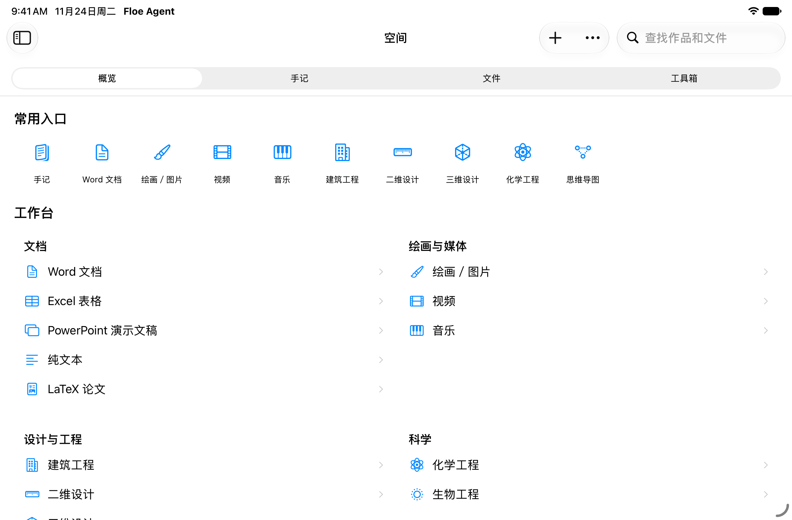

*New screenshots in this guide show Floe 1.8.72 (393) in the iPad Simulator.*

Space is the sidebar home for everything you personally own in Floe: the Notes library plus a library of editable works and files.

Choose a workbench in **Overview** based on what you want to make. Name the project and choose where to keep it. Use **Continue working** or **Files** to reopen the project later.

| What you are working on | Which feature to use | Typical result |
| --- | --- | --- |
| Class notes, reading annotations or reference material | **Notes**. Keep handwritten and annotated pages in documents. | Notes you can keep adding to |
| Meeting audio, transcripts and decisions | **Meeting Notes**. Keep the audio, transcript and highlights together. | Recording, transcript and minutes |
| Evolving drafts, reference images and candidate designs | **Canvas in Creative Mode**. Arrange and compare objects on a board. | A board you can keep arranging |
| Processes, sequences, relationships or system structure | **Diagram**. Use shapes and connections to show relationships. | An editable diagram |
| Photo corrections, cover art or a transparent icon | **Drawing / image**. Work with text, strokes, selections and masks on layers. | An editable image project and a PNG or other image |
| Cutting clips, adding music and lining up subtitles | **Video**. Align picture, sound and captions on a timeline. | A video project and MP4 |
| Arranging melodies or keeping musical parts separate | **Music project**. Arrange notes, audio and instruments on tracks. | An editable song, audio or MIDI |
| Plans, parts, floors or circuits | **2D Design, 3D Design, Building Project or Electronics Design**. Choose according to whether you are working with dimensions, solids, storeys or circuits. | A drawing, solid, building project, schematic or PCB |
| Viewing geographic data or inspecting regions by field | **Map Editor**. Work with layers, features, attributes and coordinate systems. | A map project or layer data |
| Typesetting a paper, equations and references | **LaTeX document**. Edit the source and compile to inspect the result. | LaTeX project and PDF |
| A quick calculation, conversion or measurement | **Toolbox**. Open the utility for the immediate job. | A calculation, dimension or angle |

**First walkthrough:**

1. Open **Space** from the sidebar. It has four sections: Overview, Notes, Files and Toolbox.
2. Overview shows quick-access entries, pinned works, your folders, and Continue working (recently opened notes and works).
3. Files lists your works. Switch between list and thumbnails, and filter by type: documents, drawing/images, video, or CAD.
4. To start a particular kind of work, open its shortcut or workbench under **Overview**. To choose a destination first, open the folder under **Files**, then choose a type from **+**. Enter a name, check **Location**, and tap **Create**. Start blank notes and meetings from **Notes → +**.
5. Use import to bring in existing files, or **Browse other locations…** to reach all workspace files, archived chat files and kept (recovered) documents. Deleted works can be restored from **Recently Deleted**.

**Ownership and saving:**

- Works are stored in your personal on-device library. They do not belong to any chat task: deleting a chat never deletes a work, and deleting a work never touches task or project files. Export anything important before deleting.
- Editors save into the work itself. Close and reopen a work from Continue working to confirm its latest state; recovery copies stay under Kept documents until you accept the saved file.
- A work can carry its own assistant conversation (Work assistant, or Meeting assistant for meetings). That conversation is part of the work and keeps unsent drafts; granting assistant access to one work does not open any other file.

## 2. Meetings: record, transcribe, minutes — **1.8.5**

Meetings combine a personal notebook, live recording, transcription and AI minutes in one work, opened from Notes.

**First meeting:**

1. Open **Space → Notes → + → Meeting Note**, type a name and create it. In landscape, **My Notes** is on the left. Switch among **Transcript**, **Highlights** and **Meeting Assistant** on the right.
2. To capture a meeting, use **Start Recording** at the bottom right. To work with a file, open **Recordings and Media → Import Audio or Video**. Enable live transcription if needed, or transcribe a saved recording later.
3. Review the transcript under **Transcript** and organize minutes and to-dos under **Highlights**. Review highlights before inserting them into your notes.
4. Turn on **automatic AI minutes** to keep minutes updated from the transcript, or ask the meeting assistant to answer questions about this meeting and organize notes and to-dos. Unsent drafts are kept.
5. Export **Word or PDF text minutes** from the minutes-template menu, and send follow-up actions back into your task flow.

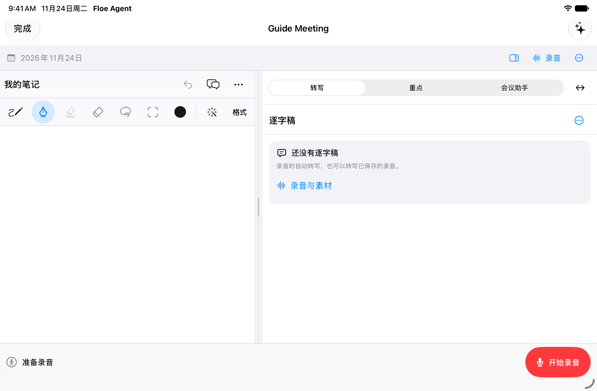

**Continuous recording in newer builds:** Pause and resume within the same meeting's recording timeline. After ending the recording, play it back and tap a transcript segment to seek to its time. Rename existing speakers or merge identities that refer to the same person; speaker separation depends on the selected recognition service. Reopen the meeting to review its recording, timestamps and corrected transcript.

**Play an imported recording.** In **Recordings and Media**, select the imported file and tap **Play Full Recording**. The player appears at the bottom of the meeting screen. Pause or scrub to review it. In the transcript, select a timestamped segment to jump to its position. Check the transcript, highlights and action items before exporting minutes.

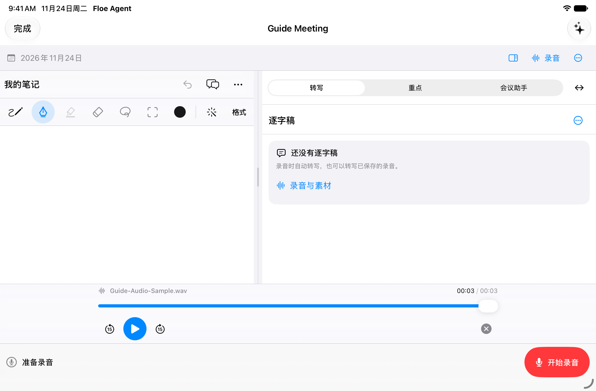

**Limits:** recordings stay on device by default; cloud transcription uses a service you explicitly select and is billed by that provider. Transcription quality follows your recognition settings (see the user manual §16).

## 3. Music projects — **1.8.5**

Space music works keep arrangement, keyboard, mixer and DJ workflows in one project.

**First project:**

1. In Space → Files, create a **Music** work and name it.
2. The workbench offers arrangement plus dedicated surfaces: piano roll, drum grid, keyboard, and DJ decks, with a mixer and effects for tracks.
3. Import audio or MIDI material, or ask the assistant to propose edits; each proposal shows what changes before you accept it.
4. Save is automatic into the work. Render when you want an audio file, then check the receipt against the actual rendered file and share or export it from the work.

**Music in this test update:** In Score, switch between Staff and Numbered notation while editing and saving the same score. Open Performance sounds to choose synthesized instrument sounds for each part. Perform & add renders audio, inserts a new track at the current playhead and returns to the arrangement when complete. Ordinary playback is for auditioning. Switch back to Staff to see complex marks omitted from the numbered view.

**Record from the playhead in newer builds:** Move the playhead to the intended start, choose audio or MIDI recording, then perform. Existing unmuted tracks play alongside it and older clips are kept. Stop, audition the new clip on the same timeline, then save and reopen to check its position. Arrangement recording, asset previews, monitoring and DJ recording have their own controls; confirm Stop in the appropriate surface before leaving.

The keyboard uses the available height for its keys. On wide screens, Show inspector / Hide inspector opens or collapses the right inspector. Expand the lower editor for a larger performance area.

**Limits:** AI-assisted editing uses your configured models; playback and rendering run on device and follow the project's real capabilities.

## 4. Diagrams and the mixed canvas — **1.8.5**

**Diagram** works well when the sequence or relationship matters. For an approval process, give each action a shape and connect the shapes in order. Reopen the work from **Space → Files** to check that its shapes and links are complete. Review the assistant's proposed changes before applying them.

**Creative Mode Canvas** keeps notes, images, documents and options for a topic together. Select an object to edit its content, or move it to rearrange the board. When comparing several image or drawing versions, keep the deliverables in their workbenches and use the canvas to record references and comparisons. See [the free-form editing walkthrough](USER_GUIDE.md#15-canvas-images-audio-and-video).

## 5. Manufacturing and 3D printing — **1.8.5**

Machining and printing open from a CAD document's **Manufacturing** entry.

**Machining walkthrough:**

1. Open your 2D/3D CAD design and enter Manufacturing. Choose the machine first.
2. Set stock, coordinates and operations; the assistant can read back the current object and suggest operations within the task's permissions.
3. Run the preview to watch material being removed along the toolpath; implemented collision checks are reported as they run.
4. Save the result, export STL or the toolpath, and reopen the saved result to verify. Manufacturing-cell (multi-spindle/multi-turret) programs save independently and can be read back later.

**3D printing walkthrough:**

1. From a CAD design or a file, prepare a print project; Floe copies the current geometry into it.
2. Arrange models on plates, add or duplicate parts, and adjust per-plate settings such as layer height and infill.
3. Pick a machine configuration: bed size, coordinate origin, nozzle offsets, custom start/end/tool-change G-code, and resin platform orientation for resin printers.
4. Slice; a completed slice opens Preview automatically, and the saved result stays bound to those parameters. Export the G-code your printer expects and check it in your slicer or host.

**Limits:** machining previews report implemented checks only — they are not a complete machine-safety certification. Native USB printer drivers are not included in this build; use your printer's normal transfer path. Physical printing and machining remain governed by your machine's real capabilities and safety rules.

## 6. Network toolbox — **1.8.5**

Open **Space → Toolbox**. Choose a shortcut at the top, use the categories below, or search by tool name in the upper right. Toolbox holds both network sessions and day-to-day measurement tools.

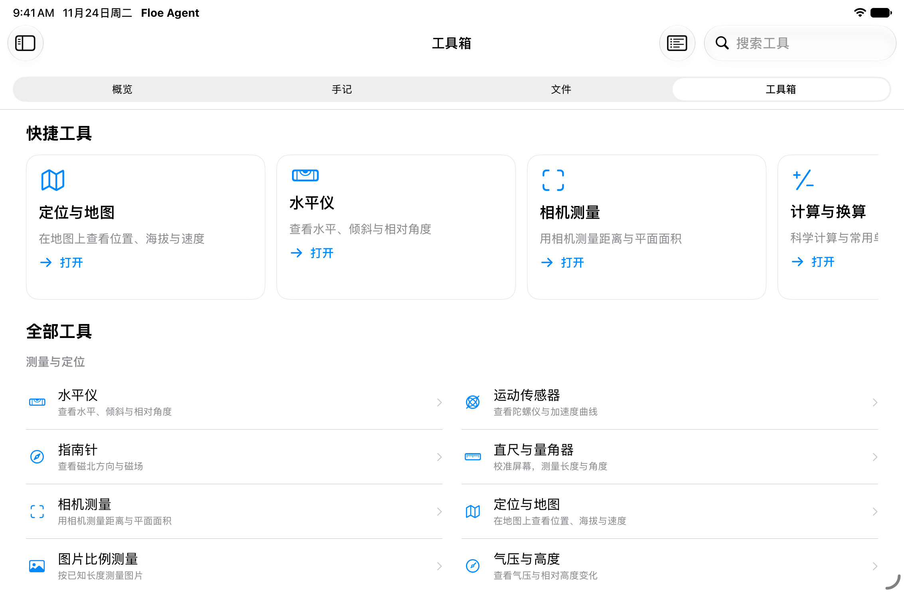

- **Diagnostics:** ping, traceroute, DNS, port checks, LAN discovery, Wi-Fi information and roaming checks. Wi-Fi names and BSSIDs are read only with system authorization; nothing scans until you start it.
- **Connections and sessions:** HTTP, WebSocket and MQTT clients, a serial assistant (TCP, UDP or Bluetooth; USB needs a supported iPad and drivers not yet shipped), plus terminal and VNC remote workspaces.
- **Analysis:** capture browser with packet-capture import (PCAP/PCAPNG); AI analysis reports progress, can be stopped, and times out honestly.
- **Utilities:** JSON formatting, encoding conversion, QR codes and checksums.

**Measurement and everyday tools in newer builds:** Choose a tool from the swipeable top entries, categories or search; the full list remains below.

- **Level, Motion Sensors, Compass, Pressure & Altitude:** start to see readings, use the offered zero, lock or recording controls, and stop collection when finished. Compass shows magnetic north; pressure-based altitude shows relative change.
- **Ruler & Protractor, Camera Measurement, Photo Measurement:** calibrate the screen ruler against a real object first. AR measurement needs supported hardware. In a photo, set a known reference length before measuring lengths, angles or areas on the same plane, then export annotations if needed. Recheck calibration after window or display changes.
- **Calculator & Converter, Location & Map:** evaluate expressions or swap units and copy results. After granting location access, inspect the position and accuracy, then explicitly save or share a place or send it to Notes.
- **Sound Analysis, Magnifier & Light, Scan & Recognize:** start the microphone or camera explicitly. Inspect relative audio levels and spectrum, zoom or freeze a view, or scan codes and text and export results. Audio readings are not calibrated environmental sound pressure.
- **Stopwatch and timers:** record laps, manage named countdowns and allow system alarms when prompted. See user manual §17 for multi-stage task timers; system alarms and the model's follow-up execution are separate outcomes.

A measurement covers one endpoint and path, not your whole network. Reports export only what you choose.

### Calculate, convert and measure

1. Open **Calculator and Conversion**, enter `2×3` in **Calculator**, and tap **Calculate**. The result, 6, also appears in **History**. Use the copy icon beside the result when you need it elsewhere.
2. Open **Unit Conversion**, choose **Length**, then millimetres and centimetres. Entering 1 gives 0.1 cm. Swap the units with the arrows to see 1 cm become 10 mm.
3. Return to Toolbox and open **Ruler and Protractor**. In **Angle**, drag the handles and read the angle between the lines. Before measuring a real length on screen, align the blue marks to a reference of known size, then finish calibration. Before calibration, length appears in screen points.

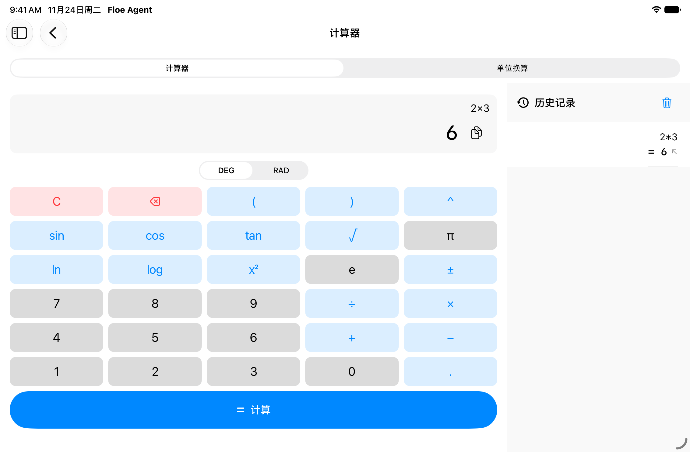

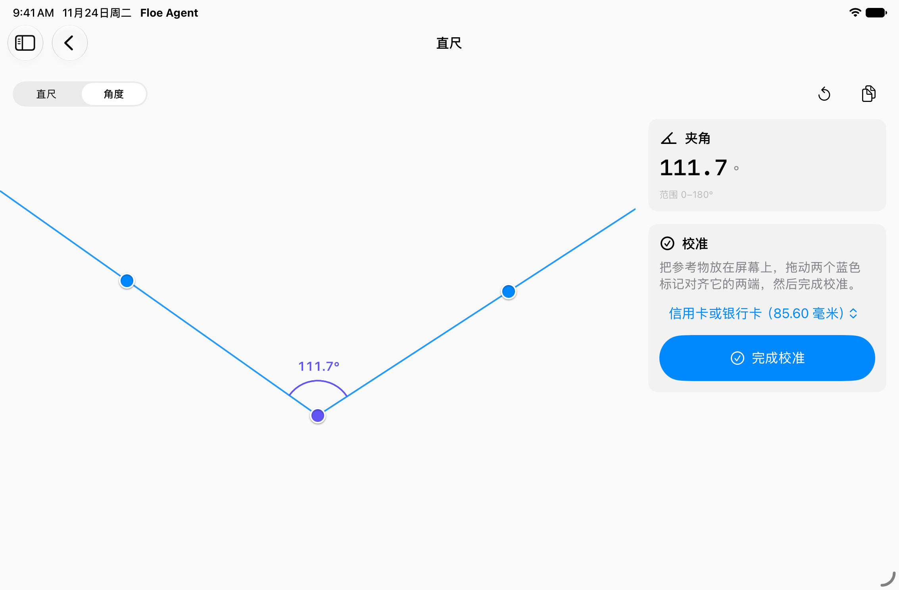

## 7. Chemistry projects — **1.8.5**

Create a **Chemistry project** from Space → New. The native structure editor saves structures into the project, calculation records stay attached to it, and structure images can be referenced from Notes. Heavy recalculation runs in your configured execution environment — check the environment before a long job.

## 8. Additional workbenches and build requirements

[1.8.6 release notes](releases/notes/RELEASE_NOTES_1.8.6_BUILD_326.md) record these additions to the published installer:

- **LaTeX** — a project workbench, source folding and PDF full-text search, with retained reading/search state across full-screen changes.
- **Electronics/PCB** — schematic/PCB editing, canvas interaction, design-rule checks and synchronization; PCB-to-schematic updates include a difference preview and confirmation.
- **Biology and CAD engineering analysis** — additional native workbench entries in Space, with editing, preview and save/reopen work included in the release scope.

Some advanced PCB and simulation operations remain in development; native USB serial drivers are not included in that build. These release notes do not establish that every specialist feature or later source change has shipped.

For GIS, font design, notation and Image Playground, check the [specialist-editor integration plan](FLOE_GIS_SCORE_FONT_PREDEVELOPMENT.zh-CN.md), [active integration records](README.md) and the selected release notes. Availability is feature-specific; source integration alone does not establish delivery.

### Start a sketch in 3D Design

1. In **Space → Overview**, open **3D Design**, name it, and check its location. Open **Sketch** on the left for lines, rectangles, circles and other tools.
2. Choose **Sketch → Rectangle** and select a reference plane when prompted. To draw with your finger, enable **Touch drawing** using the hand icon on the left, then drag between opposite corners on the grid. Check that the four edges close. If dragging pans the view, check the switch, the rectangle tool and the current plane.
3. Tap **Exit Sketching** and select the interior of the closed profile. Under **Features → Extrude**, set the distance to `2 mm`, choose **New Body** and confirm. A `5 × 3 mm` rectangle should produce a solid `2 mm` thick. If you cannot select the interior, return to the sketch and look for gaps or overlaps.
4. Close and reopen the project by name in **Space → Files** to confirm the solid was saved. For a mesh delivery, use the share icon at the top and choose **STL → Save to Files**. Check its dimensions and orientation in the receiving app. Keep the 3D project for further editing. See the [unified 3D workbench](USER_GUIDE.md#3d-models-one-unified-workbench) for more.

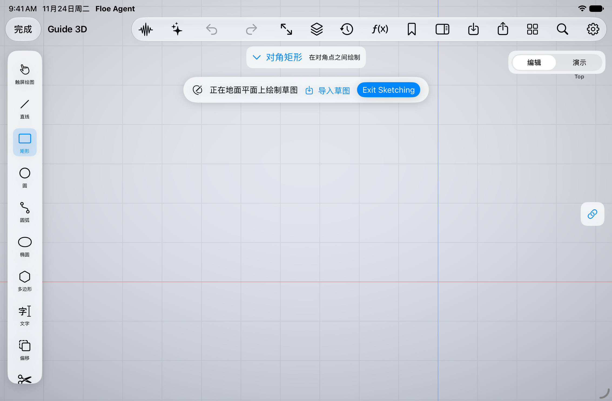

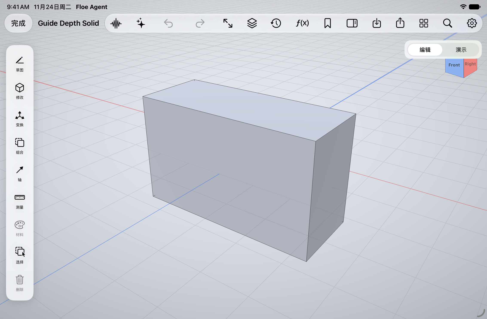

### Choose the right workbench

| What you want to work on | Where to start in Space | What to check |
| --- | --- | --- |
| Floor plans with rooms | **Overview → Building Project**. Choose a storey before editing walls, rooms or drawings. | Units, the selected storey, and which objects belong to it after reopening. |
| 2D lines and dimensions | **Overview → 2D Design**, or open an editable DXF or DWG from Files. | Selected layer, objects, dimensions and units. Save and reopen. |
| A typeset paper | **Overview → LaTeX Document**. Edit the project source and compile the PDF. | Build log and PDF pages. Keep both the project and the delivery PDF. |
| Schematics and PCB layouts | **Files → + → Electronics**. Edit the schematic before reviewing the component and net changes in PCB. | Review sync differences before applying and run design rule checks after routing. |
| Map data | **Files → … → Import geographic data…**, or choose **Map Editor** from the new-project menu. | Select a specific layer and check its coordinate system, visibility, attributes and exported geometry. |
| A molecule for a lesson | **Overview → Chemistry Project**. Open or draw a molecule in the structure editor. | Structure diagram, saved project and the status of any calculation. |
| Sequence material for teaching | **Overview → Biology Project**. Open a project and inspect a record or annotations. | Record name, annotation range, and which file is the original or an exported copy. |

Available formats and workbench options depend on the installed build.

### 2D Design: draw a rectangle and deliver a DXF

1. Create a drawing in **Space → Overview → 2D Design**. Check that the upper-right unit is **mm**, enable **Touch drawing** on the left, and choose **Rectangle**. Drag between two corners on the grid. The example measures `6 × 4 mm` with a `20 mm` perimeter. If the size differs, check the units, snapping and all four corners.
2. Use the share icon at the top, choose **DXF**, and choose a destination in Files. Open the DXF in the receiving CAD app to check that the profile is closed and its dimensions match the project.
3. Tap **Done**, then reopen the drawing by name in **Space → Files** and check its four edges. Use this drawing when continuing in Floe.

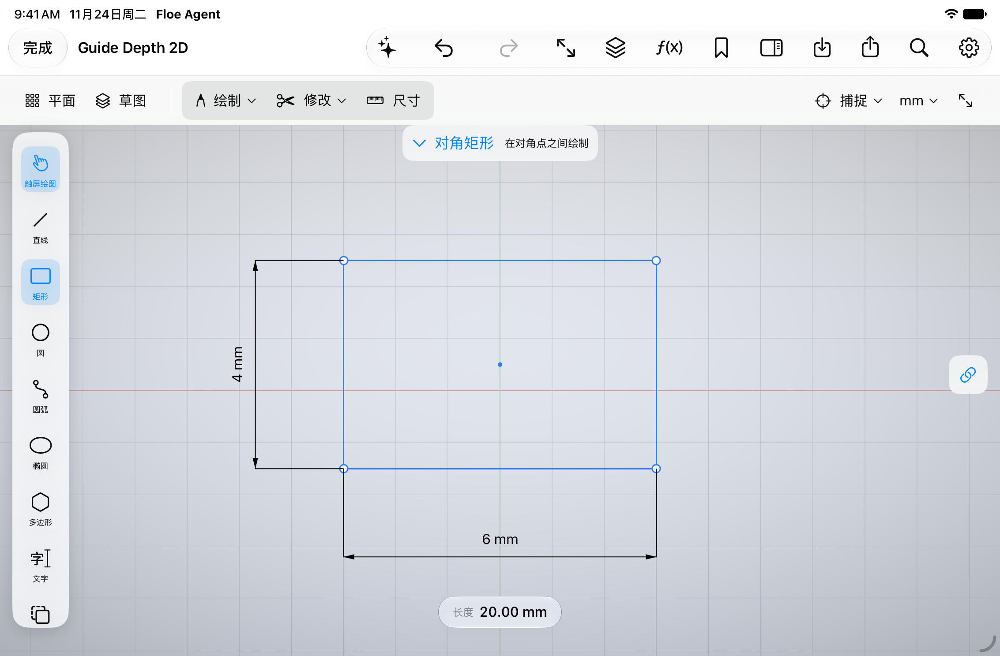

### Maps: import, edit attributes and export GeoJSON

1. Choose a GeoJSON file in **Space → Files → … → Import geographic data…**. Select its layer on the left, then tap **Fit layer** in the map toolbar. A small region may be hard to see at the initial world scale. Check that the layer is visible and contains features, then verify its coordinate system.
2. Open **Table**, select a feature and tap the field to edit. Press Return to apply the value and wait for it to save. For a test polygon with a `name` field, give it a new name while keeping its boundary. Reopen the project and the attribute table to confirm the value persisted.
3. Touch and hold the specific layer row and tap **Export layer** to open **Export data / project**. Choose **GeoJSON** and turn off **Include all vector layers** when you only want the selected layer. With the coordinate-system field left blank, GeoJSON uses **EPSG:4326**. Name the export and tap **Apply**. Open the result and check the feature count, attributes and geometry.
4. If the import reports **Unexpected EOF**, export a complete file again from the original GIS project or check whether the copy was truncated, then retry. Once it succeeds, open the new project in **Space → Files** to verify the layer.

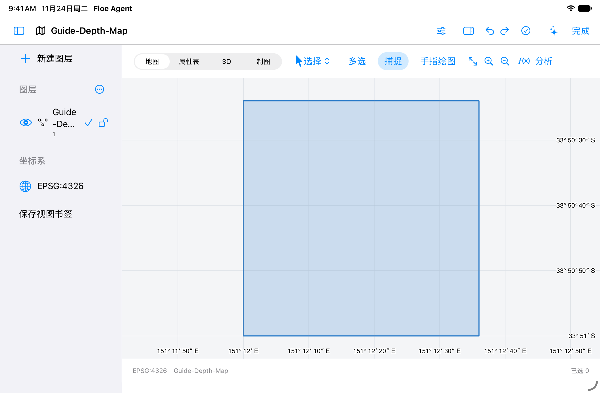

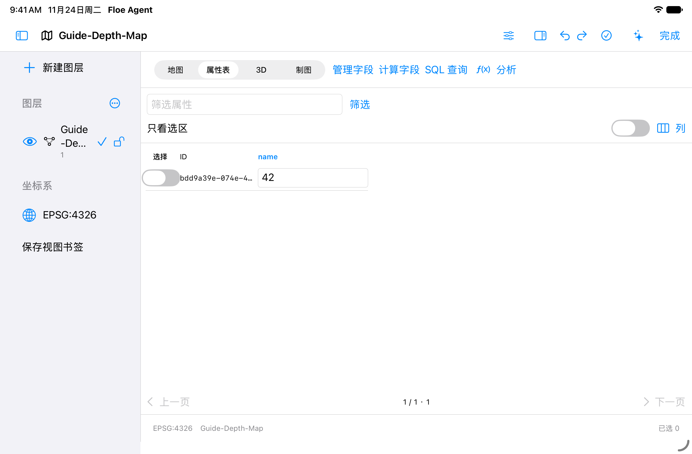

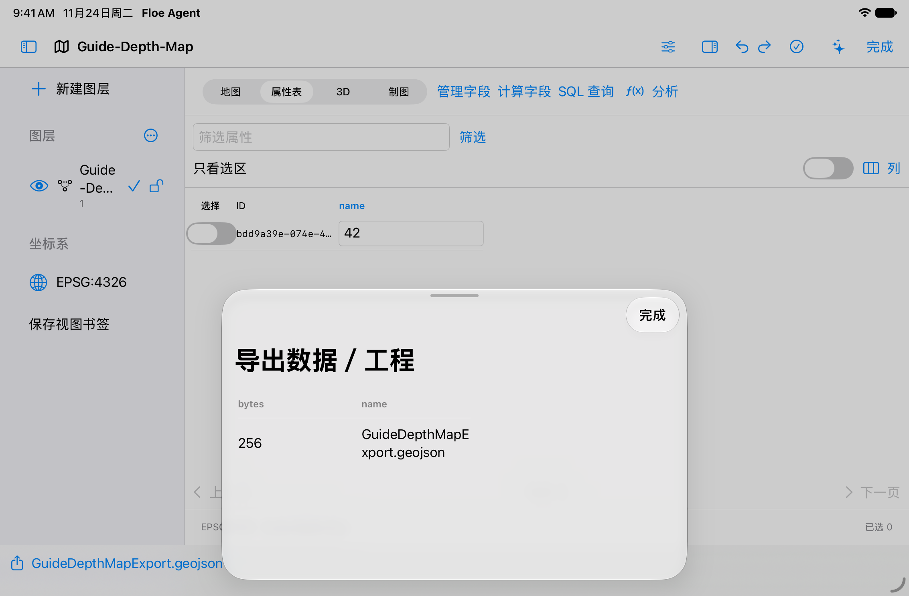

## Saving, exporting and help

- Confirm saves by closing and reopening the work; keep recovery copies until the accepted file checks out.
- Export or share before deleting; deleted works are recoverable from Recently Deleted only on the same device.
- Questions and bug reports: [GitHub Issues](https://github.com/JiangNanGenius/floe-agent/issues) (primary support channel); describe the build, device and steps. Diagnostics uploads are voluntary and carry no response-time guarantee — never include passwords, keys or private files.

[User manual](USER_GUIDE.md) · [Quickstart](QUICKSTART.md) · [Documentation index](README.md)
