<!-- docs-updated: 2026-11-24 -->
# 空间与专用工作台

[English](WORKSPACES_GUIDE.md) · [使用手册](USER_GUIDE.zh-CN.md) · [快速开始](QUICKSTART.zh-CN.md)

面向任务的 Floe 个人文件库与专用工作台教程：空间文件与作品、会议、音乐、图示、加工与 3D 打印、网络工具箱和化学工程。模型、任务、手记与 Office 的基础用法请先看[使用手册](USER_GUIDE.zh-CN.md)。

## 需要什么版本？

Floe 的各安装渠道包含的功能不同。下方版本标注表示相应工作流的发布基线；当前渠道版本及核实日期统一见 [CURRENT_STATUS](CURRENT_STATUS.md)：

| 标注 | 获取渠道 | 覆盖内容 |
| --- | --- | --- |
| **1.7.74** | [App Store](https://apps.apple.com/app/id6801209053)，iOS/iPadOS 26+ | 稳定的正式版。仅标注 1.7.74 的小节适用；空间和专用工作台尚未进入该版本。 |
| **1.8.5 基线** | [原始发布](https://github.com/JiangNanGenius/floe-agent/releases/tag/v1.8.5)；选择更新安装包时查看渠道状态 | 空间、会议、音乐、图示、加工与打印、工具箱和化学工程的原教程基线。 |
| **1.8.6 新增** | [已公开的未签名 IPA](https://github.com/JiangNanGenius/floe-agent/releases/tag/v1.8.6)；TestFlight 可用性单独核对 | 已包含 LaTeX、原理图／PCB、生物学及 CAD 工程分析入口；高级 PCB 与仿真能力仍在完善。 |
| **其他专用编辑器** | 按所选版本和接入记录核对 | GIS、字体、制谱、Image Playground 各有独立范围与资格记录，开发修改不自动进入安装包。 |

已安装版本在“设置 → 诊断与关于”查看。各渠道可用状态见[版本与安装状态](CURRENT_STATUS.md)；[官网版本中心](https://www.floe-agent.com/releases)列出所有已发布构建。

## 1. 空间：你的文件与作品 — **1.8.5**

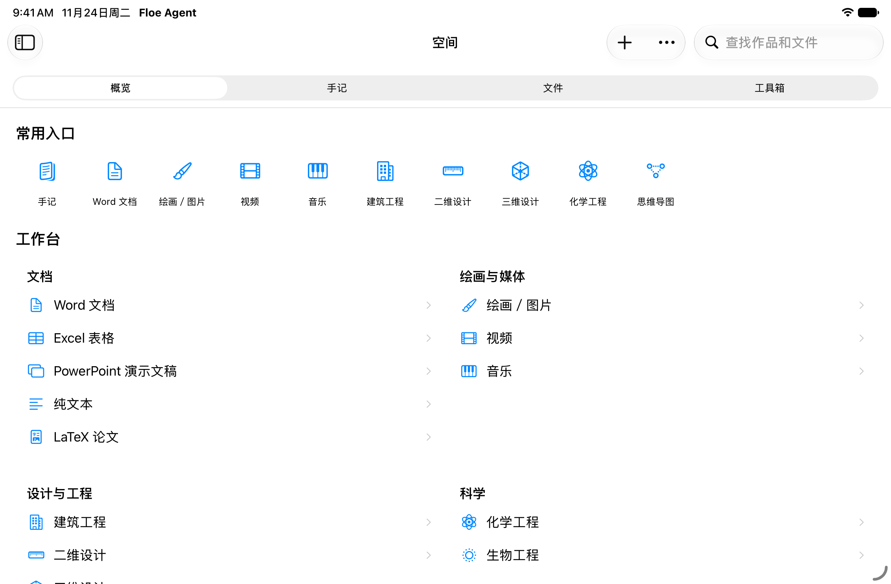

*本页新增截图取自 iPad 模拟器中的 Floe 1.8.72（393）。*

空间是侧栏中个人内容的入口：手记文库，加上可编辑作品与文件库。

在**概览**按要做的事选工作台。新建时填写名称和保存位置，做完后从**继续使用**或**文件**打开原工程。

| 你手上的工作 | 选哪个功能 | 常用成果 |
| --- | --- | --- |
| 课堂笔记、读书批注，或积累参考资料 | **手记**。按文档和页面归档，适合手写与标注。 | 可以继续补写的笔记 |
| 会议录音、转写和决定事项 | **会议笔记**。把声音、转写和重点放在同一份会议作品里。 | 录音、转写和纪要 |
| 一组还在变化的草稿、图片和候选方案 | **创意模式的画布**。在看板上自由摆放和比较对象。 | 可继续调整的看板 |
| 流程、顺序、关系或架构 | **图示**。用形状和连线表达关系。 | 可编辑的结构图 |
| 修照片、制作封面或带透明底的图标 | **绘画／图片**。按图层处理文字、笔画、选区和蒙版。 | 可编辑图片作品、PNG 或其他图片 |
| 剪镜头、加音乐和字幕 | **视频**。在时间线上把片段、声音和字幕对齐。 | 视频工程、MP4 |
| 编配旋律，整理不同声部 | **音乐工程**。分轨排列音符、音频和乐器。 | 可继续编辑的乐曲、音频或 MIDI |
| 画平面图、零件、楼层，或设计电路 | **二维设计、三维设计、建筑工程、电子设计**。按尺寸图纸、实体、楼层和电路选择。 | 图纸、实体、建筑工程、原理图或 PCB |
| 在地图上查看地理数据，按字段核对区域 | **地图编辑器**。区分图层、要素、属性和坐标系。 | 地图工程、图层数据 |
| 排论文、公式、图表和参考文献 | **LaTeX 论文**。用源码控制排版，编译后查看成品。 | LaTeX 工程、PDF |
| 临时计算、换算或测量 | **工具箱**。打开一个工具，完成当下的小任务。 | 计算结果、尺寸或角度 |

**第一次上手：**

1. 从侧栏打开**空间**。它分为概览、手记、文件和工具箱四个板块。
2. 概览提供常用入口、置顶作品、文件夹，以及“继续使用”（最近打开的手记与作品）。
3. “文件”以列表展示作品，可切换缩略图，并按类型筛选：文档、绘画/图片、视频或 CAD。
4. 想直接开始一种作品，在**概览**点常用入口或对应工作台。想先指定保存位置，在**文件**打开目标文件夹，再从右上角 **＋** 选作品类型。填写名称，检查**位置**，点**创建**。空白手记和会议笔记从**手记 → ＋**创建。
5. 使用导入加入已有文件，或点“浏览其他位置…”访问全部工作区文件、归档聊天文件和保留的（恢复）文档。被删除的作品可在**最近删除**中恢复。

**归属与保存：**

- 作品保存在设备上的个人文件库中，不属于任何聊天任务：删除聊天不会删除作品，删除作品也不会影响任务或项目文件。删除前请先导出重要内容。
- 各编辑器直接保存进作品。关闭后从“继续使用”重新打开，确认最新状态；在接受的文件核对完成前，恢复副本保留在“保留的文档”中。
- 每个作品可以有自己的助手会话（作品助手，会议为会议助手）。会话属于该作品并保留未发送草稿；授权助手访问一个作品不会打开其他文件。

## 2. 会议：录音、转写与纪要 — **1.8.5**

会议把个人笔记、实时录音、转写和 AI 纪要整合在一个作品中，从手记进入。

**第一场会议：**

1. 打开**空间 → 手记 → ＋ → 会议笔记**，输入名称并创建。横屏时左侧是**我的笔记**，右侧可切换**转写、重点、会议助手**。
2. 现场录音用右下角的**开始录音**。处理已有素材时，在顶部点**录音**，打开**录音与素材 → 导入音视频**。打开**边录音边转写**可实时查看分段，也可稍后处理已保存的素材。
3. 用**转写**核对逐字稿，在**重点**整理纪要和待办。要把重点加入自己的笔记，在核对后再插入。
4. 打开**自动更新 AI 纪要**持续根据转写整理，或直接向会议助手提问本场会议内容、请它整理笔记与待办。未发送的草稿会保留。
5. 通过纪要模板菜单导出 **Word 或 PDF 文字纪要**，并把待办回流到任务流程。

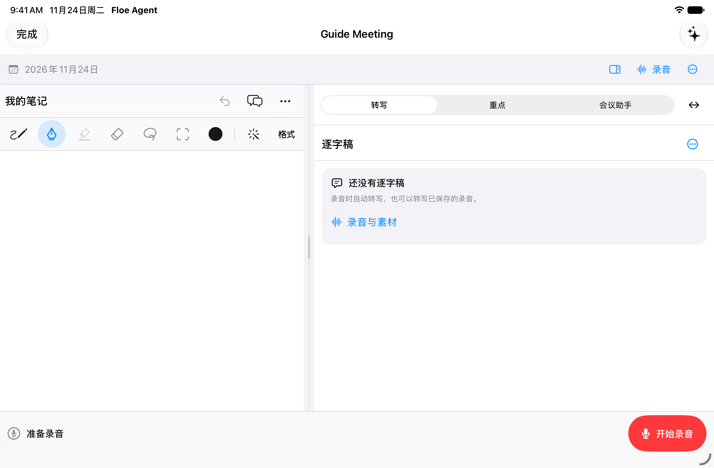

**连续录音（较新构建）：** 暂停后点继续，仍在同一场会议的录音时间线上。结束后回放录音，点转写片段定位到对应时间。可对已有说话人改名，或合并被误分为多人的同一个人；说话人区分取决于所选识别服务。重新打开会议后继续查看录音、时间位置和修正后的转写。

**回放已有素材。** 在**录音与素材**选中刚导入的文件，点**播放整段**。播放器出现在会议页底部，可暂停或拖动进度。在转写里点有时间戳的片段，可回到对应位置。导出纪要前分别核对逐字稿、重点和待办。

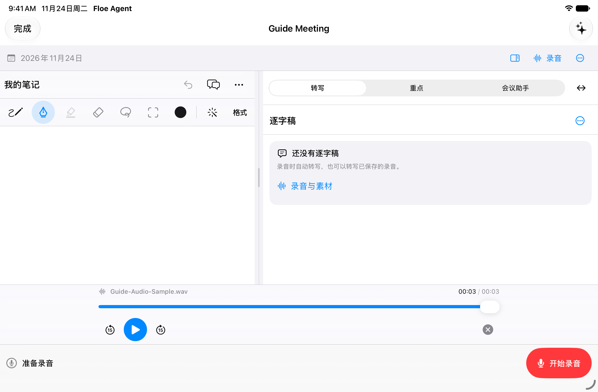

**边界：** 录音默认保留在本机；云端转写使用你明确选择的服务，费用由该服务商计取。转写质量随识别设置变化（见使用手册 §16）。

## 3. 音乐工程 — **1.8.5**

空间音乐作品把编曲、键盘、混音与 DJ 工作流整合在一个工程中。

**第一个工程：**

1. 在空间 → 文件中新建**音乐**作品并命名。
2. 工作台提供编曲，以及钢琴卷帘、鼓机、电子琴、DJ 打碟等专用界面，轨道配有调音台与效果器。
3. 导入音频或 MIDI 素材，或让助手提出修改建议；每项建议在应用前都会展示具体改动。
4. 保存自动写入作品。需要音频文件时执行渲染，按回执核对实际生成的文件，再从作品分享或导出。

**本轮测试版的音乐功能：** 在“乐谱”中可切换五线谱与简谱，编辑和保存仍使用同一份乐谱。打开“演奏音色”为各声部选取合成乐器音色；“演奏并加入编曲”生成音频，并在当前播放头位置加入新音轨，完成后返回编曲。普通播放用于试听。需要查看简谱中未呈现的复杂记号时，切回五线谱。

**从播放头录制（较新构建）：** 把播放头移到起录位置，选择音频或 MIDI 录制，再开始演奏。已有未静音轨同步播放，旧片段保留；停止后在同一时间线上试听新片段，保存并重新打开核对位置。编曲录制、素材试听、监听与 DJ 录制各有自己的控制，离开前在对应入口确认停止。

电子琴会利用可用高度显示琴键。宽屏右侧检查器可通过“显示检查器／隐藏检查器”展开或收起，也可展开下方编辑器以获得更大的演奏区域。

**边界：** AI 辅助编辑使用你配置的模型；播放与渲染在本机运行，以工程的真实能力为准。

## 4. 图示与混合画布 — **1.8.5**

**图示**适合解释“谁接到谁”“接下来做什么”。例如整理审批流程，把每个操作画成形状，用连线表达顺序。创建后从**空间 → 文件**重开，检查形状与关系是否齐全。交给助手提出更改时，先预览差异，再决定是否应用。

**创意画布**适合把一个主题下的便签、图片、文档和方案排在一起。选中对象可编辑对应内容，移动对象只改变看板布局。在比较图片或图纸的多个版本时，把成品留在对应工作台，画布保留选材和比较过程。详见[自由编辑步骤](USER_GUIDE.zh-CN.md#15-画布图像音视频)。

## 5. 加工与 3D 打印 — **1.8.5**

加工与打印从 CAD 文档的**加工**入口进入。

**加工流程：**

1. 打开二维/三维 CAD 设计并进入加工。先选择机床。
2. 设置毛坯、坐标与工序；助手可以读取当前对象，并在任务权限内建议工序。
3. 运行预览，沿刀路逐步查看去料；已实现的碰撞检查会随运行报告。
4. 保存结果、导出 STL 或刀路，并重新打开保存的结果核对。制造单元（多主轴/多刀塔）程序独立保存，可稍后读取。

**3D 打印流程：**

1. 从 CAD 设计或文件准备打印工程，Floe 会把当前几何复制进去。
2. 在打印平台上摆放模型，添加或复制零件，并按平台调整层高、填充等参数。
3. 选择机型配置：平台尺寸、坐标原点、喷头偏移、自定义开始/结束/换头 G-code，以及光固化平台的朝向。
4. 切片完成后自动进入“预览”，保存结果与参数保持绑定。导出打印机所需的 G-code，并在你的切片或上位机软件中核对。

**边界：** 加工预览只报告已实现的检查，不构成完整的机床安全认证。本构建未附带原生 USB 打印机驱动；请使用打印机的常规传输方式。实际打印与加工仍以机床真实能力和安全规范为准。

## 6. 网络工具箱 — **1.8.5**

打开**空间 → 工具箱**。从顶部快捷卡片、下方分类或右上角**搜索工具**打开所需功能。工具箱同时提供网络会话与日常测量工具。

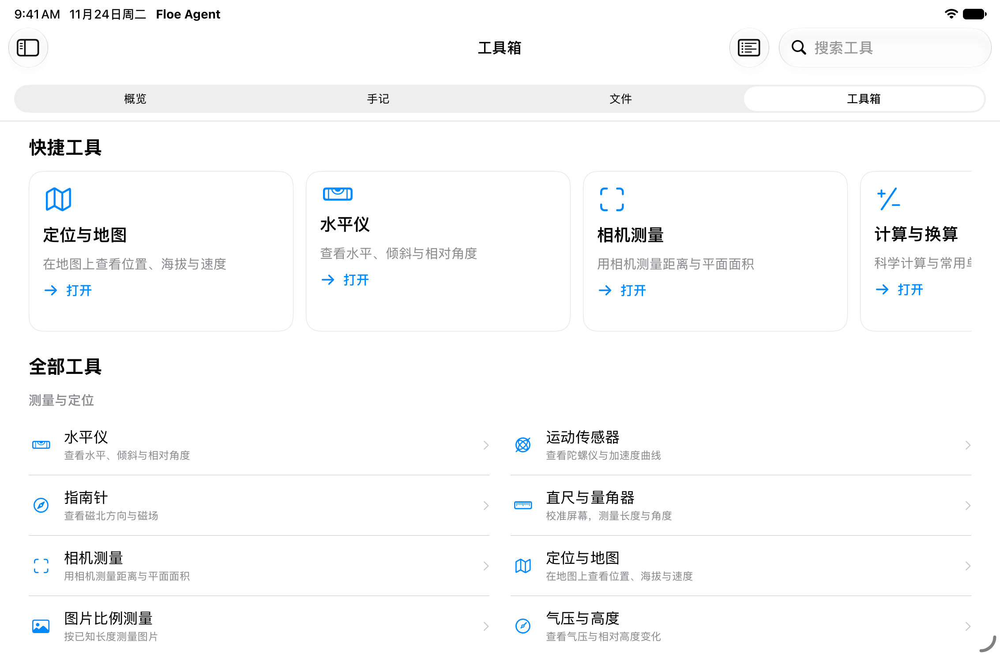

- **诊断：** Ping、路由追踪、DNS、端口检查、局域网发现、Wi-Fi 信息和漫游检查。Wi-Fi 名称与 BSSID 仅在系统授权后读取；不开始就不会扫描。
- **连接与会话：** HTTP、WebSocket 和 MQTT 客户端，串口助手（TCP、UDP 或蓝牙；USB 需要受支持的 iPad 与尚未随包的驱动），以及终端和 VNC 远程工作区。
- **分析：** 抓包浏览器，支持导入抓包文件（PCAP/PCAPNG）；AI 分析显示进度、可停止、超时如实报告。
- **小工具：** JSON 格式化、编码转换、二维码和校验码。

**测量与日常工具（较新构建）：** 在顶部滑动入口、分类或搜索中选择工具；完整列表仍在下方。

- **水平仪、运动传感器、指南针、气压与高度**：开始后查看读数，按工具提供的操作归零、锁定或记录，结束时停止采集。指南针显示磁北；气压高度是相对变化。
- **直尺与量角器、相机测量、图片比例测量**：屏幕尺先用实物校准；AR 测量需设备支持。图片先标定已知长度，再测同一平面上的长度、角度或面积，按需要导出标注图。窗口或显示条件变化后重新核对校准。
- **计算与换算、定位与地图**：计算表达式或互换单位并复制结果；定位获授权后查看位置和精度，按需保存、分享地点或存入手记。
- **声音分析、放大镜与照明、扫描与识别**：主动开启麦克风或相机；可查看相对声音电平与频谱、放大或冻结画面、扫描条码和文字并导出。声音读数不等于校准后的环境声压。
- **秒表与倒计时**：记录分段、管理多个命名倒计时，并按提示允许系统响铃。任务中的分阶段计时见使用手册 §17；系统响铃与模型继续执行分别看待。

### 计算、换算与测量示例

1. 点**计算与换算**，在**计算器**输入 `2×3`，点底部**计算**。结果为 6，也会出现在**历史记录**里。点表达式旁的复制图标可取用结果。
2. 切到**单位换算**，选**长度**和毫米、厘米。输入 1 后显示 0.1 cm。点两个单位间的交换按钮可反转方向，1 cm 会显示为 10 mm。
3. 回到工具箱，打开**直尺与量角器**。选**角度**可拖动线上的控制点并读取夹角。测量屏幕上的实际长度前，选已知尺寸的参照物、对齐两个蓝色标记，再点**完成校准**。校准前长度显示为屏幕点。

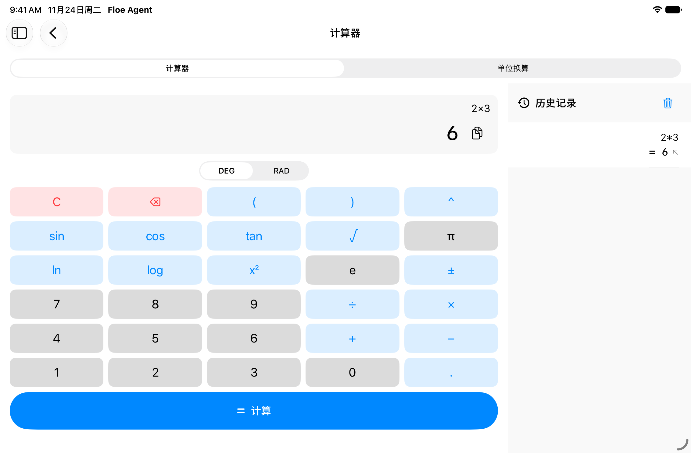

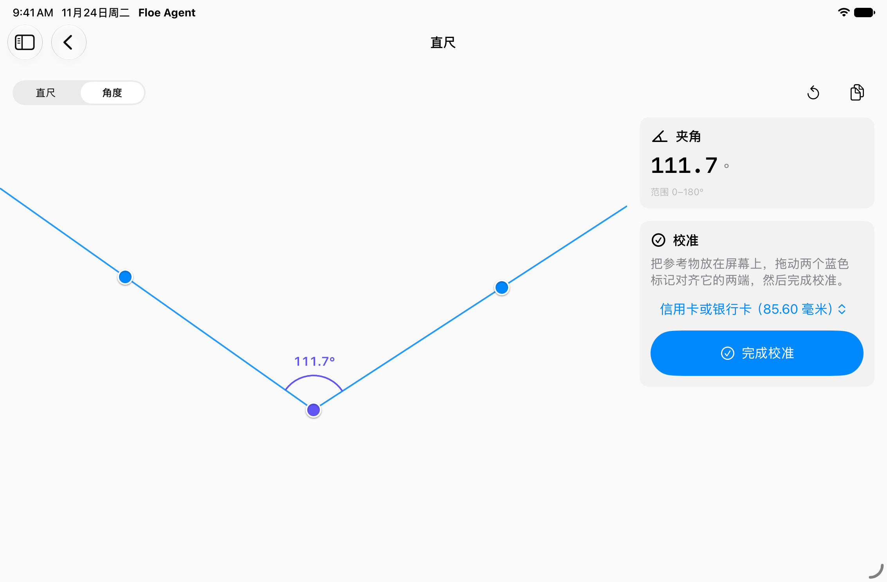

一次测量只覆盖一个端点与路径，不代表整个网络。报告只导出你选择的内容。

## 7. 化学工程 — **1.8.5**

在空间 → 新建中创建**化学工程**。原生结构编辑器把结构保存进工程，计算记录随工程保留，结构图可写手记引用。重计算在配置的执行环境中运行——长任务前先确认环境可用。

## 8. 更多工作台与适用版本

[1.8.6 发布说明](releases/notes/RELEASE_NOTES_1.8.6_BUILD_326.md)已记录这些公开安装包新增内容：

- **LaTeX**：工程工作台、源码折叠和 PDF 全文搜索，并在切换全屏后保留阅读与搜索状态。
- **电子／PCB**：原理图与 PCB 编辑、画布操作、设计规则检查和同步；从 PCB 更新原理图时展示差异并确认。
- **生物学与 CAD 工程分析**：空间中的更多原生工作台入口，本版范围包含编辑、预览及保存重开路径。

部分高级 PCB 编辑和仿真分析仍在完善，原生 USB 串口驱动未包含在该构建中。这些新增记录不表示全部专用能力或后续源码修改均已交付。

GIS、字体设计、制谱及 Image Playground 请分别核对[专用编辑器接入计划](FLOE_GIS_SCORE_FONT_PREDEVELOPMENT.zh-CN.md)、[在研接入记录](README.md)与所选版本说明。可用性按功能区分，源码接入不等于安装包已交付。

### 从空间进入三维草图

1. 在**空间 → 概览**打开**三维设计**，命名并确认位置。左侧**草图**内有直线、矩形、圆等工具。
2. 打开**草图 → 矩形**，按提示选择参考平面。用手指时，先确认左侧手指图标**触屏绘图**高亮，再在网格上从一角拖到对角。松手后应出现四条闭合边。拖动只平移视图时，先检查绘图开关、矩形工具和当前平面。
3. 点顶部 **Exit Sketching（退出草图）**，选中封闭轮廓的内部。在**特征 → 拉伸**中，将距离设为 `2 mm`，选 **New Body（新建实体）**并确认。试做 `5 × 3 mm` 矩形时，沿面外方向应得到厚 `2 mm` 的实体。如果无法选中内部，回到草图检查是否有缺口或重叠。
4. 关闭后从**空间 → 文件**按名称重开工程，确认实体仍在。需要交付网格时，用顶部分享图标选择 **STL** 并保存到系统“文件”。收件软件打开后核对尺寸和方向。同时保留三维工程供后续修改。更多操作见[统一 3D 工作台](USER_GUIDE.zh-CN.md#3d-模型统一工作台)。

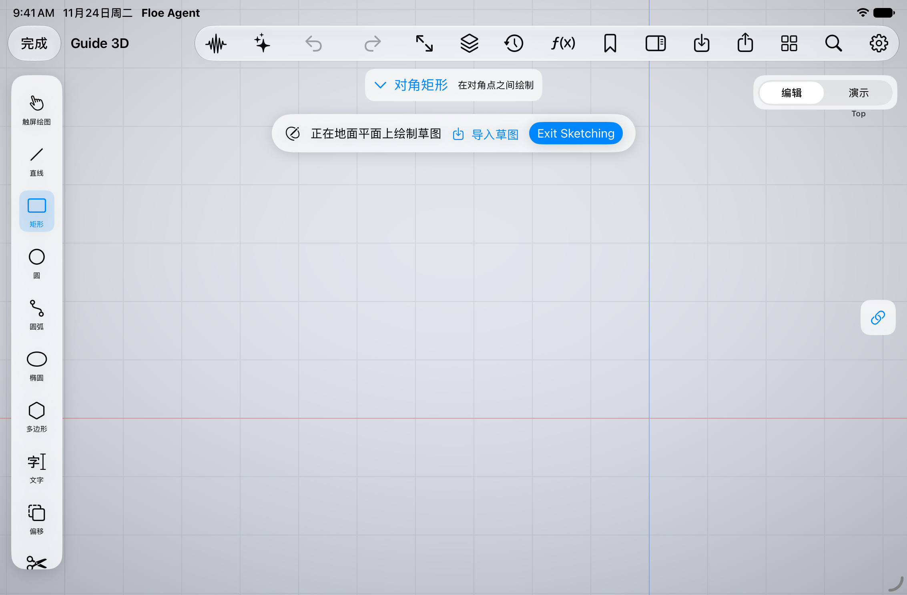

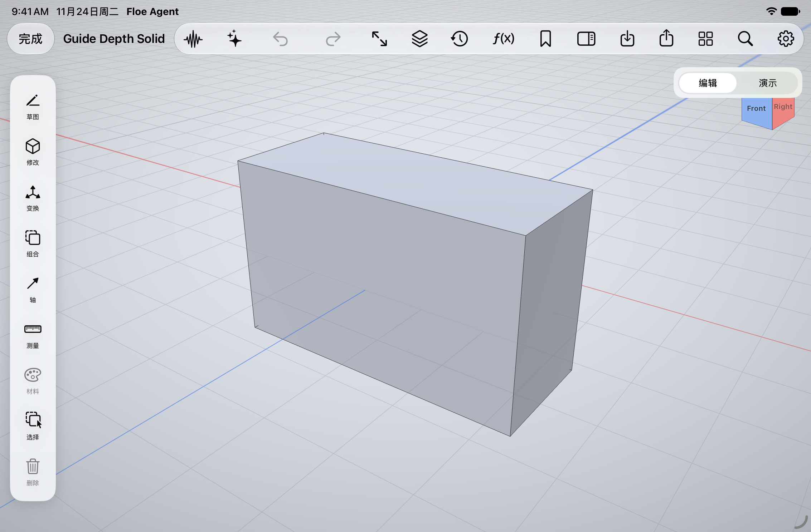

### 选对专用工程

| 想处理的内容 | 从空间进入 | 打开成果后检查 |
| --- | --- | --- |
| 带楼层和房间的平面 | **概览 → 建筑工程**，新建工程后先选楼层，再处理墙、房间或图纸 | 核对单位、所选楼层，重开同一工程检查对象归属 |
| 平面线条与标注 | **概览 → 二维设计**，或从文件打开支持编辑的 DXF／DWG | 选中图层和对象，检查尺寸和单位，保存后重开 |
| 论文排版 | **概览 → LaTeX 论文**，在工程中编辑源码，编译后查看 PDF | 核对日志和 PDF 页数，分别保留工程源码和交付 PDF |
| 原理图与 PCB | **文件 → ＋ → 电路设计**，编辑原理图后核对元件和网络，再检查 PCB | 应用同步前核对差异，布线后检查设计规则 |
| 地图数据 | **文件 → … → 导入地理数据…**，或在新建菜单选择**地图编辑器** | 选择具体图层，核对坐标系、可见性、属性和导出几何 |
| 学习用的分子结构 | **概览 → 化学工程**，在结构编辑器打开或绘制分子 | 先核对结构图和工程保存，独立检查计算是否已完成 |
| 教学序列资料 | **概览 → 生物工程**，打开工程后查看所选记录或注释 | 检查记录名称和注释范围，区分原始文件与导出副本 |

这些工作台在不同构建中的能力有所差异，入口和支持的格式以你的安装版本为准。

### 二维设计：画矩形并交付 DXF

1. 从**空间 → 概览 → 二维设计**新建图纸。确认右上角单位为 **mm**，从左侧打开**触屏绘图**并选择**矩形**。在网格上拖出两角。示例绘出 `6 × 4 mm`，选中后显示周长 `20 mm`。尺寸偏差时，检查当前单位、捕捉状态和四个角点。
2. 用顶部分享图标选择 **DXF**，在系统“文件”选择保存位置。用目标 CAD 软件打开 DXF，确认轮廓闭合且宽高与工程一致。
3. 点**完成**，再从**空间 → 文件**按名称重开图纸，检查四条边。在 Floe 继续编辑时打开此图纸。

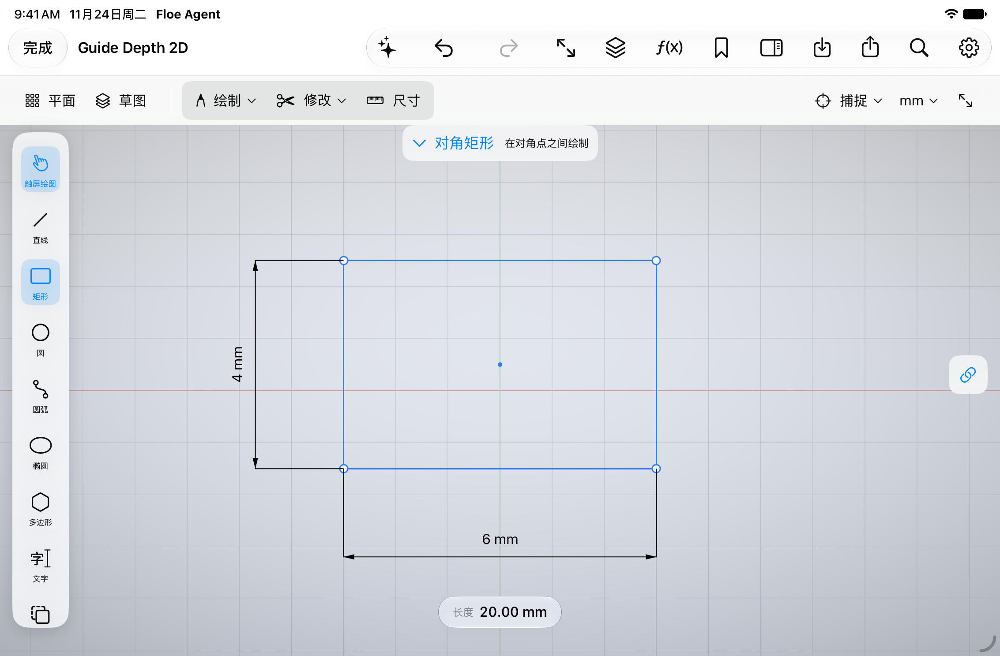

### 地图：导入、改属性并导出 GeoJSON

1. 在**空间 → 文件 → … → 导入地理数据…**选 GeoJSON。导入后点左侧具体图层名称，确认已选中，再点地图工具栏的**缩放至图层**。小区域首次打开可能落在全球视图里。先确认图层可见、有要素，再核对坐标系。
2. 打开**属性表**，选择要素，点击要修改的字段。输入后按回车提交并等待保存。用一个带 `name` 字段的面要素做练习时，可以把名称改成“示例区域”，保持原来的界线。重开项目并重新打开属性表，确认字段值仍在。
3. 长按左侧的具体图层行，点**导出图层**进入**导出数据／工程**。选 **GeoJSON**，只要当前图层时关闭**包含所有矢量图层**。坐标系留空时，GeoJSON 使用 **EPSG:4326**。填名称、点**应用**，从完成结果打开导出文件，核对要素数量、属性和几何。
4. 如导入提示 **Unexpected EOF**，用原 GIS 工程重新导出完整文件，或检查复制是否截断，然后重试。成功后从**空间 → 文件**打开新工程确认图层。

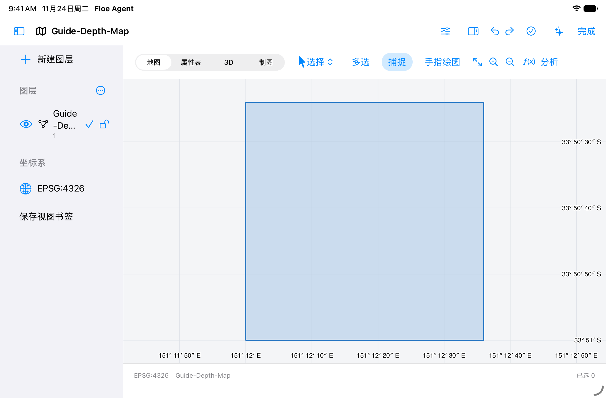

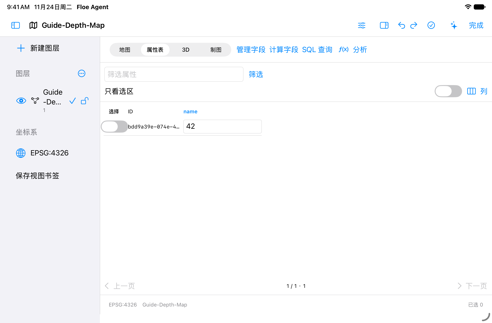

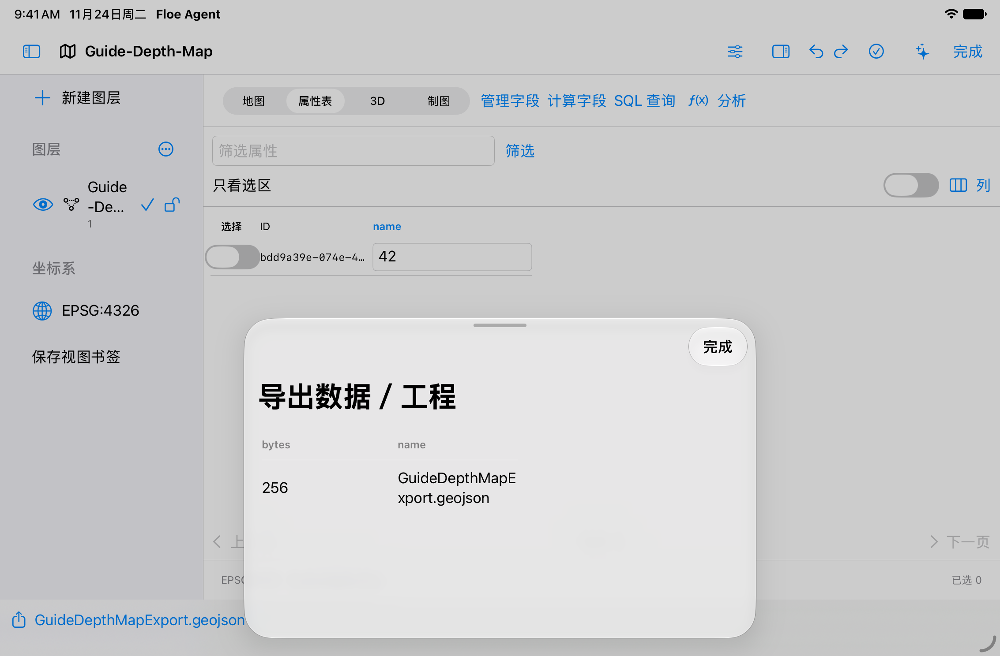

## 保存、导出与反馈

- 关闭并重新打开作品以确认保存；在核对完成前保留恢复副本。
- 删除前先导出或分享；被删除的作品仅可在同一设备上从“最近删除”恢复。
- 提问与缺陷反馈：[GitHub Issues](https://github.com/JiangNanGenius/floe-agent/issues)（主要支持渠道），请注明构建、设备与步骤。诊断上传纯属自愿，不承诺回复时间——不要附密码、Key 或私人文件。

[使用手册](USER_GUIDE.zh-CN.md) · [快速开始](QUICKSTART.zh-CN.md) · [文档目录](README.md)
