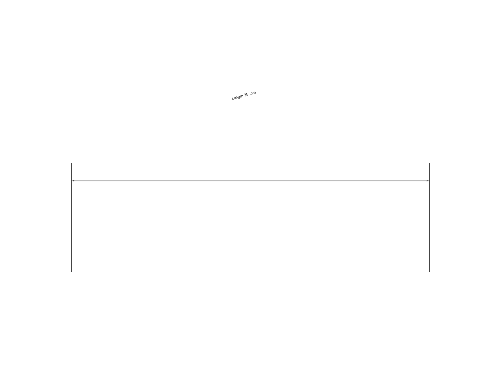
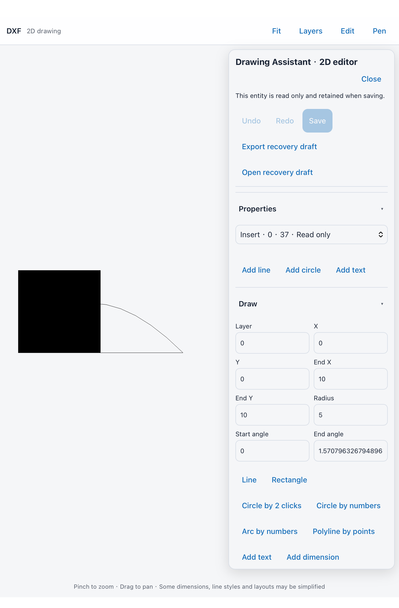

# Native drawing editing and recovery qualification

E20 and E22 meet their original criteria. Qualified App source: `83429fc78ff94f31ee07008a6b19bc95e1f693e7`, Xcode 27.1 / 27A9275, arm64 on the existing canonical iPad Simulator. Invocation numbers App304/305 are private build checks, not distribution build numbers.

The original App304 run passed five checks and failed two: native dimension Save refused a layer mismatch, and a texture-menu UI operation failed. The layer defect was real: a newly created layer without an explicit colour incorrectly inherited ByLayer, while the native writer resolved it to white. The constructor default is now used for the layer itself; entity colour inheritance is unchanged. The original refusal and assertions remain preserved.

The exact repaired source passed full App and test object compilation in 78.119 seconds. The next App run passed all **seven drawing checks**, including:

- Native LINE/DIMENSION/DIMASSOC identities and measured geometry survive text/position edits, undo/redo, strict original-format Save, fresh reopen and another geometry edit.
- Both Linear and Aligned dimensions render through the actual bundled WebKit/DxfViewer/worker/font path. The source line is hidden as a control; actual dimension text changes its image region, disappears on undo and reappears after reopening. Eight original PNGs and their source/image hashes were retained.
- Mixed block/Xref/Spline/Hatch records remain unchanged while a supported model-space line is edited and saved. The shipping visible editor shows their read-only labels, status and absence of edit fields.
- The shipping recovery action presents an actual native document-export picker containing a valid exact-source JSON journal. Session teardown removes staging and resolves the original page reply exactly once. This does not claim a particular external Files provider saved a copy.

That run still failed its separate texture-menu case; it is not reported as an all-green eight-case run. Relevant texture recovery continues separately. Root visually reviewed these unchanged synthetic screenshots:

The repaired engine also passed 64 Rust checks; one explicitly external-corpus probe remains separately qualified rather than being counted as part of that run. Actual bundled-WASM command checks passed 58/58, and native-association/recovery replay checks passed. The 52-package notices, exact wrapper/vendor hashes and all 49 bundled asset hashes remain recorded.

Editing scope remains explicit: existing Linear/Aligned dimension updates and unattached leaders are supported; unsupported dimensions, attached annotations and block/layout/Xref/Spline/Hatch edits remain read only. No universal DWG compatibility or external-reference resolution is claimed.

E23 now also meets its original corpus success/refusal/recovery criterion. Private real DWG, font/layout/object/Xref files were independently read with LibreDWG 0.14. A supported real DWG edit saves and is independently readable. Other real files retain their original refusal rather than accepting lossy output. The genuine external-reference tutorial drawing refuses strict Save; its original host and referenced-file digests remain unchanged, and the exact-source recovery replay preserves all 4,563 entities. Missing fonts and unresolved external-reference rendering remain explicit limitations.

The actual App additionally loaded that private real drawing, moved its real LINE through the shipping controls, observed the strict refusal, presented the native export picker with its recovery journal, cancelled and cleaned staging, then imported the same bytes through the shipping file-input recovery handler. This exposed and fixed a real UI defect: the first-500-entities notice had overwritten save errors and recovery results. It now has a separate persistent position. The full App rebuilt at `e12299679c484b26386d1e86f0114d0e73acf682`; the real-corpus case and full texture UI recovery both passed in 119.271 seconds, zero skipped, with canonical-device shutdown. The original failing run is preserved. The independent runner catalog/network case had already passed and was not repeated.

Native picker creation, export staging, cancellation and recovery import were verified; saving to a particular external Files provider was not automated. Proprietary tutorial files and screenshots are retained privately and not redistributed here. Whole-App release, Mac suspension and the remaining original CAD criteria are still open.
