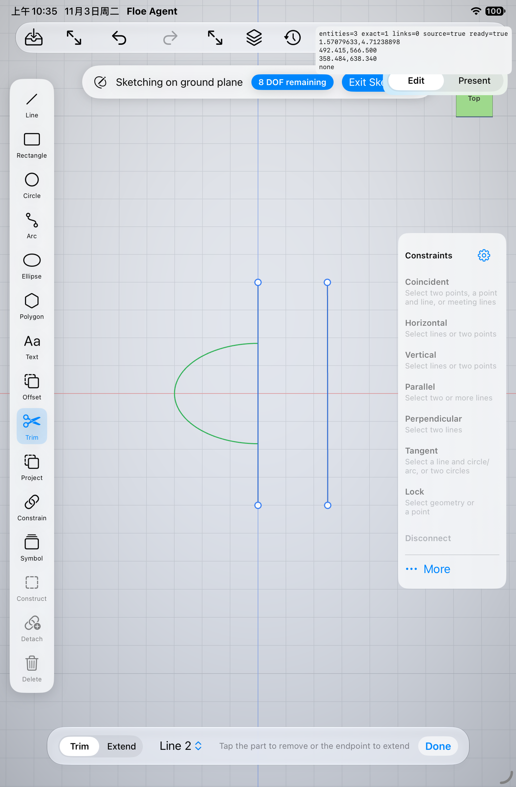
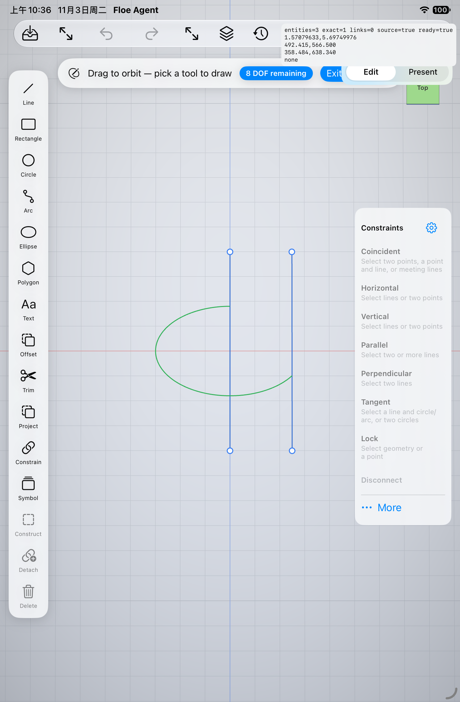
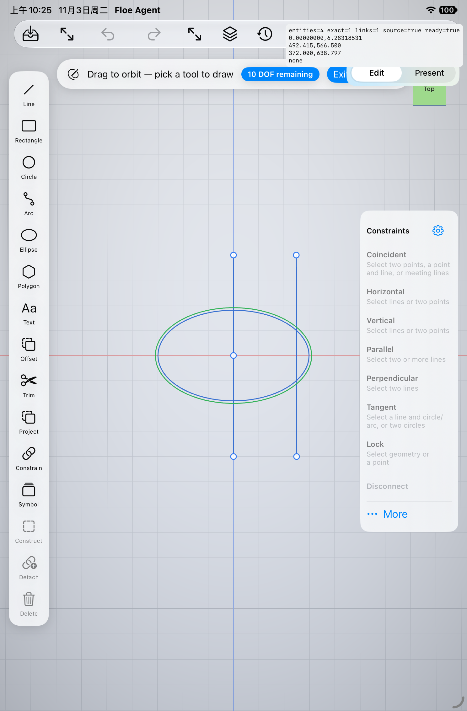

# Exact sketch curves: M03 / M04

Qualified source: `7e3091386a6dc4363da62e0c7292cfdc9fc25abb`. Xcode 27.1 (27A9275), Swift 6, arm64 iPad Simulator. These are original-criterion acceptance records, not physical-device or whole-release acceptance.

Trim and extend preserve native ellipse and multipoint spline definitions, explicit intervals, source identities and fragment mappings. Boundary intersections use native parameters. Extending a spline continues its exact endpoint polynomial spans and preserves the original interior. Linked offsets use native normal-offset curves; source edits, profile construction, undo and save/reopen share the existing transaction authority. Undefined normals, self-intersections and collapse refuse atomically, without silently removing constraints.

## Actual checks and preserved failures

- App302: full App and test object compilation/link passed in 111.592 seconds, no source drift. The OCCT source shim was compiled against the pinned libraries; no replacement engine/archive was introduced.
- Native288: 49 cases, 40 passed, 9 failed, zero skipped. All original failures and source snapshots remain retained. They exposed pinned-kernel offset conversion, spline extrapolation and physical tangent-corner handling.
- Mixed289: 30 cases, 24 passed, 6 failed, zero skipped. Exact ellipse distance, profile/volume, collapse and real native offset-preview/undo/reopen passed. The boundary-edit UI initially selected an overlapping boundary rather than the curve endpoint; the original failed result remains retained.
- Mixed290: 7/7 passed, zero skipped (66.433 seconds): six native recovery/new physical-corner checks and the actual native boundary selection, trim, extension, undo/redo and save/new-process-reopen UI flow. Interior spline samples are compared with the original native basis; normal distances use an independent native projection reference.
- Across these source-reviewed runs, all 50 distinct relevant native cases and both native UI workflows have passing evidence. Unchanged passing cases were reused after reviewing the affected paths. This is not a claim that one 50-case run passed. Preliminary compile failures and the intentionally stopped App301 build are retained separately; assertions were not weakened to hide them.

The native spline implementation retains its original geometry. A source with a real tangent corner is rejected for normal offset; it is not silently rounded or approximated. Unknown future definitions remain opaque/read-only, known sibling curves remain visible, and raw saved rows survive. Format 7 is required only when these newer semantics are present. Shared assistant routing and prior real-model proof are reused; no additional paid-model request was made for this batch.

## Original simulator images

The following synthetic fixtures were reviewed from original attachments and copied without editing. Failed-run images and recordings remain available as diagnostics, not release illustrations. Hashes and exact attachment identities are in `media.json`.

M03 and M04 are accepted. The full 106-item scope, remaining criteria, Mac suspend and release gates remain open.
