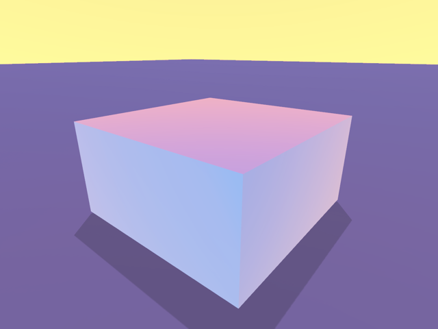
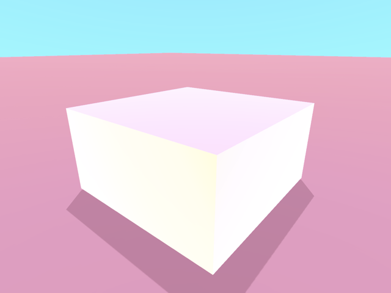
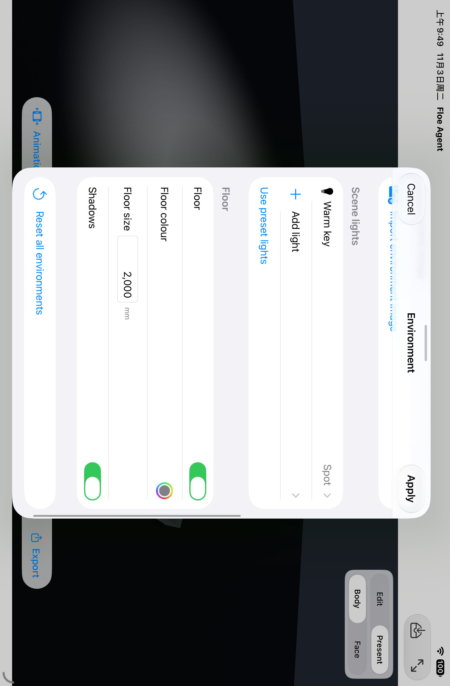
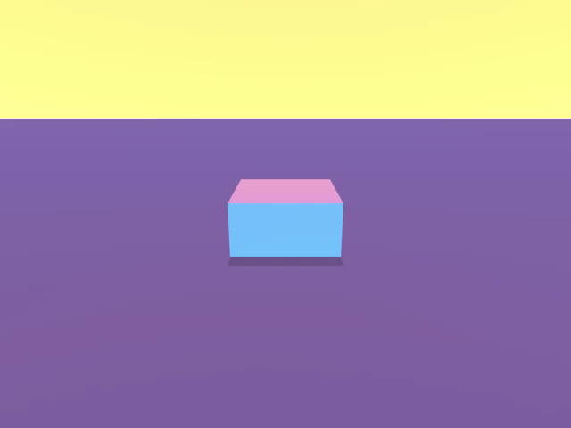

# HDRI 与命名灯光：X16 / X17

2026-11-03。当前接受 77 项原始条件、29 项继续推进；本记录不表示全部 106 项或新版本已发布。

## 实现

环境图和灯光使用同一份文档外观、撤销命令及保存权威。支持本地全景图导入、旋转、亮度、背景显示；原始图像随文档保存，不依赖用户文件原位置。图片缺失或损坏会明确报告，模型仍可查看。

可创建、命名及编辑平行光、点光源和聚光灯，调整颜色、亮度、位置／方向、作用范围及支持的阴影。添加入口在现有设置面板内打开三行原生选择页。界面与助手使用同一生产服务；没有新增每次编辑审批。

自定义灯光替代预设灯光，可明确使用空列表或恢复预设。界面编辑先预览，应用只产生一次撤销；取消保留原值。异步导入与 GPU 资源准备支持取消、关闭及过期结果隔离。

实际 authored 数据提升本轮尚未发布的格式门槛；默认外观不抬高旧文档版本。未来未知语义保留原字节并只读，不静默丢弃。查询仅返回图像身份及元数据，不回传整份图片字节。

## 当前证据

最终代码 `9d67598a089aac72c30bc2f712ab71c41efe6ba4`，Xcode 27.1（27A9275）、Swift 6.4、arm64 iOS Simulator。完整 App／测试对象编译通过，209.762 秒，无源漂移。后期修复仅改变设置界面与测试定位；底层导入、校验、渲染、保存和动画输出未变。

- **11 个不同原生行为用例通过**，来自原批 10 项通过和一项浮点断言修正后的单独通过，不把失败整批改写为通过。
- 实际 Radiance RGBE 输入的线性能量大于 2；旋转后仍保留 HDR 能量，半圈旋转交换原半球像素。测试不是重命名的 8 位图片。
- 当前 ID、撤销／重做、保存重开及真实文档摘要一致。无效、过期、重复 ID、超量灯光、坏数据及取消／关闭均拒绝半完成修改。
- 实际 RealityKit 实体具备命名灯光、正确毫米到米位置、颜色／强度／范围和可用阴影；缓存不能仅凭调用方摘要复用不同字节，修复后的资源可重试。
- 使用真实 Present 渲染器输出原始图片；旋转和亮度改变实际画面，撤销并保存重开恢复原画面。原始六帧 MP4 经独立解码，画面与同次真实渲染的 poster 一致。
- **两个原生界面路径通过**：沿用环境预览／取消／应用／撤销／重做／新进程重开；新增灯光类型选择、名称编辑、取消、应用和撤销。后者最后一次 1/1 通过，零跳过。主协调者已检查原始界面和渲染图片。

助手入口的目录、参数与通用 material 路由沿用现有服务；本批没有新增付费模型调用，不把服务测试冒充新的真实 LLM 多轮测试。既有 X35 的实际模型闭环证据独立保留。

## 原始失败与恢复

保留首轮测试 Task 返回非 Sendable 值的编译失败，以及实际界面失败。毫米到米的 Float 计算不能要求字面量逐位相等；修正为 0.00001 mm 数值容差，单位和值不变。

首个界面测试误在表单外滑动，之后修正为原生 Form 并要求完整可见。添加菜单仍未弹出，不能据此认为手势或 Group 生命周期解释已被证明。导入窗口及取消随后收敛到稳定页面所有者，原有环境流程通过，但仍未解决菜单；最终仅将新添加入口改为同一设置面板内的原生选择页，实际完整操作通过。没有依靠原样重跑掩盖失败。

## 原始画面

图片来自合成测试文档，未经修饰；原始摘要和来源见 [provenance.json](provenance.json)。全部原始录屏及图片另行留存。

## 明确范围

支持可读取的 2:1 全景图，单图不超过 64 MiB／16 百万像素。当前最多八盏动态灯光；阴影用于平行光和聚光灯。实际 Present、截图和视频共用图像与灯光；工程编辑视图仍为简化预览。本项没有宣称灯光轨道动画、任意贴图格式或离线路径追踪。

这些是固定 iPad Simulator 的 App／原生运行证据，不是实体 iPad、Release 性能或所有病态输入的证明。不使用用户手机，其他未改路径不重复整套验证。本批没有变更产品版本、发布标签或上传；其余原始条件和 Mac 挂起恢复门槛继续保留。
