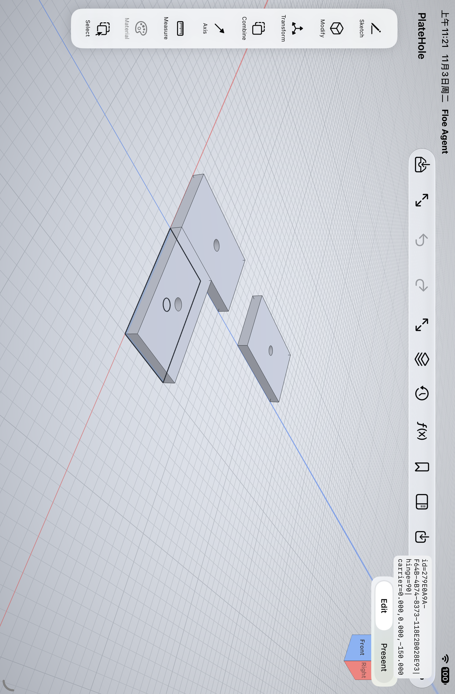
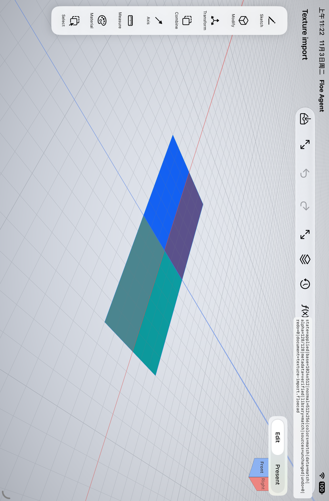
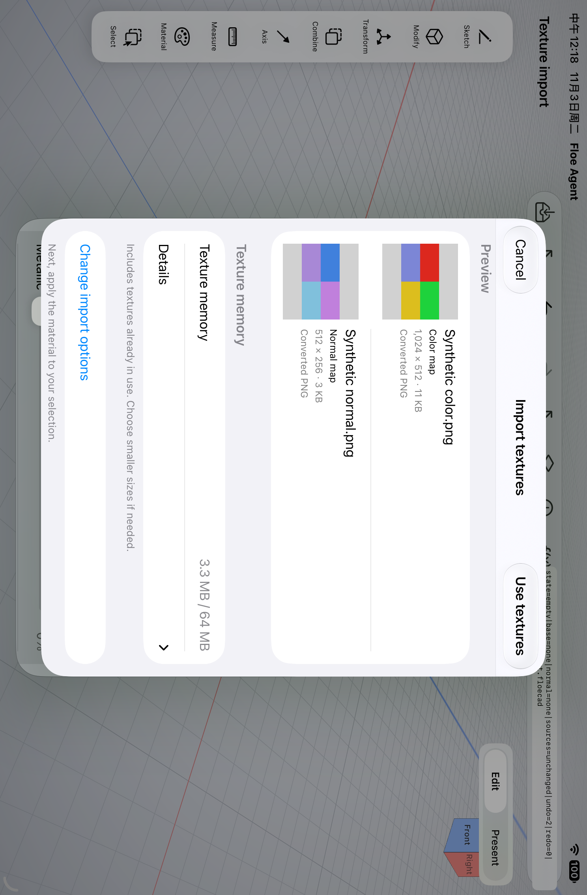

# Assembly joints, associated geometry and bounded texture import

Accepted original criteria: **E03, E04, E10, X12**. Qualified code: `56ee750d93623740d2252608f16a71b988ca4fd0`. Xcode 27.1 (27A9275), Swift 6.4 toolchain, arm64 App-hosted iPad Simulator. App303 is a private invocation number, not a new product build. Distribution remains open.

## Actual qualification

- App303 full App and test object/link build: passed in 255.996 seconds, no source drift. Six runtime executables and the exact recovery payload were bound to this source before tests.
- Native291 executed **81/81 passed, zero skipped**, including all eight new joint/binding/motion tests and all twelve texture-import/cache tests. Its wrapper correctly failed because three requested Swift Testing method selectors executed no cases. The original result and coverage failure remain preserved.
- Mixed292 recovered those selectors by running the actual suites: **42/42 native cases plus 2/2 native UI cases passed**, zero skipped, 147.294 seconds, all requested selectors executed, shutdown succeeded. The 81 passing cases were not rerun. This is 123 distinct actual native checks and two relevant UI workflows across source-bound runs, not a claim of one all-green 125-case run.
- The joint arithmetic also compiled and executed directly in Swift 6 mode: both moving roles, skew axes, uniform scaling and signed half-turns, using the actual production math file. Those focused checks supplement rather than replace the App runs.

## Assembly

Hinge and slider joints store signed coordinates, independent limits and their zero frames on the existing constraint. A nil drive leaves one permitted coordinate free inside the limits. The same bounded solver handles parameter edits and transforms; invalid limits or unsatisfiable edits leave placement and undo unchanged.

The actual three-part mechanism grounds its base, drives one hinge, and moves the downstream slider carrier through constraints. It does not author keys for each part. The motion study samples solved poses, reports sampled translation/rotation travel and runs the existing serialized-copy, off-main exact interference check. It is read-only, has cancellation and document-generation fences, and does not claim sampled chord travel is a continuous-path integral.

Native cylindrical references use their real analytic axis points. Current picks capture author-owned face names or construction-plane/axis identities, not persistent kernel indices. A real hole-centre edit and an actual datum-service offset edit move the same mate; one undo and save/reopen preserve the relation. Missing/ambiguous names require a new selection. Explicit numeric and mesh-only legacy references remain static, without invented associativity. New bindings and joints use the coordinated unreleased format 7; unknown versions preserve their raw bytes and open read-only.

The actual iPad form edited a hinge to 90 degrees, moved the constrained carrier to (0,0,-150) mm, saved and reopened in a fresh App process. The original screenshot below was visually reviewed.

## Texture import

Two actual 4096×2048 synthetic PNGs initially exceed the combined image budget. The actual native review refuses them until explicit conversion sizes are selected. Colour and normal maps were converted to 1024×512 and 512×256, decoded back for preview, applied once, undone/redone, saved and reopened in a fresh process. Independent image reads verified quadrants, alpha, semantic metadata, hashes, document-library copies and unchanged source files.

Native cases additionally verify EXIF, P3 versus numeric data maps, explicit 16-bit conversion, malformed/cancelled batches, combined existing-body/face/draft cost, twenty real RealityKit cache replacements and failed/cancelled uploads. CPU image and texture caches use their real pixel/mip estimates and subtract exact per-key costs. They are resource estimates, not measured device RSS or Metal allocations.

The Files/Photos provider picker itself was not automated by this one workflow: its DEBUG fixture stages real initial inputs into the actual draft; all selection, conversion, preview, Apply and history operations are product controls. No physical-device performance, real Pencil or paid-model claim is made. Subsequent product-copy simplification moves internal memory breakdowns behind Details; that small delta is tracked for the next object/UI check.

The small product-copy/layout follow-up is now qualified at `e1229967`: native menus select their actual values, encoded previews and the material transaction/undo/save/fresh-process reopen pass. Internal memory breakdowns sit behind Details. Original intermediate UI failures are retained; the iOS 27 menu activation-point issue uses the settled visible row and requires actual selection readback. Unchanged geometry, conversion/cache checks and the original joint workflow were reused.

Drawing E20/E22/E23 have since closed separately; see [their exact evidence](../cad-drawing-edit-recovery-20261103/README.md). The whole 106-item and Mac/distribution gates remain open.
