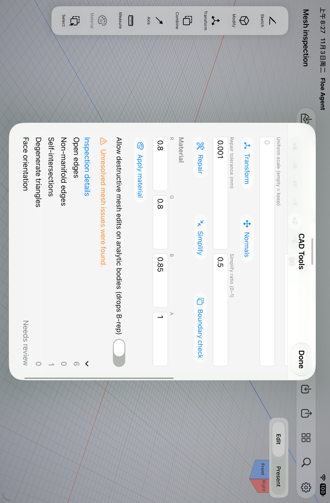
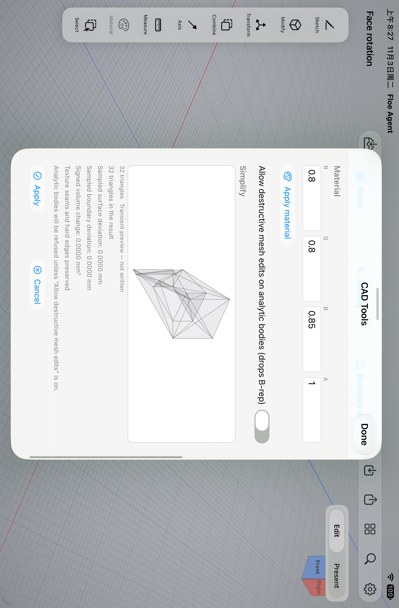
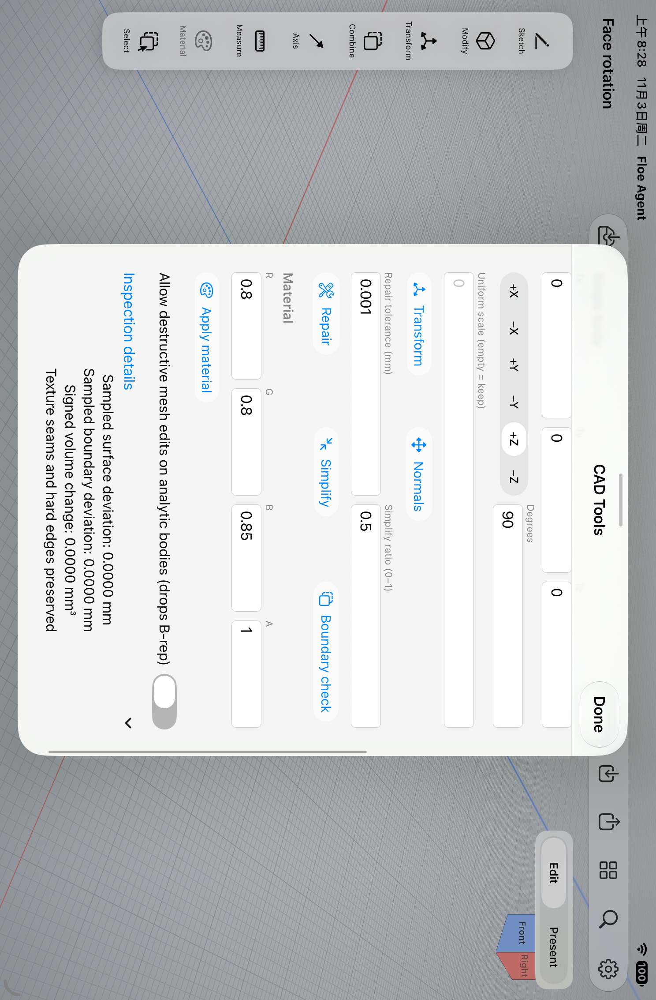

# 网格缺陷与简化检查：X05 / X06

2026-11-03。本记录对应两个原始完成条件，不代表整个 106 项或新版本已发布。

## 实现

- **X05**：分别检查开边、自相交、反向／不一致面和非流形。现有焊接、去退化清理保留；未实现的指定缺陷修复明确拒绝，原几何及撤销／重做不变。预览和应用后都报告剩余问题。开放或多壳体的方向不擅自判断，内腔不误报为反向外壳。
- **X06**：简化保护开放边界、硬边和 UV 接缝，保留实体材质；比较连通、边界、方向和 Euler 特征，避免封闭模型的孔洞被静默丢弃。逐面材质无法可靠重新绑定时明确拒绝。
- 预览与应用共用实际检查结果：双向采样表面／边界距离、有向体积变化，以及覆盖全部三角面的保守表面距离上界。大型网格明确报告采样数；未采样几何也进入上界，不能把采样值称为精确 Hausdorff 距离或经过验证的实体体积。
- 没有几何变化不增加撤销记录。取消贯穿拓扑及 BVH 准备，部分结果不发布。带完整检查的修复／简化有界预算为 60 秒，其他几何操作仍为 10 秒；测试显式期限继续生效。

## 当前证据

核心代码：`f1f64c8e00cd77bfb7c74c5eadf29a7cbb89eb2c`。最终仅错误文案映射及四项中英文本更新至 `6fa5ca80c0ee66cc13737d39afa31cee0e24244d`，核心几何、服务及正常操作路径未变。

使用 Xcode 27.1（27A9275）、Swift 6.4、arm64 iOS Simulator，唯一固定 iPad。实际完整 App／测试对象编译通过；最终文案批次 139.280 秒，无源文件漂移。

- 当前原生行为组：**35 通过、0 失败、0 跳过**。包括四类缺陷、明确拒绝、预览绑定、撤销／重开、薄壁带孔贴图、比例与尺度、孔洞拓扑、无变化、未采样上界、准备中取消、期限拒绝，以及共享干涉几何回归。
- 四项既有源变更／关闭／只读／损坏输入保护：前一组实际执行通过，未重复未改路径。
- 实际 UI：新增预览和应用后详情 **2/2 通过**；复用前一组已通过的三项取消及面板生命周期测试。已人工检查下列原始截图，详情可完整滚动查看。
- 薄壁带孔贴图样本保持接缝、材质、撤销和保存重开一致；[实际检查结果](thin-perforated-inspection.json)保留完整原生返回。
- 480,000 三角面用例完整成功，计算约 **33.754 秒**，最大主线程心跳间隔 **52.853 毫秒**，采样进程峰值约 **256.24 MiB**。这些是模拟器 Debug 测试进程数据，包含测试和缓存开销，不能作为物理 iPad 或 Release 性能承诺。

原始失败全部保留：编译遗漏的新结果分支、旧测试未标注 actor、中文默认图纸名称被旧英文断言误拒，以及加入完整检查后超出旧 10 秒期限。没有删除失败断言或以重试掩盖原因；各恢复均有对应源码修改。

## 界面

图片均来自合成测试文档，未经修饰。来源及摘要见 [provenance.json](provenance.json)。完整原始媒体另行留存。

## 限制与发布门槛

自动补洞、消除自相交及通用拓扑修复没有被宣称实现。采样距离与保守上界分别表示，复杂自交网格的有向体积不作为可制造实体体积。逐面材质简化当前明确拒绝。

本次未使用用户手机，没有物理设备性能结论。未运行已通过且未受影响的 Office／供应商整套验证；未递增版本、创建发布标签或上传。原始 106 项及另外的 Mac 挂起恢复门槛继续保留。
