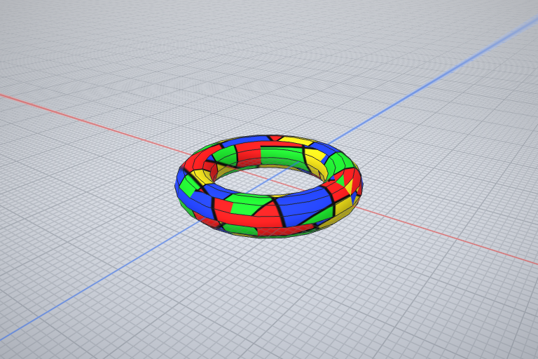
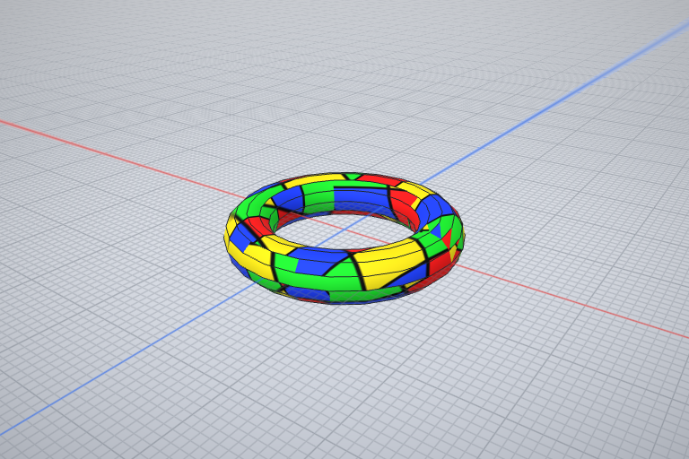

# CAD 原生编辑闭环验证

2026-11-02；对应原始 M20、E21、E35、X09 条款。继续复用现有 CAD 文档、权限、事务、撤销栈和保存服务。

- **圆柱径向编辑**：真实 STEP 导入孔壁可持续改径，保存为精确源和径向参数特征；同一实体、撤销、重开及独立实体体积通过检查。
- **二维曲线与 OCS**：真实 WKWebView、Worker 和当前 WASM 对斜面闭合 bulge 轮廓修剪与偏移，保留方向、顶点身份、撤销和同格式复读。
- **副本合并**：两个真实文档包比较同一经过验证的起点，合并独立特征；同特征冲突需显式选择。损坏起点、文件变化、重建失败和保存失败均不破坏原件。
- **UV 编辑**：实际 xatlas 对曲面标缝、展开、编辑岛和重新打包；原生材质范围、撤销、GLB 贴图与 UV、保存重开一致。

`413bbdaf` 完整 App／测试目标对象编译通过，140.727 秒。固定 iPad 模拟器实际 **55/55 通过、0 跳过**，23 个选择器全部执行，63.463 秒；模拟器已关闭，无本轮崩溃附件。二维 WK 的四个已通过用例从上一轮复用，59 个相关源码及资源逐项确认未变。55 项是相关行为检查，不是 55 个新功能。

原 219 保留为 61 项中的 56 通过、5 失败，另有 5 个选择器未命中。修复了：实际径向操作输出的合法负曲线参数被误作引用、UV 整理缺少 ComputeCharts、无具名身份的精确材质范围未跟随原子撤销，以及重开未编辑实体重新编码引发的副本比较误报。版本起点测试改用合法独立名称，仍检查相同 UUID 的不同真实内容被拒绝。没有放宽精度断言。

独立组件另行确认：四类径向编辑的直接及后台快照序列化能恢复真实精确体；原计数、非有限数、十六进制、引用越界和 NUL 损坏拒绝保持。UV 整理得到真实单图集，归一化坐标范围有效。这些组件结果不冒充 App 验收。

下图来自实际生产视口：上图为编辑 UV 后保存、重开的模型；下图仅替换已知颜色纹理，作为像素检查的负对照。全部原始图及身份记录另行保留。

副本合并目前只合并特征历史；传入的材质、资源和 UV 内容更改明确拒绝，不静默丢弃。UV 有规模限制并可能添加自动切缝。一般拓扑身份、交互手势／紧凑布局、独立 CAD 语料和真实 LLM 链仍按原对应条款继续，不因本批通过而关闭。没有实体设备性能、付费调用或发布声明。机器记录见 [app-check.json](app-check.json)。
