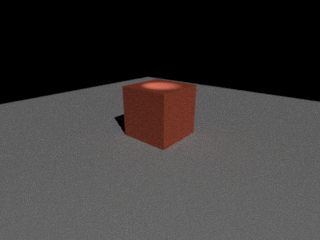
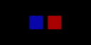

# CAD 离线渲染与动画预研发 · 2026-11-06

本页保留移植前 pbrt／Linux 适配的历史组件证据。用户随后要求专业计算与离线渲染迁到设备本地；当前主路径已换为随 App 打包的 WebGL2 路径追踪器，见[本机移植记录](../cad-ondevice-professional-20261106/README.md)。本页图像与测试不构成新后端的运行验收。

本记录保留开发工作区的组件证据；后续 App 编译、定向测试与 Simulator 页面结果汇总在[本轮集成记录](../../CAD_MESH_BUILDING_PREDEVELOPMENT_20261106.zh-CN.md)。两者均不替代 Linux guest 实际任务或物理设备验收。

## 实现

- 复用现有 Present 场景、HDRI、自由灯光、PBR 材质、权威面材质范围、实例变换与保存相机；文档、撤销栈和几何仍由原编辑器持有。
- 离线静帧使用 [pbrt-v4](https://github.com/mmp/pbrt-v4/tree/b0bdf461ba5dd6504b70ebf0932acc0fe7aa744f)，固定 revision `b0bdf461ba5dd6504b70ebf0932acc0fe7aa744f`。其源码采用 [Apache-2.0](https://github.com/mmp/pbrt-v4/blob/b0bdf461ba5dd6504b70ebf0932acc0fe7aa744f/LICENSE.txt)。按[官方场景格式](https://pbrt.org/fileformat-v4)交换相机、米制三角形、基础材质和灯光，使用 CPU `volpath` 积分器。
- 安装在任务当前选择的执行环境中进行；沿用 `jobs.submit → exec.shell`、既有任务绑定、取消与产物同步。安装脚本固定上游和子模块，并核对额外取得的 Imath revision `c0396a055a01bc537d32f435aee11a9b7ed6f0b5`。保留上游及依赖许可证。为控制资源，仅对上游谱表生成器应用“两线程”本地补丁；编译并发 2。
- 每次渲染使用新的目录与冻结输入。只有 job 完成、输入 SHA 未变、receipt 对应场景、PNG 完整解码且尺寸和 SHA 正确，结果才可进入 ready；取消后的晚到结果不能被提升为成功。大文件验真在后台执行。
- 同一任务还增加建筑专业流程的 App 薄中心：任务选定的 Linux 环境运行固定 IfcOpenShell/IfcTester/PyNite 适配器，结果按源身份、action、版本、产物摘要与 IFC 首尾校验。结构页要求选梁并确认支撑、E、泊松比与载荷。
- 实时 Present 的方向光阴影范围从固定 20 m 改为随场景尺寸变化，动画姿态变化时同步更新。相机新增“镜头展示 / Reveal”预设，使用已有相机轨道、保存、撤销和 MP4 路径。

## 当前组件证据

宿主工具链：Xcode 27.1 / Swift 6；独立 Swift 编译显式使用 arm64 macOS 15 和 macOS SDK 27。开发基础 HEAD 在记录时为 `c9a5f5fc2664151af8a63f863e72aa171c02dcfc`，本轮修改尚由主控集成，不能将此 HEAD 单独当作本轮代码的冻结提交。

| 检查 | 结果 |
| --- | --- |
| 纯场景导出器的 Swift 6 真实对象编译与执行 | 通过；越界索引与目录逃逸输入被拒绝 |
| 最终安装/渲染脚本语法与 Swift 字符串编译 | 通过 |
| 固定 pbrt 源码、Imath、子模块及本地资源补丁构建 | arm64 Mac CLI 成功，实际构建阶段 75.3 秒；原失败保留 |
| 真实路径追踪静帧 | 320 × 240、64 samples/pixel；图像可完整解码，无纯白截断像素 |
| 相机左右手 | 蓝色物体在左、红色物体在右；实际采样 RGBA 分别为 `[0,14,164,255]` / `[169,0,0,255]` |
| 实际渲染进程中断 | 1024 × 768、256 samples/pixel 的进程被 SIGINT 中断，退出 1，未产生成功 PNG / receipt |
| 拒绝复用旧输出 | 已完成目录再次执行被 guard 拒绝，原成功 receipt 不变 |
| 安装互斥 | macOS `lockf`：首次取得、并发 owner 拒绝、owner 退出后自动重新取得均通过；Linux `flock` 路径待实际 Linux 环境检查 |
| App 层验真测试 | 源/图像 SHA、伪 PNG、错误尺寸、错误 action、截断 IFC、输出符号链接反例已通过主控的实际 App-host 定向测试 |

示例是路径追踪器的真实输出，图中物体、地面、光照与阴影来自合成组件场景。

图像 SHA-256：`9df381760b4936dff278e0587bde7915e1955237c58c3a79b1dd09c3ffc9d6cb`。图像内红色像素 3610、灰色像素 43802、纯白像素 0；这些数值用于排除空图或全图过曝，并非画质评分。

精确 arm64 CLI artifact SHA-256：`bfca7a52ea251780da03cda3231299b32553d5f1d52372a5d251b9887d83c3e0`。二进制、许可证、源快照及原始日志保存在仓库的忽略目录中；未随 App 分发或发布。

## 保留的失败与修复

1. 初次 Swift 编译未显式传 target，宿主默认的 macOS 27.2 triple 无法加载 SDK 27 的标准库；后续传入明确的 target 与 SDK，完成真实对象编译。
2. pbrt 的 `PBRT_USE_PREGENERATED_RGB_TO_SPECTRUM_TABLES=ON` 不会自动提供谱表源文件；首次 CMake 失败。安装脚本改为实际生成谱表，并使用上游真正的 `pbrt_exe` target。
3. 默认一秒 passthrough sensor 曝光让普通 lux/lumens 灯光严重截断，首张过曝 PNG 与日志保留。改用固定毫秒曝光并保留 EV 调节后，代表图有色几何与阴影可见，无纯白截断。
4. 曾尝试 PID 锁；即时锁用例未达到预期，原始失败保留。最终采用内核 lease，避免手工维护死 owner 的锁目录；没有用原样重跑掩盖失败。

## 边界

离线静帧最多 100 万三角形、128 MiB 场景包、8,388,608 像素；有截面时明确拒绝。基础色图、基础金属度/粗糙度及自发光进入 pbrt；其他材质图和高级材质层目前按标量基础材质处理，差异在详情中列出。透明度按表面覆盖率处理，尚不恢复精确玻璃折射；环境背景与实时灯光的阴影/衰减规则可能有差异。

本轮没有新增离线路径追踪动画输出、降噪器或全材质等价承诺。既有动画短片仍走已存在的 RealityKit/AVFoundation 路径。建筑专业页面提供有界单梁计算、几何碰撞与 IFC 信息要求结果；专业精度、整楼分析和多国法规合规结论不由这些组件证据证明。
